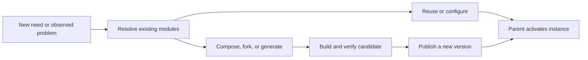

# Founding conversation: evolving community swarms

Date: 2026-09-05 (Asia/Bangkok).
Source: Codex task `01a07146-7e6d-7093-86bf-f948610c370a`, titled “Design code workflows for swarms”.

This is a direct export of the five user messages and the assistant’s visible replies leading up to the request to preserve this theory. User wording, assistant wording, links, examples, and qualifications are retained; assistant progress updates from the four completed exchanges are included. The fifth exchange ends at Ren’s preservation request. Tool calls, tool output, internal reasoning, system/developer instructions, and environment metadata are outside this conversation archive. Later folder-creation activity is recorded separately in DECISIONS.md.

Authorship: messages marked Ren are Ren’s own words. Messages marked Assistant are AI-authored elaboration. Ren’s final alignment statement supports continuing the direction; it does not turn the assistant’s prose into Ren-authored text or establish the hypotheses as proven.

<a id="exchange-1"></a>

## Exchange 1

### Ren

what's the best way for you to write code if you are in a agent swarm, in the scale of thousands?


### Assistant — progress update

I’ll check the guidance for Codex, then outline how I’d organize code ownership and verification across thousands of agents.

### Assistant — response

**At thousands of agents, I’d optimize for independent, verifiable changes with very little coordination per change.** The hard part becomes keeping everyone’s work compatible and integrating it fast enough.

My recommendation is a distributed build system with agents as workers. This is an architectural proposal, not a claim that a thousand-agent configuration is proven optimal.

1. **Partition work around stable interfaces.**  
   Define module boundaries, schemas, error behavior, and acceptance criteria before assigning implementation. Give each module an owner. Changes to shared interfaces need explicit coordination because they can invalidate hundreds of downstream tasks.

2. **Give each agent a small, complete assignment.**  
   I should receive a specific objective, a base commit, the code I may change, relevant contracts, dependencies, and a definition of done. “Implement pagination for this endpoint under this contract” is workable. “Help build the backend” leaves too much ambiguity.

3. **Isolate every implementation.**  
   Each worker needs its own checkout and execution environment, including test data and temporary resources. It submits a patch against a known revision. Codex supports worktrees for isolating parallel tasks, but that alone does not solve integration or runtime isolation. [Official OpenAI documentation](https://learn.chatgpt.com/docs/environments/git-worktrees)

4. **Use a dependency graph and durable task queue.**  
   Workers claim ready tasks. Claims expire if a worker disappears; retries cannot publish duplicate results. Store decisions, contracts, patches, and test evidence outside agent conversations. An agent should be replaceable without losing the task’s history.

5. **Keep communication local.**  
   Organize agents into groups responsible for subsystems. Workers communicate with their task owner and immediate dependencies; cross-system decisions go to the relevant owners. A single lead should see exceptions and integration health rather than read thousands of transcripts.

6. **Make acceptance depend on evidence.**  
   Require compilation, relevant tests, contract checks, and review appropriate to the change. Independent agents can challenge assumptions or find counterexamples, but agreement among agents is insufficient. Tests also need to reflect the specification; an implementation and its tests can share the same mistake.

7. **Continuously integrate through controlled queues.**  
   Validate each candidate against the current integration state, not just its original branch. Merge small changes frequently. When failures occur, pause affected dependencies and assign a bounded repair task. Avoid accumulating thousands of successful-looking branches for a final merge.

8. **Limit concurrency to useful work.**  
   If review, CI, or integration queues grow, reduce implementation concurrency. Use spare capacity for independent investigations, fuzzing, compatibility testing, or benchmarks where those have value. Measure accepted changes, regressions, rework, and cost—not code volume or agent activity.

For **me personally as one worker**, the operating loop would be:

```text
Claim a ready task
→ read its contract and relevant code
→ implement the smallest complete change
→ verify behavior
→ submit patch + evidence + unresolved assumptions
→ address integration feedback
```

The code I write should make this workflow easier: explicit types, narrow interfaces, clear dependencies, deterministic behavior where practical, and minimal global mutable state. I should keep unrelated cleanup out of the patch and raise a contract issue when the assignment requires changing another owner’s assumptions.

**The key scaling limit is how much work can proceed independently.** A thousand agents can be useful across many modules, repositories, migrations, or test cases. A tightly coupled feature may only have a handful of useful implementation tasks at any moment. I’d increase the swarm only while measured delivery throughput improves.

<a id="exchange-2"></a>

## Exchange 2

### Ren

so imagine I have A(B(D(...), E(...)),C(F(...), G(...), ...)) as a software architecture

the best way to decompose this, and makes every module to work together without knowing more than just itself and its parent module, child modules

so, in a deeper sense, one can work only relying on the information of other nodes it connects to, and the pre loaded context of the common architecture and prompts are the only extra requirement for the swarm to complete its task&#x20;

under this situation, not your current harness environment 


### Assistant — progress update

I’ll treat this as a hypothetical system where each agent sees only its module, its parent, its children, and shared architectural rules. The central question is what those local contracts must guarantee for the whole system to work.

### Assistant — response

Yes. Under that model, I’d use **recursive decomposition by contracts**, with the same working protocol at every node.

The essential condition is:

> **A node’s boundary must contain all the information needed to fulfill its responsibility, regardless of how the rest of the system is implemented.**

That would let me work inside `B` knowing only what I owe `A`, what `D` and `E` provide, and the common architectural rules. I wouldn’t need their internal implementations.

A tree makes that arrangement possible, but the quality of the boundaries determines whether it works.

**1. Decompose around responsibilities that can be verified locally.**

For each proposed module, ask:

- What observable behavior does it own?
- What state and design decisions can it keep private?
- Can we check its correctness using only its boundary?
- Can its implementation change without forcing neighboring contracts to change?

Put responsibilities that repeatedly need each other’s internal details into the same module. Split where a compact, stable contract can separate them. This follows the information-hiding principle of decomposing around encapsulated design decisions. [Parnas’s original paper](https://www.cs.lafayette.edu/~gexia/cs301/resources/parnas.html)

For your swarm, I’d make **the amount of information crossing boundaries** a primary decomposition criterion. A balanced tree can still have terrible boundaries.

**2. Every edge carries a behavioral contract.**

A function signature is insufficient. A useful contract includes the relevant:

| Contract element | What it tells the neighboring agent |
|---|---|
| Inputs and outputs | Types, meanings, units, valid ranges |
| Assumptions | Conditions the caller must provide |
| Guarantees | Behavior the module promises under those conditions |
| State and effects | What it owns, reads, or changes |
| Failure and progress | Errors, retries, ordering, cancellation, termination |
| Resource constraints | Applicable time, memory, concurrency, or cost limits |

Only include what affects the responsibility at that boundary.

For example, “returns an order ID” leaves significant ambiguity. “Repeated requests with the same idempotency key return the same order ID and create at most one order” gives another agent something it can safely build on.

**3. Each parent owns the argument that its children compose correctly.**

For `B(D, E)`, `B` has two obligations:

1. Ensure that its use of `D` and `E` satisfies their assumptions.
2. Establish that their guarantees, together with `B`’s own coordination logic, fulfill `B`’s contract with `A`.

Schematically:

```text
D's contract + E's contract + B's coordination
                    satisfy
               B's contract
```

`A` then uses `B`’s contract as the summary of that entire subtree. The same reasoning repeats to the root.

This is **assume–guarantee reasoning**. Formal contract frameworks support checking whether a composition fulfills a higher-level contract. The guarantees depend on the model and verification being sound; passing ordinary tests provides evidence rather than a universal proof. [Contract composition and refinement](https://www.pacti.org/docs/getting_started/)

**4. Every agent runs the same recursive protocol.**

```text
Receive the required contract from the parent.

If the task is manageable:
    implement it and verify the contract.
Otherwise:
    define child responsibilities and contracts;
    check that the proposed composition can satisfy this contract;
    have children implement their contracts;
    integrate and verify the composition.

Return the artifact, its contract version, and verification evidence.
```

There must also be a response for **“this contract is infeasible or underspecified.”** The agent sends the concrete conflict to its parent. The parent revises the decomposition or escalates the requirement.

Requirements flow downward; feasibility findings and evidence flow upward. Agents can remain local while information travels through multiple levels.

**5. Global requirements must be translated into local obligations.**

Suppose `A` must complete a sequential operation within 100 ms. It might allocate:

```text
A's own work: 10 ms
B's subtree:  60 ms
C's subtree:  30 ms
```

`B` only needs its 60 ms allocation and relevant operating assumptions. It can divide that budget among itself, `D`, and `E`.

Giving every node the same instruction—“finish within 100 ms”—would not establish the system limit.

Likewise, shared state needs an ownership protocol, uniqueness needs an allocation scheme, and interacting operations need a progress argument. Two children each waiting for the other can satisfy superficially plausible descriptions while the composition deadlocks.

**The important qualification to your premise is that common prompts cannot replace missing architectural information.** They can define the contract language, implementation conventions, and collaboration protocol. Actual dependencies must still be represented in the contracts.

If `D` needs something from `F`, your strict tree must expose that capability through `B → A → C → F`. `D` can remain unaware of `F`; its parent supplies an abstraction. Frequent negotiations along that path are evidence that the decomposition may need to change.

My strongest design test would be: **Can I replace any subtree with a different implementation satisfying the same contract, and leave everything outside that subtree correct with respect to the specified requirements?** The closer your architecture gets to that property, the more independently the swarm can work.

<a id="exchange-3"></a>

## Exchange 3

### Ren

can we? if we think about a few examples, large examples
for example, an app that has each page generated when needed - I mean, view
and know which ones(if already generated) to use, fork, or modify situationally
and can scale, combine, dynamically loaded, and even at each module, there could be an llm deal with interface, or code, or code updated by llm which changes the behavior of the module


### Assistant — progress update

I’ll work through a few large examples, especially how generated views could be reused or changed while preserving the contracts their parents rely on.

### Assistant — progress update

The key distinction is between a reusable module definition and its running instances. One generated view can serve many parents while each instance keeps local state and connections. Changes can then create new versions without unexpectedly changing every existing view.

### Assistant — response

**Yes—we can build an app along these lines.** I’d give each module a running implementation and an optional LLM maintainer that can select, compose, or produce a new implementation when needed.

The app would assemble views from a persistent library of **versioned module definitions**. Each running instance could still know only its parent, its children, and the capabilities its parent provides.

That distinction matters: `OrdersTable@7` could appear in thousands of views. They share the same code artifact, while each instance has its own parent, bindings, and local state.

Let’s work through three larger examples.

**1. An enterprise app with views created for each situation**

Imagine one system covering inventory, procurement, sales, finance, and logistics. Different organizations have different workflows, so the possible useful views are too numerous to design individually.

A user asks:

> “Show stockout risks for our European suppliers, and let me draft replenishment orders.”

The supply-chain module turns that request into a contract: what the view must display, which actions it must support, which data capabilities it needs, and what “stockout risk” means.

It then resolves that contract against available modules:

| Decision | When it fits this request |
|---|---|
| **Reuse** | An existing stockout workspace already satisfies it. |
| **Configure** | An existing workspace supports the required region and supplier filters. |
| **Compose** | A risk dashboard and replenishment form can be connected. |
| **Fork** | This organization needs a distinct workflow worth maintaining separately. |
| **Upgrade** | An improvement belongs in the general stockout module. |
| **Generate** | Existing modules cannot express the required interaction. |

The resulting view might be:

```text
SupplyChain
└── StockoutWorkspace
    ├── SupplierFilters
    ├── RiskTable
    ├── ForecastChart
    └── ReplenishmentDraft
```

`RiskTable` doesn’t need to know about procurement internals. Its parent gives it a data interface and receives its selection events. The parent passes the selected items to `ReplenishmentDraft`.

The generated view also doesn’t invent the business definition of stockout risk. That definition comes through a supplied domain contract.

Once the view is generated and checked, its implementation is stored. Subsequent visits load it directly. On-demand loading already has established primitives: React supports deferred component loading, and webpack Module Federation supports composing separately built modules at runtime. Those mechanisms supply parts of the infrastructure; the proposed resolver and generation process would sit above them. [React lazy](https://react.dev/reference/react/lazy), [Module Federation](https://webpack.js.org/concepts/module-federation/)

**How does it discover modules while remaining local?** It asks its parent for a capability. Parents maintain searchable summaries and forward unresolved requests upward or into relevant branches. The result comes back as a small set of candidate contracts.

The agent never needs the entire catalog in its prompt. However, discovery still transfers information: locality cannot mean being unaware of everything created elsewhere forever.

**2. A development environment that creates tools as it encounters projects**

Imagine an IDE that opens unfamiliar languages, configuration formats, distributed traces, and application-specific data.

Opening a file could produce:

```text
Workspace
└── DocumentEditor
    ├── StructureInspector
    ├── TextEditor
    ├── ValidationPanel
    └── Preview
```

For a familiar format, the parent selects existing modules. For an unfamiliar format, a maintainer can generate an inspector or adapter from its specification and examples.

A chart created for a performance profiler might also serve a database query analyzer. Both instantiate the same chart definition with different data bindings.

An LLM inside `StructureInspector` could interpret “show dependencies related to authentication.” Later, its maintainer might implement a faster traversal algorithm. That change stays local if it preserves the inspector’s contract.

But changing an edit operation from “replace this range” to “rewrite the document” changes observable behavior. The parent must accept that contract change and account for undo, concurrent edits, and persistence.

Existing extension systems already demonstrate activation in response to particular needs; VS Code exposes activation events for extensions. Generating and verifying new extensions would be an additional layer in this hypothetical system. [VS Code activation events](https://code.visualstudio.com/api/references/activation-events)

**3. A collaborative engineering platform with evolving workspaces**

Consider a platform for designing machines, running simulations, examining results, and collaborating on changes.

Opening a new simulation result might assemble:

```text
EngineeringSession
├── GeometryViewport
├── ResultsWorkspace
│   ├── FieldVisualization
│   ├── TimeSeriesChart
│   └── ComparisonTable
└── SimulationControls
```

The system could generate a specialized results inspector, reuse the chart from another engineering domain, and fork a comparison tool for a particular experiment.

Each module can improve independently. A viewport maintainer could replace its rendering implementation while preserving selection events, coordinates, and camera-state behavior.

Here, the limits become concrete. Changing coordinate units, annotation schemas, or the meaning of simulation controls affects other modules. Those changes need negotiation through the relevant parent. Collaborators in an existing session may need to remain on one compatible version until a coordinated transition.

**Visual composition can be highly local. Shared meaning and shared state need explicit agreements.**

Your idea of having an LLM at each module fits all three examples, but I would distinguish its activities:

| LLM activity | What changes |
|---|---|
| Interpret a request | Produces data or chooses declared actions within the current contract. |
| Generate a view | Produces a layout or component composition. |
| Improve implementation | Produces a new code version under the existing contract. |
| Evolve the interface | Proposes a new contract for the parent to integrate. |

“Interface” here includes both the visible UI and the module’s programmatic boundary. Rearranging controls may be local; changing what submitting them does may cross that boundary.

I’d make modification follow this lifecycle:



**Modification should normally create a new version.** Existing consumers keep their selected version until their parent adopts the replacement. Stateful replacements also need a defined state transition or migration. This makes one module’s evolution manageable for its neighbors.

For scale, I’d keep maintainers dormant until needed, use ordinary code for routine interaction, retrieve only relevant catalog entries, and cache generated artifacts. A request requiring new code needs a loading or provisional view while generation and verification finish. Thousands of available modules need not mean thousands of LLM calls per interaction.

The major research and engineering challenge is deciding whether a candidate actually satisfies the requested behavior. Similar descriptions and matching types help retrieve candidates; they do not establish semantic compatibility. Restricted view specifications, explicit domain operations, tests, and observable acceptance criteria make this much more tractable.

So the system I would aim to build lets **every node evolve its internal subtree while preserving—or explicitly renegotiating—its outward promises**. That allows the architecture itself to grow on demand, with each parent responsible for accepting and connecting only its immediate children.

<a id="exchange-4"></a>

## Exchange 4

### Ren

so imagine we start a community coordination space
at first only few functions, more like a forum
as time goes by, other members of the community starts to ask the community agent to add features, like calendar, badges, auto scheduling
others are not so happy with the design, so they proposed modify suggestions, they are edited over time
and more and more apps, like community wallet, voting, dairy.... even a few small games, and specialized agents
overtime, the space did not get slower, adding or editing features/apps did not feel harder, and everyone just happily making it more and more powerful, to a point this becomes their "os" and a part of the culture

so if we are going to build this, or similar but more evolving situation intelligent "swarm system", could we figure out how to do this


### Assistant — progress update

I’ll use the community space as the concrete case and work through how it could keep evolving: adding features, handling competing preferences, and keeping both runtime cost and maintenance effort under control.

### Assistant — progress update

Two boundaries look essential: people can have different interfaces over the same shared data, and inactive apps must stay out of other apps’ runtime and agent context. That would let a calendar redesign remain local while a change to voting rules gets coordinated with the people and modules it affects.

### Assistant — response

**Yes. We can turn this into a concrete architecture and test whether it stays adaptable as it grows.** Your community example gives us a much better test than simply asking whether agents can generate compatible modules.

The system has to preserve three things over time:

- **Technical locality:** adding a game should have little effect on reading the forum.
- **Social locality:** changing my preferred calendar layout should not require everyone to agree.
- **Continuity:** changes should preserve the community’s conversations, commitments, identity, and history.

I would build the system around those properties.

**The community needs a built-in process for changing itself.**

A member could point at something and say, “Change this,” or ask for a new capability. The agent produces a working experiment with a defined audience:

```text
Member request
    ↓
Identify affected capability and audience
    ↓
Find, configure, compose, or develop an implementation
    ↓
Create a usable experimental version
    ↓
Members try it and request revisions
    ↓
Adopt that version for a person, group, or community
    ↓
Maintain, improve, replace, or retire it
```

The experiment should exist inside the community space. Members should be able to use it, discuss it, and compare it with the current version.

Adoption changes which version an audience receives. Existing alternatives can remain available.

That is how disagreement becomes manageable. Two forum designs can display the same conversations. Two calendar interfaces can operate on the same events. A club can adopt a scheduling assistant before the entire community wants one.

Changes to shared commitments—such as voting eligibility—need a decision by the relevant community authority. The agent can explain consequences and prepare alternatives; software generation cannot itself settle that disagreement.

**Each app needs to carry its own maintenance context.**

A calendar module should contain more than code:

```text
Calendar
  purpose and responsible owner
  offered operations and required capabilities
  owned records and data schema
  views and background tasks
  current versions and their ancestry
  acceptance criteria and verification evidence
  resource limits
  migration history
  relevant community decisions
  optional maintainer agent
```

Its maintainer wakes when someone requests a change, a dependency changes, or something fails. Ordinary calendar interactions run through ordinary code.

This preserves your local reasoning model: the maintainer receives its own records, its parent’s requirements, and the contracts of its dependencies. It retrieves additional information through those boundaries.

It also makes replacement possible. Another agent can take over without reconstructing months of conversations.

**The growth you describe could work through explicit connections like these:**

| Community request | Implementation | Connection to existing features |
|---|---|---|
| “Add a calendar.” | A module owning events and attendance records. | Membership identities; optional forum embeds. |
| “Give volunteers badges.” | A module owning badge rules and awards. | Consumes defined attendance or contribution facts. |
| “Schedule our next meetup automatically.” | A scheduling agent and task queue. | Uses permitted availability and calendar operations. |
| “I dislike this layout.” | A personal or group view variant. | Uses the existing data contracts. |
| “Add a community wallet.” | A module owning a ledger and transfer rules. | Other apps receive specific permitted operations. |
| “Let our game award community credits.” | A game module with a bounded reward capability. | Requests awards through the wallet’s contract. |
| “Add a private diary.” | A personal module with its own access scope. | Uses shared identity and storage infrastructure. |

For example, the badge module should consume a defined “attendance confirmed” fact. It should not depend on finding a particular checkbox in the calendar UI or reading undocumented calendar tables.

That distinction determines whether changing the calendar remains easy.

**There should be a small common runtime beneath the apps.**

It would provide identity, capability grants, module discovery, loading, storage access, background execution, version selection, and resource accounting.

Domain rules remain in the relevant modules: badge eligibility belongs to badges; election rules belong to voting.

We can preserve local agent knowledge while allowing useful cross-app connections. A parent supplies a module with interfaces such as `calendar.createEvent` or `wallet.issueReward`. The runtime routes those calls to the appropriate provider.

If we insist that every runtime message travel strictly through the parent/child tree, ancestors must mediate those calls. That is possible, but the mediation cost must be included. I would keep the ownership hierarchy and allow parent-provided capability connections for execution.

**“It never gets slower” needs an enforceable interpretation.**

The achievable target is:

> Opening the forum costs roughly what the forum and its active dependencies require, regardless of how many unrelated apps are installed.

That requires:

- Loading only the views and services currently needed.
- Keeping unused apps and maintainer agents dormant.
- Giving background tasks bounded queues and concurrency.
- Limiting event subscriptions so one action does not awaken every app.
- Reserving resources so games and code generation cannot starve core interactions.
- Attributing runtime cost to the responsible module and version.

Installing a thousand dormant apps can be inexpensive for existing interactions. Running a thousand active simulations still consumes resources.

Similarly, a local implementation change should involve that module and its affected boundaries. A community-wide identity migration will still require broader work. The architecture should make that scope visible early.

**Evolution also needs to remove accumulated obligations.**

Cheap generation can create an expensive collection of abandoned features.

Every adopted app needs an owner, maintenance context, and a resource budget. The system needs ways to consolidate duplicate implementations, retire unused variants, and preserve old data through exports or archival views.

A community’s history can remain available without every historical experiment remaining executable in everyone’s current environment.

Versioning matters here. An agent publishes a new implementation and its parent adopts it after verification. It should not silently overwrite shared running code. Changes to stored data need explicit migration handling; reverting code alone does not undo incompatible writes.

**I would begin with a deliberately small implementation and test repeated evolution.**

The first version would contain a forum, the module host, and the request-to-experiment workflow. It could use one deployment initially, with enforced module boundaries and isolation where generated code requires it.

Then we would put it through this sequence:

1. Add a calendar through the community agent.
2. Add attendance badges using the calendar’s published contract.
3. Create competing calendar layouts over the same events.
4. Add a scheduling agent that combines existing capabilities.
5. Change the calendar contract and exercise compatibility handling.
6. Introduce a broken release and contain its effects.
7. Retire an app while keeping its records accessible.
8. Install hundreds of inactive modules and repeat the original forum benchmarks.

We would measure both runtime performance and the work needed for each change: which contracts changed, how much context agents needed, how many unrelated modules were touched, and how much repair followed.

**The twentieth change is a more revealing test than the first generated app.** If successive changes increasingly require understanding the whole system, the boundaries are failing—even if every individual demonstration looks impressive.

There is relevant work under *malleable software*: environments that people can reshape and create within together. Ink & Switch’s research articulates that direction, and its Potluck prototype explores gradually turning documents into tools. Those are useful foundations, though they do not establish the complete evolving swarm you describe. [Malleable software](https://www.inkandswitch.com/essay/malleable-software/), [Potluck](https://www.inkandswitch.com/potluck/)

For this community, I would make one product rule central: **a new feature should usually create an option before it creates an obligation for everyone.** Combined with bounded dependencies and persistent maintenance ownership, that gives the community room to develop its own software—and its own culture around making it.

<a id="exchange-5"></a>

## Exchange 5

### Ren

right, let's create a folder, this is a new thought/theory to be explored, keep all out context there, so far I am totally aligned with your take


