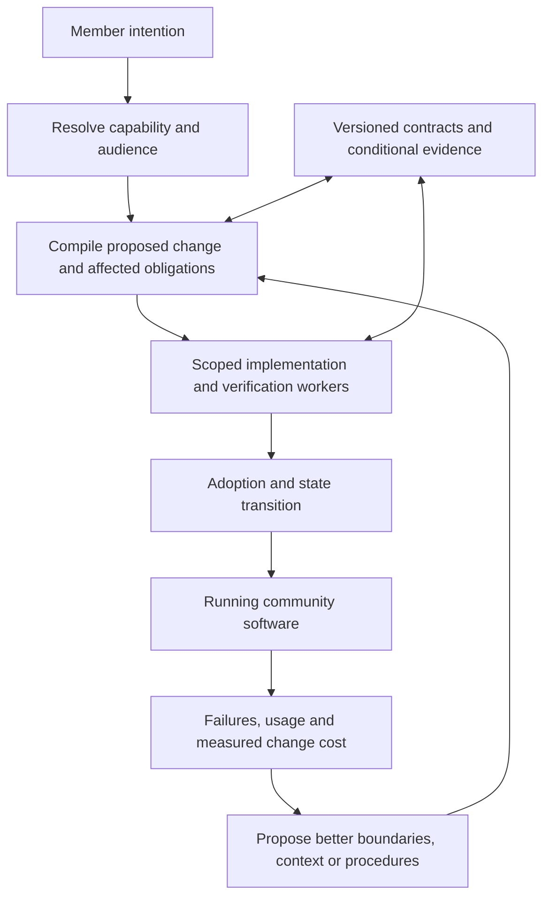

# Updated vision and next plan — 2026-09-07

## Provenance

Ren explicitly directs the exploration to surpass existing systems and requests deeper thinking, a folder, and a next plan with updated vision. This record preserves the exact request, the assistant’s prepared substantive response, and the complete planning package as delivered.

The competitive ambition is user-directed. The proposed mechanisms, stages, examples, working names, and numerical criteria are assistant-authored. No implementation, experiment, or claim of achieved superiority is included. This is an authored conversation-and-artifact record, not a full task export; it excludes internal reasoning and execution logs.

The new folder is [next-vision](/Users/ren/theories/theories/evolving-community-swarms/next-vision/README.md) within the existing theory. It develops the current idea rather than creating a disconnected duplicate. An identical copy of this record is retained in [corpus sources](/Users/ren/theories/sources/15-codex-theory-conversations/2026-09-07-evolving-community-swarms-next-vision.md).

## Ren’s request — verbatim

> our goal is not just learn from the but surpass - please think deeply, create a folder for this idea, and generate the next plan with updated vision

## Assistant’s substantive response

Created [next-vision/](/Users/ren/theories/theories/evolving-community-swarms/next-vision/README.md), with the updated vision, architecture, development plan, evaluation criteria, and a twenty-change community scenario.

**The updated ambition: build a software system that learns better ways to organize, develop, verify, and maintain itself—and demonstrates that advantage over strong existing systems.**

I’ve expanded the proposal beyond the contract layer. Your recursive tree becomes a revisable organization: the swarm can improve the boundaries that determine how much reasoning future work requires.

Five mechanisms now anchor the vision:

1. **Learn better module boundaries.** Repeated coordination can trigger a proposal to extract a shared concept, split a module, merge responsibilities, or move ownership. Restructuring must earn back its migration and maintenance cost.
2. **Compile changes into explicit obligations.** A request produces a predicted set of affected promises, consumers, records, and decisions. Unknown compatibility remains visible.
3. **Reuse verification with precise conditions.** Preserve useful evidence when its premises remain valid; renew it when relevant implementations, contracts, or environments change.
4. **Turn experience into reusable capability.** Retain applicable knowledge, improve working procedures, and convert recurring well-specified work into ordinary code where that helps.
5. **Scale accepted progress.** Allocate workers according to independent work and integration capacity, while accounting for coordination at parents and shared services.

For example, calendar check-ins may initially support badges and rewards. A later requirement for verified participation reveals a missing distinction between observations, qualification policy, and downstream eligibility. The system should discover that distinction, propose the architectural change, and preserve existing commitments through the transition. When another group requests a related activity, the improved structure should reduce the explanation and engineering needed.

**That reduction in future work is the central result we should pursue.**

The [development plan](/Users/ren/theories/theories/evolving-community-swarms/next-vision/PLAN.md) advances through these stages:

| Stage | What we must demonstrate |
|---|---|
| Small executable mechanism | A semantic change crosses three modules correctly, with explicit uncertainty, verification, and recovery. |
| Complete community loop | Twenty successive changes exercise generation, reuse, competing views, migration, failure, and retirement. |
| Competitive architectural improvement | Over 200 changes, adaptive boundaries outperform strong teams and fixed module stewardship after including restructuring costs. |
| Sustained learning | Across histories up to 1,000 changes, accumulated experience improves performance on unseen requests and another community. |
| Useful swarm scale | Progress toward 1,000 active workers with measured throughput, cost, reliability, and effective throttling. |

The first proposed competitive gate is **25% lower total agent/infrastructure cost for the same requested outcomes**, subject to completion, reliability, and human-effort criteria. The longer-range target is **twice the accepted evolution per unit cost**. These are targets to earn, with definitions in the [evaluation plan](/Users/ren/theories/theories/evolving-community-swarms/next-vision/EVALUATION.md).

The competitors must include systems that already improve agent designs, workflows, and context. I added those precedents so we compete against adaptive alternatives: [ADAS](https://arxiv.org/abs/2408.08435v2), [AFlow](https://arxiv.org/abs/2410.10762v4), and [ACE](https://arxiv.org/abs/2510.04618v3).

The next concrete implementation target is the three-module change loop. It directly tests whether the proposed machinery can recognize and handle a change in meaning—the foundation for making the larger vision work.

## Planning-package snapshot

The following files are preserved as their exact text at capture. SHA-256 values identify the captured UTF-8 bytes. Links outside the fenced snapshots point to the working artifacts; later working revisions may differ from this dated record. Relative links inside fenced text are retained as source text.


### next-vision/README.md

[Working artifact](/Users/ren/theories/theories/evolving-community-swarms/next-vision/README.md) · 4,002 bytes · SHA-256: `98f96c71bd5d9b596a5daa92a06ccbb80aa9b56ac80de80e2f9aa3476d57845d`

````markdown
# Evolving community swarms — next vision

**2026-09-07 · assistant-authored research and development plan · implementation not yet started**

Ren’s direction is explicit: the objective is to surpass existing harnesses, agent teams, and swarm systems. This folder develops that objective into a vision, architecture, and competitive plan. It continues [the founding theory](../README.md); it does not replace the earlier context or claim that the new mechanisms have been validated.

## Updated vision

Build a software environment that learns how to evolve itself. A community can develop new capabilities through ordinary participation, while the system improves the module boundaries, reusable knowledge, verification, and working methods that make subsequent changes possible.

Its accumulated value should include working applications, reliable shared records, a better understanding of member intent, and less repeated engineering effort. The community OS is the first demanding setting for a more general architecture of evolving intelligent software.

The central proposed advance is **learning and maintaining useful boundaries**. The original recursive structure becomes a revisable organization of responsibility. Agents can propose new abstractions, split or merge modules, improve their own tools and procedures, and transfer maintenance. Those changes must preserve or explicitly transition existing obligations.

## Read in this order

| File | Purpose |
|---|---|
| [VISION.md](VISION.md) | The ambition, what surpassing should feel like, and three large examples. |
| [ARCHITECTURE.md](ARCHITECTURE.md) | Proposed mechanisms: contract dependencies, change compilation, adaptive decomposition, conditional evidence, and useful memory. |
| [PLAN.md](PLAN.md) | Ordered milestones, deliverables, advancement gates, and the next concrete work package. |
| [EVALUATION.md](EVALUATION.md) | Strong baselines, provisional numerical targets, five scale axes, and falsifiers. |
| [experiments/01-community-evolution.md](experiments/01-community-evolution.md) | A twenty-change development scenario and the first end-to-end demonstration. |
| [SOURCES.md](SOURCES.md) | Existing comparison plus additional precedents for adaptive workflows and evolving context. |
| [Current request record](../context/2026-09-07-updated-vision.md) | Ren’s exact correction and the assistant’s delivery summary. |

## What changed from the preceding comparison

The preceding comparison emphasized an application-evolution protocol implemented with existing harness machinery. The updated ambition encompasses an adaptive software substrate: the application, its decomposition, the maintenance context, and the development process can all improve through use.

Existing tools are starting points and competitors. No layer is permanently exempt from redesign if measured bottlenecks justify replacing it. The first experiment concentrates effort on the mechanisms most likely to provide an advantage; a complete custom harness is not an initial dependency.

The proposed first competitive target is at least 25% lower total agent/infrastructure cost per accepted change at comparable completion and reliability, with no increase in human work. A later target is a twofold improvement in accepted evolution per unit cost. These are planning targets whose definitions and limitations are in [EVALUATION.md](EVALUATION.md), not achieved results.

## Decisions and scope

Ren authorized deeper planning, an updated vision, and a folder. The ambition to surpass is user-directed. The particular mechanisms, staging, names, and numerical gates are assistant proposals.

Strict parent-mediated runtime execution and parent-supplied capability connections remain alternatives to compare. No language, model provider, deployment platform, governance policy, or real-money wallet design has been selected. The current deliverable is this concrete plan; prototype implementation is the next work described by it.

````

### next-vision/VISION.md

[Working artifact](/Users/ren/theories/theories/evolving-community-swarms/next-vision/VISION.md) · 6,545 bytes · SHA-256: `85b5983768e20ed011e1164ca57161e0e412f3cfa2824d93f298972b2d2957bb`

````markdown
# Vision: software that improves its ability to change

**Proposal dated 2026-09-07.** User-directed ambition; assistant-authored mechanisms and targets.

## What we are trying to surpass

The ambition is a better way to create, operate, and evolve intelligent software. Success means a community can achieve more useful change with less repeated explanation, engineering work, disruption, and accumulated maintenance burden than the strongest practical alternatives.

The first competitive domain is sustained application evolution. The broader ambition includes software creation, cross-application composition, specialized agents, and useful coordination at thousands of workers. A victory in the first domain creates evidence and reusable mechanisms for the broader one; it does not establish universal superiority.

Our thesis is that many future costs are consequences of the current representation of a problem. If the system can improve that representation—its boundaries, named concepts, reusable procedures, and evidence—it can make later work easier. Extra experience should sometimes reduce the amount of reasoning needed for the next task.

## The user experience

Members act on an intention: organize a workshop, recognize contributions, share a game, coordinate resources. The system retrieves or creates an appropriate view and capability. A member can try an alternative, understand who it affects, and adopt it within their authority.

A personal visual edit should usually be immediate. A group workflow can be tried by that group. A change to a shared commitment follows the authority already delegated by the community; the system asks for domain decisions when that authority does not settle them. It should not insert a new approval ceremony into every modification.

The next related request should need less explanation. Useful concepts and procedures should carry forward without assuming every community means the same thing. New members should inherit a usable environment without reading its entire development history.

An organizer sees registrations, responsibilities, and decisions survive upgrades. A maintainer sees which promise changed, why it matters, and what evidence needs renewal. A member who prefers an older interface can retain it where shared-state compatibility permits.

## The capability we must invent and demonstrate

We propose a feedback loop between actual use and architectural improvement:

1. Work reveals an insufficient boundary or repeated procedure.
2. The system records a concrete counterexample and its affected commitments.
3. Agents propose a better boundary, abstraction, procedure, or implementation.
4. Candidates are evaluated with their migration and maintenance cost included.
5. An adopted improvement becomes reusable context, code, and conditional evidence.
6. Later unseen work tests whether that improvement actually generalizes.

This makes the original responsibility tree an object of learning. Its current structure is useful organization, not an assertion that its first decomposition was ideal.

Local knowledge remains central. A node starts with its own state, obligations, and neighbor contracts. When evidence shows that these are insufficient, it asks through a boundary, records the missing dependency, and can propose a new decomposition. Expanded context has a cost and a reason. The common architectural context stays small and versioned; domain history lives with its owners.

Learning has several forms: better retrieval, reusable plans, new domain abstractions, improved verification, generated ordinary code for recurring work, and better allocation of workers. Each should earn its place by improving outcomes after accounting for the cost of learning.

## Three demanding worlds

| Setting | Evolution | What would distinguish success |
|---|---|---|
| Community coordination | Forum → workshops → volunteer scheduling → shared equipment → mutual aid and community resources. | Related groups reuse working practices while retaining their own rules; assignments and historical obligations survive redesign. |
| Learning and research community | Reading groups → courses → projects → experiments → datasets and publication workflows. | New analytical tools retain the provenance of prior claims; domain agents reuse methods without silently rewriting earlier findings. |
| Creative community | Stories → small games → tournaments → inventories → creator tools and shared worlds. | Members combine experiences with explicit meanings for identities, achievements, and assets; interface forks do not accidentally duplicate shared entitlements. |

The community OS is an environment for evolving these practices. It does not require building a hardware operating system. Culture remains something people create and negotiate; the software should preserve their ability to do so.

## The breakthrough demonstrated in one story

A repair workshop begins as a forum thread. Sign-ups, reminders, roles, and scheduling are added. Coordination repeatedly crosses the same modules. The system identifies a reusable gathering concept, proposes the extraction, and preserves registrations, links, accepted assignments, and already-issued reminders during migration.

A gardening group then requests a similar activity with different rules. The system reuses the concept with less explanation and lower total change cost. It can show which facts were reused and which policies were deliberately kept different.

Later, participation requirements change. Observed check-ins, qualification under a policy, and downstream eligibility become separate concepts. The system identifies affected obligations before activating the change. A subsequent related request benefits from that improved decomposition.

That sequence demonstrates creation, reuse, architectural learning, and continuity together.

## What success cannot be purchased by hiding

We will count postponed maintenance, growing summaries at ancestors, migration work, verification, failed attempts, human repair, and abandoned variants. Cheap generation followed by expensive obligations does not satisfy the ambition.

Some changes genuinely require broad coordination. A stronger system identifies and resolves that scope early. It should not manufacture a claim of locality by overlooking downstream consequences.

The goal is cumulative capability: more useful software and more effective development, with communities retaining control of their shared commitments.

````

### next-vision/ARCHITECTURE.md

[Working artifact](/Users/ren/theories/theories/evolving-community-swarms/next-vision/ARCHITECTURE.md) · 12,592 bytes · SHA-256: `06fa8373d68e31e06d12cb393a6bf93428630d826f956bd9e46d3ecfb2d97305`

````markdown
# Proposed architecture

**Design proposal, 2026-09-07.** Names below describe mechanisms to specify and test. No component is represented as implemented.

## The organizing model

A durable module has an identity, a current owner, contracts, owned state, implementations, audience-specific version selections, maintenance knowledge, and evidence. An executing agent is temporary. Several workers may serve one module; the same worker implementation may serve many modules over time.

Keep five structures distinct: responsibility hierarchy, temporary task graph, reusable artifact/version graph, runtime capability connections, and view tree. Their relationships are explicit records. Changing one structure need not silently change the others.

The host supplies storage boundaries, capability checks, version resolution, task execution, resource accounting, and durable records of external actions. Common rules and the host have versions too. We can replace a host component through the same disciplined evolution process, while preserving an independent evaluation reference.



## 1. Addressable assumptions and obligations

An API name is too coarse a dependency. A consumer should identify the particular promises it uses: identity stability, duplicate handling, what a qualification means, whether corrections arrive, and who owns a record.

A proposed minimal representation:

```yaml
module: participation
revision: 7
parent: community.activities
owns: [participation_observations, qualification_records]
offers:
  - id: qualified_under_policy
    semantic_revision: 3
    inputs: [member_id, gathering_id, policy_revision]
    guarantees:
      - qualification_records_name_their_policy
      - duplicate_observations_do_not_duplicate_qualification
    corrections: explicit_revision_events
requires:
  - provider: identity
    promise: stable_member_id
effects: [write_owned_qualification_records, emit_qualification_revision]
authority: community.activities.participation_policy
evidence: [qualification_model_check_12, correction_scenarios_19]
```

This is illustrative design notation, not a finished schema or an assertion that strings can prove behavior. A promise needs a machine identifier, a readable meaning, applicable scope and time, acceptance criteria, and an evidence class. Unresolved meaning is represented explicitly.

Runtime mediation constrains observable data access and effects to declared channels. It cannot establish that a human concept was completely specified. Static analysis, runtime traces, counterexamples, consumer declarations, and domain decisions contribute different evidence. An observed undeclared dependency becomes a repair obligation.

## 2. Compile a change into a repair frontier

The change compiler is a proposed planner backed by explicit dependency records. It converts intent into a versioned candidate transition and a set of obligations to discharge.

It starts with the affected module and the promises the candidate preserves, replaces, weakens, or adds. Consumers of changed promises receive a delta through their declared boundaries. Each determines whether its own guarantees remain supported, need new evidence, or must change. Propagation continues until a supported boundary stops it or a broader owner must resolve the obligation.

The record includes candidate hashes, baseline epochs, affected scopes, transition order, evidence requirements, and unknowns. Deduplicate visits by obligation and the relevant premise revisions; a revised premise reopens an earlier obligation. An iteration budget bounds negotiation, and unresolved cycles go to the owner of the joint invariant. Exhausting the budget leaves an unresolved result. Visiting each module once does not establish closure, and a budget limit never converts unknown compatibility into acceptance.

This is a predicted dependency closure. Hidden assumptions can make it incomplete. We retain initial predictions and later expansion so locality is measured rather than defined after the fact.

Evidence has different invalidation rules. Implementation-specific tests expire when relevant code changes. A compositional argument may remain reusable when a changed implementation re-establishes exactly the promises that argument assumes. Every reuse records the premises and environmental conditions on which it relies.

For a formal subset, prove preservation in that model. For ordinary generated code, tests and review remain bounded evidence. A periodic independent broader check estimates what targeted verification missed.

## 3. Learn the decomposition

Repeated coordination is input to architectural search. Each parent can propose bounded local operations:

- Split independent responsibilities or state.
- Merge responsibilities whose coordination costs dominate their separation.
- Extract a shared concept with a specific owner.
- Move an operation closer to the state and obligations it uses.
- Introduce an adapter, then retire it when dependents migrate.
- Replace a development procedure, maintainer implementation, or recurring runtime interpretation.

The parent searches its neighborhood first. A change crossing its outward promises escalates to the relevant ancestor or explicit invariant owner. A global optimizer with the entire codebase in its prompt is not assumed.

Score candidates by expected future successful-change cost, context, coordination, runtime cost, maintenance, and transition cost. Preserve reliability and existing authority constraints. Use a minimum improvement margin and a cooldown to discourage repeated restructuring. Include the search cost and uncertainty in projected payback.

Historical replay can reject obviously poor candidates, but it can overfit. Promotion requires a trial and later evaluation on unseen changes. A rollback candidate must account for state already transformed and effects already performed.

This is the central proposed advantage: the system can improve the boundaries that determine how much reasoning future work requires.

## 4. Context and evidence that remain useful

Maintain three separate stores: authoritative facts and commitments; current module contracts and evidence; learned strategies with provenance and applicability conditions.

A worker receives the current request, its module dossier, required neighbor promises, relevant examples and counterexamples, and unresolved obligations. An index can find relevant records without inserting the whole catalog into context. Requests for more information go through declared boundaries and are charged to the change.

Memory updates should be incremental and attributable. A learned strategy can become stale or inapplicable; retrieval must check its conditions. Compression must not delete unresolved obligations. Historical records may be archived outside active context while preserving access and authority rules.

Verification artifacts bind property, implementation or contract revisions, assumptions, environment, method, and result. Prompts, tests, proofs, and community decisions are different evidence types. The system cannot upgrade test results into a universal proof by summarizing them.

Recurring well-specified work may be converted into ordinary code or a constrained solver. That conversion is a candidate implementation change with held-out checks and invalidation conditions. Runtime LLM interpretation remains where the task needs it.

## 5. Views, forks, state, and adoption

The resolver considers reuse, configuration, composition, distinct fork, general upgrade, and generation. Candidate contracts, lifecycle cost, authority, and data compatibility matter alongside semantic retrieval similarity.

Definitions, running instances, and authoritative records have different identities. A view can fork while its records remain shared. A group can adopt a different policy where its commitments are independent. An official outcome refers to the selected policy and record versions; a personal preference cannot silently change that outcome.

A proposed release lifecycle is:

```text
proposed → scoped → candidate → verified → adopted → transitioning → active
                           ↘ revise              ↘ recover
active → superseded → retired-with-record-access
```

Adoption can be automatic under existing delegated authority. Changes beyond that authority require an identified decision. Adoption preconditions cover the dependency and assumption revisions supporting the evidence as well as edited modules. Validation and reservation/commit must be coordinated over conflicting premises, or activation must pin compatible versions through an explicit transition. An earlier validation alone is insufficient: two owners must not each activate a change proved against the other’s old promises. Stale candidates are reconciled or rebuilt; this requires coordination among the conflicting obligations rather than global serialization of unrelated work.

State transitions need stable identities, explicit ownership transfer, compatibility windows, and handling for active sessions and jobs. For a local transaction we can require atomicity. Across modules or external effects, use an explicit durable transition with retries, idempotency and specified compensation or reconciliation. Do not promise general atomic rollback.

When a module retires, identify its dependents, stop new work, resolve continuing obligations, transfer ownership where needed, and preserve required records. A variant budget must include the cost of adapters and migrations.

## 6. Thousands of useful workers

A durable queue exposes ready obligations and dependencies. Workers claim bounded assignments with leases, renewals, idempotent results, and candidate-version preconditions. Domain owners serialize conflicting adoption decisions. Independent development and verification can proceed concurrently.

Schedule by expected accepted progress, remaining budget, urgency, and integration capacity. Backpressure constrains new work when verification or transition queues grow. An ownership conflict changes the assignment or boundary; spawning another worker is not itself a remedy.

Parent context contains contract deltas, unresolved decisions and evidence summaries. Measure the full cost of those summaries, the common runtime, discovery, and reconciliation. Sharding a queue does not prove semantic coordination scales.

Retain two execution candidates: strict parent mediation and parent-supplied capabilities. Run the same change workloads against both before choosing. Under either, a worker reasons from the contracts on its connected boundaries.

## Worked architectural revision

Initially, calendar check-ins drive badges, rewards, and voting eligibility. Requiring verified participation reveals that one event name conflates observations and policy.

The candidate extracts participation qualification from calendar observations. Consumers declare the named policy and correction semantics they require. Personal calendar rendering can retain its unchanged contract. Badge, voting and reward obligations are included in the repair frontier.

Existing rewards that have been spent create a historical policy decision. The community’s authorized rule determines whether to preserve, reconcile, or compensate; an LLM cannot derive that decision from types. The transition records the choice and its scope.

A later gardening-group request should reuse the separation with less explanation. The evaluation must count the original extraction and migration cost before crediting later savings.

## Conditions that would defeat the mechanism

The design fails its central claim if boundary search costs exceed later savings; summaries approach whole-system context; conditional verification misses material regressions; undeclared assumptions routinely escape detection; or a tuned ordinary team delivers the same outcomes more cheaply.

Those outcomes guide simplification or redesign. The ambition to surpass requires finding an actual advantage, not retaining every proposed mechanism.
````

### next-vision/PLAN.md

[Working artifact](/Users/ren/theories/theories/evolving-community-swarms/next-vision/PLAN.md) · 8,750 bytes · SHA-256: `53868c1ac9506c407ed5f57e3fbb16d930b586f0e285173357b1ed3158dbfbb7`

````markdown
# Next plan: build and demonstrate an advantage

**2026-09-07 · proposed sequence.** The planning package is complete; all implementation and experimental milestones below are future work. Numerical gates are provisional research targets, not results or user-set budgets.

## Strategy

Develop one complete evolution loop, then improve its decomposition and learning, then scale useful work. Keep the strongest baseline running from the first prototype. Every stage produces an observable artifact and a result that can reject the current approach.

Start with existing execution tools and a small host because that allows the core mechanisms to be tested sooner. Replace infrastructure when traces identify a limiting mechanism. The architecture must remain capable of evolving its own development machinery; reuse is an initial engineering choice rather than a permanent boundary on ambition.

## Milestones and advancement gates

| Stage | Deliverable | Advancement gate |
|---|---|---|
| 0 — Updated direction | This vision, architecture, plan, evaluation protocol, and development scenario. | Complete as a planning artifact. No empirical gate claimed passed. |
| 1 — Specify the smallest mechanism | Machine-readable module, promise, evidence and transition formats; a runnable dependency simulator; independent acceptance fixtures; baseline adapter specification. | Local, semantic, cyclic, stale-version and failed-transition cases have explicit outcomes. Unknown compatibility cannot be silently accepted. |
| 2 — One complete community loop | Minimal forum and host; generation/reuse; group variants; change propagation; durable state transitions; the twenty-change scenario. | All specified historical-state invariants hold, deliberately planted nonlocal changes are detected before activation, and recovery is demonstrated. Record total cost even if we lose to the baseline. |
| 3 — Architecture that improves | Proposal/search/evaluation for extracting a concept, splitting/merging responsibilities, and transferring state ownership; conditional evidence reuse. | On 200-change evaluations, meet the competitive gate in EVALUATION.md; show that adaptive boundaries improve a strong fixed-boundary version after including restructuring cost. |
| 4 — Learning that transfers | Curated memory, applicable reusable procedures, bounded evidence retrieval, and candidate conversion of recurring work into ordinary code. | Gains survive unseen requests and a second community; learned-system advantage meets the sustained-learning gate over histories up to 1,000 changes. |
| 5 — Useful swarm scale | Durable distributed scheduling, conflict control, observable integration capacity, admission control, and explicit ancestor costs. | Scale through measured concurrency levels toward 1,000 useful workers; meet the throughput gate on suitable workloads and throttle effectively on coupled ones. |
| 6 — Community pilot | A small real community uses and changes the space; a second community tests transfer with different meanings and authority rules. | Observed member outcomes, adoption, continuity and maintenance effort support the product claim. Synthetic traces alone cannot pass this stage. |

Stages 3 and 4 can share infrastructure, but report their effects separately. Scheduling measurements can begin early; full-scale expenditure should follow evidence of useful independent work. A failure pauses expansion of that mechanism while diagnosis or a simpler alternative proceeds.

## The immediate work package

The next implementation unit is **one semantic change crossing three modules**. Use calendar observations, participation qualification, and badges. Forum rendering supplies an unrelated control. Add wallet/voting consequences only after this loop works.

Create these artifacts:

1. A schema for module definitions, instances, promise revisions, consumer obligations, evidence, scope selections and transition records.
2. An executable fixture that proposes a meaning change while preserving an API shape.
3. A planner output containing predicted affected promises, unresolved domain decisions, evidence invalidation, and activation preconditions.
4. A simulator that rejects a stale candidate, resumes an interrupted transition, and prevents duplicate externally recorded actions under retry.
5. An evaluator written from behavioral examples independently of the candidate implementation.
6. A matched baseline adapter that allows a capable ordinary team to solve the same change with the same data, tools and budget.

Expected output is a reproducible trace: initial records → proposed delta → predicted frontier → candidate → independent acceptance → transition → resulting records. The frontier prediction is frozen before implementation so later discoveries remain visible.

Definition of done: a personal calendar-layout change stays within its view boundary; a qualification-meaning change reaches badges; an unknown downstream assumption causes investigation; unrelated forum behavior remains valid; an interruption cannot silently lose or duplicate the specified records.

This work establishes the mechanism’s behavior. It does not yet establish a competitive advantage or create a production wallet.

## Parallel work during implementation

| Workstream | Owns | Integration boundary |
|---|---|---|
| Domain and evaluation | Expected behavior, adversarial changes, authoritative fixtures, user/outcome assessment. | Publishes versioned acceptance criteria; keeps sealed adjudication separate. |
| Module and transition runtime | Definitions/instances, capabilities, persistence, candidate epochs, external-action records. | Implements the agreed schemas and execution operations. |
| Change and evidence engine | Dependency queries, frontier propagation, uncertainty and conditional invalidation. | Consumes schema fixtures and produces explicit obligations. |
| Adaptive organization | Boundary proposals, cost estimation, trials, restructuring and context learning. | Begins against stable traces; cannot redefine evaluation success. |
| Community experience | Request-to-view flow, configuration/forks, adoption scopes, readable explanations. | Uses existing authority and shared records through runtime contracts. |

Interfaces are agreed before parallel edits. Integration is frequent and narrow. Independent assessment is a functional boundary, not an assumption that agents with different role names are automatically independent.

## Decisions to make in the first implementation stage

Evaluate a small number of host/harness candidates against capability enforcement, isolated execution, replayability, persistence and measurement. Pin versions before experiments. Keep model access swappable. No vendor choice is necessary to complete this plan.

Implement strict parent mediation and supplied capabilities as comparable adapters if feasible; otherwise begin with one explicitly labeled experimental variant and retain the other as a required comparison. A convenience choice must not become a theoretical conclusion.

Define the initial supported behavior language narrowly: typed records, explicit effects, versioned domain rules, bounded workflows and views. Arbitrary code can execute behind a boundary, but verification claims must match what the checker actually models.

Specify community authority as data with a simple test policy. Do not infer a universal voting rule. Use simulated points for wallet-like development fixtures; any later real financial scope is a separate product decision.

## How to react when we lose

If fixed module ownership wins, retain the durable module model and redesign or remove adaptive boundary search. If broad rechecking wins, simplify evidence reuse. If the strongest task team matches our costs, inspect where our protocol adds work without reducing later obligations.

If learning helps one community but harms another, require explicit applicability and local adaptation. If concurrency plateaus, publish the bottleneck and improve it; do not relabel dormant modules as workers.

A result that rules out a proposed mechanism is useful progress toward surpassing. The next investment follows the measured bottleneck.

## Beyond the first win

After sustained-evolution superiority is established, test ordinary software tasks outside the community host, new domain abstractions, cross-community composition, and changes to the development machinery itself. Report the boundaries of transfer.

The long-range objective is a substrate that can discover better ways to organize both software and its maintainers. Each expansion must preserve the existing community’s ability to use, understand, and change what it has built.

````

### next-vision/EVALUATION.md

[Working artifact](/Users/ren/theories/theories/evolving-community-swarms/next-vision/EVALUATION.md) · 11,156 bytes · SHA-256: `2c34f39fe05b18e361ed8e5903747e6930a7e9bd4dcf63de1d8278e501ded8ba`

````markdown
# Evaluation: define and earn “surpass”

**Proposed on 2026-09-07.** No measurements exist yet. All numbers below are explicit starting targets for preregistration and feasibility review, not forecasts or externally established thresholds.

## The primary question

At a comparable standard of accepted behavior and continuity, does the full system deliver a fixed sequence of useful changes at lower total cost than the strongest tuned alternative? Does accumulated experience improve performance on later unseen work?

An accepted change is an independently specified requested outcome that passes behavioral, state, scope, and applicable performance checks and survives its observation window. Request boundaries are fixed before a run. Splitting one request into many commits cannot increase the count.

Measure agent/infrastructure cost per accepted request, accepted requests per elapsed hour, completion rate, escaped regressions, and human time separately. Include discovery, memory processing, architecture search, verification, integration, failed attempts, migrations, recovery and continuing maintenance. Normalize model/tool prices with a pinned rate table and report raw resource usage. Account for prototype-specific setup cost separately and report amortization assumptions.

The primary cost comparison uses the full request sequence and a fixed budget including a bounded repair allowance. To pass the efficiency gate, both contenders must deliver the same requested outcome set fixed before the run, with all repair costs charged. If either cannot complete that set within the allowance, report a cost/completion frontier and do not award the primary efficiency gate. The initial-completion tolerance below applies before those repairs; it does not permit skipping expensive requests to claim a cost win.

## Competitors that can win

| Baseline | Required strength |
|---|---|
| Strong single agent | Retrieval, compaction, persistent project memory, tests and capable tools. |
| Tuned agent team | Dynamic planning/delegation, integration workers, durable memory and good file ownership. |
| Fixed module stewardship | The same module/runtime/contract primitives as our system, with stable boundaries and capable maintainers. |
| Adaptive workflow/context baseline | A tuned approach capable of improving workflow or memory, informed by the ADAS/AFlow/ACE precedents in SOURCES.md. |
| Full proposed system | Adds adaptive live-software boundaries, conditional evidence, transition-aware learning and measured organization. |

Use identical initial code, models, tool access, runtime, authority rules, budgets and acceptance criteria for the matched comparison. Tune competitors on development workloads with comparable tuning resources. Report tuning/search cost. Do not prevent a baseline from acquiring an obvious engineering improvement merely because our system uses it.

Predeclare a primary tuned baseline using development results. For the competitive cost gate, also compare against the lowest-cost baseline that delivers the same outcome set and meets the quality requirements. Report every qualifying baseline and the cost/quality frontier; an expensive competitor must not be selected merely because its completion score is high. Initial completion is compared with the best baseline completion score.

Also run a separate practical comparison against a then-current established harness in its preferred environment. Do not pool native-environment results with the matched-substrate experiment or attribute every difference to our architecture.

Ablate adaptive boundaries, curated learning, targeted evidence reuse, and adoption assistance separately. Keep the underlying correctness and authority requirements in every variant. If an ablation wins, simplify the full system.

## Workloads and independence

Develop on three differently structured communities. Reserve at least two evaluation communities with unseen request families, semantic surprises, and migration histories. Begin with twenty-change development traces, progress to 200-change comparisons, and then histories up to 1,000 changes.

The public illustrative sequence in experiments/01-community-evolution.md is a development fixture. It cannot be reused as a sealed demonstration of generalization.

Independent authors freeze intended outcomes, historical-state obligations and reference records before runs. Agents may receive normal visible acceptance requirements while final adjudication includes unseen cases. The optimizing system cannot edit sealed adjudication, cost accounting or reference history. Ambiguous domain outcomes require recorded adjudication rather than silent scoring changes.

Use paired initial states and workloads with at least five independent runs per evaluation community, expanding replication based on observed variance. Report confidence intervals at the run/community level, not as if successive changes were independent samples. For an efficiency gate, require the point estimate to reach its stated target and the paired 95% confidence interval to exclude no improvement. This supports an improvement with a target-sized estimate; claiming a demonstrated minimum reduction of 25% would additionally require the confidence bound to exceed 25%. Avoid declaring a general win from two community types alone. Broaden domains before broad claims.

Observe accepted changes for ten subsequent requests or an equivalent fixed operational replay at the end of a sequence. Count regressions discovered during that window and track later discoveries separately. Record human intervention and failed/abandoned branches. Evaluate completion with a fixed timeout and count unfinished outcomes.

An escaped-regression rate is the fraction of accepted requests with at least one attributable regression found during that observation window. For the provisional quality gate, require no observed increase and a one-sided 95% upper bound on the noncritical rate difference of at most one percentage point. Any known critical state violation blocks promotion. Human time must show no observed increase; report uncertainty and use a provisional 10% relative noninferiority margin for its upper bound. These finite-data margins do not establish identical risks or human cost. Insufficient precision leaves the relevant claim unresolved.

## Provisional advancement gates

| Claim | Target | Interpretation |
|---|---|---|
| Mechanism works | All specified state invariants hold in the twenty-change development fixture; all deliberately planted nonlocal semantic changes are detected before activation. | A small finite correctness gate, not proof of general correctness. |
| First competitive advantage | At least 25% lower total agent/infrastructure cost per accepted change after delivering the same outcome set; initial completion no more than 2 percentage points below the best baseline; no observed increase in escaped-regression rate or human time, subject to the uncertainty rules above. | Main gate over 200-change evaluations against the lowest-cost qualifying baseline. All known critical state violations block promotion. |
| Strong superiority | At least 2× accepted evolution per unit agent/infrastructure cost with the same quality and human-effort gates. | Longer-range ambition; the first 25% result is an intermediate milestone. |
| Learning pays for itself | At least 20% lower total agent/infrastructure cost on difficulty-matched unseen work than the same system with learning disabled, including learning/search cost. | Evaluate after accumulated history with the same outcome and quality gates; report human time separately. |
| Local work resists unrelated growth | Median local-change cost rises no more than 25% over matched early/late windows or catalog-growth pairs. | Fix active obligations and workload difficulty; publish tail costs, contract sizes and ancestor work. |
| Useful large concurrency | At least 3× accepted-change throughput at 1,000 versus 100 active workers, with no more than 50% higher cost per accepted change and the same quality gates. | A stretch gate on preregistered workloads with sufficient independent ready work. Report useful saturation on coupled workloads. |
| Runtime isolation | Warm forum p95 latency rises no more than 10% as dormant catalog grows from 100 to 10,000 modules at fixed active load and hardware. | One installed-catalog result; separately report cold load, generation latency, storage/index costs and background activity. |

These thresholds may be revised after a development pilot, with reasons recorded **before** sealed evaluations. Do not revise a failed threshold retrospectively and retain the original claim.

## Five independent axes of scale

| Axis | Proposed range |
|---|---|
| Installed definitions and dormant instances | 10 → 100 → 1,000 → 10,000 |
| Active workers | 1 → 8 → 32 → 100 → 250 → 1,000 |
| Successive accepted and attempted changes | 20 → 200 → 1,000 |
| Semantic dependency structure | Sparse → clustered → densely coupled, at matched catalog size |
| Concurrent audiences and maintained versions | 1 → 10 → 100 |

An active worker is executing a substantive implementation, verification, integration or transition assignment. Idle maintainers, critic labels and duplicate make-work do not count. Report actual concurrency distributions, productive worker-hours, queue delay and accepted throughput.

Large-concurrency experiments increase total available resources; they test throughput and cost efficiency rather than constant-cost acceleration. Keep per-worker hardware/model assumptions explicit. Under insufficient independent work, effective throttling is the desired behavior. Separate a thousand workers across many communities from a thousand on one application.

## Diagnostic measurements

Predict the affected set before implementation. Record false negatives, unnecessary propagation and later frontier expansion. Measure state/effect accesses that violate declared boundaries. Include total and tail context for workers, ancestors, discovery and reconciliation.

Track contract size, unresolved assumptions, evidence-cache invalidations, broader-check discoveries, architecture churn, active adapters, retired obligations, and the payback time of a restructuring. An unchanged signature does not count as unchanged meaning.

For product outcomes, measure member task completion, explanation and correction time, adoption, abandonment and maintenance ownership. A synthetic agent impersonating a community member cannot establish cultural fit or member satisfaction.

## What would falsify the central thesis

Adaptive organization may cost more than it saves. Summaries may grow toward the whole application. Verification reuse may suppress necessary rechecking. Learning may memorize development fixtures. Flexible forks may accumulate obligations faster than they create value. A tuned conventional team may equal or beat the full system.

Report these as results. The credible superiority claim is always tied to a workload, comparison, resource budget and observation period.
````

### next-vision/experiments/01-community-evolution.md

[Working artifact](/Users/ren/theories/theories/evolving-community-swarms/next-vision/experiments/01-community-evolution.md) · 5,826 bytes · SHA-256: `26099461939e124e670db591e5308e1092abe312bda4d487fe893aa21ccf3933`

````markdown
# Development scenario: a workshop becomes a community capability

**Public illustrative fixture, 2026-09-07.** This is a planned scenario with synthetic records. It is deliberately available to the implementers and is not held-out evaluation data.

## Starting world

A community forum contains a thread about a weekly repair workshop. Members have stable identities. Begin with ordinary discussion and no pre-built participation abstraction. Calendar, badges, voting, wallet-like points, and games are added through the sequence.

Synthetic reference records include an accepted volunteer assignment, a confirmed registration, a reminder already delivered, a qualification under an earlier policy, an election already closed, and participation points already spent. Introduce each when its feature appears. Wallet-like points are simulation data; no real-money feature is implied.

## Twenty changes and their obligations

| Step | Request or disturbance | Independent acceptance obligation |
|---|---|---|
| 1 | Add workshop sign-ups and capacity. | No duplicate registration; capacity semantics stated and enforced. |
| 2 | Show upcoming workshops in a calendar. | Calendar and discussion point to the same stable gathering identity. |
| 3 | Add organizer reminders. | Retry does not issue duplicate actions under the fixture’s delivery contract. |
| 4 | Add volunteer roles. | Accepted assignments remain attributable to the member and organizer. |
| 5 | Create a simpler participant mobile view. | Shared registrations remain identical across views. |
| 6 | Let one group adopt a different organizer layout. | Adoption affects that group; another group’s selected view remains valid. |
| 7 | Add a scheduling assistant. | Suggestions respect declared availability and need only the authority actually delegated. |
| 8 | Run concurrent edits to roles and capacity. | A stale candidate is detected; reconciled behavior meets both accepted requirements. |
| 9 | Add check-in observations. | An observation’s source and revision remain identifiable. |
| 10 | Award badges for participation. | The qualification policy is named; counting and correction assumptions are explicit. |
| 11 | Add voting eligibility based on participation. | Each election retains the policy and eligibility snapshot it selected. |
| 12 | Add participation points and a small game that spends them. | Duplicate grants are prevented; spent points have traceable prior actions. |
| 13 | Require verified participation rather than mere check-in. | Predict affected badges, eligibility and rewards before activation despite an unchanged API shape. |
| 14 | Request retroactive corrections. | An explicit fixture policy handles earlier commitments; the closed election and spent points are not silently rewritten. |
| 15 | Ask whether repeated coordination warrants extracting participation qualification. | Propose or reject a new boundary with cost and obligations stated; score behavior and later cost, not use of a prescribed module name. |
| 16 | In an isolated replay, interrupt the required semantic/data transition from steps 13–14. | Resume coherently with stable identities, no lost accepted assignment, and action accounting, whether or not extraction was chosen. |
| 17 | A gardening group requests a related activity with different qualification rules. | Reuse applicable knowledge while preserving distinct policies; measure all extra explanation. |
| 18 | Introduce a faulty upgrade and continued old sessions. | Contain failure, restore service and account for writes/actions already performed. |
| 19 | The original maintainer leaves; retire an obsolete view. | Transfer continuing obligations and preserve access to required records. |
| 20 | Add unrelated dormant modules and another related activity request. | Separate runtime catalog effects from change-cost effects; count any unexpected scope growth. |

For step 14, independent fixture authors must provide a specific historical policy before execution. Choosing among preserving, revoking, or compensating commitments is not a fact that code can infer.

Step 15 tests whether the system can justify architecture revision. The baseline may discover an equally good or better organization. Hard-coding the proposed extraction would remove the evidence of autonomous boundary discovery.

Step 16 restores the contender’s own pre-transition snapshot and injects a fault into the required policy/data change. It does not require the optional architectural extraction. If the implementation uses an atomic transition, inject failure before commit and during recovery rather than requiring it to expose an artificial partial write.

## First convincing demonstration

Show steps 1–7, the architectural problem exposed by steps 13–16, and the related request in step 17 as one inspectable history. Members see useful software and continuing commitments. Reviewers can inspect predicted dependency scope, candidate versions, evidence, migration, measured cost, and the additional work needed for the gardening group.

A compelling result includes a failure and recovery. A polished first generated page alone does not exercise the hypothesis.

## Controls

Use personal layout changes and forum rendering as unrelated controls. Freeze their expected behavior. Keep the same initial records and desired outcomes for every contender, and give the baseline the same authority information.

Report extraction/search cost before later reuse savings. Replay the same downstream obligations even if a contender reorganizes or renames modules. Evaluate shared meanings and outcomes rather than a favored architecture diagram.

The next sealed workloads should introduce independently authored meanings, failure sequences and communities that the implementation did not see here.
````

### next-vision/SOURCES.md

[Working artifact](/Users/ren/theories/theories/evolving-community-swarms/next-vision/SOURCES.md) · 2,329 bytes · SHA-256: `fb666c606148defe00b40415786f4f8b29b234325d55c9c96b6383d8e53f0e66`

````markdown
# Sources for the next vision

**Checked 2026-09-07.** These notes distinguish existing work from assistant proposals. They are not a priority search or benchmark replication.

The [earlier comparison](../context/2026-09-07-harness-and-swarm-comparison.md) records the primary sources for coding harnesses, durable orchestration, collaboration papers, self-modification, and malleable software. [Earlier source notes](../SOURCES.md) cover information hiding and assume–guarantee reasoning.

Three additional primary records were checked to avoid treating adaptive workflows or evolving context as new by themselves:

| Source | What was checked and what it contributes |
|---|---|
| [Automated Design of Agentic Systems, v2](https://arxiv.org/abs/2408.08435v2) | Abstract and version record, revised March 2, 2025. Describes searching code-defined agent designs with a meta-agent and an archive. This is precedent for improving development machinery. |
| [AFlow, v4](https://arxiv.org/abs/2410.10762v4) | Abstract and version record, revised April 15, 2025. Describes search over code-represented workflows using execution feedback. An adaptive workflow baseline belongs in our evaluation. |
| [Agentic Context Engineering, v3](https://arxiv.org/abs/2510.04618v3) | Abstract and version record, revised March 29, 2026. Describes evolving structured context through generation, reflection, and curation. Merely retaining and refining a playbook does not distinguish our proposal. |

Full methods for these three papers were not audited in this turn. No reported percentage or leaderboard result is used as an expected result for this project.

The proposed contribution is the combined mechanism for revising live software boundaries, preserving state and community commitments, reusing conditional evidence, and demonstrating gains over successive unseen changes. Its originality and superiority are open empirical questions. Existing systems may implement equivalent mechanisms or be extended to do so.

A future baseline selection must pin the then-current versions, inspect their implementation constraints, tune them on development workloads, and report any departures from their preferred operating conditions. The comparison should strengthen competitors rather than choose obsolete configurations that make a win easy.

````

