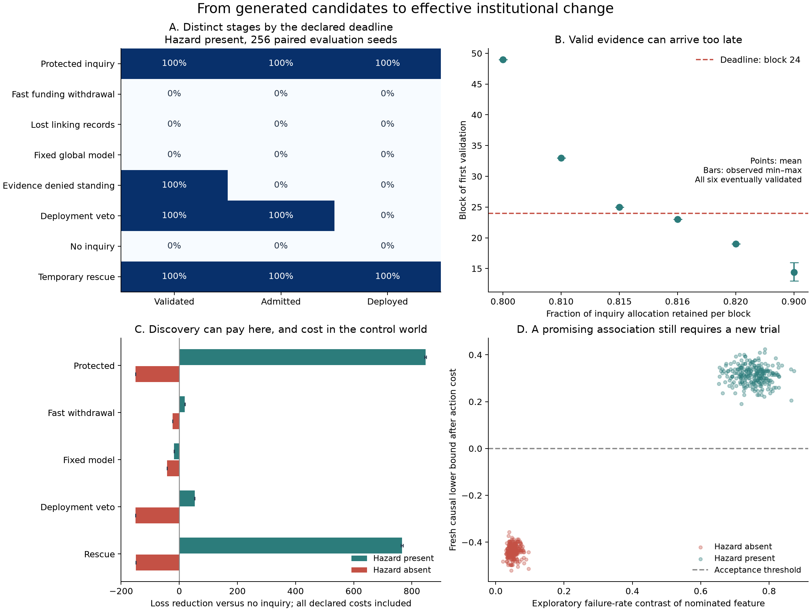

# Discovery before demonstrated returns

Research continuation, 5 October 2026. Ren asked, “please, next target”, following the model of institutional frame formation. This cycle replaces an assumed transition into the correct representation with an implemented process that constructs candidates, pays for records and experiments, tests effects on fresh cases, and separates evidence from institutional action. The conceptual direction is Ren's; the implementation, mathematics, prose, and analysis are AI-generated research assistance, with three agents contributing design, mathematical, and prior-art audits.

The main contribution is a concrete, inspectable route from records to a useful response. It also exposes a necessary financing condition: an institution must support the production of valid evidence before that evidence can justify the activity producing it. The experiment demonstrates this constraint in a deliberately small setting. It does not establish a universal social attractor, unrestricted concept formation, or a solution to alignment.

The [experiment directory](../../experiments/situated-discovery/README.md) contains the frozen protocol, code, tests, developmental history, all evaluation records, and figure. The [research log](../../_process/research/2026-10-04-integrated-evolution/RESEARCH-LOG.md) and [claim register](../../_process/research/2026-10-04-integrated-evolution/CLAIMS.md) connect this work to the earlier renewal and frame models.

## A change that is useful only when the institution learns a distinction

Each case has six neutral binary attributes. Two attributes and their values are randomly selected to define a latent context occurring with probability one quarter. The learner is not told this conjunction. Its active model initially contains no contextual distinction.

There are two already known actions. A has no extra action cost. B costs .25 per case. In the hazard-present world, failure probability under A is .80 inside the latent context and .05 outside. Under B it is .05 everywhere. In the absent-hazard world both actions fail with probability .05. The common local objective counts a failure as loss one, alongside action and inquiry costs; these components are also reported separately.

Always choosing B is worse than always A: its average failure reduction .1875 is smaller than its .25 cost. But choosing B only in the latent context has expected gain

\[
\frac14(.75-.25)=.125
\]

per population case. The institution needs a useful distinction rather than an indiscriminate switch to the supposedly better action.

This is an independent-unit environment with a two-block reporting delay. It does not accumulate physical damage. Each run has 64 blocks of 128 cases. Block 24 is a declared timeliness cutoff, not a point of physical irreversibility; later discovery can still help.

## Candidate construction and a separate causal test

During discovery the institution uses A and pays to retain the attributes and identifiers needed to link cases to later outcomes. After 512 mature linked records, a generic generator considers 73 predicates: the all-cases predicate, twelve one-attribute predicates, and sixty two-attribute conjunctions. It ranks eligible predicates by observed failure-rate differences inside and outside them.

This ranking is exploratory association. It does not establish that changing the action will help. The highest-ranked untested predicate proposes a conditional policy: B inside that group, A elsewhere. The learner freezes that candidate and obtains a new randomized trial with 128 A and 128 B cases inside the group. It observes only the outcomes of the actions actually assigned. No simulator truth, true-policy score, or counterfactual outcome is used to choose the proposal or accept it.

For binary failure rates, put

\[
\widehat\Delta=\overline Y_A-\overline Y_B,
\qquad
r=\sqrt{\frac12\left(\frac1{n_A}+\frac1{n_B}\right)
\log\frac1{\alpha_j}}.
\]

The proposed policy passes only if

\[
\boxed{\widehat\Delta-r-.25>0.}
\tag{1}
\]

There are at most four attempts, each using fresh confirmation records and \(\alpha_j=.05/4\). A weighted [Hoeffding bound](https://doi.org/10.1080/01621459.1963.10500830), conditional on nomination, controls each false acceptance; a union bound controls any false acceptance across the four attempts by .05 under the stated assumptions. Searching many predicates only on discovery records does not require an additional 73-fold penalty when the selected candidate receives independent confirmation. Adaptive reuse of the same holdout would be a different procedure, with known overfitting risks documented by [Dwork and colleagues](https://arxiv.org/abs/1506.02629).

Cash shortages can delay a trial slot. The mathematical audit checks that this does not bias this particular test: affordability and scheduling depend on group membership, the fixed action order, and cash, but not the case's remaining attributes or unseen outcome. Conditional on that schedule, outcomes remain independent draws from the stationary candidate population. This argument would not automatically survive distribution drift, informative missingness, or dependence between cases.

A different predicate can still define a useful policy. For example, a single true attribute gives a coarser policy with positive expected gain .0625. The code therefore scores false acceptance by nonpositive actual policy gain, while reporting exact feature recovery separately. The grammar and all possible raw attributes still come from the analyst. This is bounded model expansion, not unrestricted novelty or the formation of new purposes.

## What the held-out run shows

After development and review, code, protocol, and tests were frozen with SHA256 hashes. Evaluation used 256 independent seeds, fourteen arms, and two hazard conditions: 7,168 trajectories. Arms and hazard conditions share paired random inputs, so those trajectories are not independent replications. The worlds vary the identity of a symmetric two-attribute rule and the sampled noise; they do not span diverse environments. The parameters describe a benchmark selected during development; held-out seeds do not remove that model-selection limitation.

The principal hazard-present comparisons were:

| Institutional condition | Validated by cutoff | Admitted by cutoff | Deployed by cutoff |
|---|---:|---:|---:|
| Protected inquiry | 256/256 | 256/256 | 256/256 |
| Severe funding withdrawal | 0/256 | 0/256 | 0/256 |
| Linking records expire before reports | 0/256 | 0/256 | 0/256 |
| Model restricted to an unconditional policy | 0/256 | 0/256 | 0/256 |
| Evidence denied institutional standing | 256/256 | 0/256 | 0/256 |
| Deployment authority denied | 256/256 | 256/256 | 0/256 |
| Temporary inquiry rescue | 256/256 | 256/256 | 256/256 |

Protected inquiry also recovered the exact planted predicate in all 256 runs. Its mean validation time was block 14.426, with observed range 13–16. The temporary rescue averaged block 19.434. A 256/256 rate has a Wilson 95% interval of approximately 98.52%–100% under this sampling model. It does not predict comparable reliability in a real institution.

The no-standing and no-authority conditions preserve the protected condition's candidate, randomized trial, and first validated evidence exactly. Their downstream differences are enforced controls demonstrating that the implementation separates these stages; they are not surprising empirical findings about real politics. Experimental rights remain available under the deployment veto. The trials themselves can help participants, so absence of deployment is not absence of all benefit.

The short-record condition deletes the linking metadata before outcomes arrive. Its failure is a deliberate interface constraint. Once records are linked, the present implementation retains those records and learned summaries without another storage payment or expiry. Long-term institutional memory and successor training have not yet been modeled.

## The strongest negative result is a budget certificate

The first development run showed that aggressive funding withdrawal never completed a test. Review established that this result was already forced by the accounting. We retained that condition and its developmental record instead of presenting its failure as an emergent discovery.

In the normal discovery sequence, the institution captures 640 cases while waiting for 512 outcomes to mature. The first full test costs

\[
\boxed{
640(.01)+73(.01)+256(.015)+128(.25)=42.97.
}
\tag{2}
\]

These terms are discovery records, candidate generation, trial capture and measurement, and the extra action cost of 128 B trials. B's cost is counted once, even though trial B actions are financed from the inquiry account.

The severe schedule allocates eight initially, then retains half per block until a .125 floor. Across all 64 blocks it supplies only

\[
8+4+2+1+.5+.25+58(.125)=23.
\]

It cannot complete its first test even with a perfect nominee. The institution has the same potential total resource allowance as other arms, but this rule never releases enough of it to inquiry. The failure is a deterministic constraint of the chosen financing procedure, not evidence that all return-based funding produces epistemic closure.

The transferable statement is conditional. Let \(C_{\mathrm{early}}\) be the minimum expenditure a specified procedure must pay by initiation of its last necessary observation, and \(C_{\mathrm{total}}\) its minimum expenditure through producing the result. If those observations must be initiated by \(T-\ell\), cumulative available funding \(A\), including initial reserves and permitted credit, must satisfy

\[
\boxed{A(T-\ell)\ge C_{\mathrm{early}},\qquad A(T)\ge C_{\mathrm{total}}.}
\tag{3}
\]

These conditions are necessary, not sufficient. In this implementation all relevant discovery and trial costs are prepaid, with no later analysis fee, so both cost bounds are 42.97. More generally, analysis may be paid after observations arrive; its cost must not automatically be moved to the earlier deadline. Candidate adequacy, informative cases, statistical power, record survival, and implementation can each still fail. An already available free source of evidence, a cheaper valid test, different accounting, or an alternative procedure changes the bounds. The claim does not require preserving one prescribed institution.

## Eventual evidence and timely evidence separate

Before evaluation, six less severe funding schedules were added to the frozen protocol. Each starts at eight, retains fraction \(\rho\) of the previous nominal allocation per block, and has the same .125 floor. They change no search, validation, or outcome parameter.

To report by block 24, all trial actions must occur by block 22 because of the two-block delay. A necessary funding condition is

\[
\sum_{k=0}^{22}\max(.125,8\rho^k)\ge42.97.
\tag{4}
\]

The equality occurs near \(\rho=.8153055884\). This is a protocol-specific funding boundary, not an exact sufficient discovery threshold or a universal phase transition.

| Allocation retained per block | Observed validation block | Ever validated | Validated by block 24 |
|---:|---:|---:|---:|
| .800 | 49 | 256/256 | 0/256 |
| .810 | 33 | 256/256 | 0/256 |
| .815 | 25 | 256/256 | 0/256 |
| .816 | 23 | 256/256 | 256/256 |
| .820 | 19 | 256/256 | 256/256 |
| .900 | 13–16 | 256/256 | 256/256 |

The early five rows' fixed validation times reflect the binding calendar budget and reporting lag in these runs. Eventually generating good evidence and generating it within a declared intervention window are distinct capabilities. Because this world remains operational after block 24, the late discoveries still reduce subsequent loss; no irreversible collapse is simulated.

## Inquiry remains costly when the suspected benefit is absent

In all 256 protected absent-hazard runs, no proposal passed confirmation. Search nevertheless generated apparent associations in noisy discovery records, and four fresh tests consumed resources. Inquiry cost 150.49 units per run: 128 units of B trial costs and 22.49 of records, generation, and measurement. Under the paired noise coupling, both actions produce identical failure outcomes in this world, so the additional loss is exactly the declared expenditure.

Zero false acceptances in 256 runs has a Wilson 95% upper limit of approximately 1.48% for this particular null experiment. It is not proof of zero error or a calibration of the worst-case .05 analytical bound. The planted hazard is strong and the absent-hazard null is far from the acceptance boundary; the benchmark is not a difficult small-effect testing task.

In the hazard world, protected inquiry reduced total realized loss by an average 846.711 units compared with no inquiry, paired standard error 1.719. Temporary rescue reduced it by 766.166, standard error 1.631. The deployment-veto condition still improved loss by 52.952, standard error .301, through beneficial trial actions alone. All these totals include the declared action and inquiry costs. They are outcomes for the local, explicitly weighted task, not measures of general social welfare.

## What is established and what remains open

The experiment establishes that a bounded generate–test–act route is actually implemented and can be inspected without relying on an injected correct proposal. It separates candidate selection from independent causal confirmation, evidence from standing, and standing from deployment. Exact budget and reporting constraints explain part of the observed timing; the other part depends on what the search and trials produce.

Automated hypothesis generation and experimental testing are established prior art, including [King and colleagues' robot scientist](https://www.aber.ac.uk/~dcswww/Research/bio/robotsci/publications/science18.pdf). The [focused audit](../../_process/research/2026-10-04-integrated-evolution/candidate-discovery-prior-art.md) also covers expression discovery, adaptive data analysis, confidence sequences, and action-dependent evaluation. No originality is claimed for those components or for the concentration inequality.

The funding rule is currently a calendar schedule during the period without a validated proposal. Inquiry stops at the first learner validation even if the institution denies it standing. There is no learned post-discovery funding rule, endogenous veto, succession process, or durable competition between explanations. A finite horizon with prescribed shortages is not proof of an attracting permanent epistemic regime. Nor does this small script model human interpretation or the reasons people change their purposes.

The next substantive target is an institution that must decide which inquiry and evidence-preservation processes to maintain across changing problems, before knowing which will prove useful. It should allow a negative investigation to have value, prevent a successful past explanation from becoming an unquestionable template, and charge for preserving records across succession. That would test whether the institution reproduces the capacity demonstrated here, rather than receiving a fixed funding policy from the analyst.

For AI alignment, the current result supports a concrete evaluation question: can a system generate a warranted challenge to its current model, preserve the evidence, and get that challenge acted on within the relevant constraints? The benchmark supplies one testable instance. It does not settle whose reasons deserve standing, how purposes should develop, or how to protect legitimate disagreement.
