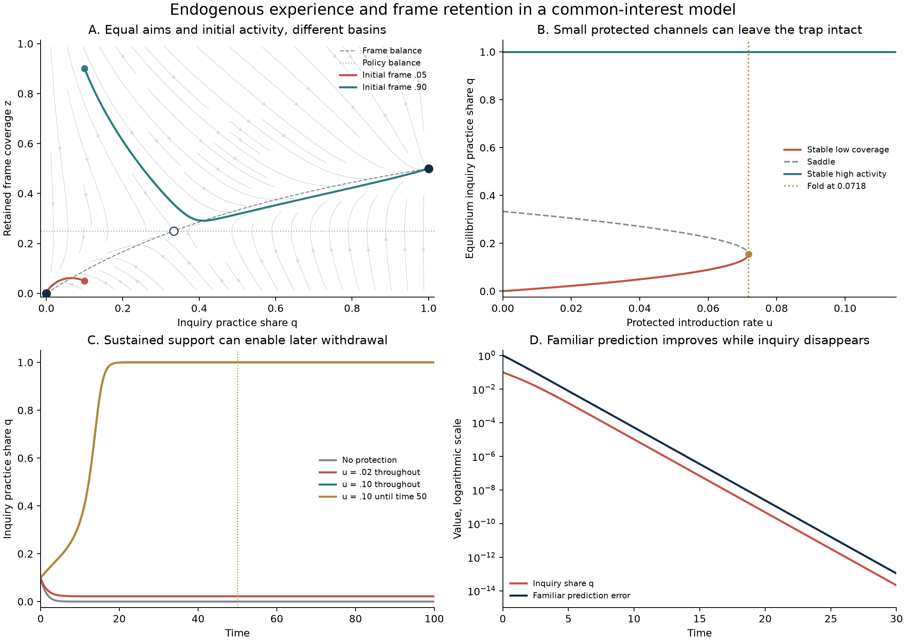

# Formation and revision of institutional frames

Research continuation, 5 October 2026. Ren asked, “with this new understanding, continue your next target”, after supplying the [situated correction discussion](../../experiments/evaluator-succession/SITUATED-CORRECTION.md). This cycle examines how shared purposes can coexist with the loss of a system's ability to recognize and establish a beneficial change. Ren supplies the conceptual direction; the equations, synthesis, and computations are AI-generated research assistance. Three research agents contributed mathematical review, prior-art comparison, and experimental design.

The principal result is conditional but substantive: a specified feedback between activity and retained understanding can have an attracting regime of exclusion, even when everyone has the same actual interests. A second result identifies when an endogenous route from understanding to new proposals destabilizes that regime. The actual value of an improvement and its capacity to establish itself enter different mathematical conditions.

This is an advance from an invariant exclusion to a derived attraction mechanism. It is not a universal theory of cognition or an empirical result about institutions. The model contains two representations chosen by the analyst, reliable diagnostic transitions, and fixed common purposes. An experiment that generates and tests candidate explanations is designed but has not been run.

The [research hub](../../_process/research/2026-10-04-integrated-evolution/README.md), [log](../../_process/research/2026-10-04-integrated-evolution/RESEARCH-LOG.md), and [claim register](../../_process/research/2026-10-04-integrated-evolution/CLAIMS.md) preserve this cycle and its predecessors.

## What must become endogenous

The previous modules explained selection, support renewal, observation limits, and functional replacement. Their actors largely received the relevant categories and conceivable responses from the modeler. The new target includes how experience changes those categories, and how the resulting understanding changes the experience subsequently produced.

For a minimal isolation step, keep common purposes fixed. Let an alternative practice have an actual common benefit that the prevailing representation cannot yet attribute to it. Everyone recognizes its immediate cost. Some members acquire a representation that can distinguish the omitted causal contribution. Familiar learning within the original representation and acquisition of this distinction are separate events.

This is a deliberately narrow form of frame change. Both practices are already available to the analyst, and the diagnostic transition is specified. The model does not invent an unforeseen practice, generate the content of a new concept, or decide which common purpose is legitimate. Those limitations cannot be removed by renaming an awareness variable.

## A common policy changes the experience that sustains its evaluation

Let \(q\in[0,1]\) be the share of institutional activity devoted to inquiry and the associated alternative practice. Let \(z\in[0,1]\) be the fraction of members retaining the expanded representation. The actual common marginal benefit is \(b\), and visible operating cost is \(c>0\). Initially assume \(b>c\). All members share the same actual interests; there are no private allocation stakes.

If evaluation averages the represented consequences across members, the represented common marginal return is \(bz-c\). The institution adjusts the log odds of the practice according to that return. Inquiry produces successful diagnostic experiences at rate \(\lambda q\) per member lacking the distinction; turnover, forgetting, or failed transmission removes it at rate \(\mu\). Thus

\[
\boxed{
\dot q=q(1-q)(bz-c),\qquad
\dot z=\lambda q(1-z)-\mu z,
}
\tag{1}
\]

with \(\lambda,\mu>0\). The second equation follows from nonnegative acquisition and loss transitions. The first is a declared collective revision protocol, not individual reproductive fitness or a theorem that every rational institution behaves this way. Returns and time are normalized to the policy-adjustment response rate.

Operating inquiry costs \(cq\) per unit time. Diagnostic exposure is consequently tied to paid activity through \(\lambda q=(\lambda/c)cq\). Recording a cost does not establish that a funding source or implementation authority exists. Here those remain available conditions.

The feedback is explicit: the institution's represented evaluation changes its activity; activity changes the experience that can enlarge the representation; retention determines whether that understanding lasts.

## Exclusion can attract despite a beneficial alternative

The square \([0,1]^2\) is invariant. At \(O=(0,0)\),

\[
J_O=\begin{pmatrix}-c&0\\\lambda&-\mu\end{pmatrix}.
\]

Both eigenvalues are negative. Therefore a neighborhood of partly active, partly informed states converges to exclusion. Closure was not merely made absorbing: nearby attempts can decay back toward it.

A second equilibrium is

\[
H=\left(1,\frac{\lambda}{\lambda+\mu}\right).
\]

It is locally asymptotically stable under the strict condition

\[
\boxed{\lambda(b-c)>\mu c.}
\tag{2}
\]

When (2) holds, the equilibria coexist with an interior saddle

\[
\boxed{q_s=\frac{c\mu}{\lambda(b-c)},\qquad z_s=\frac cb.}
\tag{3}
\]

The saddle's determinant is negative. A negative Dulac divergence rules out interior periodic orbits. The [mathematical audit](../../_process/research/2026-10-04-integrated-evolution/situated-frame-math-audit.md) supplies the stability, basin certificates, and boundary qualifications. In particular, \(q\ge q_s,z\ge z_s\), except the saddle itself, is a sufficient region for convergence to \(H\). The lower-left rectangle similarly leads to \(O\). Outside those rectangles the actual basin boundary matters.

For \(b=4,c=\lambda=\mu=1\), the saddle is \((1/3,1/4)\), and sustained activity retains frame coverage \(1/2\). At matched initial activity \(q_0=.1\), the calculations give:

| Initial retained frame coverage | Long-run activity | Long-run retained coverage |
|---|---:|---:|
| \(z_0=.05\) | \(q\to0\) | \(z\to0\) |
| \(z_0=.9\) | \(q\to1\) | \(z\to.5\) |

Actual initial net output \((b-c)q_0\) is the same. The trajectories differ in retained representation, not common purposes or initial activity. These are selected model illustrations, not an empirical comparison.

An initial prediction failed and is preserved. At the smaller \(q_0=.05\), raising \(z_0\) to .9 did **not** yield sustained activity; even \(z_0=1\) eventually lost it. In that latter calculation, activity reached only about .249 before declining. Initial understanding can disappear before the institution builds enough activity to maintain it. This does not prove that instruction generally fails: loss rate, proposal entry, retention, and the policy response all matter.

## Proposal origination changes local recoverability

Equation (1) only increases a practice already in use. Its exact-zero boundary hides an important institutional choice. Permit people who retain the distinction to originate an actionable proposal at rate \(\beta z\):

\[
\boxed{
\dot q=(1-q)\{q(bz-c)+\beta z\},\qquad
\dot z=\lambda q(1-z)-\mu z.
}
\tag{4}
\]

This extension concerns the beneficial case: \(\beta\) is the effective entry rate of a justified proposal, including whatever implementation access the equation presumes. It is not a command to adopt proposals regardless of their consequences.

Near complete exclusion,

\[
\begin{pmatrix}\dot q\\\dot z\end{pmatrix}
=
\begin{pmatrix}-c&\beta\\\lambda&-\mu\end{pmatrix}
\begin{pmatrix}q\\z\end{pmatrix}
+O(\|(q,z)\|^2).
\tag{5}
\]

Its eigenvalues are

\[
-\frac{c+\mu}{2}\ \pm\ 
\frac12\sqrt{(c-\mu)^2+4\beta\lambda}.
\]

Hence

\[
\boxed{
\beta\lambda<c\mu\ \Rightarrow\ \text{exclusion locally attracts};
\qquad
\beta\lambda>c\mu\ \Rightarrow\ \text{exclusion is unstable}.
}
\tag{6}
\]

This is a standard local stability criterion, applicable to any continuously differentiable system with this Jacobian at the equilibrium. Equality requires the higher-order terms. It is neither a newly discovered stability law nor a universal numerical measure of openness.

Its interpretation is useful: the conversion from activity to usable understanding and the conversion back to effective activity must together exceed the two losses for small seeds to amplify. A modest proposal route does not automatically erase the trap. In the example, \(\beta=.2\) still leads from a weak seed to exclusion; \(\beta=1.2\) destabilizes exclusion and the checked trajectory reaches sustained activity.

The value \(b\) of the improvement affects the nonlinear dynamics and the existence of a sustainable alternative, but drops out of this linear threshold. Under the stated update mechanism, a highly beneficial improvement can have a regime worth establishing while its smallest attempts fail to establish themselves. This distinguishes the value of a change from the reproduction of the conditions for making it.

## Protected trials can remove a basin but still have costs

Return to \(\beta=0\), and maintain an introduction rate \(u\ge0\) that protects some trials from the current evaluation:

\[
\dot q=(1-q)\{q(bz-c)+u\},\qquad
\dot z=\lambda q(1-z)-\mu z.
\tag{7}
\]

Protection introduces activity, not knowledge of a successful answer. Successful diagnostic experience must still occur. Under (2), interior equilibria solve

\[
\lambda(b-c)q^2+(\lambda u-c\mu)q+\mu u=0.
\]

The low stable equilibrium and saddle merge at

\[
\boxed{
u_{\mathrm{SN}}=\frac{\mu}{\lambda}
(\sqrt b-\sqrt{b-c})^2.
}
\tag{8}
\]

For \(0<u<u_{\mathrm{SN}}\), a stable low-activity regime persists. For \(u>u_{\mathrm{SN}}\), every initial state converges to \(H\) in this model. At equality a semistable equilibrium remains, so the strict margin matters.

For the numerical parameters, \(u_{\mathrm{SN}}\approx.0717968\). Maintaining \(u=.02\) yields a low attractor near \((q,z)=(.021873,.021405)\); maintaining \(u=.1\) escapes. One time unit of protection at .1 fails from the chosen initial state. Fifty time units puts the system inside the unassisted high basin, after which protection can be removed. Fifty is a checked sufficient duration, not the minimum or a real-world recommendation.

The absent-benefit control sets \(b=0\). For \(0<u<c\) and \(q_0<1\), equation (7) instead approaches \(q=u/c\), with recurring trial cost \(cq=u\) and no compensating modeled benefit. The exact boundary \(q_0=1\) remains invariant under this update rule and pays cost \(c\); it is an exception to the withdrawal claim. When successful evidence uptake is blocked, \(\lambda=0\), protected trials likewise cannot create retained coverage. At \(u=.1,c=1\), the checked interior start \(q_0=.05,z_0=0\) approaches \(q=.1\), with \(z=0\) throughout.

The parameter \(u\) is an introduction rate, not its own resource bill. The operating bill is \(cq\). The audit separately considers a maintained protection stock \(\dot u=\xi w-\delta_u u\), where resource flow \(w\) pays for protection. Sustained \(w>\delta_u u_{\mathrm{SN}}/\xi\), plus the trial budget and enforceable authority, is sufficient for eventual escape. That analytic extension was not included in the twelve simulated cases and still assumes an available funding rule.

In panel C the sustained and long-pulse trajectories nearly coincide because the system has already entered the high basin before protection is withdrawn. The experiment does not stop paying for the practice itself after withdrawing protection.

## Prediction can improve while the route to revision disappears

To separate familiar learning from frame acquisition, add the auxiliary error law

\[
\dot e=-r(1-q)e,\qquad r>0.
\]

Along exclusion trajectories, routine experience continues and \(e\to0\), while inquiry and retained frame coverage both vanish. This is a constructive compatibility result: accurate familiar prediction does not by itself certify capacity to revise the representation. The simple error law does not establish how actual machine-learning losses behave.

Conversely, permanent retention or independent diagnostic experience can change the outcome. The loss rate and the restriction tying new experience to the practice under evaluation are substantive assumptions. They must be measured and challenged in an application.

## Established foundations and the remaining contribution

The broad phenomenon has substantial prior art. [Fudenberg and Levine's self-confirming equilibrium](https://economics.mit.edu/sites/default/files/inline-files/sce.pdf) distinguishes beliefs supported by observed play from beliefs about unvisited contingencies. [Esponda and Pouzo's Berk–Nash framework](https://arxiv.org/abs/1411.1152) makes model fit depend on the evidence distribution generated by action. [Schipper's discovery processes](https://faculty.econ.ucdavis.edu/faculty/schipper/sceunaw.pdf) allow play to change what agents are aware of, within an analyst-specified collection of representations.

[Bala and Goyal's common-preference learning model](https://repub.eur.nl/pub/1362/eeb19960111120062.pdf) supplies an especially relevant precedent: a society can abandon an informative superior action after misleading public experience. Common purposes alone therefore do not distinguish the present contribution. The [prior-art audit](../../_process/research/2026-10-04-integrated-evolution/situated-frame-prior-art.md) records the assumptions and version-specific theorem qualifications.

The useful synthesis pursued here is the maintained institutional loop: producing experience, retaining a distinction, giving it standing in evaluation, originating a response, and supporting its implementation. The two-state model derives one mechanism and its countercase. The longer chain is not yet implemented, and mathematical originality has not been established.

## What was checked and what comes next

The [verification script](../../_process/research/2026-10-04-integrated-evolution/verify_situated_frames.py) and [saved results](../../_process/research/2026-10-04-integrated-evolution/situated-frame-checks.json) check equilibrium residuals, eigenvalue signs, the saddle-node condition, twelve trajectories with tighter-tolerance comparisons, the trial-cost accounting identity, and the Dulac calculation. The largest trajectory refinement discrepancy is about \(1.11\times10^{-9}\). The scientific figure was visually inspected. The failed initial escape prediction remains in both script and report; the matched-activity examples were selected after inspecting the basins.

The next discriminating experiment should replace the reliable binary frame transition with a bounded procedure that forms and tests candidate explanations, including false ones. Independently vary record retention, model expansion, admission of the same evidence, and actual enactment rights. Compare institutionally adjusted inquiry support with protected support, and require both present-hazard and absent-hazard controls with explicit costs. The [experiment design](../../_process/research/2026-10-04-integrated-evolution/situated-frame-experiment-audit.md) specifies these comparisons and what would count against the mechanism. It remains unrun.

For AI alignment, this motivates evaluating how AI affects the formation and retention of human reasons for correction, alongside agreement with present evaluations. It supplies no complete alignment criterion or universal ethical gradient. For the wider theory of 生生, it connects material renewal to the renewal of situated understanding: a practice can lose access to the experience through which its own conditions of continuation become intelligible. Whether that mechanism occurs in a particular human, biological, or AI system requires independently identified carriers, transitions, resources, and consequences.
