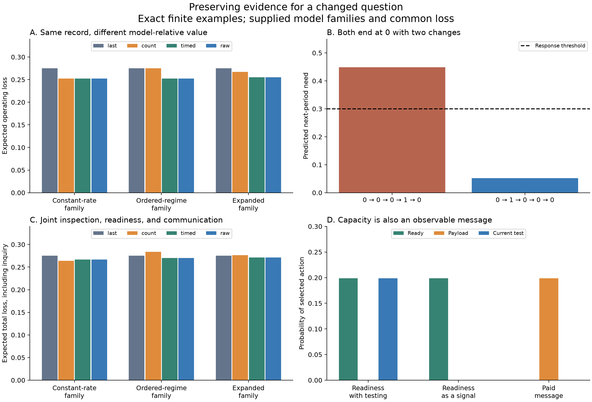

# Inherited evidence under model revision

Research continuation, 5 October 2026. Ren asked to continue, emphasizing the distinction between preserving historical evidence and preserving an old instruction. The new question is whether an inherited record retains the evidence needed to reconsider the model that gave the record its earlier meaning. The direction is Ren's; the mathematics, code, analysis, and prose are AI-generated research assistance, with three agents auditing the mathematics, implementation, and primary literature.

The central result is conditional but general in form: a summary can preserve everything needed for a decision under one model and still discard the evidence required by a later model. We demonstrate this with exact histories, then integrate paid archive inspection, maintenance of diagnostic capacity, communication, and successor action in one finite decision problem. The receiver learns from the institution's choices as well as its documents.

This does not prove that history never repeats. States and mechanisms can recur, including in these models. What recurrence does not establish by itself is that an old prescription remains appropriate. Moving from a historical observation to present action requires a model, an information context, feasible responses, and evaluative commitments. The [experiment record](../../experiments/revisable-inheritance/README.md) preserves the protocol, code, checks, numerical cases, and figure.

## One truthful summary can conceal opposite implications

Consider two observed histories:

| History | Final state | Total changes |
|---|---:|---:|
| 0 → 0 → 0 → 1 → 0 | 0 | 2 |
| 0 → 1 → 0 → 0 → 0 | 0 | 2 |

Suppose our original family of explanations assumes a constant rate of switching between zero and one. That rate is uncertain: it may be .05 or .45. For a complete, consecutive history with \(N\) transitions and \(K\) switches, its likelihood is

\[
P_h(x)=\tfrac12 h^K(1-h)^{N-K}.
\tag{1}
\]

The factor one half comes from an independent fair initial state. The two histories have identical likelihood under every constant switching rate. Final state, transition count, and known timing suffice for predicting the future within this family; the order of the switches adds nothing to that inference.

Now consider a different question: did the system begin slowly and become volatile, or begin volatile and become slow? Admit two models with equal priors. One has switching rate .05 for the first two transitions and .45 afterward. The other reverses those rates. The last regime continues into the next decision.

The first history strongly supports acceleration; the second supports deceleration. Their likelihood ratios are reciprocal:

\[
\frac{P(00010\mid\text{slow then fast})}
{P(00010\mid\text{fast then slow})}
=\left(\frac{171}{11}\right)^2.
\tag{2}
\]

After their common final zero, the next-period probabilities of state one are approximately **.44835** and **.05165**. If a response costs .3 and prevents a loss of one when state one occurs, the first history justifies responding and the second justifies restraint.

Nothing in either historical observation has become false. The expanded question makes a previously dispensable distinction consequential. An archive containing only “ended at zero, changed twice” cannot answer it, even with unlimited computation on that archive.

The integrated calculation also uses the union of the two constant-rate models and the two temporal models. Thus it includes an actual nested model expansion, rather than only switching between disjoint families. In that union, the same two histories predict approximately .44512 and .15041 and still recommend opposite responses at the .3 threshold.

## Sufficiency is relative to a model and a question

This gives a concrete meaning to model-relative preservation. With a known constant rate, the final state suffices for the specified prediction. With an unknown constant rate, switch count supplies evidence about that rate. With the admitted temporal models, counts from the early and late portions are needed. The full path contains these statistics, but it is not uniquely necessary: the two timed counts suffice for every model in the implemented union.

For the two temporal models alone, total count has exactly the same distribution under either order. It sums two slow and two fast Bernoulli transitions in both cases. The final state is also independent of the switch history because the initial state was fair. Consequently, final state plus total count contains no information about which regime is current.

The scope of a sufficiency claim depends on the acquisition design. Irregular observations require their gaps, and a history-dependent stopping rule can affect what must be conditioned on. Knowing the initial state can change what the endpoint alone reveals, but does not recover regime order from the total count in this equal-half example: the count already contains its parity. The benchmark retains the observation dates, length, and midpoint as known metadata. It does not imply that counts without provenance are sufficient for actual historical research.

The broader statistical point has established precedent. [Robert and colleagues](https://arxiv.org/abs/1102.4432) show that statistics adequate for parameter inference within models can lose information required for model comparison. The present finite construction illustrates that boundary; it is not a claim of a newly discovered sufficiency theorem.

## A general test for what a summary preserves

Let \(X\) be a finite historical record, \(T(X)\) a retained summary, and \(Y\) a specified future binary event. Under a declared joint model, define

\[
p_X=P(Y=1\mid X),\qquad
p_T=P(Y=1\mid T)=E[p_X\mid T].
\]

For response threshold \(\theta=c/L\), expected minimum operating loss satisfies

\[
\boxed{
L E[\min(\theta,p_T)]\ge L E[\min(\theta,p_X)].
}
\tag{3}
\]

The proof is conditional Jensen's inequality: \(p\mapsto\min(\theta,p)\) is concave. Richer information can be ignored, so free access cannot worsen the optimum when the model, feasible actions, and losses are held fixed. Acquisition and preservation costs can reverse the net comparison.

For a finite record space, equality for every threshold holds exactly when \(p_X\) is a function of the retained summary, except on zero-probability records. If two merged histories predict different probabilities, a threshold between them gives a strict decision loss from their merger. For a particular threshold, different predictions can still recommend the same action, so every omitted distinction does not automatically impose a cost.

There is also an elementary limit: a noninvertible summary cannot answer every conceivable question about which historical record occurred. This is not a command to preserve everything. It makes the scope of a preservation claim explicit: sufficient for which future questions, under which possible revisions, at what cost? Full records themselves can omit unmeasured context or be inadequate for unforeseen questions.

## Admission of a model is a separate operation

The expanded models in this study are supplied to the agents at handoff. The agents update their probabilities from retained evidence; they do not invent those alternatives. This distinction matters mathematically.

For a finite candidate family with positive likelihoods, a model assigned prior probability zero remains at zero under ordinary Bayesian conditioning. More data do not introduce it into the model's support. A change of support or another explicit revision mechanism is needed. A small positive prior is different: enough evidence may overcome it, although a finite history can fail to do so. This statement concerns excluded members of a finite model family, not individual points under a continuous prior.

Likewise, the archive format is fixed before the history is observed. We evaluate each format after the later model family is specified. Selecting the lowest-loss format using knowledge of that later family is only a conditional best-format benchmark. An attainable earlier choice would require a prior over future questions or another declared criterion. The experiment does not give the predecessor advance knowledge of a future intellectual discovery.

## Joint inquiry and succession without artificial forgetting

The previous cycle separated ongoing inquiry from a single evidence handoff because a naive integration would have lost information in public actions. This cycle joins archive inspection, readiness, messages, and a fresh diagnostic in one handoff problem.

The parties share the observed final historical state. The caretaker can pay to inspect whatever private statistic the chosen archive actually retained. Declining inspection leaves the correct prior conditional on public information; inspecting a total count cannot recover the erased order. A message channel can be opened before reading the private statistic, at a fixed setup charge.

After reading, the caretaker can maintain ready diagnostic capacity and optionally send the retained statistic. The successor sees readiness, the truthful payload or silence, and the public inspection and channel-opening choices. It knows the agreed prescription and computes the corresponding posterior. Ready capacity permits a paid perfect diagnostic of current need; otherwise rebuilding would finish too late for this one decision.

The episode budget covers retention, inspection, channel setup, readiness, payload, and any current diagnostic in every realized branch. Operating response has separate sufficient financing but enters total loss. No current outcome is visible before choosing a response. Observation technology, common purpose, truthful transmission, and a shared protocol remain assumptions.

The exact optimization is small. For each public final state, there are two possible responses to silent absent capacity and three to silent ready capacity. Enumerating these six receiver rules lets us minimize the sender's feasible readiness/message choice separately for each retained private type. A received complete statistic reveals the sender's type, so its best response is computed directly. This searches the entire declared finite policy class, with correct inference from the selected silent groups. The [mathematical memo](../../_process/research/2026-10-04-integrated-evolution/model-revision-inheritance-math.md) gives the formula and proof.

## Results with actual costs

The base costs are retention .003 per bit, inspection .01, channel setup .003, payload .01 per bit, readiness .015, and current diagnostic .16. The episode inquiry cap is .4; response costs .3 and untreated need costs one. Last state is the common public cue, so its acquisition is supplied to every arm rather than charged as differential archive expenditure.

The fixed-length formats use zero additional bits for the public-last-only case, three for total count, four for timed counts, and four for the full switch word. At this short length, timed counts are not cheaper than the raw word. Their inference and optimal loss are equal within all three declared families.

| Model family admitted at handoff | Public last state only | Total count | Timed counts | Full switch word |
|---|---:|---:|---:|---:|
| Constant slow or fast rate | .275000 | .263695 | .266695 | .266695 |
| Slow then fast or the reverse | .275000 | .284000 | .270370 | .270370 |
| Union of all four models | .275000 | .276348 | .271000 | .271000 |

Entries are minimum expected total losses, including the stated costs, conditional on each retained format. Under constant-rate uncertainty, the cheaper count summary wins. Under ordered-regime uncertainty, it cannot distinguish the regimes, so the caretaker optimally declines to inspect it; its .009 retention cost still has to be paid. This is why it performs worse than the public cue alone. It is a cost of retaining an unhelpful format, not evidence that correctly used information itself harms decisions.

The base public-last-only case happens to be indifferent between no response and buying readiness plus a diagnostic after public zero. Its .275 value is valid under either choice. A broader exploratory grid varies diagnostic, readiness, and payload prices rather than relying on that tie. All 144 format/family/price cases, 54 controls, and eight budget cases are retained. Some priced rich archives lose to the public cue alone; no universal preference for more storage is inferred.

These are exact finite-model expectations calculated numerically. They are not sampled trials, held-out institutional evidence, or estimates of historical recurrence. Unlike the previous cycle's calendar comparison, the present format comparison does not match actual spending: the different record sizes and joint choices have different prices, which are included in the objective. The free-information calculation separately verifies the sufficiency claims.

## Institutional choices can themselves carry the evidence

One result would be easy to misinterpret: the optimal base policies do not send payloads. They inspect records in some contexts and make readiness depend on what was found. The successor observes that decision and therefore receives information before using the available diagnostic. No-document transmission is not no-information transmission.

A stronger control forbids both payloads and the current diagnostic. Under the ordered family, with readiness costing .005, the caretaker reads the timed history only after public zero and buys readiness exactly when more switches occurred late than early. The successor treats when readiness is observed and otherwise does not. Readiness is now a paid binary message; its diagnostic capability is not exercised.

This attains full-information operating loss .25259328125. Including retention .012, expected inspection .005, and expected readiness .000849328125 gives total **.270442609375**, below the public-last-only value .275. The code's exact optimum agrees with this separate derivation. When sending a payload is cheaper than using readiness as a signal, another retained case uses a paid message instead.

This is not another proof of physical standby option value. It is a different mechanism: a visible investment conveys the predecessor's information. A model that ignores that channel could falsely attribute its benefit to equipment or falsely label the successor ignorant. Conversely, no readiness or communication rule based only on the uninformative total count can manufacture the missing regime-order information. It can still enable a new diagnostic, which is a genuinely new source of evidence.

The shared protocol makes this coordinated signaling possible. It does not establish that actual institutions interpret expenditure correctly, that signals remain honest under conflicting interests, or that an unexplained organizational expense should be treated as trustworthy evidence.

## What this contributes to the larger target

The study makes one part of the earlier integration concrete: paid inspection and diagnostic readiness jointly determine what a successor can learn from both records and visible institutional choices. Its mathematical ingredients have close precedents in sufficient statistics, finite team decisions, and [common-information control](https://arxiv.org/abs/1209.1695). The question of transferring an inference to a changed setting also has established formal treatments, including [Pearl and Bareinboim's transportability work](https://ojs.aaai.org/index.php/AAAI/article/view/7861). This experiment does not implement their causal transport algorithm.

For our program, the reusable constraint is that an institution's declared openness to model revision must be assessed against the distinctions its records and practices actually preserve. Accurate adaptation within the current model can coexist with a record that is inadequate for a later challenge to that model. That is a precise possible mechanism, not a demonstration that every institution tends toward it.

The next question is how an institution chooses what evidence to preserve before it knows which future interpretation will matter, and how an alternative model gains consideration without the analyst supplying admission. That requires explicit uncertainty over future questions or model changes, and a rule for challenging exclusions. Repeated succession, endogenous resource production, conflicting purposes, and the legitimacy of whose interpretations count remain open. No claim that history never recurs, that raw recording is always best, or that alignment is solved follows from these results.
