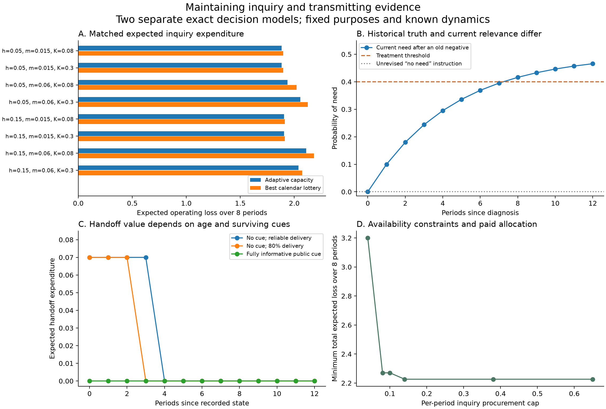

# Inquiry capacity and the inheritance of evidence

Research continuation, 5 October 2026. Ren asked, “next target please”, following the implemented candidate-discovery experiment. This cycle examines when to maintain inquiry across changing conditions, what negative findings contribute, and how evidence can reach a successor. The direction is Ren's; the mathematical development, code, analysis, and prose are AI-generated research assistance, with three agents providing mathematical, experimental-design, and primary-literature audits.

The strongest result is an exact separation between using inquiry now and preserving the ability to inquire later. A second result changes how we must model institutional memory: records are only one information channel. Actions, surviving capacity, and even a missing message can carry evidence. Treating every missing archive as a reset to ignorance can manufacture the very institutional failure a model claims to explain.

The [calculation record](../../experiments/recurrent-inquiry/README.md) contains the protocol, implementation, tests, exact expectations, complete comparisons, and figure. These are finite-model calculations, not sampled institutional evidence. The [mathematical memo](../../_process/research/2026-10-04-integrated-evolution/recurrent-inquiry-math.md) gives the derivations; the [prior-art audit](../../_process/research/2026-10-04-integrated-evolution/recurrent-inquiry-prior-art.md) identifies close established precedents.

## Why the implementation has two separate modules

The initial target combined endogenous inquiry support with paid archives and succession. During design, all three reviews identified the same information problem. If evidence changes a predecessor's decisions, a successor who sees those decisions may learn from them even when no document is preserved. Likewise, if an archive is selectively retained, its absence can be evidence.

An ordinary belief-state decision model also retains its sufficient posterior for free. Charging for a raw archive while leaving that posterior available does not establish that the archive maintains knowledge. Resetting the posterior without considering other visible signals does not repair the problem.

We therefore implemented two explicit modules. The first chooses tests, upkeep, and rebuilding dynamically while assuming free retention of the sufficient belief. The second prices a single evidence handoff and conditions correctly on all its specified cues, including silence. These are not yet one model of paid institutional memory over repeated succession. Keeping this boundary visible is part of the result.

## A system that chooses when to sustain inquiry

In the first module, a hidden binary need follows a known symmetric Markov process with switching probability \(h\). A response costs \(c\) and avoids loss \(L\) if need is present. Without response, need produces loss \(L\); without need it produces no loss. The common purpose, available response, and interpretation of need are supplied.

The controller's belief \(p\), before another observation, evolves as

\[
T(p)=h+(1-2h)p.
\tag{1}
\]

A diagnostic costs \(k\). With probability \(s\), it reveals the current state without error; otherwise it returns an explicit uninformative failure symbol. Thus a reliable negative finding and a failed investigation are different outcomes. This diagnostic is an assumed technology for answering a known question. Unlike the preceding experiment, this module does not construct new candidate explanations.

Testing requires ready capacity. Keeping it ready for the next period costs \(m\); rebuilding absent capacity costs \(K\) and takes one period. A per-period inquiry procurement cap applies to actual testing and upkeep or rebuilding in every branch. Operating response costs are financed separately and still counted in the objective. Unspent allowance is not expenditure and cannot be banked.

The controller receives no free signal from realized untreated loss or a state-dependent balance. Those consequences are available to the evaluator only. If such feedback were visible, it would be an additional observation channel and the present filtering equations would need to change.

Let \(g(p)=\min(c,Lp)\), let \(z\) indicate ready capacity, and put \(a_1=m,a_0=K\). With \(n\) periods left and zero terminal value, the implemented Bellman recursion is

\[
V_n(p,z)=\min_{d\in\{0,1\},\ d\le z,\ kd\le B}
\left\{kd+\mathbb E_q\left[
g(q)+\min_{v\in\{0,1\}:\ kd+a_zv\le B}
\{a_zv+V_{n-1}(T(q),v)\}\right]\right\},
\quad V_0=0.
\tag{2}
\]

Here \(d\) buys a diagnostic and \(v\) buys next-period capacity. Without testing, \(q=p\). With testing, \(q\) is zero or one with probabilities \(s(1-p)\) and \(sp\), and remains \(p\) with probability \(1-s\). Allocation therefore responds to experience rather than following a supplied calendar. The optimizing rule and the total procurement allowance remain supplied; this is not yet endogenous production of resources or formation of institutional purposes.

## Negative evidence can be the source of value

For one decision, perfect information reduces expected operating loss from \(g(p)\) to \(cp\). Its gross value is

\[
\Delta(p)=\min(c,Lp)-cp
=\begin{cases}(L-c)p,&p\le c/L,\\c(1-p),&p\ge c/L.\end{cases}
\tag{3}
\]

If the current response would be to act in every case, the benefit comes entirely from negative diagnoses that justify avoiding an unnecessary action. A positive finding leaves the action unchanged. For the implemented diagnostic with an independent failure probability, one-period inquiry pays exactly when \(s\Delta(p)>k\), subject to feasibility.

This does not make every negative result valuable. If the current action is already justified restraint, a negative result may have no immediate decision value. Irrelevant evidence and excessive testing costs can also make inquiry wasteful. Nor is maximizing the number of positive findings, the amount of information, or the testing rate equivalent to minimizing this loss.

## Keeping an unused capability can be strictly worthwhile

After a posterior \(q\), retaining ready capacity is strictly worthwhile when it is feasible and

\[
\boxed{
m<V_{n-1}(T(q),0)-V_{n-1}(T(q),1).
}
\tag{4}
\]

The right side is the future loss avoided by having inquiry available. It includes the alternative of rebuilding later and its delay. It need not equal the value of conducting a test today. Rebuilding uses the corresponding comparison with \(K\); when rebuilding is more expensive, keeping an existing capability and establishing an absent one can have different thresholds.

A complete two-period example starts with a certain negative finding and ready capacity. Today need is absent, so testing today is strictly wasteful. Tomorrow need appears with probability .2. Set \(L=10,c=4,k=1,s=1,m=.1\). If capacity lapses, tomorrow's best action has expected loss 2. If it is maintained, tomorrow's diagnostic and contingent response cost \(1+.2(4)=1.8\). Including upkeep gives 1.9. Rebuilding tomorrow arrives too late to help that decision.

Thus paying .1 today for a capability that is not used today improves total expected loss by .1. A higher upkeep cost of .3 removes the advantage. This is an exact conditional counterexample to judging capacity entirely by present use. It is not a requirement to preserve every institution or conduct continuous investigations. Last-period dismantling in a zero-terminal-value model also supplies no general evidence of degeneration.

## Adaptive support compared at the same expected expenditure

We calculated eight exploratory eight-period cases varying switching rate, upkeep, and rebuilding cost. Every case uses the same known diagnostic and response options. The baseline is the best capacity calendar chosen before any diagnostic result, while its testing and responses remain adaptive.

A second comparison is stricter: a linear program optimizes over all 128 capacity calendars, allows an ex ante lottery among them and adaptive randomized testing, and imposes the adaptive solution's expected inquiry expenditure as its budget. Both sides obey the same per-period procurement cap. This matches expected inquiry expenditure, not expenditure on every realized path or total operating expenditure.

One illustrative case has \(h=.05,L=1,c=.4,k=.08,s=.8,m=.06,K=.08,B=.65\):

| Policy class | Expected inquiry expenditure | Expected operating loss | Total expected loss |
|---|---:|---:|---:|
| Adaptive capacity decisions | .288376 | 1.937975 | 2.226351 |
| Best calendar lottery at the same inquiry expenditure | .288376 | 2.021340 | 2.309716 |
| Best calendar without that expenditure match | .316000 | 1.988091 | 2.304091 |

In all eight selected cases, the matched expected-expenditure constraint binds and adaptive capacity yields lower operating loss. The differences range from .007655 to .083365. These are computed expectations in selected models, with no sampling error or generalization claim. A weak advantage follows from policy-class inclusion; the strict differences quantify when conditioning capacity on evidence matters in these examples.

Controls limit the interpretation. There is no adaptive advantage when each period's need is independent of the previous period, when the diagnostic is uninformative, or when upkeep and rebuilding exceed the available cap. A stationary but initially unknown state still shows an advantage: diagnoses can fail, so capacity can be maintained until information arrives and then retired. A stationary, perfectly reliable diagnostic control added during review removes that difference: both policy classes achieve 1.68. Stationarity alone does not make inquiry worthless. Some grid cases optimally rebuild rather than keep unused capacity; more maintenance is not the objective.

## Preserved evidence and an unrevised instruction diverge

After a certain negative finding, the probability of current need after \(j\) transitions is

\[
\boxed{p_j=\frac{1-(1-2h)^j}{2}.}
\tag{5}
\]

The statement that need was absent when measured remains true. Its implication for present action changes. With \(h=.1\) and response threshold \(c/L=.4\), the old negative by itself ceases to recommend restraint at age eight. At age seven \(p_j\approx.3951\); at age eight it is approximately .4161.

A separate illustrative comparison starts from known absence but gives one controller the mistaken transition model \(h=0\). Over twelve periods in the actual \(h=.1\) world, that controller incurs expected loss 3.671799, versus 2.572645 for the controller using the supplied correct model and optimal inquiry. This comparison changes model knowledge as well as subsequent spending; it is not an isolated causal estimate of maintenance. Its purpose is to expose the difference between a truthful old observation and an unjustified assumption that nothing can change.

## A successor learns from what survives and what is missing

In the second module, a predecessor knows an earlier binary state. A successor sees a public cue and any delivered truthful message. The cue's reliability, message rule, delivery probability, elapsed time, and environmental transition law are known. Establishing the handoff channel costs \(f_0\), even when no payload is sent; each attempted message costs \(f\). Channel activation is chosen from public information before private-state-dependent disclosure.

The successor updates from the public cue and the message or its absence. A delivery failure is indistinguishable from intentional silence, so both causes enter that posterior. The successor cannot inspect the sender's private attempted-message bill; that would add another signal. The calculation enumerates four disclosure rules per cue. A concavity argument in the mathematical audit shows that hidden randomization between sending and not sending cannot improve on these deterministic rules in this particular one-step team problem.

With reliable delivery, sending only one of the two states communicates both: silence identifies the other. Let \(q\) be the probability of the old state being one, conditional on the public cue. Let \(D_j(q)\) be the operating-loss reduction from knowing the old state at its current age. The exact condition for opening the reliable channel is

\[
\boxed{D_j(q)>f_0+f\min(q,1-q).}
\tag{6}
\]

The rarer state is sent. This exploits an agreed, reliable omission channel whose establishment cost has been included. It does not imply that actual missing records are reliable negative or positive evidence; unavailable senders, unknown conventions, and delivery failures can change the inference.

For prior .5, no informative public cue, fresh evidence, \(L=1,c=.4,f_0=.02,f=.1\), acting without communication costs .4. Selective reliable communication costs .27 in total: .2 operating loss and .07 expected communication expenditure. With delivery reliability .8, the optimal rule sends the negative state, and total expected loss rises to .31. Silence then suggests a positive state but no longer establishes it with certainty. If the public cue already reveals the state, no paid communication is needed and expected loss is .2.

The same record can also lose decision value while remaining statistically informative. With a stationary prior, its gross value after age \(j\) is

\[
D_j(1/2)=\frac{L}{4}\left[(1-2h)^j-\left|1-\frac{2c}{L}\right|\right]_+.
\tag{7}
\]

In the priced reliable example, paying for transmission stops being worthwhile at age four; its gross action value reaches zero at age eight. This is one decision under known dynamics. It gives no warrant for destroying records that could serve other people, future questions, accountability, or revision of the assumed model.

## Relation to established mathematics and the next target

These results use established decision theory. [Smallwood and Sondik](https://doi.org/10.1287/opre.21.5.1071) provide the finite-horizon partially observed control foundation. [Reisinger and Tam](https://arxiv.org/abs/2201.07908) study paid observation decisions. A particularly close predecessor is [Nayyar and colleagues' energy-harvesting sensor model](https://arxiv.org/abs/1205.6018), which joins shared objectives, resources for future communication, and inference from nontransmission. No originality is claimed for the generic principles or the Bellman equation.

For our research program, the advance is a set of explicit distinctions and checked mechanisms: current use versus future availability, negative evidence versus failed inquiry, historical truth versus current relevance, and document transmission versus all surviving information. The inquiry allocation comparison also survives matching expected inquiry expenditure in the selected cases.

The next integration must derive what successors see from the institution's own earlier actions. It must charge maintenance and communication, preserve the correct joint likelihood of public traces and private evidence, and allow an old model to be challenged rather than merely predict under a known switching rate. The [common-information approach to decentralized control](https://arxiv.org/abs/1209.1695) supplies a relevant technical starting point. Supplying an optimal coordinator is a benchmark; it does not explain whether actual institutions reproduce its decision rule.

The wider north star remains how the means of understanding and revision are themselves reproduced or lost. The present calculations do not yet explain changing purposes, unrestricted representation formation, or the legitimacy of whose reasons count. Fixed shared loss is an isolation device here. Its optimum is not a universal ethical gradient or a completed alignment theory.
