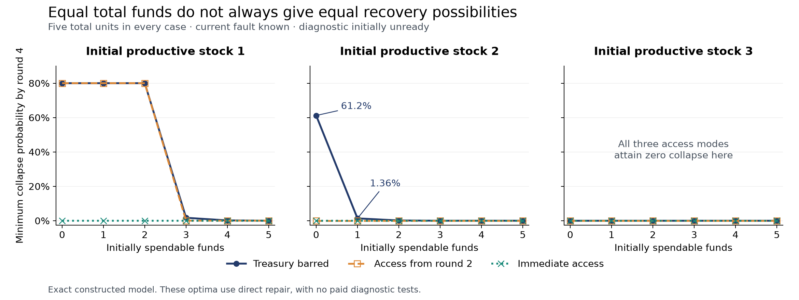

# What a useful account must preserve

Second research cycle, 5 October 2026, Asia/Bangkok. Continuation of [Investigating the full picture](full-picture-synthesis.md).

**We now have a precise negative result, a positive theorem, and a consequence for model revision.** Equal total resources need not imply equal possibilities for correction—even when the available first actions are identical. Under explicit conditions, free immediate pooling restores that equivalence. A description adequate under one access regime can become inadequate when the permitted future changes.

This advances the larger investigation by identifying a distinction that sometimes must be retained, together with conditions under which it can safely be removed. It does not establish universal completeness. These are exact results about a constructed process, with independent computational checks; they are not measurements of human institutions.

## The question we actually tested

The earlier synthesis proposed testing whether a coarse description preserves attainable recovery. Here we isolated one omission: the location of funds. Everything else relevant to the existing process—productive stock, diagnostic readiness, fault belief, remaining time, and access regime—was retained.

Two accounts hold the resources: spendable cash and a treasury. The three access regimes are permanent exclusion from the treasury, free immediate access before each round, and access beginning in round two. We ask whether replacing the two balances by their sum preserves the outcomes available to an informed controller.

“Available” concerns admissible policies under the supplied information and payment rules. A controller cannot pay today's bill with tomorrow's income. We compare possibilities, rather than assuming that every controller chooses well or that a particular institution implements the calculated policy.

The protocol was frozen locally before the main numerical run. The two-round example below was derived before that run; it is an analytical witness, not held-out evidence. The full protocol, exact outputs, implementation, proofs, and audits are preserved in the [reproduction bundle](access-study-evidence.zip).

## Equal wealth and equal first actions, different futures

Consider a system with productive stock two, a fault known to be present, and an unready diagnostic. It has five total units of funds and two rounds remaining. Repair costs three. Compare these two allocations while treasury access is barred:

| Initial condition | Spendable cash | Treasury | Total |
|---|---:|---:|---:|
| A | 0 | 5 | 5 |
| B | 1 | 4 | 5 |

Neither can repair or rebuild the diagnostic immediately. Both have exactly the same sole first action: proceed without a test or repair.

Damage occurs in the first round with probability 0.8. On that branch, productive stock falls to one and earns two units of income. A now has two spendable units; B has three. The difference that could not change their first action now determines whether repair is affordable.

The fault remains present next round with probability 0.95. Without repair, second-round damage therefore has probability

\[
0.95(0.8)+0.05(0.1)=0.765.
\]

That damage collapses the stock-one system. A cannot afford to prevent it, so its minimum two-round collapse probability is

\[
0.8(0.765)=0.612.
\]

B can repair after the adverse first round. Repair clears the fault and adds productive capacity; even the remaining healthy-state damage cannot then reduce stock to zero. Its minimum collapse probability is zero. If the first round has no damage, both reach stock three and survive the remaining round without repair.

| Result under the selected collapse-minimizing policy | A | B |
|---|---:|---:|
| Collapse probability | 61.2% | 0% |
| Expected paid expenditure | 0 | 2.4 |
| Expected repairs when the fault target is absent | 0 | 0.04 |
| Probability terminal stock is below two | 61.2% | 8% |

The last row matters: preventing collapse does not guarantee the stronger, stipulated recovery condition. Equal initial wealth also does not mean equal spending or burden. B's additional possibility is used to fund repair, and the tradeoffs remain visible.

**An identical present action menu does not certify an identical future action process.** Income can move two apparently similar states to opposite sides of a later payment threshold. A model that merges them must either retain that distinction elsewhere or accept that it cannot answer this recovery question exactly.

## What the larger finite calculation adds

The main study used four rounds, three initial stock levels, three fault beliefs, six partitions of five units, and the three access regimes: 162 starting conditions. Each was optimized under seven declared linear combinations of four outcomes:

- probability of collapse;
- expected paid expenditure;
- a limited burden measure: repairs when their fault target is absent, plus 0.05 per paid test;
- probability terminal stock is below two.

The weights are probes of what is attainable, not an endorsed social objective. The burden measure is not total harm: a repair whose fault target is absent can still improve productive stock. No ethical ordering follows from choosing these coordinates.

All 1,134 main optimizations used exact rational arithmetic. For each stock, belief, and weighting, we checked whether changing the account partition changed the minimum weighted outcome. That gives 63 comparison groups per access regime.

| Access regime | Groups with unequal minima across same-total partitions |
|---|---:|
| Treasury permanently barred | 24 of 63 |
| Access begins in round two | 15 of 63 |
| Immediate free access | 0 of 63 |

These counts describe the constructed grid, not frequencies in the world. One unequal minimum proves that the two attainable outcome sets differ. Agreement on seven probes alone cannot prove equality of entire sets. The immediate-access equality has a separate structural proof below.

*All curves hold initial total funds at five, the initial fault as known present, and diagnostic readiness at zero. Small positive risks near the horizontal axis should not be read as exactly zero.*

For initial stock two with a known fault and barred treasury, the four-round minimum collapse probability falls from **61.2%** at zero spendable cash to **1.36%** at one, **0.136%** at two, and **zero** at three or more. Immediate access and access from round two both attain zero for this particular stock-two slice.

Stock one exposes the deadline. With fewer than three spendable units, access beginning next round still leaves an 80% chance of collapse now. Immediate access reduces the four-round optimum to 0.017%, but does not eliminate all risk: rare adverse sequences can exhaust the available repair budget. Stock three buffers the difficulty sufficiently that all three regimes attain zero collapse on this slice. Access can therefore bind, arrive too late, or make no difference, depending on the physical state and horizon.

In all 378 matched comparisons, the minimum weighted outcome under immediate access was no worse than with delayed access, which was no worse than with permanent exclusion. Under the stated policy and transfer assumptions, this weak ordering follows from the ability to emulate a more restricted policy. It does not imply that every coordinate of the selected outcome improves. For example, a lower-risk policy can spend more.

## When total resources really are enough

Let cash be \(b\), treasury \(t\), total \(N=b+t\), and the cash cap \(C\). Free maximum transfer before acting produces the canonical allocation

\[
\nu_C(b,t)=\bigl(\min(C,N),\max(N-C,0)\bigr).
\]

Every same-total partition reaches the same allocation. After paying a total bill \(c\) and receiving income \(I\), total resources satisfy

\[
N'=N-c+I.
\]

This gives an exact operational reduction if the following conditions hold:

1. Transfers are guaranteed, free, immediate, and have no other effects on outcomes or observations.
2. Every complete round's bill, including every possible diagnostic branch, fits below the cash cap. Bills are nonnegative and precede income.
3. Overflow is retained without loss, and account location has no independent effect on physical dynamics, observations, or the outcome being assessed.
4. The retained state includes the information needed to predict the process. The omitted account split supplies no extra hidden-state information.
5. Controllers have enough allowed memory to implement the policy correspondence; here sufficient-belief memory is supplied freely.

The study has cap eight and maximum round bill six. Once normalized, same-total states have the same feasible operational prescriptions, the same observation and physical transition laws, and the same next-total rule. Induction gives the same attainable operational outcome laws at every finite horizon under these assumptions.

There is a stronger policy argument. Suppose transfers are optional and a controller deliberately leaves some money in treasury. A controller in the normalized system can keep a virtual record of those balances and make exactly the same operational choices. Its actual cash is sufficient for every bill the virtual controller could pay, and extra spendable funds do not force extra spending. Conversely, the optional-transfer controller can always choose maximum transfer. This establishes equality of attainable operational laws, including inefficient choices, rather than only equality of optimal scores.

The correspondence preserves physical outcomes, observations used for the operational task, spending, burden, and total funds. It does not preserve individual account histories or transfer events. A literal action such as “transfer five” may exist in one account allocation and not another. The result concerns an executable procedure—make funds spendable, then operate—with declared access to observed account balances.

Transfer fees, delays, account-specific obligations, signaling, losses, or insufficient controller memory can break the argument. The theorem identifies the work done by its assumptions; it does not assert that real resources are always interchangeable.

## Adequacy depends on what may change

The same process admits different sufficient financial descriptions:

| Admitted access process | A sufficient financial description for these operational outcomes |
|---|---|
| Treasury remains barred forever | Spendable cash |
| Free immediate pooling every round | Total funds |
| Barred now, pooling from next round | Spendable cash and total funds |

These are sufficient descriptions, not claims of global minimality. A bookkeeping question still needs the treasury balance even when it can never finance repair. A very short horizon or a restricted outcome can allow further simplification.

The most consequential result concerns changing the model's admitted future. Take two systems with stock two, a known fault, zero spendable cash, and two rounds remaining. Give one treasury zero and the other treasury three. Under permanent exclusion, both have minimum collapse probability 61.2%; the treasury can safely be omitted from this operational model.

Now allow access beginning next round. Their current cash and first actions remain identical. After an adverse first round, the system without treasury has only two spendable units and cannot repair. The other can pool its resources and pay three. Their minimum collapse probabilities become 61.2% and zero.

**The recovery question stayed fixed; the admitted future mechanism changed. A previously sufficient description stopped being sufficient.** This is a concrete instance of the earlier claim that sufficiency is relative to a model family. It does not imply that every detail must always be retained. It says that a claim of irrelevance needs a scope: irrelevant to which questions, under which possible changes?

This also keeps two changes distinct. Releasing access during a modeled trajectory is a world event. Extending a model that assumed permanent exclusion to include later release is a revision of the model family. Our two-model comparison is not yet a model of an agent discovering or negotiating a new access rule.

## Controls, verification, and a useful negative result

Removing earned income eliminates the two low-cash states' distinction: with barred treasury, both cash-zero and cash-one cases then have four-round minimum collapse probability **79.18345%**. This verifies the role of the production-to-payment bridge in that contrast. It does not eliminate every access effect; greater initial liquidity or immediate access can still help.

The known-safe control starts healthy, with fault onset and healthy-state damage both removed. No repair is needed, and the selected failure-minimizing policies have zero failure, expenditure, and burden. The four operational outcome coordinates also agree across permission regimes in the initially all-liquid base cases in this tested horizon; individual terminal account balances can differ. That agreement is a checked result, not a general theorem: later income can overflow into treasury and become inaccessible.

The study also ran initially ready and uninformative-diagnostic controls. **None of the 1,134 selected main optima uses a paid diagnostic test.** The current result is therefore about access to direct repair. It does not show that inquiry is useless, establish the value of maintained diagnostic capacity, or reproduce the inherited simulator's different objective. A later test of inquiry must make discrimination matter under an explicitly justified scenario, rather than relabeling these repair results.

An independent implementation enumerated hidden faults, signals, damage, and public observations, then solved the small decision problems without reusing the main transition helpers. It matched 4,536 one- and two-round optima, reevaluated their selected policy vectors, and matched 18 targeted four-round optima. Additional checks covered kernels for all control configurations across 5,184 audited states, 1,134 saved main score and ledger identities, the reported group counts, and 378 access-order comparisons. No discrepancy was found. Separate algebra checks covered 53,228 banking identities and 73,130 payment-prefix cases.

All eight numerical and audit scripts also ran successfully from the packaged copies; the four main deterministic result files reproduced byte for byte. These are useful error checks, not external replication. The independent solver did not rerun every four-round optimum. No longer-horizon result, demonstrated transfer to a different physical or institutional implementation, or field result is claimed.

## Relation to established work

Hard resource feasibility under partial observation already has a substantial mathematical treatment. Brázdil and colleagues distinguish a resource constraint along an execution from an expected-cost objective and explicitly represent observable resource levels. Our particular account-access example does not invent resource-constrained planning. [Primary paper, sections 3–4](https://arxiv.org/pdf/1602.07565).

Controller abstraction also has established implementation requirements. Reissig, Weber, and Rungger's feedback refinement work makes explicit that a transferred controller must use information actually available at its interface. That motivates the observed-balance adapter here; it does not by itself prove equality of our stochastic outcome laws. [Primary paper, sections IV–VI](https://arxiv.org/pdf/1503.03715).

No priority claim is made. The contribution to this investigation is the explicit connection between a failed resource summary, its repair conditions, and the revision of what counts as relevant state.

## What this lets us say next

The larger account can now make a sharper claim: **a useful description preserves the distinctions required by the future processes and questions it undertakes to explain. Its boundary of adequacy can itself change.** Here that statement has a specified example and a conditional positive theorem, rather than only an analogy.

There may be indefinitely many further consequences and applications to uncover. The pooling proof already covers infinitely many model instances through its parameters and every finite horizon satisfying its assumptions. That is mathematical generality within a declared class; it is not evidence that one account already explains every phenomenon, nor a proof of infinite-horizon control under additional criteria.

The next major evidential gap remains the [transport test](next-test.md): freeze the mechanism and measurement rules, then test whether independently measured properties of a second implementation predict its recovery outcomes. The later recognition-and-feedback stage also remains unrun. More elaboration within this simulator cannot substitute for that test.

Files: [claim and decision record](research-record.md), [complete proof and boundary cases](access-proof.md), [reproduction bundle](access-study-evidence.zip), [figure PNG](access-outcomes.png), [figure SVG](access-outcomes.svg).
