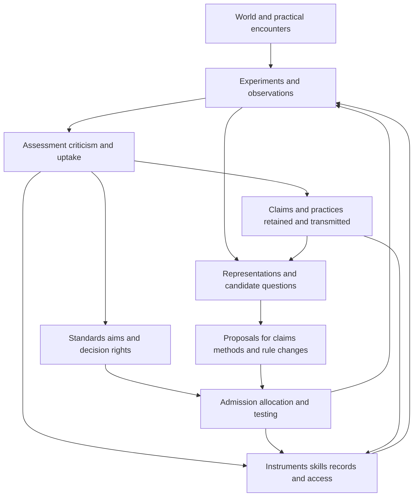

# Mechanisms of scientific change

This investigation develops Ren's proposed account of science as a situated activity that can transform the conditions of its own continuation. It extends the earlier [scientific principles investigation](scientific-principles-investigation.md) and [first account of scientific change](theory-of-scientific-change.md).

The central proposal is that **scientific change occurs through interaction between the production of claims and the production of the means to formulate, investigate, assess, and transmit claims**. Instruments, concepts, records, skills, rules, resources, and authority are parts of the causal explanation. Their organization affects which encounters can become knowledge, and inquiry can alter that organization.

This gives us a coherent architecture and several explicit mechanisms. It does not establish a complete empirical theory of all science. The stronger achievement in this continuation is a working example of an investigator revising its own search rule from experience, together with conditional results about blocked discovery, changing testability, and costly recovery. Primary cases show where to look for these mechanisms in practice. They also expose close antecedents in existing philosophy and history of science.

## The object of explanation

A scientific community has at least three distinguishable products. It produces **claims**, including explanations and predictions. It produces **capabilities**, including instruments, trained people, usable records, and new representations. It produces **rules and commitments**, including procedures for allocating attention, admitting evidence, evaluating work, and deciding which purposes matter.

These products need not improve together. A group can publish more while losing access to a distinctive instrument. It can acquire better measurements without giving those measurements standing in decisions. It can improve a prediction while retaining categories that conceal another relationship. It can change what it calls success while making little progress on the previous aim.

These are proposed possibilities, not general verdicts about institutions. To explain a case, identify the separate changes and their causes. Claims, capabilities, institutional credit, and legitimate purposes must not be treated as interchangeable measures of success.

The unit of analysis also changes with the question. A scientist can revise a belief without a laboratory changing its standards. A field can change method because existing scientists learn, because newcomers enter, because some laboratories expand, or because journals change what they accept. These mechanisms can produce similar aggregate curves while requiring different interventions.

Three causal processes consequently deserve separate names: **learning** changes an investigator's expectations or procedures through experience; **construction** changes what can be represented or done; **selection and transmission** change which investigators, practices, and arrangements persist or spread. A full account connects them without assuming that whatever spreads is what has been best learned, or that having learned something makes its implementation feasible.

## How the processes connect

Every arrow denotes a question about a mechanism. No arrow guarantees improvement. A model becomes explanatory when it states the available observations, permitted operations, decision procedures, costs, delays, and external inputs. For example, resource withdrawal can reduce calibration activity; reduced calibration can make later errors harder to identify. Both links require evidence. Labeling a later failure as deficient capacity does not establish either.

The original structure S=(X,T,R,O) can contain these processes. Merely assigning them to that structure does not derive their dynamics. A useful local model specifies who observes which part of the state and how each action changes both the target of inquiry and the investigator's future opportunities. The investigator must act on its accessible history, not on the analyst's hidden knowledge of which theory is true.

Several transitions should remain separate: generating a proposal, admitting it for investigation, producing evidence, assessing the result, authorizing a change, and propagating that change. A useful proposal can fail at any of these stages. Successful propagation can also occur without adequate evidence.

## Questions are constructed through encounters and possibilities

A question requires more than an unknown answer. It involves a distinction that can be represented, a reason to attend to it, and some conception of how an answer could matter. An investigator can construct a question through a failed expectation, a new instrument, a practical difficulty, a comparison, an analogy, or a previously unnoticed relationship. None requires that a currently accepted statement first be refuted.

Our earlier two-feature example remains useful. An outcome occurs when two binary features differ. Each feature by itself is uninformative; the correct aggregate frequency remains one half. A representation of their joint relation enables a finer question and a perfect prediction in the noiseless case. The old aggregate truth survives.

There are consequently several different boundaries to investigate. A distinction might be physically measurable but not represented. It might be represented but not proposed. A proposal might exist but receive no trial. Evidence might be produced but remain inadmissible. A recognized result might fail to change practice because no one has the resources or authority to act.

These distinctions prevent an explanation from becoming a vague claim about resistance to novelty. They also show why more data is sometimes helpful and sometimes irrelevant. If the existing records already contain the relationship, a different analysis can suffice. If the relevant relation was never recorded, computation cannot reconstruct it without additional assumptions or new observations.

## Concepts involve more than new names

A conceptual change can split a category, combine previously separate features, distinguish a process from its measurement, or connect phenomena through a new relation. A model can demonstrate some of this by showing which operations become possible after the representation changes. Merely generating a new symbol does not establish conceptual understanding.

For scientific use, a proposed concept needs a developing connection to observations, manipulations, explanations, or other concepts. Those connections can be partial and revisable. A new predictive partition does not automatically identify a causal mechanism; a successful manipulation does not settle every interpretation of its object.

A particularly important transition occurs when something previously treated as a dependable instrument becomes a research problem, or an earlier research result becomes a dependable tool. The roles of background condition and object of investigation can change. This makes reflexive inquiry concrete: investigators can investigate their own instruments, records, classifications, and methods.

This suggests a mechanism for cumulative reach. A stabilized result can become an operation that later investigators use without repeating every step of its construction. Their investigations can then expose limits of that operation, reopening parts of the earlier work. To test this account in a field, trace which later projects actually depend on which earlier operations and what happens when a dependency is removed or replaced. Counting citations alone would not establish that functional dependence.

Our finite-feature calculations model recombination within a supplied grammar. Instrument invention would require actions that change later observation channels, along with a mechanism for learning what the new instrument measures. Neither introducing a variable called novelty nor allowing an unrestricted list of possible concepts supplies that mechanism.

Novelty to an investigator can be modeled even when the analyst specifies the wider possibility space. That is a useful scope, but it does not amount to predicting all future conceptual inventions. A theory of discovery can explain conditions and distributions of transitions without deducing the exact content of every future discovery.

## Standards can become objects of inquiry

Standards do several different jobs. A rule can determine whether a project gets a trial, whether an observation counts as evidence, whether a claim is accepted, or whether a person receives credit. These rules can differ even inside one institution. Changing an admission rule is not equivalent to changing an evidential threshold, a reward system, or the ultimate purposes of research.

One proposed route for evidence-assessed revision has five parts: a way to encounter consequences of the existing rule; a way to propose alternatives; a feasible trial of an alternative; a comparison whose result has not already been fixed by the incumbent rule; and an authorized way to enact the revision. Each part has costs and can fail. Standards can also change through imitation, coercion, personnel replacement, or adoption without a trial. Those are different causal routes; the five-part process is not a description of every historical change.

This does not require that every proposal bypass checking. It requires distinguishing permission to explore a rule from permission to accept whatever an exploration reports. A limited trial can examine an alternative without granting its conclusions unrestricted authority.

The new implementation below makes this distinction operational. Its fixed prediction objective and finite edit grammar are stated rather than attributed to autonomous invention.

The learner begins with the earlier rule: investigate feature pairs only after a single feature improves the training fit. A syntactic edit deletes that prerequisite. This edit does not remove the demand for final improvement or the requirement for fresh local validation of a proposed predictor. The learner screens the edited procedure on 32 paired tasks, then compares it with the incumbent on 256 fresh paired tasks. Its decision uses observed errors and paid expenses. It receives neither a label identifying the hidden task family nor the true expected error of either method.

Each task contains three binary features. The relevant pair and the complement of its output vary between interaction tasks. Both procedures pay for their own training and validation observations. Each then makes 64 predictions on a balanced set of contexts; subsequent routine outcomes are assumed to become observable without an additional acquisition charge. This feedback assumption, the task family, prices, and controlled access are supplied by the experiment.

Under the noiseless interaction family, the incumbent has total episode loss 40.75: 32 prediction errors plus 8.75 expense. The edited procedure has loss 20.06: no prediction errors and 20.06 expense. The gain is exactly 20.69 per episode. The fresh outer check gives a conservative one-sided 95% lower bound of 9.168762 on expected gain under that task distribution, and the learner installs the edited rule. Independent prospective tasks then use the installed rule, so the implementation changes later behavior rather than merely recording an adoption label.

| Study condition | Result |
|---|---|
| Interaction tasks with a funded protected rule trial | The rule is revised |
| Same tasks, with the incumbent singleton gate controlling entry to the rule trial | The trial is blocked |
| Same tasks, with a budget below the study's required reserve | The trial does not start |
| Single-feature or constant tasks | The edit fails the discovery screen |
| Independent fair outcomes | The edit fails the discovery screen in the recorded run |
| Interaction tasks with 25% independent label noise | The edit fails the fresh check |
| Half interaction tasks and half independent-outcome tasks | Positive observed gain, but the 256-pair check is inconclusive |
| Much higher feature-use costs | The edit fails the discovery screen |

The noiseless result was checked over all six relevant-pair and complement combinations. The stochastic rows are reproducible seeded realizations, not estimates of adoption frequencies over repeated studies. A separately designed, freshly seeded 1,024-pair mixed-task study passes the check. That follow-up is retained as evidence about the sample-size limit; it does not give a lifetime 5% error guarantee for arbitrary repeated attempts.

The first successful study spends 8,297.28 cash units. Its required reserve of 11,554.56 covers every possible payment before work begins; this is a conservative financing rule, not proof that no cheaper schedule could work. A positive future episode gain alone does not establish that running the study was worthwhile.

Two different accounts clarify the cost. If all 576 prediction blocks produced during the study count as useful services, total observed loss including expense is 17,513.28, versus 23,472 for the same number of all-incumbent blocks in this deterministic setting. If those blocks are treated as research overhead, a conservative value-matching hurdle asks how many subsequent gains equal the entire cash outlay: 402 future interaction tasks using the exact gain, or 905 using the lower confidence bound. That comparison is not a claim that predictive improvements produce cash receipts or replenish the research budget.

The learned rule also has a domain. Exact external evaluation, kept out of the learner's feedback, gives future gains of +20.69 on interaction tasks, −0.25 on single-feature tasks, −0.75 on constant tasks, approximately −3.00008 on independent outcomes, and −3.37182 on the noisy interaction family. A method that was justified for one task distribution can become costly after the distribution changes.

The outcome supports a precise claim: experience can cause a learner to revise and enact an admission rule within a supplied edit grammar, without an omniscient evaluator choosing the better rule for it. The grammar contains one editable condition; protected access, the outer test, purposes, and resources remain supplied. The lockout arm also stipulates that the incumbent gate controls entry to rule trials. It tests the consequences of that institutional arrangement, not its origin.

We then extended the edit grammar symmetrically: the learner may remove or reinstate the same prerequisite. In three separately funded phases, its installed rule is carried forward through interaction tasks, independent-outcome tasks, and interaction tasks again. It removes the prerequisite, reinstates it, and removes it again after separate fresh checks. Each phase also executes the resulting rule on 32 new tasks.

| Phase | Installed rule after checking | Fresh mean gain over the incoming rule | Lower bound | Priced expense including subsequent execution |
|---|---|---:|---:|---:|
| Interaction | Pair search permitted without singleton improvement | 20.6900 | 7.2209 | 11,704.96 |
| Independent outcomes | Singleton prerequisite reinstated | 2.9756 | 0.5946 | 232,716.12 |
| Interaction again | Pair search permitted without singleton improvement | 20.6900 | 7.2209 | 11,704.96 |

The conservative check uses 256 fresh pairs in each interaction phase and 8,192 in the reversal phase, plus 128 discovery pairs per phase. These sample sizes, the phase schedule, protected access, and funding are supplied. Error allowances sum to .05 across the three checks; under the declared fresh-sampling and within-phase stability assumptions, this bounds the chance of at least one accepted revision with nonpositive expected episode gain. It does not guarantee that every beneficial edit will pass.

The total priced expense is 256,126.04 units. The reversal can be learned, but this implementation learns it expensively. This is not a lower bound on the cost of revising standards: a different comparison design or sharper valid test could cost less. The learner does not detect when the environment changes or autonomously raise the next study's budget. We have implemented repeated local rule revision, not an independently self-financing scientific community.

## Testability is partly a produced capability

Logical falsifiability concerns the relation between a claim and possible observations. Practical testing also depends on whether an investigator can obtain discriminating observations with available methods, money, time, and permissions.

For two specified hypothesis packages, let a protocol include the experiment, measurement, record use, computation, and stopping rule. The question is locally effectively testable at error limits alpha and beta if an available protocol and decision rule attain those limits before the deadline and within the resource constraints. A mathematically possible experiment that cannot be built or financed does not establish this local ability. Nor does feasible testing imply that the investigator has conceived the question or will choose the test.

If additional capability preserves every old protocol and adds new ones, the set of attainable error guarantees cannot shrink. Strict improvement requires an informative addition without an equivalent existing substitute. Mandatory costs, destructive interventions, and changed targets can invalidate the inclusion assumption.

This yields a substantive consequence for the original derivation of scientific principles. A commitment to testing claims depends on producing and maintaining the means to test them. The theory of science must therefore include instrumentation, calibration, training, usable memory, and access alongside the logic of evidence.

That is a conditional dependency, not a rule that every capability must be maintained forever. Some questions are resolved, some methods have substitutes, and some means of access are too expensive or harmful for their expected use.

## Why losing a capability can be easier than recovering it

An elementary model makes a historical dependence precise. Suppose keeping a diagnostic capability available costs one unit per period, while reconstructing it costs three. The institution receives two units each period. Under a policy of maintaining or reconstructing whenever affordable, it can sustain an installed capability but cannot reconstruct a missing one if funds cannot be saved or borrowed and no substitute exists.

A temporary funding drop below one can then destroy a capability that remains absent after funding returns to two. Restoring the previous funding flow does not restore the previous possibilities for inquiry. A startup grant, saving, credit, transferable skills, or a substitute can remove the obstruction.

This is hysteresis: the threshold for losing the capability differs from the threshold for rebuilding it. It follows from explicit maintenance and reconstruction costs under explicit funding rules. The institutions have equal current funding, not identical complete states; their installed capacities differ.

If outside restoration has a positive chance each period, permanent trapping is no longer implied. A small restoration rate can still produce long delays and missed deadlines. Historical applications need to distinguish irreversible loss, expensive recovery, and merely slow recovery.

The more general lesson is that today's output and cash flow do not fully describe the future questions a community can answer. Durable instruments, trained people, records, and routes to rebuilding can carry information about future access that current output conceals.

## Objectivity can be developed through revisable practices

Situated observation does not mean that any account is equally well supported. Once a question, intervention, and comparison are specified, the world can respond differently to competing expectations. Those differences constrain claims even though instruments and interpretation are fallible.

For this theory, objectivity is investigated through concrete relationships: which conclusions survive specified changes of observer or instrument; which errors independent checks can detect; whether predictions transfer to new cases; and how an adverse result can affect acceptance. Shared faults can make repeated agreement much less informative. Quantifying the benefit of independent checks requires a specified comparison of their error rates and dependence, rather than assuming independence alone guarantees superiority.

These are conditional forms of warrant. They do not supply a perfectly neutral standpoint or prove that every stable agreement is true. Their value is that they reveal where a conclusion depends on a particular calibration, sample, representation, or authority structure.

A procedure can be examined while some checks are provisionally retained; those checks can later become objects of inquiry. An infinite sequence of prior certifications is unnecessary for a finite, conditional comparison. But the same flexibility can become self-insulation if every adverse result leads to redefining the target. Record the old target, the new target, and results under each when the comparison is meaningful.

## Goals can change without every comparison becoming arbitrary

There are at least three different changes: learning how to achieve an existing aim; changing which aims or affected people receive attention; and changing what an institution rewards. Explaining any of them requires a mechanism. Their ethical justification is a further question.

For example, experience can reveal that an apparently successful method achieves an immediate endpoint while failing a continuing practical concern. Investigators may revise the method, broaden the outcome being tracked, or change the priority given to the longer-term consequence. The model must record which occurred rather than labeling all of them better prediction.

A local comparison can track error, time, expense, explanatory reach, and specified harms separately. Some changes improve one dimension without worsening the others. Other changes create genuine tradeoffs. A causal model still needs to explain how the people involved act when comparisons remain incomplete; a complete scalar ranking is not required as a universal philosophical assumption.

The fact that a standard spreads or sustains an institution does not establish its legitimacy. Conversely, a legitimate purpose can be poorly served by the available methods. The theory can explain the production and revision of purposes without treating whatever emerges as justified.

## Historical cases as constraints on the explanation

**Hubble shows how evidence can exist without changing the procedure it challenges.** NASA's 1990 investigation found that the null corrector used to shape and verify the mirror was misassembled; independent discrepancies had been discounted. Its later analysis found that alternative tests could detect the large fault even without the precision required for final certification. [Allen board report, summary and lessons section](https://ntrs.nasa.gov/api/citations/19910003124/downloads/19910003124.pdf)

A separate investigation documented shortcomings in expertise, access, escalation, and records. These are distinct possible causes of failed checking. The sources constrain the physical fault more tightly than they identify the relative effects of budget, hierarchy, or confidence. [NASA quality assurance investigation](https://ntrs.nasa.gov/api/citations/19920008654/downloads/19920008654.pdf)

Our inference is that a model must include both the informative discrepancy and the procedure governing its use. More iterations of production and certification can converge on the wrong result when both depend on the same faulty reference. That inference does not imply that every rejected discrepancy deserved acceptance. This is a case about engineering and scientific instrumentation, not a complete history of theory replacement.

Recovery permits a further check against a physical outcome. The 1994 Faint Object Camera report describes substantially improved light concentration after corrective optics, along with throughput and field-of-view tradeoffs. A changed appraisal label alone could not produce that optical result. Only the primary abstract was inspected. [Primary performance report](https://ntrs.nasa.gov/citations/19950040548)

**The H. pylori sequence distinguishes concept formation, causal testing, and changes in practice.** Marshall and Warren's 1984 primary abstract reports an association between curved bacteria and gastric disease and proposes a possible causal role. It does not by itself settle causation. [Original study](https://pubmed.ncbi.nlm.nih.gov/6145023/)

Hentschel and colleagues' 1993 randomized trial compared antibiotics with placebo while both groups received ranitidine and followed ulcer recurrence. Its design addressed an alternative explanation involving the direct protective action of a different treatment. This strengthens a specified intervention claim; it does not logically establish that every ulcer has the same cause or identify every mediating pathway. [Primary trial](https://pubmed.ncbi.nlm.nih.gov/8419816/)

The 1994 NIH statement then distinguished questions with sufficient grounds for a scoped clinical recommendation from questions still needing research. This is a change in clinical practice standards, not the invention of a universal epistemic rule. [Contemporaneous consensus statement](https://pubmed.ncbi.nlm.nih.gov/7920747/)

Our reconstruction is a sequence from an observed pattern to a candidate entity and causal question, then a discriminating intervention, an evidential judgment, a recommendation, and implementation. Each transition needs its own evidence. These sources do not establish a general psychological theory of invention or a story of uniform institutional suppression. Primary abstracts and indexed trial methods were inspected; the complete clinical history was not reconstructed.

Implementation is a further empirical question. A 2001 quality-improvement study reported increased screening and treatment, but its Colorado observational outcome analysis did not associate treatment with reduced rehospitalization or mortality. Different populations, designs, and endpoints limit comparisons with the earlier trial. The result prevents us from treating recommendation, uptake, and benefit as the same event. [Primary implementation study](https://jamanetwork.com/journals/jama/fullarticle/194313)

**Institutional change can remove one support while opening another route.** Azoulay, Fons-Rosen, and Graff Zivin studied premature deaths of eminent life scientists using matched subfields. Collaborator publication declined while contributions from non-collaborators increased. Their detailed mechanism evidence is more qualified than a simple claim that leaders suppress science. [Primary paper](https://assets.aeaweb.org/asset-server/files/9157.pdf)

For our account, this is a useful counterweight: the same social arrangement can support ongoing work and deter some entry. Publication and citation measures do not directly measure truth. The study is a comparative empirical design in a particular domain, not a universal law about generational replacement.

## What existing theories already explain

The interacting parts of this account have substantial antecedents. In Science and Values, Laudan directly describes mutual adjustment among theories, methods, and cognitive aims, including the possibility of rationally unresolved disagreement. His account already rejects a simple hierarchy in which fixed aims determine methods and methods determine theories. The relevant primary passages are pages 62–66; this continuation inspected those passages directly. [Primary text](https://dokumen.pub/science-and-values-the-aims-of-science-and-their-role-in-scientific-debate-9780520908116.html) · [Publisher record](https://www.ucpress.edu/books/science-and-values/pdf)

Rheinberger's experimental-systems account explicitly connects instruments, skills, research objects, representations, and social settings. It also describes research objects becoming technical conditions and technical conditions becoming research objects. This is a close antecedent to our material account of changing inquiry, not a distant resemblance. [Primary paper, especially pages 311–315](https://www.scielo.br/j/man/a/nkLPLcFWdXRWyXNQqbvzp6y/?format=pdf&lang=en)

The preceding investigation also documented discovery across interacting search spaces, Longino's revisable standards and social criticism, and cultural selection of scientific methods. We should not present feedback, social embeddedness, resource costs, or revisability as new discoveries of this project.

The contribution to test is narrower: whether explicit mechanisms connecting current choices to future access, rule revision, and recovery produce useful predictions that established or simpler models miss. A synthesis can be useful before its originality is established. Calling it a mechanistic theory earns more content only as these mechanisms are specified and checked.

## Distinguishing explanations that fit the same history

A rising share of a research method does not reveal why it spread. Differential growth of laboratories using it can generate the same aggregate trajectory as existing investigators switching methods. Switching can in turn reflect evidence, imitation, reward, or compliance. Records of people, entry and exit, beliefs, funding, evidence received, and actual practice are needed to distinguish these causes.

Likewise, every scientific change need not involve every layer. Beliefs can update under stable methods. New analyses can reuse old records. A new instrument can add little when an adequate substitute already exists. A stable standard can support productive research. A department can close without destroying its function if a workable replacement exists.

These cases are essential comparisons. The theory becomes too elastic if every success is called openness and every failure is assigned an unmeasured missing capacity. Mechanisms and measurements must be specified before using outcomes to assess them.

Three model classes provide a useful test. One holds access fixed. A second allows independently measured external deterioration. A third allows investigators' allocation and reward choices to change future access. Fit and freeze them on earlier episodes, then compare predictions under new interventions. The third must earn its additional complexity.

A discriminating study independently varies the reward for current output, access to maintenance or restoration, and whether a later task requires the capability. Measure the capability before the later task, along with actual cost, candidate generation, admission, error, and delay. Include substitute channels and cases with no later need. The predicted interaction is a later deficit specifically when current choices remove a capability needed for the later distinction, attenuated by timely restoration.

Randomized reward changes can also affect effort, staffing, or reporting. They do not automatically identify the capability mechanism. Direct variation in restoration access, independent capability measurements, and explicit alternative pathways are needed to establish that part of the explanation.

## The scope we can now defend

The emerging account covers the production of questions, concepts, methods, and standards; their evaluation and spread; and the renewal or loss of the means of inquiry. It accommodates improvement, stagnation, fragmentation, recovery, and closure without making any one of them inevitable.

There is a distinction between a map of explanatory requirements and a complete implemented model. The map now includes the main transitions we set out to explain. The calculations implement some of them in tightly bounded settings. The historical evidence constrains several others. We have not yet joined all these components into one tested account of a research community.

Its strongest current elements are conditional mechanisms. Its least developed elements remain invention beyond supplied representational operations, instrument construction with learned interpretation, changes of aims and standing, and a community in which generation, checking, authority, and material renewal are all implemented together. Primary historical cases make these gaps more concrete; they do not fill them automatically.

There is no need for a unique boundary separating science from every neighboring practice before studying these mechanisms. Many also occur in engineering and ordinary inquiry. A science-specific explanation must identify the actual arrangements of experimental work, mathematical reasoning, training, records, criticism, and institutions in its domain. The present models chiefly address empirical inquiry; they do not establish an account of mathematical proof or every discipline.

We have moved from conditions for correcting supplied claims toward an account of how investigators can transform the possibilities and rules of investigation themselves. The defensible next claim is a mechanistic theory of scientific change within specified domains, assessed through explicit rival models and interventions. Comprehensive empirical validation and originality remain open research tasks.

## Supporting results and reproduction

The [formal results](scientific-change-formal-results.md) give the assumptions and proofs behind blocked search, effective testability, recovery thresholds, and the fresh-check guarantee. The [research record](scientific-change-deepening-record.md) distinguishes implemented results, independent checks, source access, and unfinished work.

The local calculations are reproducible with the [single-study program](revise_standard.py), [exact external evaluation](exact_transfer.py), and [three-phase program](repeated_revision.py). Saved outputs are the [study results](standard-revision-results.json), [prospective transfer results](standard-transfer-results.json), [exact transfer values](exact-transfer-results.json), and [repeated-revision results](repeated-revision-results.json). Run the single-study program before the exact evaluator, which reads its saved study result. The three-phase program imports the same policy implementation but uses its own fixed schedule and samples.
