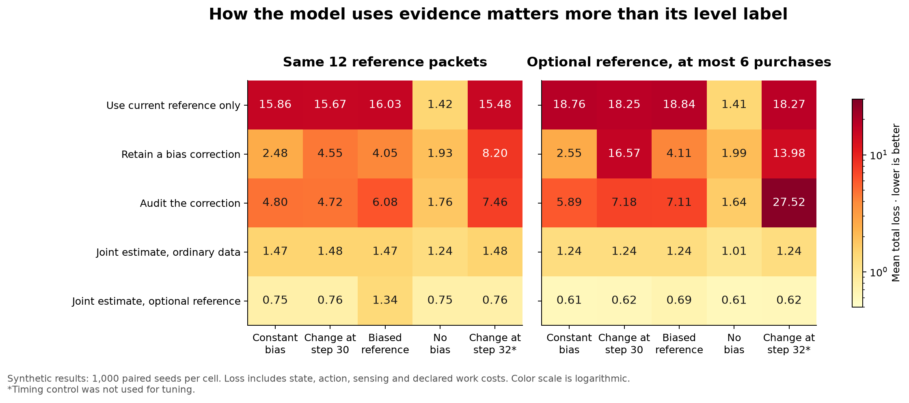
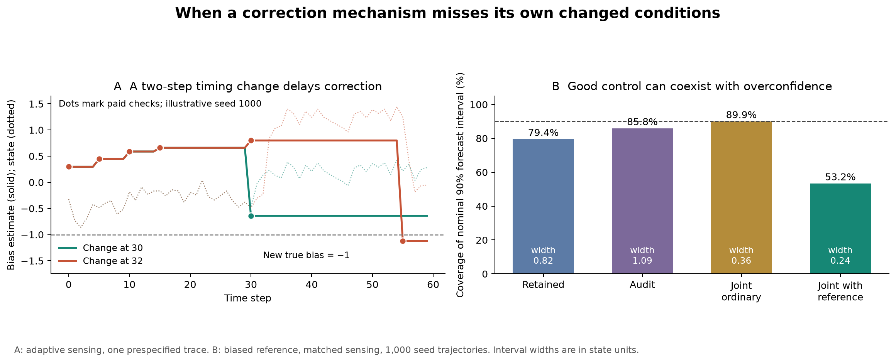

# Recursive self modeling under matched evidence and explicit costs

Research continuation for Ren, 5 October 2026. This is the completed synthetic test proposed in the first investigation. It compares ways to estimate a controlled state and the bias in that estimate, including an additional audit, a joint estimator, and equivalent nested and flat implementations.

**The experiment rejects an automatic advantage from adding a separate reflective layer.** Retaining a bias correction helps relative to crude direct control when bias is present, but a joint estimator using ordinary observations beats it in all eight primary comparisons. An extra audit can speed recovery yet worsen full-horizon loss, and its apparent success can disappear when a disturbance occurs two steps later. Nested and flat descriptions of the same calculation produce identical behavior.

These results concern the stated artificial system. The joint estimator also models its own observation process; it is not a no-memory or necessarily non-meta alternative. The result distinguishes effective mechanisms from their level labels, rather than showing that self-modeling is useless.

## The test and what was frozen

The system has a scalar state x, an ordinary sensor y, and an optional reference z:

\[
x_{t+1}=.8x_t+u_t+w_t,\quad y_t=x_t+b_t+\epsilon_t,\quad z_t=x_t+d+\eta_t.
\]

There are 60 action steps, |u|≤2, x_0∼N(0,1), and initial b uniformly selected from {−1,0,1}. Independent process, ordinary-sensor, and reference noises have standard deviations .05, .25, and .05. Every controller uses u=clip(−.5 x_hat,−2,2). The zero target and prices are supplied preferences, not conclusions about desirable feelings.

Four primary worlds have constant sensor bias, a bias sign change at step 30, reference bias d=.25, or no sensor/reference bias. A fifth world changes the sensor bias at step 32 and is a prespecified descriptive timing control. It was not used for tuning. Controllers receive neither world labels nor true biases nor change times.

At t=0,5,…,55 a reference observation is available. In the **matched-access stage**, every policy receives and pays for all 12 packets, including methods that ignore them. This isolates how the available packet is used. In the **adaptive-access stage**, policies choose whether to buy, with a common cap of six purchases. That is a hard sensing cap of .12; computation is separately priced, not included in that cap.

The loss per episode is

\[
L=\sum_{t=0}^{59}(x_{t+1}^2+.05u_t^2)+.02N_{sense}+.0001C_{work}.
\]

Work units count disclosed weighted numerical blocks, including control, forecasting, and acquisition decisions. They are not measured FLOPs, energy, or human effort. All components and sensitivity to alternative work prices are retained.

Development used seeds 0–99. Settings were selected by mean total loss across both stages and the four equally weighted primary worlds, then code, assumptions, and selections were hashed before evaluation. Evaluation used seeds 1000–1999, sharing exogenous noise draws across policies. Actions change the resulting states and observations; matched access does not mean identical observation values across different controlled trajectories.

The saved evaluation contains **80,000 policy episodes across 80 cases**. The independent unit within a case is one of the 1,000 paired seeds, not the 60 time steps. Additional equivalence replays are checks, not new evidence.

## The mechanisms compared

| Method | What it retains and changes |
|---|---|
| Raw ordinary observation | Uses y directly; no retained bias estimate. |
| Direct reference | Uses z when acquired, otherwise y; does not retain calibration. |
| Retained correction | Maintains h, an estimate of y's bias, and its uncertainty. Updates h from y−z and uses y−h. Selected update gain .5. |
| Flat retained correction | Same sufficient state, update, action, and price as the nested description, stored in a flat vector. |
| Audit | Checks a purchased calibration residual against its modeled uncertainty; switches from update gain .2 to 1 after a large discrepancy. Threshold is two modeled standard deviations. |
| Joint estimator | Maintains a joint Gaussian estimate of x and b, using known dynamics, past actions, ordinary observations, and references when acquired. Selected assumed bias process variance .04. |
| Joint estimator with ordinary data only | Same family of state/bias estimation but ignores references. Selected variance .04. |
| Repeated estimate | Computes the same corrected estimate four times without acquiring evidence or updating h again. |

For the scalar correction, a reference-step estimate is algebraically

\[
y-[(1-\alpha)h+\alpha(y-z)]=(1-\alpha)(y-h)+\alpha z.
\]

Thus calibration combines the two current sensors and retains information for later steps. Its variance calculation accounts for reusing current y. For the audit, choosing α from the residual makes the reported variance a plug-in approximation rather than an exact conditional variance after selection.

The adaptive acquisition gate uses modeled immediate variance reduction, multiplied by .5², compared with the reference fee and update cost. It reads no unpurchased reference value. It is a myopic heuristic: it neither solves the full sensing problem nor accounts correctly for every future value of retaining calibration. Its decision overhead is charged even when it declines a purchase.

## Main outcomes

Mean total loss in the matched-access stage is below. Lower is better. The complete five-world, two-stage results and separate outcome components are in [the numerical summary](results/summary.csv).

| Method | Constant bias | Change at 30 | Biased reference | No bias |
|---|---:|---:|---:|---:|
| Direct reference | 15.862 | 15.668 | 16.032 | 1.424 |
| Retained correction | 2.475 | 4.555 | 4.047 | 1.930 |
| Audit | 4.799 | 4.721 | 6.084 | 1.763 |
| Joint, ordinary data only | 1.474 | 1.476 | 1.474 | 1.244 |
| Joint, using reference | 0.755 | 0.755 | 1.339 | 0.755 |

Retaining calibration clearly helps against the direct-reference method in the biased worlds. It also injects estimation noise in the no-bias control, where it does worse than direct reference use. However, the stronger baseline selected on development data was the joint estimator using ordinary observations. Retained correction loses against it in every primary world and both access stages.

| Access | World | Retained minus selected baseline | Adjusted interval |
|---|---|---:|---:|
| Matched | Constant | +1.001 | [.916, 1.087] |
| Matched | Change at 30 | +3.079 | [2.894, 3.264] |
| Matched | Biased reference | +2.573 | [2.445, 2.701] |
| Matched | No bias | +.686 | [.627, .745] |
| Adaptive | Constant | +1.314 | [1.220, 1.408] |
| Adaptive | Change at 30 | +15.328 | [14.378, 16.278] |
| Adaptive | Biased reference | +2.872 | [2.699, 3.045] |
| Adaptive | No bias | +.987 | [.917, 1.056] |

Intervals use paired seed differences and normal approximations, adjusted by Bonferroni across the eight prespecified comparisons: each is a 99.375% two-sided interval. Every lower bound exceeds the prespecified .02 practical margin. This quantifies Monte Carlo uncertainty under the simulator, not uncertainty that the simulator represents minds.

The joint estimator with adaptive reference access buys only one reference packet in each evaluated episode. It then uses ordinary observations and dynamics. The ordinary-only version buys none in that stage. Their good performance therefore cannot be attributed to receiving more paid reference observations than retained correction, which buys six.

## Why ordinary observations can identify bias

The known dynamics provide information the simplest correction rule ignores. With constant b and no noise,

\[
y_{t+1}-.8y_t-u_t=.2b.
\]

Equivalently, the two-state observability matrix is

\[
\begin{pmatrix}1&1\\.8&1\end{pmatrix},
\]

whose determinant is .2. Repeated ordinary observations can therefore distinguish state from constant sensor bias under the supplied model. The one-step noisy estimate is noisy; filtering uses a history rather than treating that difference as exact.

This is established estimation territory. Work on recursive filtering has long separated state estimates from constant-bias estimates under declared linear assumptions. The experiment applies that general idea; it does not claim a new estimation theorem. [Friedland 1969](https://researchwith.njit.edu/en/publications/treatment-of-bias-in-recursive-filtering/)

The dynamics are also stable and accurately supplied to the joint filter. As a post-evaluation diagnostic, a passive zero-action benchmark has exact expected 60-step state loss 2.1821 and paired-seed observed mean 2.1478. It is identical across sensor-bias worlds because it uses no observations. This benchmark was not part of the frozen primary selection; no work price was assigned to it. It shows why beating a poor active controller does not by itself establish the necessity of sophisticated correction.

## The extra audit helps one metric while failing another

With matched reference access after the step-30 change, audit reaches the specified recovery condition faster: capped mean confirmed recovery is 13.41 steps versus 22.03 for retained correction. Nevertheless its full-horizon total loss is higher: 4.721 versus 4.555. Its poorer behavior before and outside the recovery window matters.

Recovery means five consecutive post-action states within ±.2, confirmed when the fifth occurs. Only the 661 seeds with nonzero initial bias enter recovery analysis. Non-recovery is censored at the remaining horizon, with the recovered fraction reported separately. Recovery is a transient condition, not permanent safety.

Under adaptive access the timing control is more striking:

| Method | Bias changes at 30 | Bias changes at 32 |
|---|---:|---:|
| Retained correction | 16.566 | 13.985 |
| Audit | 7.182 | 27.523 |
| Joint, ordinary data only | 1.237 | 1.237 |
| Joint with reference | .616 | .616 |

The two change times were specified before evaluation. They are not a sample from a distribution of possible change times, so this is a timing sensitivity result rather than a frequency estimate for the real world.

The mechanism was independently reconstructed from all seeds. Retained correction always buys at steps 0,5,10,15,25,35. It has only one calibration after either change and exhausts its six-purchase budget there. The audit's different update and uncertainty rule changes its schedule. Among the 661 actual-change seeds, it samples at step 30 in 634. When the change occurs then, 628 fast corrections happen immediately. When the change occurs at 32, it has just sampled the old regime. **None samples at step 35; 631 sample at step 55, with 628 fast corrections then.**

The audit can examine a calibration residual only after choosing to buy. Its variance-based acquisition gate does not use the values of intervening ordinary observations to detect the change. A large discrepancy can therefore exist without entering the mechanism that would trigger correction. This is a concrete failure of the selected gate and model, not a necessary failure of reflection at a particular depth.

## Better control does not establish calibrated uncertainty

In the biased-reference world with matched access, the joint estimator using the reference has lower control loss than its ordinary-only counterpart: 1.0205 versus 1.1624. Yet its nominal 90% forecast intervals cover the outcome only **53.24%** of the time, compared with **89.93%** for the ordinary-only filter. Its mean interval width is .238 rather than .358.

Exploratory paired 95% intervals confirm the distinction: the control-loss difference is −.1419 [−.1983,−.0854], while the coverage difference is −36.69 percentage points [−37.39,−35.98]. Mean state-estimation errors are similar; their small difference is statistically unresolved. The main failure is unjustified narrow uncertainty, not a demonstrated large increase in state-estimation error.

Every forecast is recorded before transition and conditioned on the action chosen. Brier scores are also retained, but their comparisons reflect the event rate induced by different controllers as well as forecast quality. They should not be treated as a pure measure of calibration. Proper scoring rules support probabilistic assessment; they do not make a finite sample or a misspecified model automatically calibrated. [Gneiting and Raftery 2007](https://sites.stat.washington.edu/people/raftery/Research/PDF/Gneiting2007jasa.pdf)

## What remains invariant in the equivalence controls

The nested and flat retained estimators have the same sufficient state, acquisition rule, arithmetic, control, forecast, and charged work. They match exactly on every recorded metric and every step of all 10,000 stage/world/seed comparisons. This is a checked implementation equivalence, not a finding that every cognitive architecture can be flattened without resource consequences.

Repeating the identical estimate calculation four times preserves behavior too. It adds 180 work units and exactly .018 to the declared loss per episode. At the .02 primary practical margin, that is below the designated threshold; it is still a directly accounted extra expense without a functional gain.

Cost assumptions affect other rankings. At work prices zero and .001, retained correction still loses the mean comparison to the ordinary-only joint estimator in all eight primary cases. Repricing frozen trajectories at .01 reverses seven of those mean rankings because retained correction uses fewer weighted blocks. The adaptive step-30 case remains worse. These are fixed-policy price sensitivities, not performance claims for algorithms reoptimized at new prices, and the work prices are not empirical cognitive costs.

## A precise identification symmetry beyond the experiment

The successful no-reference estimator relies on anchors: known dynamics, known constant forcing of zero, and specified prior information. A separately derived extension shows what happens when one anchor is removed. It was developed after the primary evaluation and does not change that dataset.

Allow an unknown constant g in

\[
x_{t+1}=a x_t+u_t+g+w_t,
\quad y_t=x_t+b+\epsilon_t,
\quad z_t=x_t+d+\eta_t.
\]

For any admissible constant c, transform

\[
(x,b,d,g)\mapsto(x+c,\ b-c,\ d-c,\ g+(1-a)c).
\]

The observation equations are unchanged. If a controller uses the same observation history and coupled internal randomness, it chooses the same action. Substituting the transformed variables in the dynamics shows that the next states remain separated by c. Induction therefore proves **identical complete observation and action histories**.

However, absolute x and the loss x² are not preserved. At a=.8, compare the noiseless zero-action worlds (x_0,b,d,g)=(0,0,0,0) and (1,−1,−1,.2). Both produce y=z=0 forever. Their 60-step state losses are zero and 60 respectively.

This proposition requires a parameter and initial-state class admitting both shifted worlds. It does not apply unchanged to the frozen experiment, where g=0 and the initial distribution is supplied. Known g=0 with a≠1 breaks the symmetry. A fixed known initial-state distribution can also supply a statistical anchor across episodes. Two nominally different sensors do not by themselves provide an absolute reference if their biases and the physical forcing are all unanchored.

The [full proof](identifiability-proof.md) records those boundaries. Six exact rational trajectory checks corroborate the construction. The conceptual consequence is precise: **another reflective layer receiving the same evidence cannot distinguish worlds whose entire permitted observation histories are identical.** That is an information constraint preserved through further processing. It does not mean every property of those worlds is invariant.

## Decisions and remaining scope

The first investigation's general cautions survived, but its next-test conjecture has narrowed. Persistent correction is useful relative to some methods; it has no demonstrated universal or unique architectural advantage. A joint state-and-bias model is itself compatible with a self-modeling interpretation. A higher-order audit requires a working route for evidence to challenge it; a confidence-based gate can obstruct that route.

The next useful experiment should vary the **anchors and challenge route** together: unknown physical forcing, uncertain reference bias, and change times drawn from a distribution fixed before evaluation. Compare the present variance gate with an ordinary-innovation trigger and a small protected schedule of checks, under the same sensing budget. Include false alarms and no-change costs. A three-state reference-bias estimator is plausible under the known-forcing model; it must not be advertised as solving the unanchored four-variable case. That expanded study was unrun when this report was written. It is now completed in the separate [correction-access continuation](../correction-access/report.md), using fresh data.

This test did not measure neural architecture, feelings, physical deliberation latency, energy, or peak implementation memory. It records analytically required persistent belief storage and end-to-end simulation runtime, not isolated policy runtime. Computation and sensing costs are supplied, the action policy is shared and restricted, purposes do not change, and the acquisition rule is a heuristic. The observed control benefit is not a proof of wisdom, legitimacy, or alignment.

## Reproduction and evidence

The [frozen protocol](protocol.json), [development scores](results/development.json), [selected settings](results/selected.json), and [freeze manifest](results/freeze.json) retain what was chosen before evaluation. [All raw episode metrics](results/all-results.npz), [summaries and contrasts](results/summary.json), and example trajectories are included. The [independent analysis](independent-analysis.txt) recomputes the results without importing the simulator and reconstructs acquisition schedules from the sensor-noise equations.

Twelve filter tests and ten independent runner tests pass. An independent result audit passes 2,184 numerical assertions. General proof arguments are separate from numerical checks. No post-evaluation policy edits or retuning were made. The passive benchmark and unknown-forcing symmetry are explicitly labeled later diagnostics.

Run `python filter_model.py` and `python test_runner.py` for the component tests. With NumPy installed, `python independent_analysis.py` recomputes the saved results. `python experiment.py evaluate` reruns the frozen evaluation into the included results directory after checking hashes. Matplotlib is needed only for `python plot_results.py`. Dependencies used here are recorded in [requirements](requirements.txt).

Additional primary context: [Hay and colleagues 2012](https://people.eecs.berkeley.edu/~russell/papers/uai12-meta.pdf) explains why myopic computation value can miss future benefits; it does not prove this acquisition heuristic optimal. [Tzoumas and colleagues 2020](https://arxiv.org/abs/1802.08376) studies sensing through control objectives for fixed sensor-set selection; its guarantees do not transfer to this adaptive, clipped, and sometimes misspecified system.
