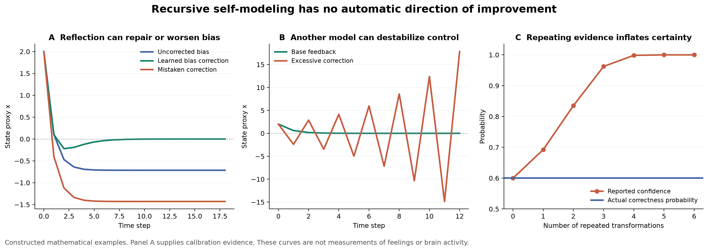

# Recursive self modeling and the scope of invariance

Research synthesis for Ren, 5 October 2026. This record examines what follows when a feeling is modeled, that model is modeled, and the resulting representations feed back into experience or action. The formal constructions are illustrative systems. They are not an established architecture of the mind or a reduction of subjective experience to a scalar.

The proposed experiment has now been completed. Read [the continuation results](experiment/report.md) for the matched-evidence comparison, timing failure, calibration results, and a further identification-symmetry proof. The original arguments below remain the first investigation's record. A second completed study now tests [access to correction under hidden changes and wrong anchors](correction-access/report.md), with fresh data and explicit scheduling bounds.

**The strongest defensible answer is conditional:** a process does not acquire an exemption from applicable constraints merely by representing another process. But this is different from proving that a property survives the transformation from a target to its representation. Accuracy, stability, information, usefulness, and legitimate authority are not automatically preserved by moving to a higher level.

The useful research question is therefore: **what does the next act of reflection receive, preserve, change, cost, and enable us to check?** A level number alone answers none of these questions.

## Distinguishing the operations

These are working definitions for this investigation, not proposed resolutions of every philosophical dispute about representation.

| Term | Operational meaning here | What the definition does not imply |
|---|---|---|
| Representation | A state or structure with a specified interpretation that supplies answers or predictions about a target for some questions. State the target, interpretation, and correctness conditions. | A mere correlation is not sufficient evidence of a representational role; a representation may be false. |
| Model | A representation containing enough structure to support specified inferences, predictions, or counterfactual queries. | It need not be a verbal theory or an explicit picture. |
| Self modeling | Modeling some state, disposition, process, or capability of the system implementing the model. | It does not require modeling the entire system. |
| Meta modeling | Modeling properties of another model or modeling process, such as its uncertainty, bias, scope, or update rule. | Repeating a conclusion with greater confidence is not necessarily a new model of that model. |
| Monitoring | Obtaining information about a target or process and using it to update a representation. | Monitoring need not control its target or be consciously reportable. |
| Introspective observation | Monitoring directed toward one's own mental activity or reported experience through a specified access process. | Access to a report does not establish access to every cause of the reported experience. |
| Simulation | Running a model through possible transitions under specified inputs or interventions. | A simulated consequence need not occur in the target. |
| Regulation | Changing a target or its conditions through a policy assessed against a specified criterion. | Better regulation does not imply more accurate retrospective description, or a legitimate criterion. |
| Recursive construction | A rule that can apply again to its own products or to processes of the same kind. | The rule does not itself perform infinitely many applications. |

For example, “I feel tense,” “my interpretation of that tension may be biased,” and “my bias check is itself too quick to dismiss tension” concern different targets. The second and third need not occupy separate anatomical compartments. A shared process can successively take different contents as its target, using memory or a pointer to distinguish roles. Conversely, an implementation may use separate modules. **Semantic depth, simultaneous storage, and elapsed computation are different measurements.**

Nelson and Narens distinguish monitoring from control within an object/meta-level framework, explicitly allow more than two levels, and do not require those further levels for their model. That framework organizes functional relations; it does not establish an infinite neural hierarchy. [Nelson and Narens 1990](https://sites.socsci.uci.edu/~lnarens/1990/Nelson%26Narens_Book_Chapter_1990.pdf)

## Three different claims often called invariance

Let a target have state x and a representation have state r(x). Before comparing them, distinguish the following.

1. **A constraint applies throughout a domain.** If every implemented process in a declared domain satisfies C, and every implemented meta-process belongs to that domain, then each meta-process satisfies C. This follows from the premises. Calling something a meta-process does not remove it from the domain. Whether the proposed constraint actually applies throughout that domain remains a separate scientific or mathematical question.
2. **A property is preserved by a map.** For level-specific quantities J and K, preservation means K(r(x)) = J(x). This needs a specified map, quantities, domain, and proof. A lossy label generally cannot preserve every property of its target.
3. **A dynamical property persists through time.** A forward-invariant set A obeys T(A) ⊆ A; a conserved quantity obeys J(T(x)) = J(x). Neither follows from the mere existence of a model of T.

The candidate principle becomes more precise as follows:

> For a representing process belonging to a declared class, constraints valid throughout that class apply to it as well. Its representational role supplies no exemption; class membership and applicability must be justified independently.

This is a structural framing with explicit premises, not a newly proved physical law. A regulator can be outside the subsystem it regulates while remaining inside a larger causal account. An observer can also read a target without influencing it in a particular idealized model. “Participates in the world” does not entail “has nonzero influence on every target.”

At the physical level, the implementation of a representation and its represented content must also be distinguished. The implemented simulation consumes the resources actually used by the simulator; an imaginary world represented inside it need not obey the simulator's laws as content.

## A minimal model with two representational roles

Let x_t be a measurable scalar state proxy, m_t a first estimate of that proxy, and h_t a model of the first estimate's systematic bias. The proxy is not identified with a feeling itself. Suppose

\[
m_t=x_t+b,\qquad u_t=-k(m_t-h_t),\qquad x_{t+1}=a x_t+u_t.
\]

Here b is a constant sensor bias; u_t is the controller's action. The assumed target is x=0. Choosing that target is part of the model, not a conclusion about which emotions a person should have.

Supply a calibration channel z_t=x_t and update the meta-model by

\[
h_{t+1}=(1-\lambda)h_t+\lambda(m_t-z_t).
\]

The timing is explicit: the action at t uses h_t; the calibration updates h for the next step. The reference is separately supplied and exact in this clean example. It is not statistically independent of x or m.

With residual bias δ_t=b−h_t, the joint process is

\[
\begin{pmatrix}x_{t+1}\\ \delta_{t+1}\end{pmatrix}
=\begin{pmatrix}a-k&-k\\0&1-\lambda\end{pmatrix}
\begin{pmatrix}x_t\\ \delta_t\end{pmatrix}.
\]

**Checked proposition:** the equilibrium of this full linear system is asymptotically stable for all initial states exactly when |a−k|<1 and |1−λ|<1. The matrix is triangular, so these are precisely the conditions that both eigenvalues lie inside the unit circle.

Set a=.8, k=.5, b=1, λ=.5, x_0=2. Three implementations then give different outcomes:

| Implementation | Behavior | Limiting x |
|---|---|---:|
| No bias correction, h=0 | A biased estimate steers the state away from the supplied target. | −5/7 |
| Learned correction, h_0=0 | Calibration estimates b and removes the persistent error. | 0 |
| Mistaken correction, h=−1 | The supposed correction doubles the residual bias. | −10/7 |

The meta-model has a specific referent: the first model's error mechanism. Merely describing it as higher-order does not explain its success; the informative calibration channel and stable update do.

There is a decisive limitation: if z is always available for direct control, u=−kz already achieves x_{t+1}=.3x_t. The example demonstrates reusable calibration, not the superiority of a meta-layer over all simpler policies. A fair test of calibration's practical value needs intermittent or costly reference access, followed by use of the corrected cheaper channel.

Nor does the meta-model escape reference error. If z_t=x_t+d, then h tends to b−d and the limiting state is −kd/(1−a+k). At d=1/4 it is −5/28. The reference's bias passes through the correction.

The saved verification uses exact rational arithmetic for these recurrences and checks their values at 200 steps against the analytically derived limits. A finite run corroborates the arithmetic; the stability argument establishes convergence.

## Counterexamples to automatic improvement

**Correct monitoring can be followed by harmful regulation.** Start with the exact estimate m=x. Base control gives x_{t+1}=.3x_t. Let a higher model assert that the estimate must be multiplied by four, producing control u=−.5(4m). Now x_{t+1}=−1.2x_t, so nonzero trajectories oscillate with increasing magnitude. Another implemented model has worsened stability.

**Repeated confidence is not repeated evidence.** Suppose an unchanged binary answer is correct with probability .6. Start with calibrated confidence q_0=.6 and repeatedly apply

\[
q_{n+1}=\frac{q_n^2}{q_n^2+(1-q_n)^2}.
\]

This squares the odds, as if the same support independently confirmed itself. After four transformations confidence is about .99848, while actual correctness remains .6. The expected Brier loss is

\[
E[(q-Y)^2]=.6(.4)+(q-.6)^2,
\]

so it rises from .24 to about .39879. This is a constructed failure mode, not a claim that human introspection obeys that equation.

**Agreement can be caused instead of discovered.** Let an earlier state F_0 and a model output M be independent fair bits. If the controller sets F_1=M, prediction and later state agree perfectly. Yet M contained no information about F_0. Validation after intervention must distinguish successful control from an accurate account of the prior state.

**An exact self-description can be small.** A finite program can correctly report a selected fact about itself, or expose its current state. Self-reference alone does not force falsehood, infinite regress, or complete incomprehensibility. Universal forecasting claims require a much larger target class and encounter different limitations.

## Information limits with explicit interfaces

For a fixed target F, suppose the only input to M_2 is M_1 plus randomization conditionally independent of F. Then F → M_1 → M_2 is a Markov chain and

\[
I(F;M_2)\le I(F;M_1).
\]

**Proof:** expand I(F;M_1,M_2) in the two orders. Conditional independence makes I(F;M_2|M_1)=0. Consequently I(F;M_1)=I(F;M_2)+I(F;M_1|M_2), and the last term is nonnegative. For this finite-variable argument, the result is a standard data-processing inequality, not new mathematics.

This is an upper bound, not conservation. Equality needs additional conditions. It also does not say that computation cannot improve a bounded decision procedure: an algorithm may extract a useful consequence already implicit in its data while adding no Shannon information relative to those data. The ideal decision maker with complete use of its evidence is a different comparator from a quick heuristic.

If the higher level also receives reliability information E, the appropriate bound is instead I(F;M_2)≤I(F;M_1,E). For independent fair F and E, let M_1=F XOR E. Alone M_1 carries zero bits about F. Supplying E allows M_2=M_1 XOR E=F and yields one bit. This is not a violation; the interface changed. Re-examining an internal signal, remembering context, learning an algorithm during training, or asking another person can likewise change the relevant input accounting.

Feedback requires time indices. The preceding F_0/F_1 counterexample shows why comparing information about different target states is not a data-processing argument. More generally, indistinguishable input histories cannot be distinguished by further processing alone, but a new action may create discriminating observations.

## Resource bounds and reused processes

Suppose N simultaneously active implemented levels have additive costs c_k and total available resource R. If each c_k≥c_min>0, then

\[
N\le\lfloor R/c_{\min}\rfloor.
\]

The proof is the sum bound N c_min≤Σc_k≤R. More generally, divergent cumulative costs eventually exceed every fixed R. But **positive costs alone are insufficient**: c_k=2^(−k) has every finite prefix below one. That mathematical counterexample does not show an actual infinite physical implementation is possible; it shows what the proposed proof has failed to establish.

A common subroutine may implement successive levels with reused memory. Its description length can be fixed while its runtime grows. A finite-state loop can run indefinitely without storing an indefinitely deep explicit stack; if arbitrary depth must be distinctly encoded, that encoding has its own cost. Bounds on simultaneous memory do not automatically bound lifetime iterations, and bounded expected expense is not a hard cap on every realized trajectory.

The same distinction applies to continuing becoming: a fixed finite reserve limits cumulative uncompensated expense, while replenishment, substitution, reuse, and changed implementation can change the feasible duration. Which resource is renewable must be stated. No universal energetic cost per “thought level” has been derived here.

## What a reliable abstraction must preserve

Let T:X→X be deterministic dynamics and r:X→M a proposed coarse representation. An exact closed coarse transition G satisfying

\[
r\circ T=G\circ r
\]

exists on r(X) **if and only if** r(x)=r(x′) implies r(T(x))=r(T(x′)).

Necessity follows by applying G to the equal coarse states. For sufficiency, define G(r(x))=r(T(x)); the condition ensures that the answer does not depend on which representative x is chosen. Iterating gives r(T^n(x))=G^n(r(x)).

A minimal counterexample uses X={0,1,2}, r(0)=r(1)=0, r(2)=1, and T(0)=0, T(1)=2, T(2)=2. Two states with the same current representation have different represented successors, so no such deterministic G exists. Adding the omitted distinction, retaining suitable history, or changing to a justified probabilistic model can alter the result.

If J is a conserved fine-state quantity, it descends to a coarse quantity only when J is constant on every set of states merged by r. Under that condition J=J_bar∘r and exact coarse dynamics conserve J_bar. Thus even an established fine-scale invariant need not be recoverable from every representation.

Prediction sufficiency also differs from decision sufficiency. A compressed representation preserves a specified optimal decision when a common optimal action can be chosen for the fine states it merges, under the given losses and feasible actions. Preserving a feature for one task does not preserve it for every later question or intervention.

There is also a genuine but limited invariance under **invertible re-description**. If coordinates are changed by a bijection h and the new dynamics are G=h∘T∘h^(-1), then G^n(h(x))=h(T^n(x)). With the output decoder and action rules transformed consistently, observable trajectories are identical. Calling coordinates “a state model and a bias meta-model” or “one augmented state estimator” can therefore describe the same implemented calculation. Behavioral success alone need not identify a unique semantic depth. This does not make all architectures equivalent; information access, timing, memory, and allowed interventions can distinguish implementations.

For approximate models, let d be a metric on the represented state space and suppose d(r(T(x)),G(r(x)))≤ε on the required domain, while G is L-Lipschitz. Compare the represented true trajectory r(T^n(x_0)) with the simulation y_(n+1)=G(y_n); write their distance as e_n. Then prediction error satisfies

\[
e_n\le L^n e_0+\epsilon\sum_{j=0}^{n-1}L^j.
\]

This follows by induction from e_(n+1)≤L e_n+ε. If L<1, e_0=0 gives the bound ε/(1−L); if L>1, small one-step errors can amplify. The metric, reachable domain, discrepancy bound, and Lipschitz assumption must actually hold. More levels do not supply them.

## Finite self reference and stopping

A finite expression such as R(R(...R(m))) can be extended by another application whenever resources permit. This indefinite extensibility is different from having completed an infinite hierarchy. An infinite mathematical specification is also different from an executed physical process.

There are at least three distinct meanings of a fixed point:

- A representational fixed point m=R(m) is a state unchanged by a particular update.
- A dynamical fixed point is an equilibrium of time evolution; its existence does not imply attraction.
- A computability fixed point identifies programs with the same computed function after an effective code transformation; it is not a stable emotional state or necessarily the same source text.

For the update R(m)=1−m on [0,1], m=1/2 is a fixed point but the trajectory from zero alternates 0,1,0,1. Stopping because an account repeats, or because a numerical update converges, establishes neither its truth nor its value. Kleene-style self-reference and Turing-style undecidability have precise formal domains; they do not independently show that consciousness requires infinity or that every particular act of introspection must fail. [Primary-source map](sources.md)

For bounded reflection, let s include available evidence, computational state, time, and resources. Let S(s) be the expected loss of the best currently executable terminal action, and let c be an available further computation or observation with cost κ(c,s) and resulting state s′. Assume finite action and computation sets, finite expected losses, a declared transition model, and a finite horizon decreased by each further operation. Then

\[
V(s)=\min\left\{S(s),\min_c[\kappa(c,s)+E[V(s')\mid s,c]]\right\}.
\]

Reflection is selected when a feasible continuation has lower expected total loss than stopping. This is a conditional decision criterion, not an oracle for actual humans. Estimating the value of a computation itself consumes resources and can be wrong. A fixed budget or deadline can terminate the procedure without recursively proving that termination optimal.

A one-step rule that stops whenever no single computation immediately improves the answer can fail. Two complementary observations can each be uninformative alone and fully informative together. In the fair-bit XOR construction, paying .1 for each of two shares reduces expected classification error from .5 to zero, giving net benefit .3; paying for either alone appears wasteful. Multi-step option value matters. The bounded-metareasoning literature explicitly treats this difficulty. [Hay and colleagues 2012](https://arxiv.org/abs/1207.5879)

## What the empirical literature can establish

The primary literature separates questions that the word “meta” can blur. Confidence and task accuracy can dissociate; models of confidence can use signals different from those supporting the original decision; and higher-order theories of consciousness compete with theories that place the explanatory emphasis elsewhere. These are not interchangeable claims. The source map records each paper's evidential type and the limits of its contribution.

Affect labeling can alter processing of emotional stimuli. In an fMRI task, participants labeled emotions displayed by faces, and amygdala responses differed across task conditions. This does not directly measure an infinitely nested model of one's own feelings, and a brain response is not an independent readout of phenomenal experience. [Lieberman and colleagues 2007](https://teams.semel.ucla.edu/sites/default/files/publications/May%202007%20-%20Putting%20Feelings%20Into%20Words.pdf)

The direction is not universal. In one experiment with 79 participants, labeling one's feelings was associated with lower reported distress for high-intensity aversive images and higher reported distress for low-intensity images, relative to passive viewing. This is evidence against treating labeling as an invariably calming operation, not a universal law of emotional recursion. [Levy-Gigi and Shamay-Tsoory 2022](https://journals.plos.org/plosone/article?id=10.1371/journal.pone.0279303)

None of these studies establishes that indefinitely deeper reflection is possible, more accurate, or wiser. This investigation has not located a direct empirical test of arbitrary recursive depth matching Ren's example.

## Criteria for useful reflection

Descriptive evaluation should compare consequences under controlled conditions. Proposed practical criteria are:

| Dimension | Evidence that another step helped | Important countercheck |
|---|---|---|
| Judgment | Better held-out predictions or decisions. | Keep evidence, time, and computational allowance comparable. |
| Calibration | Confidence more closely matches observed correctness. | Greater confidence by itself is not improvement. |
| Control | Better specified outcomes with acceptable delay and instability. | A changed target can manufacture apparent predictive success. |
| Revision | Correction after an informative contradiction or context change. | Agreement only within the existing frame may conceal excluded alternatives. |
| Resource use | Benefit exceeds actual computation, observation, and delay costs. | An equal ceiling is not equal spending. |
| Recoverability | The procedure can pause, act, and later reopen inquiry. | Permanent certainty can look efficient by excluding future checks. |

The normative questions remain separate: who chooses the target, whose losses count, who can contest the model, and what risks may be imposed to improve it? A more accurate or stable controller does not answer them. “Wisdom” therefore cannot be operationalized here as recursion depth alone.

Returning to observation is especially promising when competing explanations make the same claims from current evidence but predict different new observations. Acting may be preferable when delay is costly or a bounded intervention can supply information. Further computation may be preferable when the evidence already contains a useful relation that the current method has not extracted. These are conditional alternatives whose value must be assessed in context.

## The next discriminating test

The first investigation proposed testing **whether the benefit comes from nesting itself, better computation, or an added information channel**. Its blueprint is recorded in [the decisions and next test](decisions-and-next-test.md). The completed [continuation](experiment/report.md) uses a noisy controlled state with sensor bias, intermittent paid calibration, a reference-bias control, and regime changes. It records observation access, declared computational expense, forecasts, and control outcomes; physical latency and measured peak memory remain outside that implementation.

The crucial comparison is a reusable calibration model against a simple policy with the same available evidence and budget. A gain from receiving more informative data is not evidence that nesting caused the gain. A gain that survives matched access and simpler-policy comparisons would support a narrower architectural claim worth investigating further.

## Connection to continued becoming

This investigation supports a limited bridge to Ren's larger research program: **the ability to correct a model is itself an implemented capacity with information, timing, resource, and authority conditions that can be changed by the process it regulates.** Its preservation is an empirical and design question. It does not follow from announcing another meta-level.

The existing research on inherited evidence provides a close structural connection. A summary sufficient within one model can erase distinctions needed to compare later models. Applied here, an introspective account may preserve enough to execute an existing policy while losing evidence needed to challenge its frame. This is a proposed cross-domain mapping, not an empirical equivalence between minds and institutions.

The current examples hold the target, candidate grammar, and assessment criteria fixed. They do not yet explain the formation of new purposes, unanticipated concepts, or a legitimate right to revise someone else's criteria. They neither establish a universal theory of consciousness nor solve alignment. The resulting constraint is more modest and testable: a self-correcting system needs an attainable route from consequential evidence to revision, and that route cannot be assumed reliable merely because it operates at a higher level.

## Research record and verification

The [source map](sources.md) preserves primary references, disagreements, and access limits. The [claim register](claims.md) separates conditional proofs, constructed counterexamples, empirical findings, hypotheses, and normative commitments. The [decisions record](decisions-and-next-test.md) preserves rejected formulations and unresolved questions.

The [verification report](verification.json) records 15 successful checks, with exact rational arithmetic except for finite mutual-information logarithms. The [trajectories](model-trajectories.csv) and [reproduction script](reproduce.py) permit inspection. These checks establish consistency of the specified examples, not empirical validity or a proof of universal completeness.

To reproduce the checks, run `python3 reproduce.py` from the downloaded research folder; the calculations use only the Python standard library. Add `--plot` to regenerate the figure with Matplotlib. The plotting dependencies used for the saved figure are recorded in [plot requirements](plot-requirements.txt).
