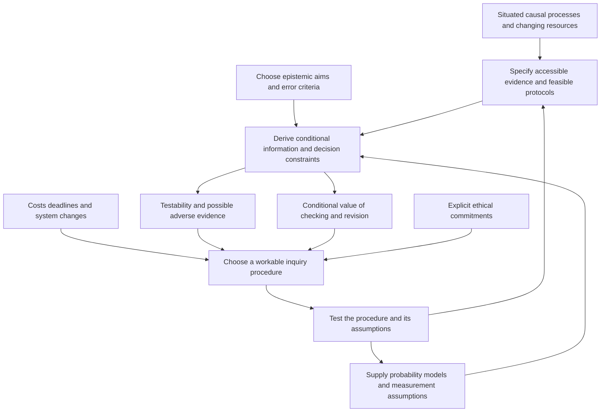

# Deriving scientific principles from the conditions of inquiry

Research investigation for Ren, 5 October 2026, Asia/Bangkok. This is AI-assisted conceptual and mathematical research, with small exact calculations and a primary-source audit. It is not an empirical validation, a claim of mathematical novelty, or a complete theory of science.

**Some scientific principles can be derived as conditional requirements for particular kinds of reliable inquiry. They cannot all be deduced from causal embeddedness alone.** If investigators aim to distinguish competing claims with bounded error, their accessible evidence must distinguish those claims sufficiently. If they aim to detect and correct mistakes, there must be an attainable route by which adverse evidence can change their conclusions. Resource limits make the availability, cost, timing, and renewal of that route part of the problem.

This gives a precise role to empirical testability and possible adverse evidence. It gives conditional reasons for independent checks, assumption disclosure, calibrated uncertainty, and revision. It does not uniquely determine a scientific method, a universal demarcation criterion, an ethical objective, or the people whose interests deserve protection.

The most defensible interpretation is therefore **a framework for the conditions of corrigible inquiry**: inquiry that can detect and appropriately correct specified errors while remaining accountable to declared constraints. “Corrigible” here includes resisting mistaken corrections. It does not mean maximum willingness to change one's mind.

## What follows from what

Each row states an additional premise. The framework's causal vocabulary does not supply these premises for free.

| Added aim and assumptions | Consequence | Status and limit |
|---|---|---|
| Distinguish two claims using one accessible transcript, with false-positive probability ≤ α and false-negative probability ≤ β | The transcript laws must differ by total variation at least 1 − α − β | Mathematical necessity; does not promise an affordable test or a good explanation |
| Compare fixed models inducing distinct laws for accessible evidence using likelihoods | There are possible evidence events favoring each relative to the other | Mathematical consequence; neither model need forbid any finite observation |
| Require logical refutation of a deterministic package | An admitted observation must contradict a consequence of that package | Logical consequence; which assumption failed is a further question |
| Require a causal effect to be identified from supplied data and causal assumptions | Every compatible model agreeing on the data distribution must agree on the target effect | Identification criterion; finite estimation and truth of the assumptions remain separate |
| Require lower decision error; additional information is free, can be ignored, and does not alter the available actions or world | Optimal expected loss cannot rise with that information | Mathematical consequence; does not establish universal disclosure or mandatory data retention |
| Error checks have specified detection probabilities and conditional independence | Repeated checks reduce the chance that all miss an existing error | Mathematical consequence of the dependence model; shared faults can impose a floor |
| Require expected Brier loss for a binary outcome to be minimized under a specified conditional law | Report that conditional probability | Decision-theoretic consequence; the law is not made known by this result |
| Require false-alarm control across continued testing | The entire selection and stopping procedure must satisfy the chosen bound | Mathematical constraint; a fixed-sample guarantee alone is insufficient |
| Require correction after a possibly erroneous commitment | Some feasible later history must permit the relevant commitment to change | Reachability necessity; openness alone gives no reliable revision mechanism |
| Require a priced test to finish before a deadline | Its observations, computation, and payments must be feasible in sequence | Accounting and timing necessity; funding does not manufacture informative evidence |
| Require fair treatment, consent, or standing for affected people | Those requirements must be supplied and defended explicitly | Normative commitments; not deductions from prediction accuracy or persistence |

The dependency structure is:

An arrow into a conclusion records a dependency, not proof that the premise is true. Ethical commitments constrain the choice of inquiry; they are not outputs of the information inequalities.

## Distinctions that falsifiability alone does not capture

**Logical falsifiability** concerns incompatibility: a claim or theoretical package excludes some admissible empirical statement. An accepted statement of the excluded kind yields a contradiction. The acceptance and interpretation of that statement remain fallible. A probability-zero point under a continuous distribution is not automatically a logical impossibility: every exact outcome can have probability zero.

**Empirical testability** concerns whether a specified observation procedure can assess a claim against relevant alternatives or discrepancies. It can be probabilistic. Testability is relative to an observation interface, background assumptions, and alternatives; actual power is a further question.

**Identifiability** asks whether the target quantity has a unique value across models compatible with the available distribution and assumptions. A model may be statistically testable without every parameter or causal claim being identifiable. A parameter may be identifiable with unlimited observations but very difficult to estimate within the available budget.

**Probabilistic prediction** specifies probability laws for observations. Prospective predictions are fixed before their assessment outcomes; fitting or updating on assessment data requires the evaluation procedure to account for that reuse. A model assigning nonzero probability to every finite outcome can still make sharply different predictions from a competitor. Extremely flexible models may retain testable restrictions on joint distributions or future behavior; flexibility by itself does not establish untestability.

**Likelihood discrimination** compares how well fixed models predict specified evidence. A likelihood ratio is relative evidence, not the probability that a model is true. Failing to reject a null is neither proof of its truth nor automatically strong support for it. A low-power procedure often fails to reject even consequential false alternatives.

**Practical feasibility** adds available interventions, permissions, sample size, expense, computation, equipment, time, and measurement resolution. A logically possible test may be inaccessible now. A useful claim about a unique historical event need not permit replaying that event; different surviving traces can support different tests.

**Scientific adequacy** is broader again. A claim can be testable and false, or survive a weak test. Explanation, measurement, exploration, and mathematical work contribute to science without each individual component having its own isolated empirical refuter.

## A minimal formal account

Let θ index a possible world or complete model package. Let hₜ be the entire transcript available to an investigator by time t, including measurements, actions, public cues, timestamps, retained records, and relevant randomization. A protocol π chooses the next action and whether to stop from that transcript. Under θ it induces a transcript law Pθᵖⁱ.

Write Π(B, d) for protocols feasible within a declared resource budget B and deadline d. In a changing system, an action can alter both the physical state and future observation channels. A schematic transition is

\[
(x_{t+1},S_{t+1})\sim K_\theta(\cdot\mid x_t,S_t,a_t),
\qquad Y_{t+1}\sim O_\theta(\cdot\mid x_{t+1},S_{t+1},a_t),
\]

where S = (X, T, R, O) names configurations, transformations, enabling resources and relations, and accessible distinctions. This is a modeling schema. It does not uniquely specify a probability law, a loss function, a boundary, or the meaning of correction. A supplied finite model also does not explain the discovery of concepts outside its language.

The following results hold after these missing pieces are supplied. Their mathematics already belongs to established statistics, decision theory, and control; the proposed framework helps make their premises visible together.

### Discrimination requires a discriminating channel

For fixed π, compare P₀ and P₁, and let φ(h) ∈ [0,1] be the probability of choosing claim 1. Define

\[
\alpha=E_0\phi,\qquad \beta=E_1(1-\phi).
\]

Because a bounded test's expectation difference cannot exceed total variation,

\[
\boxed{\alpha+\beta\ge 1-\operatorname{TV}(P_0,P_1).}
\]

Proof: α + β = 1 − (E₁φ − E₀φ), and E₁φ − E₀φ ≤ TV. On a finite transcript space, choosing claim 1 where its probability mass exceeds claim 0's attains the bound. With equal priors and unit misclassification loss, minimum average error is (1 − TV)/2.

Identical laws therefore imply α + β ≥ 1. They do not imply that the investigator cannot choose a claim, act prudently, use prior knowledge, or reopen a question on a calendar. They exclude reliable *evidence-based discrimination between these worlds using this interface*. If the initial transcript laws agree and the entire next observable transcript has the same conditional law in both worlds at every common history and available action, induction shows that adaptive action selection cannot break the equality either. This premise includes resource and action-availability cues; identical sensor emissions alone are insufficient when underlying transitions differ.

For a resource limit, define D(B,d) = sup over π ∈ Π(B,d) of TV(P₀ᵖⁱ,P₁ᵖⁱ). If D(B,d) < 1 − α − β, the requested guarantee is unattainable within that class. Meeting the bound is generally not sufficient for the specified pair of error limits: the test's tradeoff between the errors still matters. A positive gap between laws can also be far too small to exploit within the budget.

Self-reflection does not evade this argument. If an internal representation is computed from the same transcript and world-independent randomization, its distributions cannot be more distinguishable than the transcript laws. Computation can make implicit information usable for a bounded investigator; it cannot create empirical information separating genuinely identical inputs. Newly available internal measurements count as additional evidence and must be included.

### Adverse evidence follows from model comparison

Take distinct normalized probability masses p and q on a finite observation space. Let A = {y : q(y) > p(y)}. Then q(A) > p(A), and normalization gives q(Aᶜ) < p(Aᶜ). Thus occurrence of A favors q over p, while occurrence of Aᶜ favors p over q. With common positive support, likelihood ratios move in both directions. Support-exclusive events can provide more decisive discrimination.

This is a precise sense in which a discriminating comparison exposes each model to possible adverse evidence. It does not require one impossible observation, does not force posterior belief to cross a decision threshold, and does not prove either model is true. Both could be wrong. A rule that labels every possible outcome equally supportive of one fixed claim supplies no evidential discrimination on that comparison.

The conclusion depends on retaining the predictions that were actually assessed. Replacing a failed prediction after seeing its outcome creates a revised model. That may be scientifically productive, but fit to the revision data does not by itself validate the new prediction rule. The revision's extra flexibility and its evaluation procedure need accounting.

### Refutation concerns a package of assumptions

Let H be a focal claim, A auxiliary assumptions, M a measurement model, and D a design and recording protocol. If

\[
H\land A\land M\land D\Rightarrow E,
\]

then accepting ¬E entails ¬(H ∧ A ∧ M ∧ D). It does not entail ¬H alone. For stochastic packages, a surprising event ordinarily supplies probabilistic grounds for criticism rather than deductive contradiction.

Discriminating follow-up tests can target measurement or auxiliary alternatives. An auxiliary explanation is not automatically an illegitimate rescue: its credibility depends on its own support, predictive restrictions, and additional checks. Conversely, permitting arbitrary after-the-fact changes without new constraints can immunize a claim against the very comparison it purported to face.

Observation being mediated by instruments and concepts does not make all readings equally defensible. Calibration standards, independent channels, error models, traceable records, and tests of consequences can make specific disagreements tractable. They do not give a view from outside every assumption.

### Uncertainty and revision require declared objectives

If Y is binary with specified conditional probability p, and the investigator minimizes expected Brier loss, reporting q incurs

\[
E[(q-Y)^2]=p(1-p)+(q-p)^2.
\]

The unique optimum is q = p. This justifies faithful probability reporting under this loss and law. It neither supplies p nor makes every forecast empirically calibrated. Calibration, interval coverage, posterior probability, and error rates are different properties. A constant forecast of one half can be calibrated over a balanced population while missing perfectly predictable differences between its subgroups.

A similarly modest revision result is exact. Suppose, under a fixed target, an event W has positive probability and by a fixed time t₀ the investigator has entered a permanently unchangeable incorrect assertion on W. At every time t ≥ t₀, its error probability is at least P(W). A requirement that this error vanish is incompatible with that positive-probability permanent commitment. With a random finite entry time τ on W, the finite-time bound is P(W ∩ {τ≤t}), and the limiting lower bound is again P(W). Some path to correction is necessary; no particular frequency of revision is implied. A known correct answer need not be repeatedly reopened, and arbitrary switching can worsen accuracy.

## What the worked examples establish

### A claim with no accessible empirical difference

“An undetectable marker accompanies every observation but never affects any accessible observation or intervention” induces the same transcript law as its denial by construction. Within that interface, the marker cannot be empirically discriminated. This does not prove that it is meaningless or settle every metaphysical question; it identifies the missing empirical difference.

A less artificial example is causal ambiguity. Let U be a fair binary variable. Model A has X = U and Y = X. Model B has X = U and Y = U. Both produce (X,Y) = (0,0) or (1,1), each with probability one half. Passive observations do not distinguish them. Setting X to 1 yields P(Y=1)=1 in A and one half in B. The causal question becomes distinguishable if that intervention is correctly implemented and accessible. Pearl's identification framework makes this distinction between data, causal assumptions, and target queries explicit. [Pearl 2010](https://pmc.ncbi.nlm.nih.gov/articles/PMC2836213/)

### A deterministic refutable claim

An ideal specified device returns 0 on every permitted input. A reliably recorded output 1 on a permitted input contradicts that deterministic claim. With a fallible recorder, however, output 1 instead challenges the joint claim about device and recording. Logical form and empirical warrant must be kept separate.

### A stochastic model with no impossible finite coin sequence

Compare 20 independent tosses with head probability one half against head probability three quarters. Every finite sequence has positive probability under both models. A predeclared test rejects the fair-coin model at 15 or more heads. Exact calculation gives:

| Quantity | Result |
|---|---:|
| Probability of rejection under the fair model | 0.02069473 |
| Probability of rejection under the three-quarter model | 0.61717265 |
| Total variation between the 20-toss laws | 0.76660016 |
| Minimum average classification error with equal priors | 0.11669992 |

These figures answer different questions: the minimum-error classifier need not use the same threshold as the level-.05 test. Failure to reject occurs about 38.3% of the time under the specified biased alternative. Calling it confirmation of fairness would hide the test's limited power. Results assume independent tosses, fixed probabilities, valid recording, and the stated sampling rule.

### An apparent refutation that depends on the instrument

Let physical state F and sensor inversion B each be 0 or 1, and let the reading be R = F XOR B. Reading 1 is compatible with both F=1,B=0 and F=0,B=1. Repeating the same noiseless reading cannot identify which package is true. A test of the same sensor on a known zero reference yields C=B, allowing F=R XOR C. This isolates the auxiliary assumption instead of merely repeating the disputed reading.

The reference itself must be valid, the sensor behavior stable across the reference and target, and the calibration paid and completed in time. Those are new premises. Calibration using an unrelated sensor can fail to test the original sensor's inversion.

## Continued testing changes the error problem

A guarantee for one fixed sample does not automatically apply when the investigator can inspect repeatedly and stop at the first favorable result. Nor does a per-test error rate control the chance of ever making an error across a research program. With 20 independent true-null tests of exact size .05, that latter probability is 1 − .95²⁰, approximately .6415. Dependence changes that number; the union bound remains available without independence when the individual guarantees are valid.

We checked four predeclared procedures for independent Bernoulli observations, allowing at most 100 samples. The null is p=.5 and the designated alternative is p=.75. All probabilities below were computed with exact rational arithmetic, rather than estimated by simulation.

| Procedure | False alarm under p=.5 | Detection under p=.75 | Expected samples under p=.75 |
|---|---:|---:|---:|
| Inspect one upper-tail binomial test only at n=100 | 4.4313% | 99.9853% | 100.00 |
| Inspect the ordinary p≤.05 criterion after every toss | 20.2058% | 99.9945% | 14.46 |
| Inspect at allocated level .05/[n(n+1)] | 0.0480% | 80.7126% | 64.17 |
| Stop when the likelihood ratio for .75 versus .5 reaches 20 | 4.0890% | 99.3449% | 24.28 |

The high detection rate and short sample count of ordinary repeated inspection are bought partly by a much larger false-alarm probability. The spending scheme is valid but very conservative here; it is not asserted optimal. The likelihood-ratio rule benefits from specifying the relevant alternative in advance.

For spending, Σₙ .05/[n(n+1)] = .05, so the union bound controls any crossing, even without independence between the successive tests. Each fixed-time p-value must remain valid; if the tested claim is selected using those same data, that fact needs an additional argument.

For the likelihood-ratio procedure, let Kₙ count heads among the first n tosses. Then

\[
E_n=(1.5)^{K_n}(0.5)^{n-K_n}
\]

is a nonnegative martingale of initial mean one under the fair null. Stopping at its first crossing and a finite horizon gives P(crossing) ≤ .05; taking increasing horizons preserves the bound. This permits optional stopping under the stated model. It does not validate an arbitrary p-value at an arbitrary stopping time. Modern time-uniform inference develops this distinction systematically. [Howard et al. 2020](https://arxiv.org/pdf/1808.03204v7)

The same issue recurs one level up: selecting hypotheses, diagnostics, statistical methods, or self-evaluation rules from favorable results can overfit the evidence. Fresh validation, valid selective inference, or methods designed for adaptive reuse can address specified forms of this problem. Reusing a holdout repeatedly can turn it into training information. There is no free meta-level whose evidence use is exempt from accounting. [Dwork et al. 2015](https://arxiv.org/abs/1506.02629)

Error definitions must remain explicit. Per-test size, familywise probability of any false rejection, expected false discoveries, false discovery rate, and confidence-sequence coverage are not interchangeable. Resetting an error budget after each revision does not give a lifetime guarantee.

## Why checking and disclosure can help

Computational reproducibility means obtaining consistent computational results from the same data and analysis steps. Replicability concerns consistent results from studies collecting their own data to address the same scientific question. These are the conventions used here; terminology varies. Neither automatically establishes the truth of a theory, and one failed replication need not establish fraud or identify the failed assumption. [National Academies 2019](https://www.nationalacademies.org/read/25303/chapter/3)

For an existing error, suppose each check misses it with probability r, independently conditional on that error. Then all k checks miss with probability rᵏ. If a latent shared failure makes every check miss with probability q, and otherwise misses are independent with probability r, the result becomes

\[
P(\text{all miss}\mid\text{error})=q+(1-q)r^k.
\]

At r=.2 and q=.1, each check's marginal miss probability is .28 and five checks leave miss probability .100288. Five independent checks with the **same marginal miss probability .28** instead leave .28⁵ = .00172104. Agreement among methods sharing an instrument, data source, software defect, or background assumption can therefore be much weaker than its headcount suggests. These calculations condition on an error and say nothing by themselves about the posterior probability that an accepted result is correct; that requires other rates and prior prevalence.

An identical deterministic rerun can add no information about a shared modeling defect, while still detecting a difference in computational environment or exposing an unreproducible result. The useful question is which failure channel a check can detect. Independent replication, alternative instruments, code review, negative controls, and adversarial criticism address different channels. Opposition by itself is not informative; a critic needs a relevant test or argument and a route for it to be considered.

Disclosure has a parallel decision-theoretic justification. Under a fixed, correctly specified joint law, when a reader gets extra information about methods, can ignore it, and faces unchanged actions and losses, its optimal expected decision loss cannot increase. It can inspect whether the inference depends on an assumption that matters to its use. This is a claim about attainable optimal decisions, not a guarantee for bounded or confused audiences. Producing, retaining, interpreting, and sharing information cost resources; disclosure can also change behavior or conflict with legitimate privacy constraints. The theorem supports adequate auditable access under a specified purpose, not compulsory publication of everything.

Exact duplication can be wasteful if it adds negligible information or displaces a more informative test. Replicating a unique astronomical or historical event may be impossible; independently checking its traces may remain feasible. A destructive assay consumes its specimen. A social test can change participants' behavior. Deployed predictions can change the distribution being predicted, a phenomenon formalized in performative prediction. Assessing predictive performance after deployment must then account for that deployment rule; this does not make a truthful earlier observation false. [Perdomo et al. 2020](https://proceedings.mlr.press/v119/perdomo20a.html)

## What the philosophy sources add

The traditions disagree about what is being appraised and over what timescale. Treating them as versions of the same information theorem would lose the issue under investigation.

Popper's primary texts separate scientific status from truth and acknowledge fallible observation and auxiliary revisions. His methodological rules seek exposure to criticism; his view is not adequately represented by “one anomalous reading conclusively disproves an isolated theory.” Our probabilistic reconstruction explains one role for risky prediction, but does not establish Popper's demarcation proposal. [Popper primary extracts, compilation pp. 183–185 and 208–212](https://kpfu.ru/staff_files/F812164186/HISTORY_AND_PHILOSOPHY_OF_SCIENCE_COMMON_PROBLEMS.pdf)

Duhem analyzes physical experiments as tests involving connected theoretical and instrument assumptions. His argument motivates the package-level analysis above; it does not make every observation arbitrary or show that criticism is impossible. [Duhem 1906, Part II, chapter VI](https://fr.wikisource.org/wiki/La_Th%C3%A9orie_physique/SECONDE_PARTIE/Chapitre_VI)

Kuhn emphasizes routine puzzle solving and the development of standards that make later severe challenges possible. His discussion contests whether possession of testable predictions alone adequately characterizes scientific practice. That is a dispute about scientific development, not a denial of the testing inequality. [Kuhn 1970, pp. 4–10](https://api.pageplace.de/preview/DT0400.9781139926973_A24437007/preview-9781139926973_A24437007.pdf)

Lakatos shifts appraisal toward evolving research programmes and the distinction between successful new predictions and accommodation of known results. His account permits continued work amid anomalies while demanding an account of progress. It does not license every rescue or require immediate abandonment after every failed prediction. [Lakatos 1973, preserved LSE transcript, pp. 4–6](https://brutalminds.com/wp-content/uploads/2023/09/Science-and-Pseudoscience-Overview-and-Transcript-_-Philosophy-Logic-and-Scientific-Method-1973-1.pdf)

Bare falsifiability is insufficient for epistemic reliability: a precise false claim can be falsifiable, and biased testing can falsely favor it. Conversely, absence of a deductive refuter among finite observations is not a sufficient reason to dismiss a stochastic model. Neither observation settles every proposed boundary between science and other inquiry. These are conceptual limits; the authors' historical accounts require separate historical assessment. A detailed reading of Laudan's demarcation critique remains unfinished and is marked as such in the [literature map](primary-source-map.md).

## How this bears on the developing framework

The most useful contribution of the situated framework is to insist that an inquiry procedure belongs inside the situation it investigates. Evidence collection can change X; testing can enable or remove transformations T; inquiry spends and sometimes renews R; measurement and conceptual revision alter accessible distinctions O. An institutional claim of openness is incomplete if no one can afford, interpret, communicate, or act on its possible counterevidence.

The inherited research already established several ingredients: indistinguishable worlds can require different responses; retained summaries can lose information relevant to a later model; admitting a question differs from validating an answer; and an inquiry service's recognized returns need not preserve its future capacity. The present result connects those ingredients to scientific methodology. It does not derive their mathematical foundations anew from S, nor claim that S selects a unique ontology.

Resource feasibility is a prefix condition. If the procedure's payments due through time t exceed the initial reserve plus accessible receipts and permitted credit through t, it cannot execute as specified—even if its eventual expected benefit is large. If required future inquiry depends on enabling functions that would otherwise be exhausted, it also needs timely access to their renewal, replacement, or external support. That does not imply continuous testing, permanent preservation of one organization, or preservation of every record. Rest, substitution, restart, and closure after a resolved task can be appropriate.

Most importantly, **evidence admission must not be confused with hypothesis acceptance**. An alternative may merit a discriminating test before the incumbent observation system exhibits an anomaly. The framework's earlier four-world construction demonstrates that possibility. It does not entitle every proposal to unlimited resources or automatic deployment.

Recursive self-modeling adds more objects whose assumptions and information channels must be inspected. A self-assessment can be useful and still depend on the same evidence or selection bias as the assessment it reviews. A self-correcting description is not itself evidence that the implemented process has an attainable corrective route.

The aims and evaluation standards can themselves change. Each formal guarantee still concerns its declared target, model class, and error event. Revising those changes what must be justified; it cannot silently inherit the old guarantee. Evidence can inform the consequences of an evaluative choice without deciding its legitimacy or whose interests count.

## Rejected derivations and remaining questions

We reject the following implications: causal participation entails a duty to seek truth; survival entails ethical legitimacy; testability entails truth; every stochastic claim needs an impossible finite observation; a surprising result identifies the focal theory as the failed component; repeated agreement entails independence; calibration entails adequate causal understanding; and self-reference certifies a process's reliability.

We also reject unconditional instructions to maximize replication, transparency, storage, or revision. Counterexamples include perfectly correlated errors, protected private data, destructive tests, expensive uninformative records, and correctly settled decisions that repeated reopening can degrade. These counterexamples qualify universal demands; they do not erase the conditional value of the practices.

Open questions concern how useful new model classes become conceivable; how investigators learn which checks share errors; how changing targets can be distinguished from earlier misspecification; how inquiry resources should be allocated under competing, incompletely comparable aims; and what grants people legitimate standing to demand tests or contest standards. The present mathematics supplies no agreed answers to those ethical and institutional questions.

## The next research test

The next useful study should ask whether preserving a feasible route to *diagnose and revise a testing package* improves inquiry beyond simply funding more repetitions. It should test a concrete implementation of that proposal, not try to confirm the whole framework at once.

Use a small simulated instrument laboratory with independently varied physical faults, sensor faults, and later changes in each. Investigators receive the same initial records and candidate vocabulary. They must distinguish a physical change from a measurement error, choose a warranted response or abstain, and pay for all observations, computation proxies, calibration, and response delays. Shared and independent sensor errors must be explicit.

Compare four protocols under the same hard budget and deadline: repeated original measurements; access to a priced reference calibration; calibration plus a separately sourced measurement channel; and an adaptive protocol allowed to revise both the physical and measurement models using fresh confirmation observations. Include a resource-matched fixed schedule. Equal budget caps do not imply equal expenditure, so report actual cost as well as error and delay. Do not make one arm receive the correct revised model as an oracle.

Before running the comparison, freeze the observation and payment chronology, candidate rules, metrics, seeds, and analysis. Predict: repetition will not resolve a strictly shared ambiguity; a relevant reference can; a diverse channel can improve discrimination or precision when it adds target-relevant information; revision access with no informative evidence cannot break observational equivalence; and expensive or destructive extra tests can have negative net value. Include no-change, no-fault, uninformative-calibration, correctly specified baseline, and unlimited-free-calibration controls.

Primary outcomes should be correct diagnosis by the deadline, false physical refutations, missed changes, time to warranted revision, abstention, actual expenses, and test-induced damage, with their tradeoffs reported separately. Define whether the error target concerns one episode, a finite program, or continuing use. Separate each investigator's internal confirmation data from the experimenter's final evaluation worlds; final evaluation feedback must not tune the protocols. Use fresh held-out worlds for comparison, and assess generalization to error mechanisms absent from development.

Evidence against the proposed implementation would include loss of its claimed net advantage after matching resource allowances and pricing all costs, failure of the stated calibration mechanism to explain improved diagnosis, or excessive false revisions on stable controls. Equalizing informative observations is a separate mediation control: disappearance of an advantage there can support an information-based explanation, while defeating any claim of an additional advantage beyond information access. Such findings concern the mechanism or its purported value. They would not refute the proved information bound; a numerical violation of that bound would instead expose a mismatch in assumptions or implementation.

**Status:** the small analytic and statistical checks in this report are completed. This richer comparison is a prospective design and has not been run. It does not yet explain unrestricted discovery, strategic institutions, or changing ethical purposes.

## Research records

The [verification results](verification-results.json) retain exact fractions and numerical values for the coin, stopping, sensor, causal, and correlated-check examples. The [formal supplement](formal-supplement.md) adds proofs and verification details; the [source map](primary-source-map.md) records primary readings and access limits; the [decision record](research-record.md) preserves accepted claims and corrections. The [research bundle](scientific-principles-research.zip) contains these deliverables, reproducible code, independent checks, review notes, and copies of the supplied framework references. External copyrighted source PDFs remain reading references and are not redistributed in the bundle.

The conclusions are conditional applications and a proposed synthesis. Agreement among the contributing AI agents is not independent empirical evidence, human peer review, or proof that the framework is novel.
