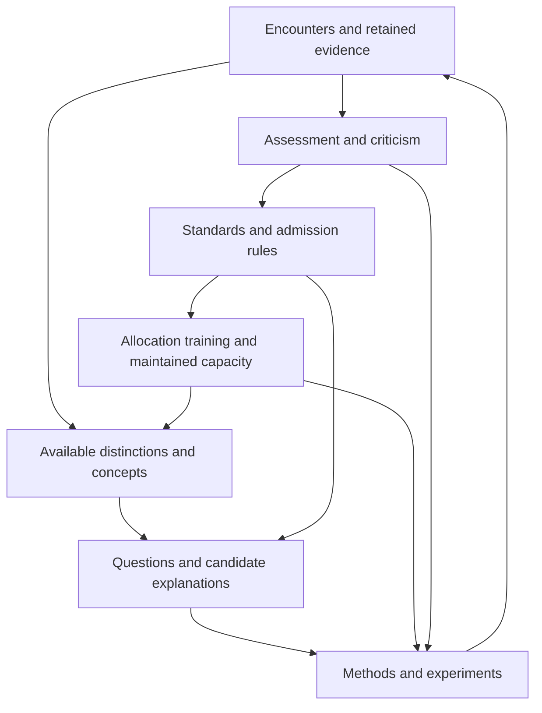

# How inquiry produces and changes its own conditions

Research continuation for Ren, 5 October 2026, Asia/Bangkok. This note follows the [initial investigation of scientific principles](scientific-principles-investigation.md). Ren asked whether the framework could explain how questions, concepts, methods, and standards arise and change, and thus become a theory of science. We developed a candidate explanatory architecture, implemented two restricted calculations, reviewed close primary precedents, and tested the interpretation against counterexamples.

**The promising thesis is that scientific inquiry develops through feedback among the distinctions people can make, the questions they formulate, the methods they can execute, the standards they use, and the arrangements that reproduce those capacities.** Its objects of explanation include the production of new knowledge and the transformation of inquiry itself.

This advances the earlier emphasis on correction. A discovery can introduce a useful distinction without revealing that an old aggregate statement was false. The framework therefore needs an account of knowledge production as well as error detection, and an account of how those activities are sustained and changed.

This is a candidate mechanistic theory of scientific change, with two small implemented components. It is not yet a complete theory, a demonstrated empirical explanation of scientific institutions, or an established original contribution. Several key ingredients already have substantial prior art.

## The move from conditions to mechanisms

The previous work asked what must be true for an investigator to distinguish claims and correct mistakes. The present question asks how the investigator acquires and changes the very means of doing so.

| What changes | Operational question | Candidate mechanisms | What a model must not supply invisibly |
|---|---|---|---|
| Questions | Which alternatives or unknown relations become objects of investigation? | Practical problems, exploratory encounters, recombination, analogy, disagreement, new instruments, prediction failures | The useful question already selected and correctly interpreted |
| Concepts | Which distinctions become representable and usable? | Splitting categories, combining features, detecting relations, constructing measurement variables, revising interpretation | The correct new primitive or its meaning |
| Methods | Which ways of producing and assessing evidence become executable or prevalent? | Experimentation, skill learning, instrument design, comparative checking, imitation, cost and reward | An omniscient choice of the most reliable method |
| Standards | Which questions and claims receive attention, acceptance, or credit? | Experience of failures, criticism, comparison, changes of purpose, negotiation, authority, selection among practices | A universally correct evaluator outside the causal process |

These mechanisms are proposals to specify and test, not consequences of writing more variables into S=(X,T,R,O). A causal account must state who can observe what, which operations they can perform, how proposals are generated, how choices are made, what is paid, and what observations would count against the mechanism.

The central loop is:

The arrows need individual mechanisms. Some expand inquiry; some stabilize useful routines; others prevent a needed change. No direction toward truth or decline follows from the existence of a loop.

Four transitions are especially important to separate: **generation, admission, validation, and propagation**. A question can be conceived yet receive no hearing, receive a hearing but no test, pass a test but receive no uptake, or spread without adequate validation. A theory that treats all four as one act of acceptance will misidentify their causes.

## A discovery that does not refute the old answer

Consider two independent fair binary features C and D. The outcome Y equals 1 exactly when they differ:

| C | D | Y |
|---:|---:|---:|
| 0 | 0 | 0 |
| 0 | 1 | 1 |
| 1 | 0 | 1 |
| 1 | 1 | 0 |

Each row occurs with probability one quarter. The unconditional prediction P(Y=1)=.5 is correct. The predictions conditional on C alone or D alone are also .5. Yet knowing their joint relation predicts Y perfectly.

The distinction “the features differ” supports a new predictive question and a finer answer. It does not falsify the original unconditional statement. In this example, conceptual refinement increases resolution while preserving an earlier truth.

Two obstructions must be distinguished. If observations genuinely consist only of unlinked independent marginal records, the missing joint relation is an information limitation. If complete linked records already exist but the search rule examines features only one at a time, the obstruction is the search procedure. More computation can help the latter without violating the former's information bound.

This suggests a concrete conditional prediction: **a rule requiring every representational change to deliver an immediate individual gain can block a useful combination whose components have no individual gain.** It is a familiar complementarity problem, not a new theorem about all discovery. The explanatory work lies in establishing whether a particular institution or learner actually implements such a gate.

## An implemented model of bounded concept refinement

We implemented a learner with three binary fields, the third irrelevant to the planted relation. Its generic operations fit majority-label prediction tables for every single field and every pair of fields. It receives no world identifier, no XOR operation, and no prevalidated candidate. The hidden rule is used only by the evaluator generating outcomes and checking results.

Training takes one outcome at each of the eight three-field contexts. Fitted prediction error receives a complexity penalty of 1/32 per additional table cell. Ties are deterministic and recorded. Two search procedures use the same raw training records:

1. A greedy procedure considers pairs only after some singleton improves the penalized fit. If so, it considers pairs containing the best singleton.
2. A bounded pair-search procedure fits every singleton and pair, then selects the best improving table.

If a procedure nominates a candidate, it buys a separate validation outcome at each of the eight contexts and adopts only if at least seven predictions match. The data used to generate a candidate are not reused as its validation outcomes. Both protocols are analyst-supplied; their autonomous invention is not modeled.

Each outcome costs one unit, each singleton or pair fit costs .25, and later predictions using a field cost .02 per retained field per decision. The initial constant fit is common and assigned no additional fitting charge. Access to the controlled context grid is supplied, with no separately priced setup action. Loss is a unit for each wrong prediction plus these declared costs. The comparison allows 100 subsequent decisions with uniformly distributed contexts; baseline prediction error is .5. These are illustrative cost choices, not estimates of human research expense.

| World | Procedure | Probability of adoption | Expected inquiry cost | Extra total loss versus no study over 100 future decisions |
|---|---|---:|---:|---:|
| Noiseless relation | Greedy | 0 | 8.75 | +8.75 |
| Noiseless relation | Pair search | 1 | 17.50 | −28.50 |
| Relation with 25% independent label noise | Greedy | .005600 | 11.4371 | +11.4483 |
| Relation with 25% independent label noise | Pair search | .110775 | 16.0542 | +14.1197 |
| Independent fair labels | Greedy | .015106 | 12.4023 | +12.4326 |
| Independent fair labels | Pair search | .025818 | 15.3750 | +15.4481 |

Negative extra loss means improvement after charging inquiry and subsequent feature use. In the noiseless case, pair search learns the four-cell table implementing the relation and validates it. The analyst can describe that table as mismatch; the code does not invent that semantic name. Greedy search stops at the singleton plateau.

The negative controls matter. With 25% noise, pair search produces useful prediction gains on some paths, but they do not recover the inquiry cost over this horizon. Adoption is not synonymous with successful discovery: some accepted candidates have no positive deployment value after feature costs. The validation threshold tests predictive matches and does not itself optimize cost or horizon. Under fair independent labels, neither procedure has genuine predictive value and either can adopt a spurious pattern. Conditional on any selected candidate under that specific null, the validation-pass probability is 9/256; the pair-search proposal probability is 47/64, yielding unconditional false adoption 423/16384. These are one-episode results under that null, not general false-adoption or lifetime guarantees.

**Information caveat:** this experiment uses a fixed complete context grid. Its full transcript differs between the noiseless relation and independent-label worlds; even the total number of positive training outcomes can differ in distribution. We do not claim that this entire training experiment lacks an anomaly or is observationally indistinguishable. The observed obstruction is a specified search gate acting on informative data. The unlinked-marginal impossibility example is a separate construction.

**Scope:** the objective of prediction, base fields, grammar, costs, and validation rule are supplied. The learner generates and assesses a composite representation within that grammar. This is a local model of concept refinement and candidate-question formation, not unrestricted conceptual creativity or discovery of new purposes. Actual realized costs differ; the table is a priced comparison, not an equal-expenditure experiment.

The [exact results](concept-generation-results.json) and [reproduction code](reproduce-concept-generation.py) preserve all four noise levels tested, including .1. All probabilities use rational enumeration rather than sampling.

## A mechanism for the spread of methods under fixed standards

A theory of science must also explain why a method persists when it is unreliable. Desirability under an epistemic aim and prevalence within an institution are different variables.

As a deliberately restricted reconstruction, suppose method j has sensitivity sⱼ, false-positive rate fⱼ, cost cⱼ, and faces a true-claim prevalence π. A positive result earns credit u. A reported false positive is detected later with probability d and incurs penalty λ. Then its expected institutional score is

\[
R_j=u[\pi s_j+(1-\pi)f_j]-c_j-\lambda d(1-\pi)f_j.
\]

A further propagation rule is required. For example, if the share x using a careful method follows \(\dot{x}=x(1-x)(R_c-R_q)\), the sign of the score difference determines its increase in the interior. This imitation equation is an assumption, not a consequence of the score formula. Scores may be negative; they are not probabilities, offspring counts, or certificates of financial survival.

For equal sensitivity, let the careful method reduce false positives by Δf>0 at added cost Δc>0. Then

\[
R_c-R_q=(1-\pi)\Delta f(\lambda d-u)-\Delta c.
\]

Carefulness receives the higher score exactly when

\[
\lambda d>u+\frac{\Delta c}{(1-\pi)\Delta f},
\]

for π<1. Thus improvements in error detection change propagation only through the specified feedback and reward mechanism.

With π=.1, common sensitivity .8, u=1, quick/careful false-positive rates .2/.05, and costs .1/.3, the threshold is λd>67/27. With penalty λ=4, it becomes d>67/108≈.62037. At d=0, quick has the larger score; at d=.7, careful has the larger score. Direct enumeration of all truth, result, and later-detection outcomes reproduces the formula exactly. [Results](method-selection-results.json) · [Code](reproduce-method-selection.py)

The model assumes equal study opportunities per unit time, correct later detection, equal d conditional on each method's published false positives, and collectible penalties. Audit expense, censorship, strategic avoidance, false accusations, learning d, and renewal of the auditor's resources are unmodeled. Changing these can change the conclusion. This is not a recommendation for harsher penalties.

This calculation explains a possible selection pressure on supplied methods under specified enforcement practices. It does not explain how their content was first invented, how the reward rule itself arose, or whether the standard is legitimate. It is closely related to existing models of scientific incentives; it is included for its transparency, not mathematical originality.

## How standards themselves could change

Three kinds of change should remain distinct. **Learning about reliability** can alter a procedure while preserving the target: repeated reports of instrument failure motivate new calibration requirements. **Changing what matters** can introduce a new target or protected population. **Changing institutional rewards** can alter what receives attention while leaving both declared aims and method performance fixed.

To make standards revision endogenous, a next model must specify how evidence of method failures becomes available; how agents propose a modified rule; who can evaluate and enact it; and how its enforcement is financed. Assigning a variable Vₜ to “standards” and allowing it to change explains none of these transitions by itself.

A first bounded mechanism could retain reported predictions, record later independently accessible outcomes, propose edits to an acceptance rule from a generic edit grammar, and compare those edits on fresh cases. Agents would pay for generating and checking an edit; the institutional reward would depend on specified observable consequences rather than the experimenter's hidden truth. Changes to the underlying goals would be recorded separately from improved performance under a continuing goal. This mechanism is proposed here and not yet implemented.

No permanent universal scalar is necessary for every local comparison. We can compare error, delay, expense, and specified harms separately, require protected constraints, and prefer a change that improves one dimension without worsening the others. Tradeoffs may remain unresolved. For a standard change, evaluate old and new procedures under both old and new criteria when meaningful; this distinguishes target changes from better performance on a continuing target. It does not decide the legitimacy of a newly chosen aim.

Self-application need not demand infinite prior certification. A finite investigator can provisionally hold some references and aims fixed while checking a method, then later revisit those references or aims. This produces conditional warrant, not an infallible external standpoint. A framework that treats every success and every failure as support for itself would lose its empirical content.

## Close precedents and the contribution still to establish

**Discovery across interacting spaces.** Klahr and Dunbar's 1988 primary study models interaction between hypothesis and experiment search. The inspected paper reports constrained human discovery tasks, not an unrestricted theory of invention. It is a direct precedent for experience changing candidate formation. [Primary text](https://www.cs.northwestern.edu/~paritosh/papers/sketch-to-models/klahr-dunbar-dual-space-search-cogsci-1988.pdf)

**Representations and experimental paradigms.** Schunn and Klahr's 1995 four-space model adds data representations and experimental paradigms. The primary AAAI version also discusses cost, risk, information, and feedback about expected experiment success, and explicitly limits its account of generating representations. Thus neither multiple interacting search spaces nor resource-sensitive discovery is new here. Read pp. 40–43, especially the limitation on representation generation on p. 43. [Primary text](https://cdn.aaai.org/Symposia/Spring/1995/SS-95-03/SS95-03-009.pdf)

**Revisable appraisal.** Kuhn's *Objectivity, Value Judgment, and Theory Choice* describes multiple appraisal criteria whose application and relative weight can differ. Longino's 1996 *Cognitive and Non-Cognitive Values in Science* examines background assumptions and locally revisable standards, including engagement with Laudan's account of theories, methods, and aims. These are substantive antecedents, not versions of our score formula. Read Kuhn's primary excerpt and Longino pp. 39–40 and 54–55; access to the latter was intermittent. [Kuhn excerpt](https://cseweb.ucsd.edu/~goguen/courses/268D/kuhn.html) · [Longino primary scan](https://joelvelasco.net/teaching/5330/longino1996.pdf)

**Institutional propagation.** Smaldino and McElreath's 2016 model allows publication rewards to select research methods that impair reliability without requiring deliberate fraud. Our score example is a restricted reconstruction of this kind of mechanism. The 2023 replication and companion correction identified implementation problems while retaining the main modeled deterioration result. That supports scrutiny of the model, not universal claims about institutions. [Original](https://arxiv.org/abs/1605.09511) · [Replication](https://pmc.ncbi.nlm.nih.gov/articles/PMC9943874/) · [Correction](https://pmc.ncbi.nlm.nih.gov/articles/PMC10480692/)

**Distributed exploration.** Weisberg and Muldoon's 2009 epistemic-landscape model studies collective search under different strategies. Its supplied significance landscape and simplifying assumptions delimit the comparison; it is not a proof that dissent always improves science. Read §§2.1–2.2 and the closing robustness discussion. [Author-uploaded primary text](https://www.researchgate.net/publication/257943182_Epistemic_Landscapes_and_the_Division_of_Cognitive_Labor)

The outstanding contribution is therefore more specific than “science has feedback.” We should test whether explicitly modeling how present inquiry creates, spends, preserves, or removes the means of later inquiry improves explanation and prediction beyond fixed-access learning, exogenous-resource models, and existing models of discovery or institutional incentives. Novelty remains unestablished. A complete primary reading of Laudan's *Science and Values* is especially important; only publisher description and Longino's engagement were inspected in this pass.

## A theory needs outcomes it rules out

Some limiting cases are already clear. A resolved finite question can justify closing a laboratory. Stable assumptions can make productive work possible. Open debate cannot distinguish worlds through an uninformative channel. A narrowly correct closed procedure can answer a stable supplied question. Strategic investigators can adapt to audits without improving reliability. Generic feedback and revision also occur in engineering, journalism, and ordinary inquiry; this architecture alone does not demarcate science.

A theory of science can share general mechanisms with these activities while studying science's particular instruments, training, public records, distributed criticism, and institutions. It need not claim a timeless necessary-and-sufficient definition. But it must explain specific scientific transitions, not merely rename every activity as inquiry.

The next discriminating study should compare three models of the same laboratory community: fixed capacities; externally declining capacities; and capacities changed by the community's own allocation, retention, and reward choices. Allow bounded question generation, concept refinement, and acceptance-rule edits rather than supplying a correct revision. Cross a current-output reward rule with access to pair-recording or calibration, its maintenance price, and whether a later world makes that capability valuable. Freeze mechanisms, evaluation worlds, and criteria before assessing outcomes.

The central prediction is an interaction: **reward-driven removal of a capability should impair later discovery specifically when that capability would have supplied the needed distinction.** A funded preservation or rebuild route should reduce that deficit when timely and worth its cost. Stable worlds, substitute channels, expensive maintenance, shared calibration faults, and false proposals must supply negative controls.

Measure capability loss before the later need, generated and admitted questions, representation changes, error, discovery delay, actual cost, and institutional reward separately. Match resource allowances and price actual expenditure; do not assume equal caps mean equal spending. Equalizing acquired information is a mediation control, not an automatic refutation of an information-based mechanism.

The mechanism loses support if the predicted interaction is absent where its conditions hold, the proposed capacity change does not mediate the effect, agents do not follow the posited rules, or simpler models predict the interventions equally well. Success in a simulation would establish consequences of its assumptions. Human discovery tasks and prospectively assessed institutional cases would still be needed to explain actual science.

## What this continuation establishes

| Component | Current status |
|---|---|
| Conditional information, checking, and resource constraints | Derived in the preceding investigation |
| Production of a useful composite distinction | Implemented and exactly checked within a supplied finite grammar |
| Failure of a singleton-improvement admission gate | Exact constructed example, with noisy and null counterweights |
| Selection pressure on methods under observable credit and later penalties | Exact score calculation; propagation law is supplied |
| Standards generated and revised from experience | Specified as a next mechanism, not implemented |
| Joint self-renewing research community | Prospective design, not run |
| Historical or empirical theory of science | Open; requires comparison and evidence beyond these constructions |

The earlier instrument-laboratory study also remains unrun. This continuation changes the emphasis toward the formation of inquiry rather than silently reporting that earlier proposal as completed. The original research bundle is preserved unchanged.

The [research and verification record](scientific-change-record.md) summarizes the checks, interpretation corrections, and remaining work. User-facing calculations and results are linked above. Agreement between the independent calculations verifies the constructed examples; empirical assessment remains a separate task.
