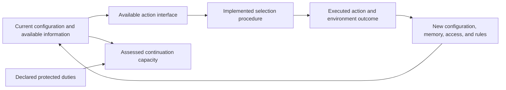

# A formal account of constraints across scale

The central proposal is a theory of **feasible continuation through maintained and revisable prerequisites**. A process can continue, recover, or change only through responses whose required support, distinctions, access, and timing can be jointly supplied. The same constraints can hold at different scales while the organization of work, support, memory, and access changes the outcome.

This cycle gives that proposal a connected mathematical form. It establishes a policy-transport criterion between descriptions, an exact model linking scale to recurring repair and infrastructure expense, and a paid-evidence model for succession. These are conditional results in declared model classes. They do not yet establish a universal empirical theory of evolution, a law of inevitable improvement, or a complete explanation of concept formation.

The distinction matters because it makes the proposal predictive. “Support is needed” alone is too broad to discriminate outcomes. A specified interface, payment schedule, information channel, and disturbance class can predict an exact deadline, minimum reserve, viable range of infrastructure, or error threshold—and can be wrong when applied to the world.

## The common structure

A complete assessment has five parts:

| Part | What it specifies | What is lost if omitted |
|---|---|---|
| Process | Configurations, possible actions and outcomes, clocks, outside inputs | The causal mechanism |
| Available control | Decision information, retained memory, actual access, allowed response mechanisms | Whether a response can really be chosen and implemented |
| Test | Protected function, failures, target, horizon, and robust or probabilistic criterion | What success means |
| Implemented selector | The procedure actually choosing actions and changing itself | Why a feasible response is or is not used |
| Scale correspondence | How states, interventions, observations, costs, and tests map between descriptions | Whether a result transfers |

A convenient process representation remains

\[
\mathcal M=(Q,A,W,\Delta,I,\Pi),
\qquad q\xrightarrow{a,w}q'.
\]

`Q` is the configuration space, `A` the described actions, `W` the admitted environmental choices, and `Δ` the transition relation. `I` specifies decision information, and `Π` is the class of physically and informationally implemented controllers under assessment. Time, resource transactions, permission, and memory updates are included in the transition semantics. Every admitted action must have defined outcomes; an invalid or blocked action cannot become successful through a missing transition.

For an application, write a configuration as `q=(x,b,ℓ,m,ρ)`: other physical state, typed accessible stocks, relationships and execution rights, records and controller memory, and active rules or representations. These components may affect one another through transitions. Calling them state variables does not make them interchangeable resources or explain how their changes arise.

Let `B₀` be a nonempty initial uncertainty set consistent with the current information and retained memory. Let `𝒯` be a set of acceptable complete runs, incorporating safety, recovery, deadline, and any declared revision duty. Finite ending is acceptable exactly when the test permits it; a blocked or prematurely terminated run does not pass by default. Define robust capacity by

\[
\boxed{
\operatorname{Cap}_{\mathcal M,\mathcal T}(B_0)=1
\iff
\exists\pi\in\Pi\ \forall q_0\in B_0\ \forall\omega\in\Omega_{\mathcal M}:
\operatorname{Runs}(q_0,\pi,\omega)\subseteq\mathcal T .
}
\]

Here `ω` ranges over all admitted environmental strategies and outcomes, with its information and move order declared. `Runs` includes every admitted realization of internal random choices; this all-run guarantee differs from probability-one success. The policy must include an implementable memory mechanism whenever memory is restricted or paid. A random seed cannot serve as an uncharged record of discarded observations.

For uncertain stochastic environments, a different declared test may ask for success probability at least `1−ε`, expected expense, or a tail bound. This requires probability kernels and a specification of what uncertainty remains adversarial. Expected performance and guaranteed continuation are different quantities.

A single yes/no capacity is usually insufficient. The useful object is a **profile of capacities over a declared family of tests**: what can be maintained, what can be repaired, which successors can take over, and which revisions can be put into effect. Test choice records whose functions and interests are protected; it is not supplied by the mathematics.

## The constraints and their feedback

The formal core has three unavoidable compatibility requirements and one dynamical question.

**Support at every prefix.** For each typed stock, every required payment must be affordable when due. If `b_j=b₀+Σ_{t<j}v_t`, then every admissible prefix must satisfy `b_j≥0`. Conversions, loans, remote holdings, replenishment, and access delays require explicit routes. Equal totals at the end do not imply a feasible beginning or middle.

**Responses based on available distinctions.** If two decision histories leave the same accessible information and controller memory, an admissible controller gives the same next-action distribution. Different correct responses in those histories require a new distinction, a useful retained one, or a response that works in both. The analyst's knowledge supplies none of those automatically.

**One jointly executable sequence.** All prerequisites must coexist or be obtained in a compatible order before their deadlines. Individually obtainable information, permission, and materials may compete for the same money or time. Authority is modeled as actual standing or access; its legitimacy is a separate substantive question.

**Feedback into future capacity.** Current activity changes stocks, apparatus, memory, relationships, and rules, which changes later feasible policies. The question is therefore not only whether a response exists now, but what the implemented activity does to future response capacity.

A simple causal diagram is:

The selection procedure itself may be represented in the configuration and revised by a transition. A proposed amendment then has the same questions of evidence, generation, authorization, implementation, and future consequences as any other action. An encoding of changing rules does not explain the invention of a rule outside the supplied grammar.

## What a change of scale must preserve

Three operations often called scaling have different meanings.

A change of units or an invertible relabeling changes the description. If costs, clocks, observations, actions, and tests are transformed consistently, capacity is unchanged. For example, the necessary repair obstruction `dL≤B`, where `d` is minimum depletion rate and `L` minimum repair delay, has the unit-invariant ratio `dL/B` when `B>0`.

A coarser description discards distinctions. A sufficient criterion for preserving a guarantee is that an abstract response can be implemented as a concrete procedure using available information, every possible internal outcome is covered, all internal payment and safety constraints hold, and duration and memory are accounted for. Equality of endpoints or aggregate balances is insufficient.

A physical change in size or connection changes the system. Adding modules while sharing one diagnostic interface changes workload per channel. Replicating both modules and their support can preserve that ratio. Changing ownership or read rights may remove usable evidence without changing the raw record. Such changes can reverse outcomes while the constraints remain the same.

The [transport theorem](constraint-transport.md) formalizes the bridge: a winning abstract policy lifts through a certified implementation of each abstract step. Certificates must preserve information, permitted control, internal safety and resource prefixes, endpoint relation, and bounded time. A reverse implication needs separate justification, such as a reverse certificate. Composing certificates can transport a result through multiple scales, with the time and expense bounds composed as well.

A coarse state need not be a sufficient predictor. For example, take the deterministic cycle `a→b→c→a` and label both `a,b` as `0`, and `c` as `1`. After macro-history `10`, the present `0` represents `a` and is followed by `0`; after `00`, the present `0` represents `b` and is followed by `1`. Current label `0` alone loses the needed phase. A valid coarse model must retain suitable memory, retain history-dependent transitions, or explicitly accept uncertainty. A declared approximation needs an error bound appropriate to the test.

## An exact scale and renewal result

The [integrated model](scale-and-renewal.md) has `n` modules, `k` shared diagnostic channels, and a mandatory diagnose–authorize–execute repair sequence. Each stage costs one and takes one slot; diagnosis is the shared bottleneck. Every fault wave affects all modules, and production resumes only after all are repaired.

Let `c` be per-module operating cost per slot, `p` healthy per-module surplus before diagnostic upkeep, and `u` upkeep per channel per slot. Fault onsets are separated by at least `Δ` slots, may begin immediately, and repair must finish within `H`. Define

\[
T=\lceil n/k\rceil+2,
\quad C=3n+(cn+uk)T,
\quad q=pn-uk.
\]

`T` is fastest repair duration, `C` its total expense, and `q` healthy cash increment. With starting cash `b₀` and carried-cash cap `B`, indefinite solvency and timely repair are possible **exactly when**

\[
b_0,B\ge C,\qquad T\le H,\qquad q\ge0,
\qquad \max(\Delta-T,0)q\ge C.
\]

The first inequality supports the first repair. The last replaces each repair's expense before the earliest next wave. A positive long-run deficit cannot be solved by any larger finite starting reserve. A fastest pipeline attains the criterion; allowing the controller to choose arbitrary slower schedules does not improve it in this declared model.

For `n=8,c=1,p=4,u=2,Δ=8,H=6`:

| Diagnostic channels | Repair duration | Repair expense | Replenishment before earliest next fault | Outcome with sufficient starting cash |
|---:|---:|---:|---:|---|
| 3 | 5 | 94 | 78 | Recurring deficit |
| 4 | 4 | 88 | 96 | Sustains every admitted sequence |
| 5 | 4 | 96 | 88 | Recurring deficit |
| 8 | 3 | 96 | 80 | Recurring deficit |

Only four channels work at this size. Extra installed channels cannot be shut down in this comparison and incur unavoidable expense. Adding free optional actions would be a different comparison.

Write `r=k/n`. The same conditions depend on `r`, per-module reserve, and the same prices and disturbance parameters. Exact proportional replication preserves feasibility. Fixed `k` with growing `n` eventually misses any fixed deadline. In this parameter regime the viable ratio band is precisely `1/2≤k/n≤9/16`, subject to sufficient cash. Integer apparatus counts make some small sizes infeasible and larger designs feasible. The common constraint predicts the differences; it does not require identical behavior.

Installation expense adds another decision. If channels cost `F` each before operation, minimum total endowment for a recurrently viable design is `Fk+C`. Under a nearby regime with maintenance `u=1`, the cheapest design uses four channels when `F=1`, but three when `F=10`. No preference for maximum repair speed, maximum size, or maximum redundancy follows without an objective and its costs.

## Evidence across time and succession

The [paid-memory study](paid-memory-and-succession.md) follows one binary condition through turnover. The predecessor holds an old report; the successor may inherit it through a paid channel, obtain a fresh report, or act without one. The actual report register can be preserved, blocked, or erased. The actuator receives that physical register rather than the solver's history. Fees and architecture are chosen before the hidden report, preventing them from secretly encoding it.

For a stationary symmetric binary condition that flips with probability `η∈[0,1/2]` each tick, the minimum error from an accessible report of age `a` is

\[
\boxed{e(a)=\frac{1-(1-2\eta)^a}{2}.}
\]

This formula concerns a supplied stochastic process and an expected-error test. If the report is inaccessible or the relevant register is erased, the best error is `1/2` under the uniform prior. For a fixed unknown condition (`η=0`), a retained accessible report enables exact response; after all informative channels are erased, no common response guarantees success in both conditions. Fair guessing achieves worst-case success `1/2`.

For `η=0.1`, a one-slot gap before handoff, and the supplied prices and latencies, inherited evidence costs `0.8` and gives error `0.244`; fresh inquiry costs `4.2` and gives error `0.18`. A chosen objective `cost+20×error` prefers inheritance. A requirement of error at most `0.2` instead requires fresh inquiry. If fresh inquiry misses the deadline, neither route meets that quality requirement. A cheaper average score and satisfying a protected quality bound are different tests.

Increasing the prehandoff gap to eight slots makes reacquisition preferable under the same score. Slowing the condition's change to `η=0.001` makes inherited evidence preferable again at that gap. Even an unchanging condition can favor reacquisition after a sufficiently costly storage interval. The constraints retain their form while evidence age, persistence, access, and retention expense change the result.

The report also compares equal already-paid archives and equal cash with open versus blocked handoff; when a fresh test is too slow, the best attainable errors are `0.244` and `0.5`. Raw information somewhere in the system is not equivalent to timely usable information at the successor.

The same memory model also has an exact time-scale transformation. Grouping `k` ticks gives an effective flip rate `ηₖ=e(k;η)`, and `e(kn;η)=e(n;ηₖ)`. Matched evidence age has the same predicted error. Preserving the full handoff guarantee additionally requires transforming storage bills, payment order, access, and deadlines; matching the error formula alone is insufficient.

These finite handoffs can be repeated under an explicitly supplied per-epoch funding arrangement. They do not complete an endogenous production-and-succession model or imply perpetual error-free service when each handoff has positive error. That remains a distinct integration task.

## Capacity, actual evolution, and evaluation

A feasible winning controller is a possibility claim. The actual system runs some particular selector `σ`, so its behavior is described by its own runs or outcome law. Capacity does not imply that `σ` discovers the winning controller, chooses it, or retains it through succession. In the eight-module example, a selector minimizing repair time chooses eight channels and loses sixteen cash units per earliest cycle. A selector requiring recurrent feasibility chooses four and can continue. A selector that rewards immediate output can likewise spend a reserve or destroy a correction interface needed later. Selection can transmit that behavior if its contribution and inheritance mechanisms favor it.

To explain actual evolution, the model must supply candidate generation, evaluation, action selection, and transmission or learning. If those mechanisms change, their update process and support costs belong in the dynamics too. The capacity theory constrains the resulting process; it does not replace these mechanisms with an inevitable tendency toward viability.

Nor does persistence establish goodness. An arrangement can maintain itself while narrowing other people's agency. A legitimate dissolution can preserve people and functions better than organizational survival. Ethical evaluation requires explicit protected interests, standing to contest, acceptable harms, and rules for changing those commitments. Permission in a model is not a proof of legitimate authority.

The philosophical idea of continued becoming can be investigated through a changing profile of functions, recoveries, successors, and revisions. This operational profile does not exhaust its meaning or privilege permanent preservation of one carrier.

## What the full picture now includes and what remains open

| Question | Present result | Remaining bridge |
|---|---|---|
| What makes continuation feasible? | Explicit policy, information, support, timing, and access semantics | Independent measurement in a real system |
| Can a result move across scales? | Sufficient implementation and composition certificates | Exhibiting a certificate or validated approximation for each application |
| Why can outcomes differ by scale? | Exact shared-capacity and recurring-expense frontier | Testing the supplied architecture and alternatives |
| How can evidence survive replacement? | Paid memory, access, staleness, and successor decision mechanism | Realistic multi-party handoff and contested interpretation |
| Why is a feasible response chosen? | Clearly separated actual-selector object | A causal generation, learning, selection, and transmission model |
| How can the repertoire itself change? | Represented rule updates and certified revisions | Concepts or mechanisms outside the analyst's supplied family |
| Which continuations deserve protection? | Explicit test and affected-party commitments | Substantive ethical and institutional justification |

A testable cross-domain hypothesis is now sharper: **independently measured support, information, timing, and access structure predicts intervention outcomes beyond current output and aggregate reserves.** A useful test must freeze the boundary, substitute routes, response mechanisms, and mapping before observing held-out interventions. Delaying replenishment, changing channel concurrency, blocking handoff, or changing evidence age should have the predicted consequences within measurement tolerance. A missed threshold, an unmodeled usable substitute, or a failed intervention correspondence counts against the claimed model; it cannot be repaired indefinitely by renaming the premises.

The next formal extension should model the adoption and transmission of these selectors on the same physical process, with paid learning and a control in which continued maintenance is unnecessary. The next empirical application should begin with two implementations of the same measurable function at different sizes, rather than two domains linked only by analogy. That makes workload, access, repair time, evidence age, and recurring expense comparable. Subsequent domain transfer can then test the same measured relation with a new, independently justified map.

The resulting working theory is broad enough to connect renewal, correction, succession, and rule change, while precise enough to separate a proved constraint from an untested mapping. Its central claim is that the requirements for feasible continuation retain their form while the organization that satisfies them changes across scale, space, and time.

## Evidence and research record

The mathematical tools are established. The [source audit](universality-audit.md) connects this account to controlled aggregation, predictive state, temporally extended actions, and feedback refinement, with access limits and precise scope. In particular, [Givan, Dean, and Greig](https://cs.brown.edu/people/tdean/publications/archive/GivanetalAIJ-03.pdf) treat equivalence in finite decision processes; [Reissig, Weber, and Rungger](https://arxiv.org/html/1503.03715) show why usable control interfaces matter to refinement. Neither source establishes this project's empirical or normative claims.

The [claim register](CLAIMS.md) separates definitions, proofs, constructed examples, and open hypotheses. The [verification record](verification/verification-receipt.json) identifies the scripts and preserved results. Code agreement checks the supplied models; it does not verify that real systems have their mechanisms. The prior [second cycle](../cycle-2/README.md) and [foundations](../formal-foundations.md) retain the derivations this cycle extends.
