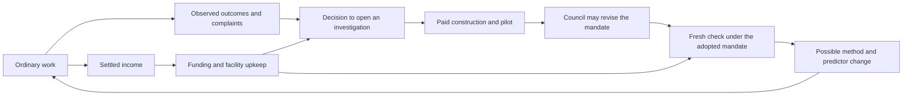

# An integrated mechanism of scientific change

## What is now implemented

The remaining integration is implemented as one continuing, bounded community. Ordinary work produces outcomes and income. Observed shortfalls can open a paid investigation. A council can change whose outcomes count in the institutional mandate. A fresh comparison can change the method and the predictor actually used. All of this draws on the same cash account as the maintenance and rebuilding of the checking facility.

This supplies an executable example of the proposed mechanism. It does not establish that the mechanism explains all scientific change, that its particular institutions are desirable, or that it is historically novel. The broader argument and relationship to existing work remain in [Mechanisms of scientific change](mechanisms-of-scientific-change.md).

The core proposition is now more precise: **a community can change the arrangements that determine its next inquiry, while depending on ordinary activity to maintain its ability to investigate those arrangements.** The same feedback can support discovery, delay it, or exhaust the institution's resources.

Every connection in this diagram changes an implemented transition. It is not a diagram of variables whose relationships are left to the reader.

## What the community does

There are two groups, A and B, and one service request from each in every round. Each request has three binary features and a binary outcome. The institution initially evaluates scientific proposals using A's prediction error, although it serves both groups and keeps separate error summaries for both. All scenarios last 700 rounds, so each group has exactly 700 requests whether or not the community can afford to serve them.

Initially, one feature predicts both groups' outcomes. In the lasting-opportunity environment, B's outcome later depends on a relationship between two features: their exclusive-or. Neither feature separately predicts that relationship. A supplied search rule requires a useful single-feature improvement before admitting a combined representation. The proposed edit removes that prerequisite. The candidate is constructed by fitting finite tables; no procedure inserts the correct combined predictor by knowing the world type.

This is a small example of concept construction and admission-rule revision. Its representation grammar, permissible rule edit, and testing procedure are supplied. It does not generate arbitrary scientific languages or revise every higher-level rule.

The community can open a review after a sustained error threshold, a qualifying B complaint, or sufficient time without examining its method, subject to a cooldown and affordability. The last condition is an explicit curiosity policy. The institution receives no hidden phase label or instruction to change methods on the date the environment changes.

An opening reserves the priced construction and pilot stage plus a cash floor. A separate affordability decision follows once the candidate, mandate, and fresh sample size are known. If the full check is unaffordable, the attempt ends without installing the proposed method. Its spent money and review index remain spent.

Ordinary records retain recent group error summaries; they do not retain complete linked feature/outcome records for replay. The checking facility provides the prospective linked records and shadow forecasts required by the implemented review route. It costs money to maintain, can be lost, and can be rebuilt. This establishes dependence on that specified route. It does not prove that every possible alternative form of checking would require the same facility.

## How a purpose changes

The council represents three supplied interests: A, B, and a steward concerned with the worse-served group, operating expense, liquidity, and avoiding observed harm to A. A paid pilot informs their ballots. A majority can give B standing in the mandate, changing its weights from `(A=1, B=0)` to `(A=1/2, B=1/2)`.

That vote changes the criterion used for a subsequent fresh method comparison. It does not itself certify the proposed predictor. Inclusion can therefore precede the money or evidence needed to act on it.

The two sets of group outcomes remain visible throughout. A changing institutional score cannot erase B's previous failures or relabel an unserved request as a correct prediction. The same fresh comparison is also recorded under both sets of weights as a diagnostic; the unused score is not a second retrospectively selected statistical test.

This is endogenous adoption of an institutional purpose among supplied alternatives. The individual concerns, voting constitution, candidate mandates, and valuation of operating cost remain normative inputs. The council is a central representation of those interests, not a population of independently learning political agents. Its pilot-based judgment is fallible, and a successful vote establishes neither ethical legitimacy nor a mathematical discovery of whose interests matter.

## Evaluation and results

The code, policies, prices, worlds, measurements, and seed rule were frozen before the held-out run. Development used four named seeds. Evaluation then used 64 previously unused seed clusters across six environments and five institutional policies: **1,920 complete runs**. Ordinary exogenous cases are matched across policies within a seed; policies only receive the additional evidence they actually purchase.

These are deliberately constructed environments, including favorable cases. The held-out seeds test reproducibility across simulated cases within those environments. They do not make the worlds representative of human science.

{{RESULT_TABLE}}

Entries count B's wrong completed services **plus unserved requests**, averaged over the 64 seeds, out of 700 requests per run. Wrong answers and missing service are also reported separately in the machine-readable results. The policies are interventions on this program, not estimates of the effects of changing real institutions.

{{RESULT_DISCUSSION}}

The figure uses the first predeclared evaluation seed, 800001. Its choice was fixed before outcomes were inspected. The full table and saved records retain every seed and all five policies.

## One complete recorded trajectory

{{TRACE}}

The important causal distinction is between recognizing a reason to investigate, paying for an investigation, changing the purpose used to assess it, obtaining sufficient fresh evidence, and deploying a different practice. They are separate events with separate failure points.

## What the checking guarantee actually says

At the start of fresh checking, freeze the actual installed predictor package, the proposed package, the adopted mandate, the current task distribution, and the known recurring operating-cost difference `δ`. One observation round provides one fresh case per group. Both passive predictors can be scored against the same outcome because their forecasts do not cause that outcome; both computations and the required linked records are charged.

Let

\[
G_i=\sum_g w_g\bigl(\mathrm{error}_{\mathrm{installed},g,i}-\mathrm{error}_{\mathrm{candidate},g,i}\bigr)-\delta.
\]

Let `W` be the sum of weights for groups on which the two frozen predictors can disagree on an allowed input. Then `G_i` lies in an interval of width `2W`. The known cost difference shifts that interval without widening it. Review `j` receives

\[
\alpha_j=\frac{0.05}{j(j+1)}.
\]

The sample size is fixed before fresh checking; the code targets a radius of .075 subject to a 64–512 round cap. Acceptance requires

\[
\overline G-2W\sqrt{\frac{\log(1/\alpha_j)}{2n}}>0.
\]

Under independent checking draws from the declared stationary review law, Hoeffding's inequality bounds acceptance of a nonpositive-mean proposal by `α_j`, conditional on the prior history and pilot. Conditioning and the union bound extend this to adaptively opened reviews because the allowances sum to .05. Started attempts consume their index even if the pilot fails or the full check is unaffordable. No favorable early prefix can authorize acceptance. If `W=0`, the weighted forecasts agree everywhere and their gain is determined by the known cost difference.

This is a guarantee about the **frozen deployed packages under the current review distribution**. It does not certify the candidate-generating algorithm for all future tasks, the mandate's ethics, or future advantage after drift. Initial bootstrap fitting and the council's pilot-based decision do not receive this outer guarantee. The simulation uses deterministic keyed pseudorandom streams to instantiate the declared draw laws; a fixed tape is not itself a source of mathematical randomness.

One-time research expense is kept in the cash and total program accounts. A positive recurring deployment gain does not imply that the research pays back its total cost. The conversion between operating currency and error in this objective is supplied, not deduced from the theory.

## Material accounting and audit

All named costs draw on the same account: acquisition, field reading, linkage, fitting, forecasts, opening, hearings, checking, ordinary operation, refunds, upkeep, and rebuilding. Cash enters through endowed initial capital and settled service fees. There is no borrowing against future revenue and no unrecorded rescue transfer. Outcomes and fees settle within the service round; a full review is an atomic experiment during which the task law is held stationary. Long research delays, changing prices inside an experiment, and opportunity costs beyond the named tariffs are not modeled.

{{AUDIT}}

The pre-freeze audit corrected an important deployment shortcut: reviews now compare candidates against the predictor actually installed, rather than silently refreshing the incumbent first. It also corrected omitted computation charges, payment side effects hidden inside assertions, and fitting debits that followed the computation. Those corrections are documented with the development changes; they were completed before held-out evaluation.

## Consequences for the proposed theory

The integration supports several conditional claims more sharply than an architectural sketch could:

1. **A field can lack recognized failure while an excluded group suffers.** An accurate incumbent target does not necessarily generate the question that would broaden it. In this model, complaints and protected inquiry access supply a route beyond the current target.
2. **Purpose, evidence, and capacity can change at different times.** Institutional recognition need not wait for deployment, and recognition cannot by itself finance a valid test.
3. **Preserving inquiry is a resource-allocation policy with opportunity costs.** It enables later revision in some environments and can undermine ordinary service in others. The poverty failure is a failure of the modeled policy under its contracts, not a proof that every alternative policy must fail.
4. **Loss of checking capacity need not immediately destroy existing competence.** Already compiled predictors can keep working in a stable environment. What is lost here is a route to further investigation and revision.
5. **Scientific change can remain path-dependent even with a fixed evidence rule.** Earlier spending, authority decisions, and capability loss change which later experiments become feasible. More favorable evidence is only one part of the transition.

The completed result is therefore a bounded, executable candidate mechanism of scientific change. It closes the requested causal loop within its stated variables. Human validation, unrestricted concept formation, strategic institutional conflict, changing ultimate commitments, and the evolution of the review constitution remain outside this model. Those boundaries define the scope of the finished result; they are not concealed assumptions that the integration solved them.

## Reproduce and inspect

- [Frozen protocol](integration-protocol.md), [development and correction record](integration-development-record.md), and [source freeze](integration-freeze-manifest.json).
- [Validation summary](integration-summary.csv), [complete summary statistics](integration-validation-results.json), and [all recorded runs](integration-all-runs.jsonl.gz).
- [Independent audit](integration-independent-audit.md), [audit results](integration-audit-results.json), and [purpose audit](purpose-integration-audit.md).
- [Reproduction instructions](integration-reproduction.md) and [complete integration bundle](integrated-inquiry-bundle.zip).

The model and numerical evaluation use Python's standard library. Only optional figure regeneration requires Matplotlib.
