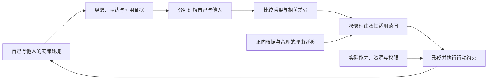

# 认知、理论、理，以及“己所不欲，勿施于人”的位置

2026-10-06。AI 研究综合，回应 [Ren 的新问题](../../../sources/15-codex-theory-conversations/2026-10-06-cognition-theory-li-and-reciprocity.md)。承接[汉字与理论树](HANZI-AND-THEORY-TREE.md)及[先秦／文言研究](PRE-QIN-AND-WENYAN.md)。本轮完成定向原典比较、现行理论接线和条件推论；整条研究方向仍是**可行、尚未完成、可以继续探索**。

**结论：这句话在生成理论中有明确的候选位置——主体理解自己的处境，形成对他人的判断，再检验这种理解对行动提出什么约束。它可以重构为有条件的实践推论；其中“由己知人”的预测部分还能写出误差界。** 认识迁移、理由成立、形成行动习惯及实际做到，是需要连接的不同环节。

## G0 and knowledge

**同日后续 / Later continuation:** [知识的当前专章 / Current knowledge account](KNOWLEDGE.md)区分命题知识、解释性理解与知如何，并以形成的内容、实际整合及失败路径解释认识持有和相关错误范围；20 项 Lean 定理／34 项声明审计保持其精确对应范围。下列“把握”保留为首轮候选，不要求所有命题知识都包含解释性理解。 / The concluded investigation develops cognitive uptake and error scope while retaining the candidate's fallibility. G0 supplies ethical direction without alone identifying knowledge; the checked component is not a complete definition or universal necessity proof.

**2026-10-08，新研究候选 / New exploratory proposal.** 按 [Ren 的新方向](../../../sources/15-codex-theory-conversations/2026-10-08-g0-and-knowledge.md)，从已接受的 G0“整体中的生及其继续生成具有基本正面规范意义”考察知识。工作候选是：**知识是在生成过程中形成的、有根据地把握实际关系，并能在相应范围内进入理解、推论、预期或熟练回应。** 知者与所知在同一展开中分化；共同形成不使所有痕迹、适应或成功都成为知识。“有根据地把握”仍须实质解释，不能把有用直接当作正确。

**Working proposal:** knowledge is a formed, warranted grasp of actual relations, available for understanding, inference, anticipation or skilled response within its relevant scope. Knowing and what it concerns differentiate within one unfolding. Their common formation does not make every trace, adaptation or successful result knowledge; the nonaccidental connection supporting a grasp remains to be explained.

G0 为发展和运用这种理解提供生成方向：理解依存、可能、损失与修复，可以参与生的实现及继续生成。认识如何形成承接已有生成解释；正确与根据是本轮公开提出的认识条件，不冒称从规范公理单独推出。幸运猜中、有益错误、真实知识的破坏性运用，以及有根据地承认未知，均须保留。下一连接是有根据的辨识如何区别于碰巧成功的调整。

G0 gives a generative direction to developing and using understanding of dependencies, possibilities, losses and repair. The formation account draws on the existing theory; correctness and warrant are explicit proposed epistemic conditions, not conclusions from G0 alone. Lucky success, useful error, destructive use of accurate knowledge and warranted recognition of ignorance remain tests. The next connection concerns what separates knowing discrimination from merely successful adjustment. [Argument, inherited evidence and substantive self-review / 论证、已有证据与实质自审](../../../_process/research/2026-10-05-generative-foundation-review/root-foundation/G0-AND-KNOWLEDGE.md). No new theorem or empirical result; the following 6 October study retains its historical scope.

## 1. 认知、理论与理，不是同一层的三个名称

仓库较早的《生生不息论》已经把概念、地图、模型、理论和叙事归入“像”，并用“像亦象”说明表征也在现实中发生；“理”则与象的结构相连。这是既有成稿的思想谱系，不是本次才提出，也不把归档成稿句子全部归为 Ren 的逐字原话。[出处与来源等级](../../../_process/research/2026-10-05-generative-foundation-review/root-foundation/COGNITION-THEORY-MAP.md)

在这个基础上，本轮提出以下工作定位：

| 概念 | 在现有生成解释中的位置 | 判断它是否成立，要检查什么 |
|---|---|---|
| **理** | 所研究的对象与过程中实际起作用的关系、结构和约束；例如哪些条件使某能力得以形成、维持或失效 | 指认了哪些对象和条件？关系是否真的成立？适用域在哪里？ |
| **认知** | 主体形成、使用和修订分辨、预期及理解的实际活动；本轮重点是其中能够形成模型的部分 | 差异怎样进入证据与记忆？怎样影响判断？错误如何发现和修正？ |
| **理论** | 对这些关系与条件作出可表达、可推论、可批评的系统表述，是“像”的一种 | 概念与对象如何对应？哪些是前提、推论、经验支持和未决猜想？ |
| **推理** | 在一定表示和规则中，从已接受的内容转到新判断 | 规则是否保真或保留所声称的可信度？输入是否有根据？ |
| **道理／行动理由** | 某些事实为什么支持一个判断或行动，而不只是事实怎样发生 | 所援引的根据、适用对象、行动者和冲突条件是否成立？ |

这张表是当代工作词表。认知不要求每时每刻都有一套语言化理论；理论也可以分布在文本、仪器和共同探究中。一个错误理论仍是理论，一个有效的认知过程也可能只掌握局部结构。把“理”用作客观条理的名称，不等于把我们当前关于理的表述设为不会错。

古典有相应但不完全相同的区分。《荀子·解蔽》将人的知的能力与可知的物之理相对；《正名》进一步讨论认知能力、所合与心及感官的关系。《韩非子·解老》强调“万物各异理”。这些材料支持逐物、逐条件辨理，不能直接确立所有古人共有一套现代认知模型。《说文》的“理”条还保留治玉义及形声分析，不能把现代“理论”一词的含义从偏旁直接推出。[原典、字义与版本说明](../../../_process/research/2026-10-05-generative-foundation-review/root-foundation/COGNITION-LI-CLASSICAL.md)

## 2. generative model 在这里涉及三类需要区分的对象

如果指我们正在研究的**生成根基**，任务是说明组织、认知、评价和行动怎样在现实中形成，怎样发展或失败。如果指认知科学中的**主体生成模型**，任务通常是描述主体怎样预测观察、推断隐藏状态，并比较可能行动。研究者还会用另一层理论去解释主体的模型。这些对象都可以进入共同的生成解释，但不能无条件互换。

主动推断的一种明确表述，将内部模型对观察的解释与依偏好评价未来行动区分开来。因此表示“他人会痛苦”与把它作为约束己方行动的理由，是可分别检验的环节。[Da Costa 等，2020，§1–3](https://arxiv.org/pdf/2001.07203) 社会认知模型也会分别推断行动者的信念、欲望与感知，而不是直接把观察者的偏好复制过去。[Baker 等，2017](https://www.nature.com/articles/s41562-017-0064)

这些现代模型是比较工具。仓库尚未证明一切认知都必须采用其中某个算法；古典的“知”“恕”也不因此变成古代贝叶斯理论。[现代对照与读取范围](../../../_process/research/2026-10-05-generative-foundation-review/root-foundation/COGNITION-MODEL-COMPARATORS.md)

本轮要推进的连接可以画成：

“己所不欲，勿施于人”可以成为中间几个步骤的简洁行动准则。图中的伦理根据和执行条件仍要落实，不能因为准则简短就被省略。

## 3. 原典本来就把它放在“恕”与实践之中

《论语·卫灵公》中，子贡问能否有“一言”终身行之，回答以“恕”引出这句话。《颜渊》中，它出现在仲弓问仁及敬人、使民的语境。《雍也》则由“己欲立而立人，己欲达而达人”谈到“能近取譬”。这组材料使我们有根据把它研究为**从切近经验出发的实践方法**，而不只是一条脱离场景的逻辑句。[《论语》原文入口](https://zh.wikisource.org/wiki/論語)

《公冶长》又记子贡表达不欲别人加诸己、亦欲不加诸人的志向，孔子答“非尔所及也”。至少可见：表达这个志向与实际达到它，在文本中并未被混为一件事。

章节编号依版本略异：常用的《卫灵公》15.24及《雍也》6.30，在本轮所核维基文库分别标作十五之二三、六之二八；《颜渊》12.2与《公冶长》5.12按所读版本记录。详细段落与链接见[原典笔记](../../../_process/research/2026-10-05-generative-foundation-review/root-foundation/COGNITION-LI-CLASSICAL.md)。以上材料没有宣称人皆同欲，更未给出下文的数学公式；公式是本轮的现代重构。

## 4. 第一条 bounded 结论：由己推人何时保留判断

先固定一个有实际可选方案的情境。以自己的经验作参照，经过角色与情境校准，得到对他人后果的估计。这里“换位”要带上他人的身体、偏好、信息和实际选择，不只交换姓名。

设 \(L_j(a)\) 是方案 \(a\) 对他人 \(j\) 造成的某一明确不利后果，\(\widehat L_{i\to j}(a)\) 是己方据经验和证据作出的估计。数值在同一目标量与尺度上比较，不把不同人的原始感受任意相加。假设在这次比较的方案上，有独立根据支持

\[
\left|\widehat L_{i\to j}(a)-L_j(a)\right|\leq\varepsilon.
\]

那么，若对两个可行方案的估计满足

\[
\widehat L_{i\to j}(a)-\widehat L_{i\to j}(b)>2\varepsilon,
\]

就能推出 \(L_j(a)>L_j(b)\)。证明只需一次误差传播：真实差额至少是估计差额减去 \(2\varepsilon\)，因此仍为正。**也就是说，当推己及人的误差小于判断所留出的余量时，这次由己推人的比较有保证。**

进一步令 \(F\) 为有限、非空的可行方案集，误差界对每个 \(a\in F\) 统一成立。若选择的 \(\hat a\in F\) 使估计损失距该集合上的最小值至多 \(\eta\geq0\)，则

\[
L_j(\hat a)-\min_{a\in F} L_j(a)\leq2\varepsilon+\eta.
\]

这就是一个明确的 bounded 结果：迁移误差与决策近似会限制所选方案的效果。它是标准稳健比较界在本问题中的运用，不主张新数学发现，也不把它当作古人已经写出的定理。[完整条件、证明与反例](../../../_process/research/2026-10-05-generative-foundation-review/root-foundation/RECIPROCITY-BOUNDARY.md)

关键研究任务仍是怎样取得 \(\varepsilon\) 的根据。仅仅“我会这样感受”不能证明这个误差很小；共同脆弱性、相关经验与他者证据可能支持迁移，明确差异则会改变或否定它。数值例中的损失指标也只测声明的后果，不能独占伦理价值。

## 5. 第二条条件推论：从“不欲”到“勿施”

预测比较还没有独自说出“应当”。更强的路线，需要问：**我反对这种对待，依据的究竟是什么？这个根据换到另一个承受者那里是否仍然存在？**

若我反对的是一种无同意、无必要、可避免的羞辱，相关根据可能是这种对待对主体造成的伤害或侵犯。若这些根据在他人身上仍成立，就不能一面承认它们足以构成理由，一面仅以“承受者换了人”为由把理由取消。若主张自我关系或某项责任是理由的必要部分，就须说明它为什么相关，不能只把人称差别放进符号里。

在下列条件下，可以得到一个精确的“勿施”推论：

1. 已独立成立一个反对特定受损或侵犯的正向理由；不把任何即时厌恶都直接等同于有效理由。
2. 他者情境保留了这个理由的充分根据，且有根据将它适用于当前行动者。患者地位与谁有理由行动，都要核对。
3. 有可行的替代方案避免该损失；相关后果、义务和权利比较完整，没有足以抵消或推翻该比较的相反理由，额外伤害也已计入。

由此得到：**当前行动者不应选择那个额外施加了该损失的方案。** 若第 3 项尚未满足，前两项通常只给出一个需要计入、但可能被其他理由抵消或压过的反对理由，并不自动解决全部冲突。这接续[伦理根基的 N1–N4 与无额外代价恶化推论](ETHICAL-FOUNDATION.md)及[慧根研究的患者／行动者理由迁移](HUIGEN.md)。

这项结果不是把“勿施于人”原封不动设为公理。它把准则拆成可分别支持和反驳的条件：受损根据、迁移范围、实际选项、相反理由。**不过，理由的正向根基及跨主体适用仍是实质前提；目前的最低生成条件尚未单独推出它们。** 全部人都不被关切的模型也可对称，仅靠对称性不能生出第一个正向理由。

更换承受者和更换行动者也不是同一操作。一个理由支持我照顾自己，并不只凭给两个人同时改名就变成我应照顾另一个人的理由；后一条连接必须实际建立。

另有一个更直接的人际起点：**若我已正当地要求别人不要对我施加某种损失，我承认的已经不只是自己的厌恶，而是该处境对别人的行动构成理由。** 若角色互换后的情境保留同一充分根据及全部相关条件，一致性便要求我承认对方也能向我提出同类要求。这能约束只为自己保留例外的主张，同时允许双方偏好不同。它提供了“恕”作为人际理由一致性检查的一条积极路线。

## 6. 这条准则怎样帮助生成模型，而不抹平不同的人

| 情形 | 对准则的检验与修订 |
|---|---|
| 我厌恶热闹，但对方主动选择热闹 | 自己的偏好不足以否定对方的选择；更新对他人的模型 |
| 我不愿承认错误，却负有更正错误的责任 | 不欲本身不足以取消纠错理由；考察厌恶背后的根据 |
| 双方都反对没有必要的羞辱，且有同样可行的尊重方案 | 若根据与适用均成立，支持“勿施”的直接条件推论 |
| 某人因威胁而说“我愿意” | 表达、真实处境与授权须分别核对；改变报告不等于消除受损 |
| 制止一个人的伤害行为，使其不悦却保护了别人 | 需要核对正当权限、必要性与较少伤害的替代；不能只记一个人的不欲 |
| 对方不能表达或无法回报 | 无法借互报取得利益不取消已经成立的患者根据；需要其他辨识和代表渠道 |

这些是对当代模型化的检验案例，不声称它们都能反驳对原句的成熟解释。仓库旧稿的“他者与我同为主体；他者非复制之我”已经保留了两端：共同性使推及可能，差异使持续询问和修正必要。

负面准则先约束施加损失，但它并不穷尽积极帮助。原典“己欲立而立人”提供另一条研究入口；不能简单把所有自己想要的东西强加给别人。行动的生成机制还须说明，这些区分怎样进入记忆、习惯、制度与可执行的限制，而不是只存在于纸面的理论。

## 7. 本轮进入派生图的结果与下一步

本轮连接的是：**形成认知与对象区分 → 由自我经验建立可修正的他者模型 → 检验跨主体理由 → 对行动形成约束。** [既有对象分别学习结果](RECIPIENT-CORRECTION.md)说明，照搬己方记录可能失败，分别保存并学习他者后果可以修正行动对应；它并未因此独自推出伦理地位。[科学探究研究](SCIENTIFIC-PHILOSOPHY.md)则要求对宣称的辨识能力给出实际证据与实现条件。

本轮新增的是概念接线、原典对照、手工条件证明和反例。没有新增人类实验、Lean 证明、已形成的心理机制或对整部古典的完备解释。实际律、对象尺度、迁移误差根据、正向理由与行动者适用仍需各自支持。

已有机制已经实现了复制己方估计、再由他者证据纠正的有限实例。下一步应在此基础上，检验初始迁移何时有校准根据，怎样取得误差界、跨对象泛化并支付实际观察成本，以及让有根据的理由实际约束行动的条件。比较直接复制、自我经验经校准迁移、只使用他者证据三种路线；分别评价后果预测、权利与理由、实际执行。不能以研究者的成功分数暗中安装所要解释的伦理选择。

若域内迁移无法校准，便限制或放弃相应“由己知人”的捷径；若另一主体保留同一充分根据却仍不能得到当前行动者的理由，就继续审查根据和适用，而非把争论藏在“相同”一词中；若理由虽成立却无法付诸行动，则转到习成、资源与权力的生成条件。以上工作从已有路线向前推进，尚未完成统一根基。[整合与审读记录](../../../_process/research/2026-10-05-generative-foundation-review/root-foundation/COGNITION-RECIPROCITY-REVIEW.md)
