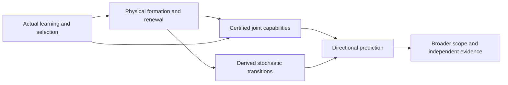

# Physical formation and renewal: branch completion plan

5 October 2026; scope integrated 6 October 2026. AI-assisted execution plan for the physical formation, renewal and directional-comparison branch. The repository's governing goal and completion conditions are in [generative grounding](GENERATIVE-GROUNDING.md). The [three-session integration](../../../_process/history/2026-10-05-repository-reconciliation/three-session-integration/README.md) preserves the incoming plan and accepts its technical contributions at their stated scope.

## The branch goal and what completion means

This branch asks how actual interactions form, maintain, replace or lose organizations and capabilities, and under which conditions their dynamics favor shared continuation. It connects physical formation and renewal, joint capability, stochastic comparisons, architecture, and evidence. Its formal specification supplies constraints and candidate mechanisms to the wider derivation of organization, significance, learning and wisdom.

The repository's immediate foundational priority is how actual constitutive dependencies come to shape a process's own revisable regulation. Physical renewal and its failure conditions contribute to that transition; completion of the chemistry or an RNA assay alone cannot close it. The concern and ethical studies contribute further transitions whose assumptions must be connected, rather than being either appended without a bridge or excluded from the common explanatory task.

Branch completion requires an explicit specification, integrated deductions, empirical support at the scope claimed, and justified coverage. Broader favorable direction is a further testable hypothesis. A negative result can close a candidate route and improve the common account; it does not by itself refute universal explanatory scope. The [whole-foundation completion conditions](GENERATIVE-GROUNDING.md#completion-of-the-unified-foundation) govern the repository across these branch milestones.

Complete replacement of every original carrier is one stringent assay, not the definition of generativity. Durable structures, transformed organizations, branching descendants and maintained ensembles require their own observable continuation conditions and actual support accounts. Preserve the current assay's results while testing whether another organization or unit of continuation addresses the intended question.

Full formalization should lead because it exposes missing premises before another example hides them. It means a precise language, explicit assumptions, theorem statements, proofs or marked proof obligations, and measurable predictions. The ledger, concrete typed reactions, inherited-reserve turnover bound and original-carrier observer implication are now checked in Lean; slot refinement, stochastic and protocol bridges must follow. It cannot validate the physical premises or replace external evidence.

The formalization order is concrete: first type the coupled physical process, permitted observations, resource-dependent interventions and common tasks; then formalize conservation, support, failure and sequential composition; then derive actual formation/repair/succession kernels; finally state and prove the directional comparison under independently testable structural premises. A favorable transition ratio cannot be installed as an axiom and then reported as the explanation. Machine checking should start with the stable finite event tables, ledger invariants, coupling and composition lemmas, preserving the model assumptions explicitly. A successful compilation would certify those deductions, not show that nature supplies their premises.

The [direction-and-turnover clarification](../../../_process/history/2026-10-05-support-and-shared-generativity/completion/DIRECTION-AND-TURNOVER.md) now removes one ambiguous interpretation. A nonconstant capability cannot increase from every state of a finite irreducible process at every time; sustained resource-dependent turnover remains possible at a stationary distribution. In the current absorbing specimen, unconditional productive capability eventually vanishes even with imperfect observations. The positive target therefore needs explicit preparation, support and timescale quantifiers. A maintained regime, an intervention advantage, a stationary comparison and spontaneous temporal development each require their own proof. This rules out a stated overstrong claim; it does not silently substitute another claim for the full goal.

## The argument to complete

Each arrow is an obligation in the [formal specification](FORMAL-SPECIFICATION.md). Separate examples at its endpoints are insufficient. A common positive mechanism should explain the sign of the prediction, including its reversal when support, timing or incentives change.

## Work sequence and acceptance gates

| Stage | Concrete deliverable | Completion test | Current position |
|---|---|---|---|
| 0. Fix the common specification | Operational interface; assay definitions; direction quantifiers; source and conflict ledger | Every used claim has typed premises, scope and output; no pending contribution silently counted as established | Version0.10 adds marked renewal composition, a rate-derived repetition obstruction and a machine-checked original-loss observer; registered source reviews remain complete |
| 1. Realize the existing physical mechanism | One stochastic event model for shared capture/recycling and loss; source/sink/work ledger; seed and restart alternatives | Boundary behavior, balances and event rates checked; deterministic approximation justified where used; physical identification distinguished from model choice | Typed stoichiometry, the carrier observer and reserve bounds are machine-checked; slot refinement and physical calibration remain open |
| 2. Certify its actual joint possibilities | Fixed functional assays with time, energy, information and protected-condition budgets | One implementable protocol realizes each advertised joint profile; comparisons include losses as well as gains | Original eight profiles have rigorous bounds; sixteen sequential profiles now have independently checked floating calculations; a distinct resource-dependent allocation theorem certifies one joint hitting profile; broader capacities remain open |
| 3. Derive the directional prediction | First-passage/exit analysis and full transition graph, or justified reduced dynamics | Rates and approximation errors come from Stage 1; capacity levels come from Stage 2; favorable sign follows after all costs | Whole-entrance/first-turnover composition is certified; repeated-cycle semantics and necessary reliability bounds are derived; broad capability direction remains open |
| 4. Explain actual formation and retention | Connect learned concern, constructed control, resource renewal, revision and succession within one installed process | Positive formation and continuation arise under actual dynamics; suppression, bypass, depletion and calibration failures retained; primitives identified | The existing singleton-lineage architecture has a fuel-independent (3/4)^n repetition upper bound at unit rates; reliable operation requires a demonstrated architectural or contextual change |
| 5. Generalize and test | Mechanism-class theorem plus an independent validation study with competing explanations | Class specified before outcomes; limits and failures predicted; parameters identified separately from evaluation; external data test held-out predictions | RNA task bounds, a measured transfer interface and a signed co-occupancy prediction are available; linked three-cycle joint validation remains unrun |
| 6. Resolve coverage and interpretation | Explicit statement of what physical regimes and claims the finished theory covers | Strong quantifiers defended; unsupported extensions removed from the established results; moral claims separately justified if asserted | Open research, with no guaranteed positive outcome |

Stages 1–3 describe the physical branch's proof dependencies. Stage 4's source integration can run in parallel, but it must ultimately meet the required physical and capability interfaces. Select the next branch task by its contribution to the governing derivation; do not infer scale-independence from completing one proof.

## First proof package

The first component is now written: [a declared stochastic realization](../../../_process/research/2026-10-05-support-and-shared-generativity/completion/STOCHASTIC-REALIZATION.md). Its event law reproduces the deterministic drift and permits a scoped absorption proof. This advances the construction; it does not infer unique microscopic rates from the differential equations or complete the integrated directional theorem.

The [joint-capability bridge](../../../_process/history/2026-10-05-support-and-shared-generativity/completion/JOINT-CAPABILITY-BRIDGE.md) now connects that law to actual joint tests without introducing reduced favorable rates. At a common horizon and reliability, extra recycling improves one reliable output and loses one reliable reserve profile. The [subsequent opportunity audit](../../../_process/research/2026-10-05-support-and-shared-generativity/completion/REGULATION-OPPORTUNITY-AUDIT.md) shows why those are distinct functions: recycling transfers fuel into usable material without reducing assigned work. A reserve loss alone does not establish that regulation is needed to preserve later production. The next construction must address a demonstrated productive conflict and include its own costs. A free controller that can suppress any inconvenient reaction is not an available premise.

That construction has now been attempted in the same process: [fuel-responsive inhibition](../../../experiments/shared-renewal-capability/regulation/README.md) forms from zero, with material, binding, wear and work accounted for. The first prespecified comparison is negative: constructed regulators underperform the absent-regulator arm across the declared tests. More source power and a correct sensing sign are insufficient. Retain this failure while developing the positive explanation; do not silently relabel the regulator as generative or tune away its costs.

The **mechanistic boundary for net useful regulation** now has two new components. The [response diagnosis](../../../experiments/shared-renewal-capability/regulation/response/README.md) applies the exact identity and independently confirms the negative net effect. Construction can irreversibly consume the last productive unit; moreover the proposed inhibitor has not been shown to target a pre-existing productive fuel conflict. The opportunity audit supplies a conditional kinetic inequality for when reduced opportunity loss outweighs productive slowdown, but its rates have not been derived from a resource-dependent physical implementation. These findings redirect the next work from parameter tuning to identifying the opportunity and its physical loss mechanism.

The [delivered-continuation experiment](../../../experiments/shared-renewal-capability/continuation/README.md) now completes the next fixed-model assay: initial recycling and assembly, another assembly in a later window, and productive survival throughout. Faster recycling improves repeated delivery in the tested original pair. All 384 constructed-versus-absent sequential comparisons for the old regulator remain negative. Independent marked-process reconstruction checks the later event directly.

The [resource-dependent allocation-control theorem](../../../_process/research/2026-10-05-support-and-shared-generativity/completion/ALLOCATION-CONTROL.md) then identifies a productive conflict and changes the corresponding interaction. Bound Y is prevented from consuming the last R that can become capture machinery. Actual fabrication consumes one R and one F; finite-rate path bounds show a net gain in fresh capture with both productive forms present, from a common supported preparation with G initially absent. This is a conditional theorem in the same reaction framework, not a successful rerun of the old architecture. The [independent review](../../../_process/history/2026-10-05-support-and-shared-generativity/completion/ALLOCATION-REVIEW.md) checks its hazards, timing, ledger and comparison scope.

The same resource-dependent architecture and target have a proved early disadvantage and later advantage. The new theorem therefore predicts a genuine time reversal after construction cost, rather than demonstrating only a favorable prepared controller. The exact break-even time and general gain/failure surface remain to be derived.

The matched preparation is the counted material and fuel. The compared models still differ in supplied construction-channel availability. Creating G molecules is paid within the enabled network; physically implementing and funding the difference in fabrication capability remains open. This distinction belongs in the full physical identification and architecture-origin work below.

The earlier composition obligations now have a scoped resolution. [Integrated formation and renewal](../../../_process/research/2026-10-05-support-and-shared-generativity/completion/INTEGRATED-FORMATION-RENEWAL.md) uses one N=4 law, a type-neutral joint event and complete four-carrier turnover. [Integrated thermodynamics](../../../_process/research/2026-10-05-support-and-shared-generativity/completion/INTEGRATED-THERMODYNAMICS.md) transfers its strict branch contrast to finite source stocks and reversible reactions with quantified error. The [review](../../../_process/history/2026-10-05-support-and-shared-generativity/completion/INTEGRATED-PROCESS-REVIEW.md) checks the composition and proves the closed model's type-symmetric equilibrium. This finishes one mathematical consistency milestone. Its tiny certified probabilities and extreme uncalibrated hierarchy do not finish physical identification or useful selection.

The [resource-dependent access review](../../../_process/history/2026-10-05-support-and-shared-generativity/completion/PAID-ACCESS-REVIEW.md) adds a stronger finite-event milestone: complete succession has a certified comparison at prespecified unit positive coefficients, with an exact early sign reversal and a narrow effective-rate neighborhood. Its separate reversible H10 construction preserves the baseline sign, although success is only about 2.7e-13 and the source inventory remains enormous. The new [Lean kernel](../../../experiments/shared-renewal-capability/formal/README.md) checks the forward ledger, old construction obstruction and six-capture turnover bound. It does not yet check the typed stochastic model or validate physical premises.

Full formalization now has a concrete dependency order: **typed reactions and carrier histories → ledger projection and exact failure pruning → certified event probabilities and approximation → resource-dependent observation/protocol semantics → joint-capability and directional theorem**. Each arrow must be proved; placing separately correct results next to one another is insufficient. Physical rate identification and source validation run in parallel and determine whether those proved implications describe an actual system.

The [v0.8 review](../../../_process/history/2026-10-05-support-and-shared-generativity/completion/ENTRANCE-DISCOVERY-REVIEW.md) closes two narrower steps: all 42 typed events project correctly into the Lean ledger, and every formation history is retained in the certified entrance comparison. The latter gives about 0.1220% entry through gate0 versus 0.1178% through gate1 by time 10; neither is reliable operation. Full successor composition must use the actual inherited reserve, for which the newly checked capture minimum is 6+m′−m. The earlier selected seven-capture result cannot substitute for this complete kernel.

Two parallel branches now have concrete contracts. [Resource-dependent prospective discovery](../../../_process/history/2026-10-05-support-and-shared-generativity/completion/CONSEQUENTIAL-DISCOVERY.md) detects covered positive-margin omissions without requiring an archival anomaly, conditional on continuing feasible funding and implementable correction. [RNA identification](../../../_process/research/2026-10-05-support-and-shared-generativity/completion/RNA-IDENTIFICATION-CONTRACT.md) reconstructs the published effective matrix and derives a joint replacement boundary, while exposing missing joint preparation, clock, capacity and binding information. The former needs an implemented prospective learner; the latter needs independent measurements and held-out outcomes.

The [v0.9 successor result](../../../_process/research/2026-10-05-support-and-shared-generativity/completion/FULL-SUCCESSOR-RESULT.md) now resolves the whole-entrance first-replacement computation. Its two functions have opposite certified comparisons: replacement allowing reserve spending favors entry gate1, while replacement restoring inherited reserve favors gate0. Total success is only about1.84e−11 at H10. This closes a finite-model interface while demonstrating that the current preparation does not provide reliable regeneration. It is now a gain/failure reference; more arithmetic on the same rare event does not by itself satisfy the physical reliability gate.

The [RNA partial-identification result](../../../_process/research/2026-10-05-support-and-shared-generativity/completion/RNA-PARTIAL-IDENTIFICATION.md) supplies a concrete next empirical contract. A conventional two-RNA restriction has a certified conditional joint probability about0.0866263712553, uniform over printed rounding intervals. Its microscopic enzyme-scale ambiguity preserves the task, while unmeasured joint dependence can change it. Calibrate the task-relevant law or its identified range; require additional microscopic detail only where it changes a claimed functional or support prediction. The population-replacement task still differs from the synthetic original-carrier assay, and the physical test remains unrun.

The [repeated-renewal analysis](../../../_process/history/2026-10-05-support-and-shared-generativity/completion/REPEATED-RENEWAL-COMPOSITION.md) now supplies the actual successor/time/cost recursion and shows why a scalar one-cycle probability cannot be iterated. The [physical critique](../../../_process/history/2026-10-05-support-and-shared-generativity/completion/REPEATED-RENEWAL-CRITIQUE.md) proves a stronger bottleneck than eventual extinction: every N4 organizational return has one Y carrier, yielding a (3/4)^n upper bound for n complete turnovers at the declared rates, irrespective of fuel availability. Reliable repetition therefore requires an identified change to redundancy, birth/wear competition, restart, or the larger coupled organization. Increasing source strength alone is insufficient.

The previous RNA fivefold task also cannot be repeated unchanged inside a retained fixed-capacity droplet. Whole-droplet retention does not dilute its contents. The next preparation is produced by mixing/partition and replenishment; identify that transition before claiming repeated joint renewal. The original one-stage result remains valid with its stated scope.

The [new source audit](../../../_process/history/2026-10-05-support-and-shared-generativity/completion/RNA-REPEATED-RENEWAL-EVIDENCE.md) finds measured mixing and communication interfaces, while preserving the differences among RNA growth, dye calibration and selected image snapshots. The conventional transfer closure already predicts opposite effects of mixing on local joint occupancy for different starting associations and occupancy scales, even with identical separate count distributions. The [exact mixing check](../../../experiments/shared-renewal-capability/renewal-composition/README.md) makes this a discriminating measurement target, not evidence that the repeated functional assay has succeeded.

The next obligations are now:

1. **Complete the formal bridges and the full entrance/return process.** The [resource-dependent access result](../../../_process/history/2026-10-05-support-and-shared-generativity/completion/PAID-ACCESS-SUCCESSION.md) now closes the earlier missing full-successor event: formation, replacement of all four carriers and return have one certified comparison at unit positive coefficients. Its early sign reverses, and its success remains rare. The typed projection is machine-checked; the carrier lift is exhaustively checked; whole-entrance first replacement and reserve restoration now have directed bounds. The original-loss implication is now machine-checked inside a permissive observer. Next prove the actual material-slot refinement and bring the numerical certificate and repeated composition into the same account; extend source/reversibility errors to every reachable cycle entry. The present calculation retains all failures and actual reserves, but does not supply repeated reliable renewal or a physical implementation.
2. **Replace an existence hierarchy with attainable bounds.** Identify one implementation's species, source/waste chemistry and rates separately from its outcome. Specify a meaningful reliability, deadline and measurement error before evaluation. Bound total additional-channel/model error below the predicted effect. A less pessimistic mathematical bound can help, but tuning an arbitrary generator is not physical identification. Large conservative existence margins and real attainable operation are different milestones.
3. **Derive actual retention and spread where claimed.** Include every formation history, failed entry, loss and successor—not only the selected positive branch. Explain how useful activity changes the corresponding material return or propagation law despite faster-copying alternatives. Compare unconditioned organization and output, not just fractions among survivors. For the current closed reversible model, equilibrium is exactly type-symmetric; a maintained nonequilibrium source needs its own work account and derived favorable mechanism.
4. **Carry the resulting law into common joint-capability tests.** Preserve losses, protection, accessible information and changing assay vocabulary. Derive transition or renewal kernels from the physical law; test any claimed order before replacing regions by scalar levels. Specify temporal development, stationary comparison, intervention gain and survival conditioning separately. A useful delivery event is an intermediate certificate.
5. **Test a prediction beyond the conventional baseline.** The reviewed resource-allocation model already predicts both beneficial and harmful inhibition. State the extra quantitative constraint from this theory, identify its parameters independently and evaluate new outcomes, including adverse regimes. Formal consistency does not replace this external test.

6. **Implement resource-dependent discovery within the continuing process.** Extend the assay vocabulary through actual available tests, using D1's coverage and error contract. Charge search, evidence retention and installing the correction alongside existing maintenance. Test omitted consequential distinctions even when old predictions remain accurate. Derive formation and renewal of this testing capacity rather than assuming an indefinitely funded external researcher.

For the empirical branch, first calibrate the RNA preparation's joint occupancy, support capacity, physical clock and growth-to-next-preparation transition. Measure active enzyme or complex lifetimes when those resolve task-relevant ambiguity. The next bounded study is three consecutive cycles in linked reactor replicates, with fixed functional thresholds, minimum local joint occupancy and newly produced functional RNA. Keep all prepared reactors in the denominator; droplets are subsamples. Compare partial-memory transfer with complete pooling, using independently calibrated parameters and held-out conditions. The existing separate-dye and single-channel RNA assays do not supply simultaneous partner outcomes. Establish compatible joint readouts and their effects on subsequent function before evaluating the prediction. This can identify a useful task without uniquely identifying every microscopic parameter.

The first practical handoff has four concrete parts: (a) finish the material-slot-to-Lean observer proof and machine-check marked-kernel composition; (b) specify one resource-dependent redundancy, restart or larger-ensemble mechanism that escapes the present singleton bottleneck, with a derived reliability bound; (c) calibrate its growth/transfer and observation law, retaining compatible-law uncertainty; and (d) run the prespecified finite-round validation with both favorable and adverse conditions. These are acceptance gates, not promised outcomes or estimated completion dates. Existing public sources support preparation of this study but do not replace collecting its missing linked observations.

For this physical branch, the proposed empirical deliverable is a physically calibrated repeated joint-renewal prediction with meaningful reliability, together with a proved mechanism explaining its gain/failure conditions. First establish that the measured transfer process returns to an adequate preparation family and changes the identified singleton-lineage or capacity bottleneck; a successful isolated episode does not establish that return. The whole-entrance successor calculation supplies the synthetic reference; it must not substitute for attainable operation. The existing combined event proof is retained as the consistency reference. The new work must close a named interface rather than supply another disconnected possibility example. The [RNA-network evidence audit](../../../_process/research/2026-10-05-support-and-shared-generativity/completion/PHYSICAL-EVIDENCE-RNA-NETWORK.md) supplies a concrete empirical starting point: account for local association, specificity, replenishment and failed lineages, then discriminate against conventional replication models. Explaining favorable retention remains necessary for a spontaneous direction claim; good engineered performance alone does not establish it.

A further successful example is an intermediate step. The required theorem must state an independently recognizable mechanism class and predict both gains and reversals; its premises cannot be defined by the favorable outcome.

The new allocation theorem supplies one such sufficient class for one joint delivery. It leaves class coverage, broad capability comparison and spontaneous direction unresolved; this intermediate closure does not redefine the full goal.

The old assay vocabulary must also be extended when genuinely new functions are claimed. The regulator adds fuel-responsive chemistry while reducing the tested plant functions; this does not establish an ordering over every possible function. Define the new regulation assay and its intervention/readout costs before evaluation, then compare both arrangements in the same expanded vocabulary. This addresses Ren's original question about possibilities missing from a current model without treating every new structure as automatically beneficial.

The synthetic proof package now connects the existing shared-resource law through whole-entrance first replacement; preserve it as one integrated reference. Extend it or its empirical counterpart only through explicit task, support and observation mappings. The required package contains:

1. An event table and generator, including accessible-work accounting and explicit source assumptions.
2. A small prespecified joint assay suite: material conversion, maintenance/repair, and one second productive function, with any protected reserves separately stated.
3. An exact small-state calculation where feasible, followed by controlled approximations for larger systems. Treat finite extinction, seeded restart and continuing immigration as different physical models.
4. A comparison of functioning renewal and a declared alteration, with construction, competition for resources, and upkeep charged on both sides.
5. A theorem or falsifying witness for the resulting directional claim. Report finite-time and stationary statements separately.
6. An independent derivation/check of the composed argument, including the interfaces rather than only algebra and code agreement.

If the capacity regions are incomparable, retain that result and explain which functions gain or lose. If the sign depends on support or cost parameters, derive the boundary. A precise condition for reversal may be a substantial explanatory advance, while the stronger universal positive objective remains unresolved.

The current supplied repertoire already permits the \(Y\) structure; its invasion exponent does not depend on its shared-renewal contribution. Explaining selection of beneficial coupling therefore needs additional dynamics or a demonstrated regime, not a verbal appeal to persistence. This is an early discriminating test.

## Integration of other sessions

The [integration record](../../../_process/history/2026-10-05-support-and-shared-generativity/completion/INTEGRATION.md) assigns completed work to particular obligations. Contributions include faithful causal reduction, whole-process certification, renewal thresholds, joint capacity, learned and revisable concern, scientific inquiry, and a bounded live-AI succession experiment.

For each contribution record its statement, quantifiers, state and dynamics, preparation, sources and budgets, available interventions, observable and horizon, proof/evidence status, failure cases and outputs. Two results connect only when the first supplies the second's premises, or a new bridge provides a quantified approximation. Repeated summaries and copied experiments do not count as independent support.

The registered contributions now have these statuses:

| Chat | Expected use |
|---|---|
| Unify theory sessions | Completed and integrated: repository preservation, index and provenance; no added scientific evidence |
| Unify theory sessions (2) | Completed and reviewed at commit b379528: conditional joint formation and funded reconstruction accepted with its counterexamples and equilibrium scope |
| Review v0.2 build plan | Registered turn completed and [reviewed](../../../_process/history/2026-10-05-support-and-shared-generativity/completion/APPLICATION-INTEGRATION.md): verified engineered application; human/device/deployment gates remain open; no theory interface closed |

A later turn in **Unify theory sessions** completed at commit c5cf2cc. Its [concern-settlement contribution review](../../../_process/history/2026-10-05-support-and-shared-generativity/completion/CONCERN-SETTLEMENT-INTEGRATION.md) accepts the repaired conditional process and bounded decision results. The human-study protocol remains unrun and supplies no new empirical evidence. This separately completed contribution does not change the consolidation's evidential role.

All registered contributions have now completed and received a scope review. The finite integration follow-up is paused under its existing stop rule; the broader theory goal remains active. A subsequent application audit turn was observed but is outside this fixed theory-integration acceptance set. New directly relevant research can be registered explicitly without reopening completed source reviews.

On completion, freeze the inspected artifact bytes and record hashes, turn identity and reading scope. Treat later edits as deltas. A chat's completed status is provenance, not a correctness certificate. Preserve conflicting results rather than smoothing their differences into a common narrative.

## Evidence path after the first proof

The practical sequence is: finish one physically resource-dependent mechanism and derive its gain/failure boundary; generalize the proof to a stated class; identify one real implementation independently of evaluation; test held-out predictions against established alternatives; then examine whether the same mechanism survives transport to another domain. Selection and renewal of the architecture must be shown within the installed dynamics. A successful intervention does not by itself establish a spontaneous direction of reality. Broad coverage cannot be completed by translating the same simulation into biological and institutional vocabulary.

Before collecting new validation results, freeze the claim, meaningful effect or error tolerance, unit of analysis, parameter-identification procedure, adverse controls and comparison models. Include regimes expected to fail. A favorable fit on the same data used to choose the model is not predictive validation.

Use the existing live-AI handoff work as one bounded source for resource-dependent feedback, maintained records and successor behavior. It does not validate physical universality, human moral development, or an origin of evaluative architecture. A later chemical/biological or institutional test must identify its own mechanisms and measurement limits; a numerical mapping between vocabularies is insufficient.

The [completed Ceroni methods and data audit](../../../_process/research/2026-10-05-support-and-shared-generativity/completion/PHYSICAL-EVIDENCE-CERONI.md) advances the physical evidence branch beyond the earlier abstract-only inspection. The accepted manuscript, supplementary methods/figures, reporting form and selected source-data records were reviewed; exact source bytes are preserved. This engineered feedback addresses a real competition between target expression and host growth. Some controller designs improve growth, while others reduce it despite a higher capacity-reporter readout; these are net package effects, not independently measured molecular costs. In the reported batch comparison, reduced output per biomass can be outweighed by more productive biomass. The audit derives the corresponding finite-batch observation identity, with maturation and loss, without claiming to identify its parameters from endpoint fluorescence.

The controller was installed before the experiment; beneficial construction from zero and architecture discovery remain untested. Source label/summary discrepancies, missing replicate-level late-batch data and unmeasured controller states prevent a defensible full kinetic identification from the inspected files. Preserve these ambiguities rather than assigning labels to obtain a preferred fit. Next, build the conventional resource-allocation/feedback comparison with explicit observation laws and identification requirements; derive what additional quantitative restriction our theory supplies. Then identify parameters separately and freeze a validation plan before evaluating new outcomes. The already-read published results can support a labeled retrospective analysis, not a pristine held-out test. This evidence cannot be transferred to the failed G network by analogy, and recovering an established feedback result would not by itself demonstrate new predictive content.

The [Weiße resource-allocation baseline](../../../_process/research/2026-10-05-support-and-shared-generativity/completion/RESOURCE-ALLOCATION-BASELINE.md) now supplies the actual cellular equations, growth closure, finite-batch balance and a conditional allocation boundary. It distinguishes actual protein mass from a fixed reference mass and records differences between the published supplement and model code. Controller RNA/protein spending, sensing and binding must still be added and identified before using it for the biological feedback system. This is a concrete conventional comparison, not an identification of our synthetic gate or a new validation result.

The [RNA-network audit](../../../_process/research/2026-10-05-support-and-shared-generativity/completion/PHYSICAL-EVIDENCE-RNA-NETWORK.md) supplies another concrete implementation family. It separates evolved interactions from supplied translation and droplet transfer, and derives the joint-moment terms that average abundances omit. Its protocol for identification, complete accounting and held-out prediction is prospective. This work does not yet provide an independently fitted microscopic generator or an extra successful prediction beyond existing compartmentalized replication theory.

A broad theory can earn support through common mechanisms and distinct successful predictions across independently studied domains. An unrestricted claim about every physical realization needs a correspondingly stronger argument. If the project also seeks a literal theory of fundamental physics, recovering or explaining established relativistic and quantum laws is an additional major obligation; this operational interface has not done that.

## Completion discipline

Maintain a versioned claim register with **defined**, **proved conditionally**, **numerically checked**, **empirically supported**, **refuted in stated scope**, and **open** statuses. Publish acceptance criteria before each validation round. Revisions must state why a premise changed and which prior tests cease to apply.

The branch finish criterion is an integrated, scrutinized explanation that satisfies its claimed scope. A polished manuscript, simulation count, agreement among AI reviewers or universal-looking notation does not establish that result. The wider universal explanatory objective continues under generative grounding. Favorable-direction hypotheses remain open to support, restriction or rejection without silently redefining that objective.
