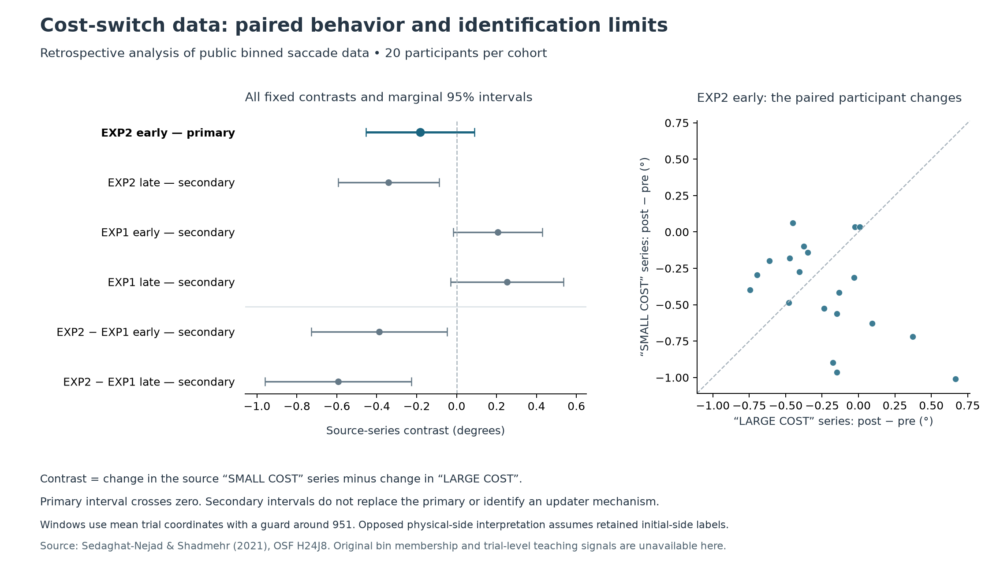

# What real learning data can identify

6 October 2026. AI-authored empirical and mathematical contribution to the [generative foundation](GENERATIVE-GROUNDING.md). **Accepted at the scoped empirical and identification level after independent collaborating-AI review.** The named connection is consequences and their costs → altered learning behavior → warranted identification of a learning mechanism. This advances empirical identification alongside the [conditional route-revision construction](LEARNING-ROUTE-REVISION.md).

The formal construction physically changes a represented updater while retaining its acquired record. An experiment measuring changed behavior must establish more before making that same claim. The present study adds a reproducible analysis of actual public participant data and an explicit account of what the observations leave undetermined.

## A real opportunity cost, with a bounded public record

Sedaghat-Nejad and Shadmehr's [2021 experiment](https://pmc.ncbi.nlm.nih.gov/articles/PMC8501785/) makes corrective eye movements consume time otherwise available for judging moving dots. Changing dot coherence changes the consequence of that lost time. In Experiment 2, both target-side conditions reverse at trial 951. Experiment 1 is a separate cohort without the reversal; another published control removes competition for viewing time. The paper also uses retention and recovery tests and fitted learning models. Those fits are not reproduced here.

We preserve the original [OSF workbook and provenance](../../../sources/29-motor-learning-cost-2026-10-06/README.md). It contains participant-level binned curves, without the raw trial records needed to reconstruct delivered teaching signals or individual error-driven updates. Our [analysis protocol](../../../experiments/motor-learning-cost/PROTOCOL.md) was fixed before the new calculations, after reading the published conclusions. It is a retrospective secondary analysis.

The analysis retains 20 participants in each of two cohorts, paired by ID only within a cohort. It averages eight pre-switch bins, eight early post-switch bins and nine late bins, using the published mean trial coordinates and a guard around the switch. Missing values would stop the calculation; none required exclusion or imputation. The unreported raw bin membership and valid-trial counts remain unknown.

## The primary result remains uncertain

The contrast is the post-minus-pre change in the source **SMALL COST** series minus the corresponding change in **LARGE COST**, in baseline-relative saccade-amplitude degrees. Negative values mean greater shortening of the SMALL COST series. Source labels are retained literally. Reading them as fixed physical sides across the switch follows the published design, but is not independently verified by raw target tags or a data dictionary.

| Fixed comparison | Mean contrast | Marginal 95% interval |
|---|---:|---:|
| **EXP2 early — primary** | **−0.182°** | **[−0.453°, +0.090°]** |
| EXP2 late — secondary | −0.340° | [−0.594°, −0.087°] |
| EXP1 early — secondary | +0.206° | [−0.016°, +0.429°] |
| EXP1 late — secondary | +0.253° | [−0.030°, +0.535°] |
| EXP2 minus EXP1 early — secondary | −0.388° | [−0.728°, −0.048°] |
| EXP2 minus EXP1 late — secondary | −0.593° | [−0.960°, −0.226°] |

The primary interval crosses zero. This is neither evidence of exact equality nor a reason to replace the primary with a stronger secondary result. The between-cohort contrasts require additional comparability assumptions for a causal interpretation. The intervals describe a sampling model, not simultaneous or causal coverage. These guarded-window summaries are different from the paper's mixed-model and state-space analyses, so they do not verify or refute those analyses.

Two independently written implementations agree on all 2,000 analyzed amplitude cells, every participant summary and every fixed aggregate. One reads the workbook through a spreadsheet library; the other parses its original XML. They also use different implementations of Student-t quantiles. The [experiment record](../../../experiments/motor-learning-cost/README.md), [evidence audit](../../../_process/history/2026-10-05-support-and-shared-generativity/completion/MOTOR-LEARNING-COST-EVIDENCE.md) and [review](../../../_process/history/2026-10-05-support-and-shared-generativity/completion/MOTOR-LEARNING-COST-REVIEW.md) preserve source ranges, assumptions and computational scope. Reanalysis does not add new participants or a replication experiment.

## What would identify a changed updater?

The [identification argument](../../../_process/history/2026-10-05-support-and-shared-generativity/completion/UPDATER-IDENTIFICATION-MATH.md) separates three claims: task conditions change subsequent behavior; a specified model has a different fitted update gain; a retained physical organization changes how matched evidence updates memory.

There is an exact obstacle to inferring the third claim from the first two. A larger update coefficient acting on an external error can produce precisely the same trajectory as a fixed coefficient receiving an amplified internal error signal. A changing probability of completing a write can also reproduce a changing mean update gain. Matching current behavior need not match hidden memory. The synthetic countermodels illustrate these distinctions; they are not estimates of the participants' neural processes.

A stronger identification therefore needs an independently specified retained component, matched or adequately controlled memory and delivered evidence, accounted write opportunities, and intervention or restoration that changes subsequent updating while preserving the other paths. The relevant distinction survives a change of mathematical representation when that representation preserves the interventions and observations. A changing operative updater can still obey fixed underlying physical laws.

## What this changes in the foundation

The study gives the dependency-to-learning account an explicit empirical checkpoint and an identification limit. Opportunity cost, acquired response, encoded evidence, write access and updater organization cannot be collapsed into one measured “learning” variable. This constrains how the existing formal mechanism can be mapped into a real system.

Formation and continued support of the sensing/revision architecture remain constructive obligations. The stronger empirical bridge now has a specific target: preserved carrier and memory, independently characterized teaching input, retained mechanism intervention and later operational use. A selective intervention supporting that chain would strengthen the mechanism claim; an effect attributable to input encoding or write access would require changing its location in the account. This study does not settle shared concern, ethical grounds or universal favorable direction, and adds no new completion condition to the governing roadmap.
