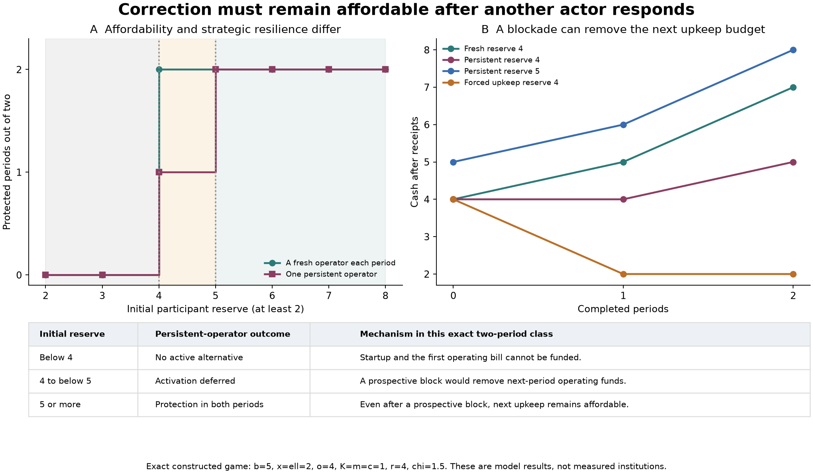

# How effective correction can form and be prevented

Development 1 of the unified theory, 5 October 2026. Research direction: Yongxu Ren. AI-assisted derivation, exact model study, and interpretation. This advances the foundation through one specified formation mechanism; it is not empirical validation or a claim of mathematical priority.

The new result is that **affording a corrective capacity and making it withstand another actor's response are different requirements**. A participant can construct an alternative that makes protection worthwhile to an operator. Yet an operator who values future control can sometimes spend more today to leave that participant unable to finance tomorrow's correction. The study derives an exact boundary between those outcomes in a two-period class.

The corresponding development of the foundation is: **where continued responsiveness matters, understanding an action includes understanding how it changes the conditions of later understanding, choice, and correction**. In institutions, this includes who will retain the means to question and alter subsequent decisions. This is a causal claim about a specified mechanism, not a definition making every preserved institution good.

## What is now explained

The earlier formal core established conditional feasibility, renewal, and installed-process certificates. Its recurring correction example supplied a binding rule. The new model gives the operator a real choice to protect, ignore, or obstruct the participant. The participant chooses whether to build and operate the means of refusal. Effective protection can then arise from their choices without an imposed benevolent controller.

The construction follows the earlier [continuing-participation study](../../../experiments/continuing-participation/README.md), which already separated consent, compensation, and dated liquidity and proposed a funded fallback. This extension adds actual construction, rival use, strategic obstruction, and the effect of current obstruction on future operating cash. The [proofs](FORMATION-MATH.md), [frozen protocol](../../../experiments/constructed-correction/PROTOCOL.md), and [experiment](../../../experiments/constructed-correction/README.md) keep those contributions separate.

Lost rents and self-enforcing incentives have established foundations in [Levin's relational-contract analysis](https://web.stanford.edu/~jdlevin/Papers/RIC.pdf). Explicit models also study the emergence of institutions, including [Itao and Kaneko's evolutionary dynamical-systems game](https://arxiv.org/html/2501.07249v2). This work contributes a transparent conditional mechanism within the present theory; it does not originate those research programs. The [prior-art review](FORMATION-PRIOR-ART.md) identifies close precedents and unresolved assumptions.

## A material alternative changes an actual decision

The participant has one unit of labor or another input. It can use that input in shared production or in an alternative facility. Both uses are available, but the same input cannot be spent twice. Shared production gives the participant receipt \(b\) when safeguarded and \(x=b-h\) otherwise. An activated alternative gives \(o\), with

\[
o_0<x<o<b,
\]

where \(o_0\) is the inactive fallback. The operator loses rent \(r\) if the input is withheld, measured relative to its actual replacement opportunity. Before the participant allocates its input, the operator can implement a safeguard costing \(c\), offer harmful production, or temporarily block the alternative at cost \(\chi\).

After an alternative has been activated, credible participant choices leave the operator comparing

\[
\text{safeguard}:r-c,\qquad
\text{block}:r-\chi,\qquad
\text{unblocked refusal}:0.
\]

For an operator concerned only with this period, protection is uniquely selected exactly when

\[
c<\min(r,\chi).
\]

The actors are modeled as knowing the game and selecting the specified best responses. The calculation does not explain how they learn it or separately budget the computation of a full continuation strategy. Cash feasibility refers to the modeled physical bills; a real implementation must additionally fund its actual information and decision machinery.

The safeguard is physically completed before the input is delivered. It is not a promise whose later enforcement is assumed. Its observability, the participant's control of the input, the available technologies, and the cost of interference remain premises.

Three different outcomes follow. If protection is cheapest for the operator, shared production becomes protected. If interference is cheapest, the participant anticipates obstruction and normally declines to fund the alternative. If losing the input is cheapest, the participant can leave. Exit can improve the participant's position even though cooperation declines; it is not counted as an ethical failure merely because shared output falls.

An additive benefit does not automatically provide the same influence. If the alternative produces \(o\) both during cooperation and refusal without using anything withheld from the operator, \(o\) cancels from the participation comparison. More wealth may still help, but this particular threat mechanism has disappeared.

## Formation needs value and accessible resources

Construction costs \(K\), operation costs \(m\), and necessary subsistence \(\ell\) is also due before current receipts. No borrowing is supplied. If the selected active receipt is \(y\), the per-period private gain relative to inactivity is

\[
a=y-x-m.
\]

Over \(T\) stationary periods with participant discount \(\delta\), installing and operating has positive incremental value when

\[
K<a\sum_{t=0}^{T-1}\delta^t.
\]

It still requires enough opening cash to pay every bill. For the prescribed active path, exact feasibility is

\[
w_0\ge K+m+\ell+
\max\{0,-(T-1)(y-m-\ell)\}.
\]

When baseline receipts merely replace subsistence, \(x=\ell\), inactivity cannot accumulate the missing money. A profitable and indefinitely maintainable operating regime can therefore remain inaccessible. Building dormant equipment earlier does not create the money needed to activate it later.

These are private incentives and physical budgets. They do not establish the legitimacy of the allocation, justify the harm, or measure all the participant's interests in money.

## A persistent operator can attack future corrective capacity

Now let one operator value both periods. Use \(b=5\), \(x=\ell=2\), \(o=4\), \(o_0=0\), \(K=m=c=1\), \(r=4\), and \(\chi=3/2\). Both actors know the game. The participant starts with four units of cash.

The first construction, upkeep, and subsistence bill is exactly four. If the operator safeguards, the participant receives five and can fund the next upkeep. Safeguarding twice gives the operator \(3+3=6\).

If the operator blocks the first activation, the participant receives two. That cash pays subsistence but not the next upkeep bill of three. Baseline receipts cannot rebuild the shortfall. The operator can then obtain unprotected participation in the second period, earning

\[
(4-3/2)+4=13/2>6.
\]

The first block costs more than a current safeguard, but buys a more profitable future relationship. The participant anticipates this and activates only in the final period. It may build the equipment early and leave it dormant, or build later; the exact conclusion concerns delayed operation, not a unique construction date. There is no blockade on this selected equilibrium path: its credible prospect has already changed behavior.

Give the participant one more unit of initial reserve. A hypothetical first block now leaves three, enough for the next upkeep. Blocking no longer removes future correction, so the operator safeguards immediately.

| Environment and decision rule | Initial reserve | Protected periods | Participant net gain | Final cash |
|---|---:|---:|---:|---:|
| Fresh operator each period, optimal participant | 4 | 2 | 3 | 7 |
| Persistent operator, optimal participant | 4 | 1 | 1 | 5 |
| Persistent operator, optimal participant | 5 | 2 | 3 | 8 |
| Persistent operator, participant activates whenever affordable | 4 | 0 | −2 | 2 |

The last row is a declared heuristic with a different strategic response, not an equilibrium-optimal participant. It exposes the harm from assuming that an affordable static remedy will remain worthwhile after the operator reacts.

For the class specified in the proof, the exact thresholds are

\[
W_{\mathrm{aff}}=K+m+\ell,\qquad
W_{\mathrm{res}}=K+2m+\ell.
\]

Below the first threshold, operation cannot be financed. Between the thresholds, activation is deferred. At or above the second, immediate protection is selected in both periods. This requires the full stated two-period assumptions, including \(x=\ell\), \(h>K+m\), \(b>o\ge m+\ell\), \(r>\chi>c\), and \(\chi<2c\). The second threshold removes this particular financing attack; it is not invulnerability to arbitrary interference.

## What the completed enumeration shows

The exact-rational study covered 1,152 parameter cases, each under fresh and persistent operators, with four participant policies: 9,216 grid policy runs. Another 2,304 runs reversed operator tie preference. There were 480 separate one-period games, 36 succession cases, and nine named control cases. These are deterministic authored cases, not independent empirical observations.

Under the reported equilibrium selection, the optimal participant's value was lower with a persistent operator in 85 parameter cases and equal in 1,067. It was higher in none of this grid. The counts describe this chosen grid and do not establish a general law about patience or turnover. Changing operator tie preference affected a reported outcome in 97 of the 2,304 strategic environments. The focal strict two-period witness survived that change.

Succession adds a separate lesson. When rebuilding is available at cost \(K\), a handoff price \(J>K\) need not be paid: the participant can rebuild. Conversely, a successor operator able to block cheaply can end protected operation even when equipment is transferred for free. The experiment assumes a continuing participant objective through the handoff; it does not derive a departing person's willingness to leave wealth to someone else.

An independent reconstruction matched 1,269 dynamic comparisons and 128 complete one-period equilibrium correspondences. A second implementation checked 1,728 stage games, 30,375 resource-prefix cases, 243 members of the analytical two-period class, and 1,458 reserve variations. A further adversarial reconstruction passed 2,100 rational cases, including fractional reserves and both exact boundaries. All passed. These checks support the stated calculations; the proofs remain separate and neither provides evidence about actual institutions. Complete records and policy definitions are in the [experiment report](../../../experiments/constructed-correction/README.md).

## The advance in the unified theory

The new mechanism makes future response capacity an object of present strategic choice. An action can change today's output and change who can influence tomorrow's output. Finance therefore enters both as a productive resource and as a condition of effective agency. An action selected by long-term self-interest can deliberately reduce another actor's future choice.

This sharpens three distinctions already implicit in the foundation: a response can be physically possible, affordable on an intended path, and privately attractive after other actors' responses are included. These are different tests. The original whole-process certificate remains valid; its transition model must include the actual strategic responses rather than a repeated one-period best response that the persistent actor has reason to abandon.

The implication for wisdom is broader than bargaining. A learning system can likewise consume the evidence, memory, attention, or independence needed to challenge its next judgment. Understanding a present improvement therefore requires examining what it does to later inquiry and choice. This is an inference about how to apply the framework, not a new empirical result about cognition.

## Standing and influence have different grounds

The accompanying [ethical development](ETHICAL-FOUNDATION.md) gives a positive, premise-relative argument for standing beyond usefulness. Subject-relative harms supply reasons under an explicit standing premise; relevant consistency prevents those reasons disappearing solely because the sufferer's identity or administrative label changes; answerability requires claims to be capable of affecting consequential power. The argument does not compel an unqualified egoist through an equation of survival.

Standing concerns whose claims deserve consideration. Influence concerns whether an actor can cause a selector to respond. Legitimacy concerns whether the resulting arrangement and its powers can be justified. The game explains one route to influence. It does not confer standing only on valuable contributors or make every credible threat legitimate.

A simple countermodel makes the remaining causal gap precise. Production requires stock \(R_t\ge R_{\min}>0\). Start in that region and fix \(R_*\ge R_{\min}\). Let the stock obey

\[
R_{t+1}=(1-\lambda)R_t+\lambda R_*,\quad 0<\lambda\le1.
\]

While that stock requirement holds, the supplied technology produces \(Y>\lambda R_*+c\) each period; a supplied renewal rule pays the replenishment \(\lambda R_*\), and allows safeguard \(a_t\in\{0,1\}\) costing \(c>0\). A patient suffers \(h(1-a_t)\), with \(h>0\), but this harm affects neither the selector's payoff, future production, available actions, nor any other response. The selector has no direct concern for that patient and receives \(Y-\lambda R_*-ca_t\).

The stock remains in the productive region by convexity and converges to \(R_*\). The renewal rule and productive technology are supplied; the model isolates selection of concern. Over every finite horizon, or an infinite discounted horizon with \(0<\delta<1\), omitting the safeguard is uniquely payoff maximizing: it adds \(c\) at that date with no future disadvantage. Thus maintained production and perfect information can coexist with systematically unaddressed harm in this model. This is an elementary conditional counterexample, not a claim that actual reality necessarily has those institutions or preferences.

## The explanatory frontier at Development 1

We now have one derived route from a materially constructed alternative to an operator's protective response, with exact formation and strategic failure conditions. We also have a more explicit ethical account of why protection can be owed even where that route gives no leverage.

The remaining central task is to explain how effective concern and protection extend beyond privately useful counterparties. A next model should let agents construct a shared guarantee for someone with no valuable input, and account for why contributors fund it, how its control survives replacement, and how it can be challenged. Direct concern, reciprocal exposure, coalition formation, and enforceable commitments should be distinct candidate mechanisms, with explicit adverse cases. Their success cannot be assumed by assigning the patient's loss to an omniscient planner's objective and calling the result emergence.

The broader work on discovering new questions remains open. This game assumes public, accurate observation and a supplied alternative technology. It advances the formation of effective correction while leaving the formation of new understanding as a separate, connected research task.

**Later disposition, integrated 6 October 2026:** [Development 2](JOINT-FORMATION.md) now constructs one paid ally mechanism protecting a patient without that patient's own useful input, including learned concern, evidence, input control and reconstruction under stated strategic conditions. The earlier frontier above records the question that motivated that advance. The origin of its teaching and transfer architecture, broader warranted scope and legitimate governance remain open; the [joint-formation review](../../../_process/research/2026-10-05-repository-reconciliation/three-session-integration/JOINT-FORMATION-REVIEW.md) distinguishes this conditional resolution from those remaining obligations.
