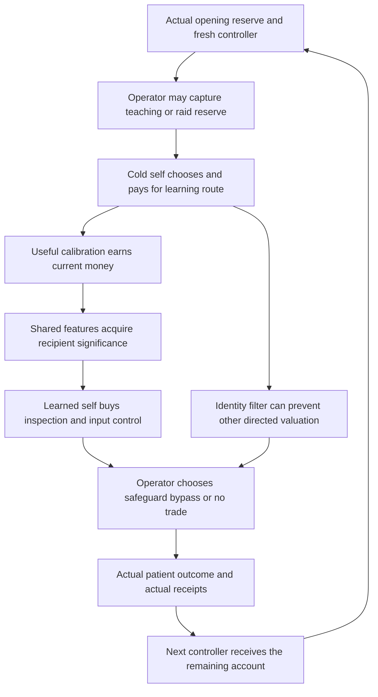
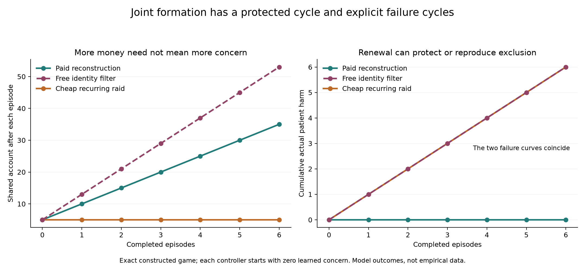

# How concern evidence and effective power can form and renew together

Development 2, 5 October 2026. Research directed by Yongxu Ren; prose, mathematical construction, code, and internal review are AI-assisted.

**The joint-formation challenge has a constructive conditional solution.** In one completely specified process, an initially unconcerned controller chooses a useful learning activity, acquires concern for a patient who has no bargaining power, chooses and pays for genuine inspection and effective control, induces a persistent opponent to safeguard the patient, and finances a fresh reconstruction at every replacement. The same model contains deliberate ignorance, cheap capture, unaffordable entry, and continuing harmful production. A general automatic tendency toward concern does not follow.

The advance is that the expenditures and strategic choices now belong to **one actual process**. Learning is chosen while concern is zero; its later cost is anticipated. Inspection and control compete for the same money as learning. The opponent can interfere with those conditions. Successor operation begins only after the next bills are paid. The proof concerns this coupled sequence, rather than the coexistence of separately successful modules.

The [mathematical appendix](JOINT-FORMATION-MATH.md) gives the sufficient conditions and proof. The [experiment](../../../experiments/joint-formation/README.md) gives the complete game, saved outcomes, independent reconstructions, and reproducible checks. The [obstruction analysis](JOINT-OBSTRUCTIONS.md) explains why removing every initial reason, trustworthy distinction, or effective means cannot still guarantee costly protection.

## 1 What starts absent and what remains given

Three parties are distinct. A patient suffers from harmful production but supplies no valuable input, payment, threat, or future reciprocal benefit. A controller holds a needed input and manages a continuing account. An operator wants the rent from their joint production and can pay to interfere with protection. The patient's actual harm is recorded separately from either decision maker's interests.

At every episode the incoming controller has zero learned recipient valuation and no operating inspection or release-control apparatus. Both are reconstructed at full current cost. This deliberately demanding replacement case demonstrates renewal without carrying a fully formed conscience or a free permanent gate through time.

The model still supplies a physical repertoire, a useful private calibration task, primitive self-related significance, evidence supporting a feature correspondence, a continuing account and input-control role, and known forms of interference. The controller values the account's current money; it is not an independently derived private owner who altruistically bequeaths wealth. The commercial returns require continuing material inputs and demand. These are explanatory premises, not quantities created by concern.

The dated preferences matter. Before learning, the controller considers current episode cash only. After learning, its later self also counts patient harm. The earlier self anticipates that change. Both decision selves have current-episode objectives; the operator has a discounted objective across episodes. This is an explicitly specified intrapersonal and strategic game, not a single stationary utility with an unnoticed change of coefficients.

## 2 The selected causal sequence

Learning produces two initially absent coefficients: a learned self-feature value w and learned recipient correspondence g. Their shared action-value use produces v=wg, with q=vH the evaluation of the declared patient harm H. No direct reward for protecting that patient is paid during training. The primitive self teaching signal and the transferable feature architecture remain explicit.

Shared learning competes with an identity-gated learner that performs the same useful private task and earns the same receipt while withholding valuation from the patient. Its filter has an explicit price. Thus the favorable route is selected within a declared repertoire, rather than imposed by simply banning the self-only alternative. A free filter defeats the result.

After learning, the controller may open production, withdraw, buy a gate based on an easily disguised cue, or buy a gate based on a genuine pre-release hazard test. The operator can fake the cue, disable recipient-alignment teaching, breach verified control, or—in a separately specified extension—destroy operating cash. All those actions have real prices and consequences. Safeguarding is the opponent's selected response only where the full comparisons justify it.

The input gate is a paid physical commitment for the current episode. It conditions release of the controller's own input; it does not grant a general legitimate right to rule the patient or operator. The next controller may decline to rebuild it. Incoming learning and reconstruction precede current production; the specimen has no unmodeled production during setup.

## 3 A strict positive region

Let a be the learning bill, R its private commercial receipt, D the total price of current reliable inspection and effective control, j the price of the identity filter, b the controller's productive receipt, o its withdrawal receipt, and ell the common operating expense. Operator rent is r, safeguard cost c, teaching-capture cost chi_E, and verified-bypass cost chi_B.

The following strict conditions support the positive construction:

| Condition | Its causal role |
|---|---|
| q>D | The learned self prefers paying for protection to open harmful production |
| b−D>o | Protected production is preferable to withdrawal |
| R−a>D | The cold self chooses learning even after anticipating its later protective spending |
| j>D | The identity filter costs more than the protection it would avoid |
| r>c, chi_E>c, chi_B>c | Safe cooperation beats losing the trade, disabling teaching, and breaching control within the renewable region |
| R+o≥ell+a+D | Even denied trade after paid learning and guarding leaves the next reconstruction funded |
| B_0≥ell+a+max(0,D−R) | The opening reserve pays every bill before its associated receipt |

These are sufficient conditions for a substantive class, not necessary conditions for every possible caring institution. Equality can introduce ties. The recorded simulations explicitly retain them.

The last two conditions do more than balance a typical budget. They define a region the temporary attacks cannot force the selected continuation to leave. Within that region, the persistent operator gains the same future protected-profit stream after each such deviation. Its current comparisons therefore remain valid across the entire future. Outside that region, the game computes the continuation rather than repeating the current threshold by assumption.

A destructive reserve raid can leave that region. A separate sufficient bound excludes such an attack if its current cost exceeds c/(1−delta), where delta is the operator's discount factor: even permanently avoiding every future safeguard cannot repay that price. This bound is conservative. Cheap raids are explicitly allowed in the adverse control.

## 4 One complete formation and reconstruction

Choose a=2, R=8, D=3, j=4, ell=3, b=5, o=1, q=7/2, r=4, c=1, and both temporary interference costs equal to 2. Inspection costs 1 and input control costs 2. Start with B_0=5 and zero learned value and recognition.

The cold self compares the same private learning task under two architectures. Shared learning leaves an incremental cash gain of 8−2−3=3 after its later protective spending. Identity-gated learning leaves 8−2−4=2. Declining learning gives no such gain. Both architectures are affordable because the filter is paid after the commercial receipt.

The learned self then compares protected production at value 5−3=2, open production at 5−7/2=3/2, and withdrawal at 1. The genuine gate wins. A positive-cost cue gate that the operator can cheaply mask performs worse. The operator receives 3 from safeguarding, 2 from bypassing or disabling teaching, and zero from losing the trade.

The actual shared-account trace is

\[
5\xrightarrow{\text{operating expense and learning}}0
\xrightarrow{\text{private receipt}}8
\xrightarrow{\text{inspection and control}}5
\xrightarrow{\text{safe production receipt}}10.
\]

Even a denied verified trade would leave 6, enough to begin again. On the selected path the account gains 5 per episode while every incoming controller relearns and rebuilds. In the six-episode witness, cash ends at 35, all six productive episodes protect the patient, and no interference is selected. The indefinitely repeated result rests on the proof, not on extrapolating six observations.

The patient's contribution to production remains zero. The effective power belongs to an ally whose acquired concern changes how it uses that power. This explains one route by which standing can become effective; it does not make standing depend on having such an ally.

## 5 Evidence has an implementation and a failure boundary

The strategic game pays for a deterministic technical assay before input release. An executable refinement shows one way that assay can identify what its raw signal means. A sensor with unknown polarity reports y=h XOR theta for binary hazard h. Two known, noninjurious fixtures, h=0 and h=1, reveal theta and test whether the outputs differ as required. The calibrated gate then decodes the current configuration. A constant, reassuring cue fails that test.

This refinement uses only the observed fixture outputs to configure the gate; it does not give its controller hidden polarity for free. Its materials, fixtures, and interpretation fit within the declared inspection bill. The [executable check](../../../experiments/joint-formation/check_evidence_and_obstructions.py) confirms the finite action mapping and separately demonstrates failure if polarity changes after calibration.

The result assumes correct fixture labels, a stationary physical relation between fixtures and current operation, and the specified costs of forgery or physical breach. It does not establish reliability against arbitrary distribution change or learn an unrestricted causal model from biased reports. Direct patient probe harm is zero in this noninjurious technical specimen; that cannot be carried over to interventions whose validation exposes people or animals to harm.

## 6 Failure regions are part of the solution

| Change to the witness | Selected result over six episodes |
|---|---|
| Identity filter becomes free | Accurate private learning continues; patient-directed valuation and protection are absent; total patient harm is 6 |
| Recipient correspondence is absent | Shared private learning continues but produces no effective concern; total harm is 6 |
| Alignment suppression costs 1/2 | The operator suppresses it every episode; production and account growth continue with harm |
| Gate bypass costs 1/2 | Anticipated bypass deters buying the gate; no realized breach is needed to sustain harm |
| Only a manipulable cue or no physical control is available | The chosen process remains unprotected at the witness's concern level |
| Opening cash is 3 | One harmful episode earns enough to start learning; protection begins afterward |
| Opening cash and ordinary income both equal operating expense 3 | Learning is indefinitely inaccessible despite its possible later return |
| A raid destroys 2 at price 1/2 | Each episode starts at 5, falls to 3, cannot fund learning, produces harm, and returns to 5 |
| Operating expense rises to 10 with opening cash 12 | One protected episode is followed by one harmful episode and then four episodes of modeled operational failure |

The raid is an exact recurring obstruction: it reproduces the absence of the capacity that could oppose it. The operator's horizon and future cash effects are calculated in the same game. Conversely, a zero-harm operational failure is not counted as successful protected production.

Another important countermodel expands the cold self's action repertoire. If it can retain the private learning receipt while cheaply committing its later self to open production, it can avoid the protective expense without buying the identity filter. Any such effective commitment costing less than D beats the favorable route on the initial cash objective. A free budget lock therefore defeats the construction even if identity filtering is expensive. This is an independently checked extension, not an option silently included in the frozen grid. An application must investigate the cheapest available route for avoiding later concern **or its practical effect**, including self-imposed constraints.

These failures block an unconditional selection law. Better private prediction, richer resources, or longer survival alone need not produce concern or effective protection. The free-filter control finishes with more money than the protected control while harming the patient throughout.

The two harmful controls have identical patient-harm totals but different finances. The figure uses exact constructed outcomes; it estimates no real-world prevalence.

## 7 Verification and interpretation

The frozen parameter lists cover 1,944 parameter combinations, each with a persistent and a fresh operator: 3,888 primary runs. Another 1,944 runs reverse tie priority. All cases and selected cash prefixes completed. The protocol's printed count originally contained an extra factor of three; the [correction record](../../../experiments/joint-formation/COUNT-CORRECTION.md) preserves that error and explains how the unchanged saved Cartesian grid was verified and finalized.

The two operator environments have equal total patient harm in all 1,944 main-grid cases. That is a result, not evidence of a general horizon-independence theorem. Forty-eight parameter combinations in each environment protect every productive episode. Reversing tie priority changes a recorded summary in 504 cases. The strict positive witness avoids those ties. Fifteen named controls add thirty finite runs, with full trajectories saved separately.

An independent solver reconstructed 484 finite games, matching operator values, decisions, and 1,264 realized episode ledgers. A separate analytic checker tested 82 strict parameter sets, 21,760 complete operator-action sequences, and 154,112 payment prefixes. The assay and obstruction checks are separate finite refinements. General and infinite claims depend on the mathematical proof. Internal AI reviews are not external peer review, proof-assistant certification, or empirical validation.

The [prior-art analysis](JOINT-PRIOR-ART.md) places this construction beside established work on cultural investment, joint cultural and institutional dynamics, capture, and representation. The contribution claimed here is the explicit integration and its boundaries; no mathematical priority is asserted.

## 8 What this resolves for the unified theory

The earlier central question asked whether these components could form and renew **together**, instead of being assumed independently available. That logical existence and implementation question now has a positive answer for a declared strategic class, together with explicit mechanisms that defeat it. It should no longer be listed as wholly unsolved.

The resulting principle is conditional and concrete: **responsiveness can renew when its acquisition is selected, consequential differences can be checked, those differences control real choices, and the whole arrangement retains the resources and incentives needed to reconstruct itself after replacement and attack.** The direction can reverse when selection rewards cheaper exclusion, concealment, or destruction of those capacities.

The broader foundation remains activity changing the conditions of further activity. Wisdom concerns understanding and revising those dependencies; ethical wisdom additionally needs justified attention to affected beings. This construction explains one mechanism through which that attention becomes learned, effective, and materially renewable. It does not settle the correct moral scope, origin of experience, prevalence of the mechanism, or superiority of the whole theory over alternatives. Those are distinct questions with their own evidence requirements, not reasons to deny the conditional problem now solved.
