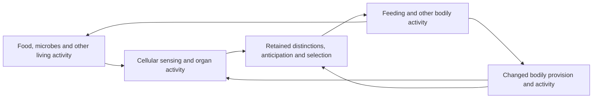

# 尺度之间的关系 / Relations across scales

8 October 2026, Asia/Bangkok. AI-authored research following [Ren’s direction](../../../sources/15-codex-theory-conversations/2026-10-08-relations-across-scales.md). Extends the [exact systems projections](../history/SYSTEMS-COMPLEXITY-CHAOS.md) and [controlled refinement](../history/CONTROLLED-REFINEMENT.md). [Proof correspondence](../../../_process/research/2026-10-05-generative-foundation-review/root-foundation/RELATIONS-ACROSS-SCALES-PROOF.md) · [Integration, counterreview and sources](../../../_process/research/2026-10-05-generative-foundation-review/root-foundation/RELATIONS-ACROSS-SCALES-INTEGRATION.md).

**一个尺度的描述是否充分，取决于它在实际变化中保留了哪些关系，以及我们据此要作出什么判断。较粗描述可以足够准确；总量预测完全准确，也仍可能遗漏具体位置的基本损失。组织关系改变时，原先充分的描述可能需要增加信息、缩短有效时域，或重新校准。**

**A description’s adequacy depends on the relations it preserves through actual change and the judgment it is meant to support.** Coarser descriptions can be sufficiently accurate. An exact prediction of a total can nevertheless omit a basic loss at a particular position. Changing organization can require additional information, a shorter prediction horizon or renewed calibration.

**Ren’s subsequent clarification makes the organizational connection explicit: cells participate in organs, organs in bodies, and bodies in ecosystems; cognition and the selection of activities occur within these relations.** The account below now distinguishes this actual organization from the maps used to describe it. The [embodied-scale integration and review](../../../_process/research/2026-10-05-generative-foundation-review/root-foundation/EMBODIED-SCALES-INTEGRATION.md), [biological evidence](../../../_process/research/2026-10-05-generative-foundation-review/root-foundation/EMBODIED-SCALES-EVIDENCE.md) and [14 additional checked results](../../../_process/research/2026-10-05-generative-foundation-review/root-foundation/EMBODIED-SCALES-PROOF.md) preserve their distinct scopes.

## 1. 同一展开的不同描述 / Descriptions within one unfolding

Cells, organisms, communities and institutions are not introduced as independent layers of reality. Each description selects patterns and relations within connected activity. Some such relations sustain recognizable organization; their causal importance must be identified rather than inferred from their place in a hierarchy. A summary is neither automatically a real collective organization nor necessarily an arbitrary convention. A proposed biological or social scale needs correspondence to its actual formation and effects.

数学中用一个较细状态 \(x_t\) 表示本轮研究所保留的共同关系，用 \(p_t(x_t)\) 表示另一描述。这里“较细”只相对于这个映射，不表示最终微观本体或完整宇宙状态。被省略的关系仍在实际活动中；它们可以通过误差、记忆、耦合或描述修订重新进入解释。认识与判断也是同一过程内的活动，本轮数学没有解释其全部形成。

The map \(p_t:X\to Y\) selects a description from a more detailed state \(x_t\). “More detailed” is relative to this map; it does not assert an ultimate microscopic ontology. The omitted relations remain active. The map may change with time, but its discovery, implementation and support are not derived merely by allowing a time index. Fixed carriers can encode stored organization; genuinely changing description types require a further common encoding or a richer formalization.

The named foundational contribution is **organization and representation → warranted identification of consequences across descriptions → application of justified practical conditions**. This tests a correspondence requirement of the universal programme: judgments about the whole must remain accountable to differentiated consequences. It supplies no new proof of G0 and adds no ethical weighting rule.

### 细胞、器官、身体与生态关系 / Cells, organs, bodies and ecological relations

**“部分”不只是放在一个更大的容器里面。** 一个细胞成为器官活动的一部分，涉及它的分化、位置、连接和实际参与；器官活动又改变这些细胞得以继续活动的条件。身体通过多个器官和组织的协调形成相对持续的活动中心。生态关系则延伸到其他生命、食物、空气、水和共同栖居条件，其边界通常不等同于解剖边界。这里有嵌套，也有交叉、迁移、竞争和合作，不能一律画成一棵固定树。

A part–whole explanation identifies how activities are organized together, what that organization accomplishes, and how it supports or changes its participants. Anatomical inclusion is one relation; functional participation and dependence are others. A cell’s contribution depends on its connections and state, not simply on its being inside an organ. A body is sustained through coordinated activities whose participants also require support. Its ecological participation extends through relations that cross its anatomical boundary. Microbial lineages can live within a body without becoming ordinary cells of that organism. Organ systems overlap; not every organism has organs. The sequence cell–organ–body–ecosystem is therefore an important biological case, not a universal fixed ladder.

| Relation being explained / 所解释的关系 | What must be identified / 必须辨明的内容 | What cannot be inferred from the label / 名称本身不能推出 |
|---|---|---|
| Cell participation in an organ / 细胞参与器官 | Differentiated activity, arrangement, communication and material support / 分化活动、排列、传递与实际支持 | A pile of cells already performs the organ’s work / 细胞总数已能说明器官功能 |
| Organs participating in a body / 器官参与身体 | Coordinated provision, regulation and effects on continuing activity / 协同供给、调节及对继续活动的影响 | Every local increase benefits the body / 每处局部增加都使身体更好 |
| A body participating in ecological relations / 身体参与生态关系 | Acquisition, consumption, production, dispersal and effects on other lives / 获取、消耗、产生、传播及对其他生命的影响 | The ecosystem is one organism with one decision center / 生态系统就是具有单一决策中心的身体 |
| Cognition within these relations / 其中的认知 | Discrimination, retention, anticipation, selection and correction through actual activity / 活动中的分辨、保持、预期、选择与修正 | A separate mind directs an otherwise passive body / 独立心灵指挥被动身体 |

What is often called influence “from above” must be unpacked through these relations. A change in whole-body activity can change local supply or signaling; the change reaches cells through particular pathways. Calling it a bodily condition does not introduce an additional force outside cellular activity. Conversely, explaining those pathways does not eliminate the usefulness of a bodily description that preserves their coordinated effects. A proposed intervention on a bodily variable must have an admissible realization: one cannot hold every constituting relation fixed while independently changing the whole they constitute.

“向上”与“向下”描述的是同一展开中不同关系路径。整体组织能使部分具有单独时没有的作用，部分的变化也能重组整体活动；具体方向、延迟与强度由机制及证据决定。不是先把“约束”和“流”分成两种本体，再让其中一种统治另一种。哪些关系在某段时间内相对稳定、哪些变化较快，同样需要说明。

The existing [living-dependency account](../history/LIVING-DEPENDENCIES.md) supplies conditional results on inherited organization, support, competing uses and recovery. [New possibilities](../history/NEW-POSSIBILITIES.md) explains how changed organization can enable effects unavailable to its earlier operative repertoire. These results support the present connection without constituting a derivation of every biological organ or a proof that all ecological relations are beneficial.

### 认知怎样参与尺度关系 / How cognition participates

Cognition enters the explanation when activity forms discriminations and retained effects that guide subsequent activity: detecting a difference, retaining something of it, anticipating a consequence, selecting a response and revising after what happens. This is a working functional account of the cognitive activities relevant here, not a complete definition of consciousness. A molecular response alone does not establish reflective thought. Human deliberation adds language, reasons, learned commitments and social relations whose specific organization must be explained.

**认知不是加在细胞—器官—身体—生态链条最上方的又一层。** 感知和记忆的实现需要身体活动及其支持；它们形成的预期与选择又改变身体接下来做什么，进而改变器官负荷、局部条件和生态参与。能够选择，不等于每次选择都成功，也不等于知道全部后果。

For a feeding episode, the explanatory circuit is:

The nodes select overlapping activities within a shared history; cognition is realized through some of the cells and organs already represented. Arrows identify explanatory connections requiring mechanism and evidence. The diagram is neither an anatomical map nor a claim that one experiment has measured every arrow.

The [primary evidence assessment](../../../_process/research/2026-10-05-generative-foundation-review/root-foundation/EMBODIED-SCALES-EVIDENCE.md) identifies four concrete tests. In mice, interfering with gut neuropod signaling changes sugar preference: a cellular contribution inside an organ matters to whole-animal choice. [Buchanan et al., 2022](https://pmc.ncbi.nlm.nih.gov/articles/mid/NIHMS1756304/). Neural feeding-related activity can also change before consumption and reverse after food removal; a contemporaneous bodily nutrient quantity alone misses relevant anticipation. [Chen et al., 2015](https://pmc.ncbi.nlm.nih.gov/articles/PMC4373539/).

In fruit flies, nutrient conditions and particular commensal bacteria alter food choice. [Leitão-Gonçalves et al., 2017](https://journals.plos.org/plosbiology/article?id=10.1371/journal.pbio.2000862). In a separate fruit-substrate experiment, fly participation changes yeast abundance and community composition, including reduced diversity; altering conditions favorable to one participant need not expand every other life’s possibilities. [Stamps et al., 2012](https://journals.plos.org/plosone/article?id=10.1371/journal.pone.0042238). These studies constrain different links. Their different preparations, species and timescales are not silently joined into one measured history.

三个判断必须分别保留：活动是否被选中，活动在当前条件下是否实现，以及其整体后果是否具有好的方向。准确的预期可以被用于破坏；有益意图可以因条件变化而失败；身体一处得到支持也可能伴随另一生命的损失。认知和尺度对应为伦理判断提供需要辨明的实际后果，不独自给出伦理根据。

### 描述应随所问的问题改变 / Descriptions change with the question

For an inventory question, an amount may suffice. For an organ-function question, arrangement and available capacity may matter. For a choice question, acquired signals, retained history and response organization may matter even at the same current amount. For consequences across lives, other participants, access and renewal can become indispensable. A description earns adequacy for its stated task; a successful total does not license erasing these distinctions elsewhere.

The analyst’s map and a living participant’s operative discrimination must also be distinguished within the same unfolding. Writing a better variable in a paper does not make an organism acquire it. Actual revision requires a realized route for sensing, retention, learning or reorganization, with its support and delay. [Controlled refinement](../history/CONTROLLED-REFINEMENT.md) already checks exact preservation of observations, memory and selected histories; [protocol composition](../history/PROTOCOL-COMPOSITION.md) accounts conditionally for multi-event implementations. The new approximate result in §7 adds the effect of potentially different choices. None of these interface theorems alone explains the formation of the capacities it relates.

## 2. 有限时域内的近似保持 / Approximate preservation over a finite horizon

Consider actual and represented histories

\[
x_{t+1}=F_t(x_t),\qquad y_{t+1}=G_t(y_t).
\]

They are not two independent realities: the second is a proposed representation of selected relations in the first. The actual history is also a checked history of the existing generative core, with the stage index retained. Time here is a sequence index, not a supplied physical clock rate.

Define the current discrepancy \(e_t=d(p_t(x_t),y_t)\). Supply and justify two local bounds on the reached states:

\[
 d(p_{t+1}(F_t(x_t)),G_t(p_t(x_t)))\le\varepsilon_t,
\]
\[
 d(G_t(p_t(x_t)),G_t(y_t))\le L_t e_t,\qquad L_t\ge0.
\]

The first measures one-step failure of correspondence, including any change of description; the second bounds propagation of existing error. Lean derives, throughout any specified horizon whose premises hold,

\[
 e_n\le E_n,\qquad E_0\ge e_0,\quad E_{t+1}=\varepsilon_t+L_tE_t.
\]

No global bound on all unreached states is necessary for this theorem. However, evidence that bounds hold on one observed history does not establish them for unobserved interventions. A predictive use must warrant them for the possible histories to which it applies.

若已有 \(E_0\le B\)，且每步 \(\varepsilon_t+L_tB\le B\)，则该时域内 \(E_t\le B\)。这个不变上限是充分条件，并非所有成功近似的必要条件。小单步误差不能单独保证长时域可靠：形式反例每步增加 \(\delta>0\)，零预测的误差为 \(n\delta\)，最终超过任意给定界限。

A checked cap criterion is \(E_0\le B\) and \(\varepsilon_t+L_tB\le B\) at each step. It is sufficient, not necessary. The checked positive-drift counterexample has constant small one-step discrepancy but arbitrarily large accumulated error. Neither a stable-looking aggregate nor a previously successful fit warrants indefinite use.

**Description changes must be charged.** A fixed state can be described first by \(p_0(x)=x\) and then by \(p_1(x)=x+M\). Each frozen description commutes perfectly with identity dynamics. Keeping the old predicted coordinate nevertheless introduces error \(|M|\). A valid coordinate transport can remove this particular mismatch; the example challenges omission of that transport, not changing descriptions itself.

## 3. 多尺度组合与组织变化 / Composition and changing organization

For another map \(q_t:Y\to Z\), suppose the first scale has defect \(\varepsilon_t\), the second has defect \(\eta_t\), and \(q_{t+1}\) changes distances by at most a factor \(K_t\ge0\). Lean proves the composed one-step defect is bounded by

\[
 K_t\varepsilon_t+\eta_t.
\]

因此，把两个各自可用的近似接起来，还要检查第二个描述怎样放大第一个描述的遗漏。若要预测多步，组合后的动力学仍须提供其误差传播条件；一个单步组合式不能替代整个历史的验证。

This is a two-map result that can be applied successively, not a formalization of every hierarchy. For multi-step prediction the composed model still needs its own propagation bounds. Distances, units and sensitivities are supplied correspondence choices, not interchangeable measures of ethical significance.

A concrete mechanism shows why descriptions can cease to suffice. In one joint two-position process, let

\[
F_c(a,b)=(a+cb,b),\qquad p(a,b)=a+b.
\]

The positions describe differentiated relations in the same history. The equation is an illustrative linear coupling, not a conservation law or a biological fit. At \(c=0\), the total-only identity model is exact. When coupling changes, the next total is \(p(a,b)+cb\). If evidence bounds \(|b|\le B\), the identity predictor has one-step error at most \(|c|B\). Without such information, a universal small bound has not been supplied.

For equal-total states \((2,0)\) and \((0,2)\), any common prediction whose error is at most \(\varepsilon\) in both must satisfy \(c\le\varepsilon\). Thus for positive coupling larger than the tolerated error, no refitting of a total-only predictor solves this uniform task. Retaining the consequential coordinate \((p,b)\) restores an exact update. This particular repair retains as much information as the original pair; it is not a dimensional-reduction achievement.

这解释的是“何时必须补回某种关系”，并未证明每次都要退回全部细节。可以保留有关坐标、使用可靠的记忆、限制适用情境，或接受有界误差；各路线都要说明实际可获得的信息及代价。本轮验证了坐标修复与有界误差，没有构造记忆核或自动选择最佳尺度。

## 4. 从预测误差到具体判断 / From prediction error to particular judgments

Suppose \(f_i(x)\) measures a specified condition at position or relationship \(i\), and \(g_i(y)\) estimates that same condition from the representation. Require independent calibration

\[
 |f_i(x)-g_i(p(x))|\le a_i,
 \qquad |g_i(p(x))-g_i(y)|\le K_i d(p(x),y).
\]

Then the checked observable error is at most \(a_i+K_iE\). With a separately warranted threshold \(\theta_i\),

\[
 g_i(y)\ge\theta_i+a_i+K_iE\quad\Longrightarrow\quad f_i(x)\ge\theta_i.
\]

An upper error margin can likewise certify a strict violation. When the uncertainty interval crosses the threshold, two values compatible with the same estimate lie on different sides: neither verdict follows from that estimate alone. These are sufficient certificates, not a complete decision procedure.

各项条件保持其索引和各自单位；没有把生命、负担与参与合成一个总分。阈值、指标所指及哪些条件应受保护，来自实际对应与明示伦理承诺，不能从距离函数或预测准确率中推出。校准正确也不意味着所有相关位置已被纳入。

The indexed theorem preserves every supplied condition without averaging them. Whether the index set includes everyone affected, whether the readout tracks the relevant condition, and why its threshold has practical authority remain distinct obligations. This supports application of [practical judgment](PRACTICAL-JUDGMENT.md) under its explicit premises; it does not derive its additional commitments from approximation theory.

**An exact total can still lose the target.** The joint transfer \(T(a,b)=(a+b,0)\) preserves \(a+b\) exactly for every state. Yet \((1,1)\) satisfies the two conditions \(a\ge1,b\ge1\), whereas its successor \((2,0)\) does not. Lean proves that no predicate of the total alone characterizes those two conditions on all states. The failure is in the representation’s information, not in a separately toggled ethical label.

For this one conjunction, \(\min(a,b)\ge1\) is an exact test. That smaller summary still does not identify who lacks support, the size of every loss, consent, history or responsibility. Thus a description can suffice for one claim and fail for another. No assertion that every aggregate is ethically useless follows.

## 5. 论证、检验与边界 / Argument, testing and limits

The affirmative result is that useful scale relations can be stated as explicit, testable contracts. Complete microdescription is not required for every warranted inference. Conversely, relational unity does not make every coarse summary adequate: it directs attention to precisely which connections are retained or lost.

本轮完成的是一般有限时域误差、两尺度组合、具体条件的认识性传递，以及真实信息丢失的形式反例。它不宣称自动发现自然尺度、证明宏观主体形成、建立整个重整化理论、控制所有反馈策略，或证明普遍伦理。所给法则不因在模型中“给定”便被说成现实之外；其形成仍是可继续解释的关系。

The formal package records **21 new checked theorems**, plus 42 inherited audits replayed from the core and exact-organization module. It uses the existing pinned Lean/Mathlib environment. No new empirical experiment is claimed. The [proof receipt](../../../experiments/integrated-correction/general-framework/generative-basis/lean/systems-complexity/analysis/scales-verification.json) binds source, compiler and audit output. Counterreview was performed by the same agent and is explicitly not an independent-agent review.

## 6. 下一连接 / Next connection

This was the next connection after the initial approximation study. Ren’s clarification additionally requires the organizational and cognitive account above. Section 7 advances its approximate-choice interface; section 9 now supplies a distinct checked construction of operative description revision, with its own cost, delay and correspondence limits.

The next substantive test selected after the first round was **evidence of changed dependency → justified revision of an operative description → preserved response conditions**. Section 9 completes one conditional realization of this test. Existing inquiry and selector-revision mechanisms should be reused. A prospective application would fix relevant conditions and error tolerances, vary a coupling that an aggregate omits, and compare the original aggregate with a description retaining the identified relation. It must test predictive error and the specific condition judgment separately, including the cost and delay of obtaining the extra information.

第一轮据此选择把“何时需要修订描述”的证据实际接入已形成的认识与回应过程。第9节现已完成一个有条件的实际构造；自发尺度形成与经验识别仍须另外检验。已有有条件基础的完成范围保持不变。

## 7. 选择会改变误差传播 / Choice changes error propagation

Let the detailed joint state include the relations through which cognition operates. A selected action is \(a_t=\pi_t(x_t)\); the represented selection is \(b_t=\widehat\pi_t(y_t)\). Supply action-dependent updates \(F_t(x,a)\), \(G_t(y,a)\), and the earlier maps \(p_t\). These are two descriptions used in a correspondence test, not an external controller and an independently existing world. The policies are supplied in this theorem; their formation is not proved by writing \(\pi\).

In addition to same-action model defect \(\varepsilon_t\) and state-error propagation \(L_t\), require a bound on the difference in action effects at the represented state:

\[
d(G_t(y_t,a_t),G_t(y_t,b_t))\le\sigma_t.
\]

Then Lean checks the finite-horizon bound

\[
e_n\le E_n,\qquad E_{t+1}=\varepsilon_t+L_tE_t+\sigma_t,
\quad E_0\ge e_0,\quad L_t\ge0.
\]

An approximation that changes the selected action must account for the changed effects. Equal actions allow \(\sigma_t=0\); different actions may also have the same relevant effect. No metric on action names is required. The theorem requires a common action vocabulary, finite horizon, applicable local bounds and corresponding state maps. It does not cover an uncalibrated change of action repertoire.

For the specified threshold rule “choose true iff score ≥ \(\theta\),” suppose \(|r-\widehat r|\le u\), \(u\ge0\). Lean verifies equal true choices if \(\widehat r\ge\theta+u\), and equal false choices if \(\widehat r+u<\theta\). The asymmetry follows from the rule’s treatment of equality. Near the threshold, scores \(-\delta\) and \(\delta\) differ by only \(2\delta\) but choose effects 0 and 1 for every \(\delta>0\). Accurate estimation by itself therefore does not preserve the selected effect. These margins concern fidelity to a stated policy, not the policy’s practical or ethical correctness.

**同样准确的状态描述，未必给出同样的行动；行动影响又进入下一步实际状态。** 需要保留选择所依赖的区别，或明示选择改变所造成的误差。阈值附近的不同选择不是所有近似都失败的证明，而是旧有误差界缺少行动连接的具体反例。

A separate finite witness puts sensing, retention, selection, bodily acquisition and another living participant’s consumption in one shared state. Sensing followed by response transfers available support into the bodily store. Clamping the sensor changes the selected response despite equal starting support. Another participant can consume the shared unit after sensing: the retained plan persists until the attempted response, but its material opportunity is gone. Lean checks the actual core trace and conservation of the declared support count throughout every finite event list. The two participants are positions in the same process, not a separately given agent and environment.

This witness tests the distinction between acquired information, chosen attempt and realized effect. Its Boolean sensor, memory, response rule and event schedule are supplied. Sensing is cost-free in this local law; metabolism, organ structure, population renewal and ecological regeneration are omitted. Thus it is a checked explanatory countermodel, not a physiological model, a derivation of consciousness or a sustainable ecosystem. The earlier **21** scale theorems and these **14** additional theorems have separate receipts; the latter freshly replay **63** inherited audits. [Correspondence and dependency audit](../../../_process/research/2026-10-05-generative-foundation-review/root-foundation/EMBODIED-SCALES-PROOF.md).

## 8. 本轮整合与后续检验 / Integration and further tests

The account now connects actual part–whole organization, ecological participation and cognitively selected activity, alongside the mathematical relations between descriptions. Its strongest supported claim is a conditional explanatory architecture: organization enables differentiated capacities; supported cognitive activity selects responses; responses alter the conditions of subsequent cellular, bodily and ecological activity. The four primary studies constrain particular realizations, and the formal results specify when descriptions preserve consequences and choices.

本轮没有把“细胞属于器官”偷换成“细胞是器官的一个数字摘要”，也没有把认知当作整体之外的选择者。完成的是这些关系的理论接线及明确范围内的检验。所有尺度自发形成的普遍推导、整个生物圈的量化模型、意识理论及普遍伦理证明仍不由此成立。

The next stronger test should select one biological preparation and join a measured change of cellular or organ function to acquired discrimination, selected activity and its changed support conditions. Compare an amount-only description, a physiology-only description without the relevant history, and a description retaining the identified cognitive relation. Specify the interventions, delays, observation error, alternative mechanisms and effects on other lives. The present integration does not require withholding its conclusions until all biology is solved; it does require these further correspondences before claiming a quantitatively verified complete biological loop.

## 9. 取得证据、修订描述并实际回应 / Acquired evidence, revised description and enacted response

8 October 2026, continuation. A new checked history connects the earlier approximation criteria to an operative revision. Records, inquiry, available support, changing dependencies and response are roles within one evolving state. The result advances **acquired consequence → description revision → calibrated and feasible response**. It supplies an implementation condition for practical judgment; it does not establish the ethical authority of the target being protected. [Argument, dependencies, counterreview and sources](../../../_process/research/2026-10-05-generative-foundation-review/root-foundation/SCALE-REVISION-INTEGRATION.md).

**修订不只是换一种说法。** 依存改变后，取得的总量变化进入保留记录；进一步辨别取得被旧描述遗漏的坐标；修订后的预期实际改变所选回应。查询、辨别、修订和回应都要花费工作量，并在已声明的规律中经历时间。即使新描述正确，剩余支持不足也可能使回应不能实现。

The supplied local law has a signed condition level \(a\), a retained coordinate \(b\), an available support source \(S\), a stored view and an operating account. Activating a dependency changes each subsequent stage's loss to \(b\). Without intervention, \(a'=a-b\); an eligible response of amount \(u\) gives \(a'=a-b+u\), \(S'=S-u\). The coordinate \(b\) is retained by this law. These are illustrative quantities, not measured cellular stores, a physiological conservation law or a model of every affected life.

The entrance is \((a,b,S)=(12,3,1)\). An initial probe records the actual total decrement, an inspection obtains \(b\), and revision transports the recorded total through its own delay. The coarse forecast assigns half the predicted total to \(a\); the refined forecast subtracts the acquired second coordinate and the recorded next loss. Both can learn the total decrement. Only the refined rule uses the second coordinate. The response amount is read from the stored view, not from privileged access to the actual dependency switch.

| Declared stage | Actual \(a\) | Retained information or effect |
|---|---:|---|
| Entrance and dependency activation | 12 | \(b=3\), support source 1 |
| Probe | 9 | Total 12; recorded decrement 3 |
| Inspection | 6 | Total 9; measured second coordinate 3 |
| Revision | 3 | Transported total 6; refined next-condition forecast 0 |
| Response | 1 | One support unit delivered; source exhausted |

The exact endpoint and revision-state checks appear in `acquired_revision_endpoint` and `enacted_refinement_protects`. The stage table unfolds the declared law. The inherited charger assigns each of the four operations 1044 abstract work ticks: initial fuel 4176 becomes spent work 4176. The fixed tariff and idealized real-valued registers do not constitute a finite-bit implementation or an energy measurement.

Clamping revision preserves the same acquisitions, stage costs and physical history up to response. Its next-condition forecast is \((6-3)/2=1.5\); for threshold 1 it selects no support and ends at \(a=0\). The revised forecast is 0, so it selects one unit and ends at \(a=1\), with \(b=3\) in both histories. This isolates an operative consequence of using the acquired distinction. It does not prove that every successful response requires that distinction: an equally funded, supplied fixed-one-unit response also succeeds here.

**Calibration has a direct practical role.** Let \(\widehat r\) be the stored forecast of the next condition without intervention, and assume independently that \(|r-\widehat r|\le U\). Lean checks

\[
u=\max(0,\theta+U-\widehat r)\quad\Longrightarrow\quad r+u\ge\theta.
\]

The earlier observable-error certificate can supply \(U=\alpha+KE\). Actual enactment additionally requires the declared additive response law, a current context-bound record and enough source to deliver \(u\); executing the event also requires operating fuel. A sufficient error bound is not itself an available resource. With a biased coordinate reading, allowance 3 restores the example's condition; with an accurate reading, that same conservative allowance asks for 4 units against a source of 1 and the funded refusal ends at \(a=0\).

校准、绑定、及时性、可支付性各有作用，不能相互冒充：错误情境的记录被拒绝；额外等待使旧时间戳失效；但把旧内容盖上新时间戳仍可能误判。读数偏差或忽略修订耗时都可让“已修订”的模型错失支持。查询也可耗尽回应所需的工作量。拒绝一个无根据或不可实现的回应不意味着实际条件已获保护。

The new package contains **27 checked theorems**, separately replaying **106 inherited audits** (core 18, exact organization 24, earlier scales 21, existing inquiry dependency module 43). It reuses the actual `RemainingDependency.charge` and context decoder. It is a new quantitative realization, not a replay of the ancestral learner's numeric endpoint or a composition theorem for its full learning algorithm. [Lean source](../../../experiments/integrated-correction/general-framework/generative-basis/lean/systems-complexity/analysis/ScaleRevision.lean) · [fresh verification receipt](../../../experiments/integrated-correction/general-framework/generative-basis/lean/systems-complexity/analysis/scale-revision-verification.json). The separate 14-result embodied-choice extension retains its own scope and receipt.

## 10. 后续连接的选择 / Selecting the continuation

The acquisition channel, candidate descriptions, response repertoire, tariffs, schedule and threshold are still supplied. Detecting that a total changed does not discover which omitted relation explains the change. The checked revision uses an installed second-coordinate channel; the proof does not justify selecting it in every case. Likewise, the finite controller's stopped state does not assert that biological activity or loss stops outside the represented history.

下一连接是：在多个可能的解释、查询途径和回应之间，怎样根据已取得的证据及剩余时间、工作量与支持作出可校准的选择。应保留无需进一步细化就能成功的固定／稳健回应，也检验查询本身使机会消失的情形；不能预设“更多细节必然更好”。这与第8节的具体生物对应检验相接，但本轮尚未完成该经验闭环。

The next study selected inquiry versus immediate response under matched evidence and support, varying the true dependency rather than only perturbing a fixed witness. Section 12 now establishes this comparison for an explicit constant-loss law. For biological use, the cell–organ–body–ecological relationships in sections 1 and 8 still require measured correspondence. The present result completes a conditional mechanism connecting evidence to revision and response, while leaving general route selection, calibration in actual cases and normative scope distinct.

## 11. 组织机制的组合与生物对应 / Composition of organized activity and biological correspondence

8 October 2026. Ren requested completion after the distinction between component proofs and whole-account certification. The [new integration and completion assessment](../../../_process/research/2026-10-05-generative-foundation-review/root-foundation/ORGANIZED-SCALES-INTEGRATION.md) adds **26 checked Lean theorems**, with **77 inherited audits**, and a reproducible reanalysis of **403 published measurements**. This completes a connected conditional construction and advances empirical correspondence. It does not certify the entire biological account.

The same joint event law now connects regional material transfers, serial signal operations, cumulative retention, funded withdrawal, competing response conditions and renewed or interrupted exposure. An exact view compresses the signal route while retaining the distinctions needed by its actual law. General composition also covers selected activity when the successive dynamics and operative choices agree through their descriptions. These are checked interface requirements, not consequences of merely naming cells, organs or bodies.

Two histories from the same initial state acquire information at different times. They end with equal material, current support, spent work, route and context, yet differ in retained effect and withdrawal. Equal whole-organ burden can also conceal different regional signals. Thus descriptions must preserve the particular relations through which a capacity is realized; more detail is useful when it recovers a consequential distinction, not simply because it is more detail.

**局部操作经组织形成可传递的作用；持续后果参与选择；选择是否实现还取决于支持及竞争条件；实际活动再改变后续接触。** 形式模型中这些连接已接通，并保留断路、耗尽支持及重新接触的反例。但线性传递、保持规律、费用与时序仍为明确给定；细胞分化、组织发生和生态再生未由此推导。

The [primary evidence assessment](../../../_process/research/2026-10-05-generative-foundation-review/root-foundation/ORGANIZED-SCALES-EVIDENCE.md) now distinguishes enterococcal learning, a mapped motor circuit and newer epithelial-neural signaling results. The evidence requires region and context sensitivity and narrows the unspecified gut-to-activity connection. These preparations do not supply one matched trajectory calibrating the whole formal loop.

**Remaining for the stronger request:** identify and validate the observation maps, mechanisms, delays and error bounds linking local physiology, acquired history, activity and subsequent microbial conditions in one preparation. Test held-out interventions and conventional rival models. Sustained ecological renewal and the generality of the account remain further empirical/explanatory obligations. The existing conditional foundation and earlier completed results retain their declared scopes.

## 12. 何时继续查询，何时直接回应 / When to inquire and when to respond

8 October 2026, further continuation. **The useful amount of detail depends on the available responses, the conditions they must preserve and the time in which they must act.** A distinction matters for this task when histories compatible with the current evidence require incompatible responses. More information can make an adequate response selectable, but obtaining it also changes the history in which that response must occur. [Argument, exact hypotheses and self-counterreview](../../../_process/research/2026-10-05-generative-foundation-review/root-foundation/INQUIRY-CHOICE-INTEGRATION.md).

若当前证据所容许的各条历史仍有共同可行的回应，就不必仅因“描述可以更细”而继续查询。若这些历史需要互不相容的回应，进一步辨别才可能解除选择困难；但查询期间的真实变化、工作消耗和后续支持都须计入。这里解释的是具体任务中的认识充分性，不把任务目标本身当作已获得伦理证明。

### A common horizon and explicit tolerances

For the supplied additive law, let the initial condition be \(a\), the constant loss per stage be \(\ell\in[\ell_-,\ell_+]\), the common horizon be \(H\ge0\), and the one permitted nonnegative intervention be \(u\le S\). The terminal condition is

\[
x_H=a-H\ell+u.
\]

Require \(L\le x_H\le B\). The upper bound prevents an excessive intervention from counting as success; neither bound receives normative authority from the equation. For a nonempty loss interval, Lean proves that a single intervention works throughout it exactly when

\[
\max(0,L-a+H\ell_+)\le u\le\min(S,B-a+H\ell_-).
\]

A robust immediate response exists exactly when this interval is nonempty. Its left endpoint is the least such dose. This is an elementary interval result, not a new general control theory or proof that every target should be a scalar interval.

More generally, a deterministic policy based on an observation can satisfy the declared action conditions for every represented history exactly when every observation class admits a common admissible action (with the formal theorem's nonempty action-type hypothesis). Histories with the same observation but disjoint admissible actions defeat a guaranteed policy based only on that observation. The existence proof uses classical choice; it does not construct sensors, establish calibration or supply a computable optimal policy.

### Actual acquired evidence can resolve a conflict

The two compared histories share initial condition 8, support 5, operating work 2088 and the same available evidence: the loss is between 1 and 3. The installed routes each end at **stage 2**. Immediate response delivers a selected dose during stage 1, then time passes. Inquiry instead records the actual total decrement during stage 1 and uses that acquired loss to select a dose during stage 2. The inherited work charger and probe run within the same joint state; the route selector reads the same visible bounds in both histories, not the hidden actual loss.

| Actual loss per stage | Doses meeting terminal interval [7,8] | Acquired response | Terminal condition | Support left |
|---:|---:|---:|---:|---:|
| 1 | [1,2] | 1 | 7 | 4 |
| 3 | [5,6], restricted by supply to 5 | 5 | 7 | 0 |

No single immediate dose succeeds in both histories. Inquiry selects 1 or 5 from the recorded decrement and succeeds in both checked executions. Its unassisted intermediate conditions are 7 and 5, above the separately declared floor 0. The terminal lower target 7 is not silently required at every intermediate stage.

This is a scoped information advantage over one immediate intervention chosen before acquisition. An equally informed conventional controller can do the same. The comparison does not exclude split interventions, continuous feedback, reversible action or additional sensors: those are different repertoires that require a new comparison.

### Inquiry is sometimes unnecessary or too late

Widening the acceptable terminal interval to [3,8] leaves the loss range and support unchanged. Immediate dose 1 then works for **every** loss in [1,3]. In the checked high-loss execution it reaches 3 and uses 1044 work ticks; inquiry uses 2088. For a fixed dose, early and late intervention have equal terminal effect in this particular additive law, while early support gives at least as much condition before late delivery. The advantage is not obtained by giving immediate response a shorter evaluation horizon.

With initial condition 2 and actual loss 3, one inquiry stage crosses the floor to −1. An immediate dose 5 instead ends at condition 1 at the same stage-2 horizon. Better eventual information cannot erase a past violation. This is a signed condition coordinate, not a claim that a biological stock literally becomes negative.

A first selector checked a failed robust-response test, inquiry work and waiting headroom. A counterexample shows that it still selected inquiry when the source held only 4 but the eventual correction needed 5. The preserved failed rule is followed by a repaired rule checking post-inquiry correction capacity and excessive unassisted outcomes as well. The repaired rule retains the useful inquiry case and rejects that insufficient-support case. Its general theorems certify the immediate robust dose or the calibrated post-query correction and waiting floor; its two concrete inquiries are actual checked executions. Selection overhead and the origin of its uncertainty bounds remain supplied.

**实查范围：28项新定理，133项继承审计。** 本轮连接的是证据所能区分的历史、可行回应的交集及实际查询／回应时序。保留查询失败、直接回应成功和修订选择器的反例。阈值、容差、法则和候选路线仍明示；没有宣称所有尺度已穷尽或全部生物关系已验证。

[Lean source](../../../experiments/integrated-correction/general-framework/generative-basis/lean/systems-complexity/analysis/InquiryChoice.lean) · [checked receipt](../../../experiments/integrated-correction/general-framework/generative-basis/lean/systems-complexity/analysis/inquiry-choice-verification.json).

The remaining application question is how actual evidence warrants the interval, the acquisition delay, the outcome tolerances and the response repertoire. Constant loss and exact sensing make this conditional comparison possible; changing dependencies during inquiry can invalidate it. The biological correspondence of section 11 therefore remains essential, as do comparisons with equally informed conventional methods. The general lesson is to preserve the relations needed for a feasible, justified response—not to maximize descriptive detail.

## 13. 历史、活动与后续生物条件的实测检验 / Measured history, activity and later biological conditions

8 October 2026. [The empirical continuation](../../../_process/research/2026-10-05-generative-foundation-review/root-foundation/BIOLOGICAL-CONTINUATION-INTEGRATION.md) completes the selected public-data prediction comparison and burden analysis. It adds no new theorem: the earlier checked composition retains its supplied mechanisms and correspondence assumptions.

In 198 worms' mixed-density foraging data, prior encounter and exploitation densities improve held-out conditional prediction. A five-parameter history model has mean soft cross entropy **0.605695**, versus **0.621669** for an equally sized nonlinear current-density/time model. All encounters and 100 stochastic imputations for an animal stay together in one fold. The nonlinear rival wins for 73 animals, and a separately evaluated frozen transfer model underpredicts exploitation overall. These qualifications prevent turning a useful additional distinction into a universal rule that richer descriptions are always better.

这里需要保留的，是此前接触如何继续影响后来的活动；“记忆”不是附着在身体之外的另一个实体。现有数据通过行为分类概率和食物密度代理来表述这个关系，尚未定位具体的细胞保持机制。较简模型也保留距上次取食的时间，因此检验的是先前食物密度的信息作用，而非彻底无历史的身体与独立心智的对立。

A separate pathogen preparation constrains the reverse connection, from activity opportunities to later bodily/microbial conditions. Tissue-promoter and neuronal interventions affect avoidance; ASE-only rescue fails, while combined neuronal expression can succeed. Among 70 published individual measurements, mean rectal pathogen fluorescence is **3022.642** with ordinary lawns and **4633.858** with full lawns that restrict avoidance. Geometry and exposure opportunity change together. The result is not an isolated cognitive-command effect or a measurement of ecosystem renewal.

The studies support a connected explanation in which tissue organization, sensory integration, continuing effects and movement jointly change what follows. Ordinary embodied learning and physiology implement this explanation and receive full credit. Their datasets do not provide one calibrated cell–organ–acquired-learning–microbial-renewal history. That remaining test needs identified cohorts, measured observation maps, held-out plates/interventions and later viable microbial counts through repeated cycles. Matched cohorts can supply correspondence where simultaneous measurements are impossible; no requirement that every variable come from one animal is imposed.

**完成范围：** 已有数据的预测、常规模型比较、后续负荷重分析及理论整合已完成；形式证明与经验计算分别保持验证范围。**未完成：** 全尺度联合校准、持续生态更新及整个一般理论的验证。这些不能通过新增一个有限模型或改写状态来替代。

## 14. 描述在变化中还能用多久 / How long a description remains usable

8 October 2026, continuation. The preceding comparison assumed that the acquired loss remained constant. The new study allows the dependency to change between reading and response. **A record's usefulness depends on what can change before its consequence is realized, as well as on what the record originally captured.** [Argument, theorem map and counterreview](../../../_process/research/2026-10-05-generative-foundation-review/root-foundation/CHANGING-DEPENDENCY-INTEGRATION.md).

时间戳能说明何时取得记录，不能独自保证记录仍适用于当前关系。读数误差、取得以后发生的变化、预测所覆盖的时段和回应容差都要相连检验。重新查询也不自动恢复确定性：查询之后仍可能继续改变。相应修订是把新读数与后续变化的可靠界一起使用。

### Error, tolerance and the remaining opportunity

If the actual condition and upcoming loss are \(a,\ell\), their retained estimates are \(\widehat a,\widehat\ell\), and their separately warranted error bounds are \(\alpha,\beta\), Lean checks

\[
|(a-\ell)-(\widehat a-\widehat\ell)|\le\alpha+\beta.
\]

Sensor error and change since acquisition similarly add; a finite sequence of stage errors is bounded by the sum of its stated bounds. These bounds require real correspondence. An old successful prediction does not establish them for a changed dependency.

For an unassisted terminal prediction \(r\) with error bound \(E\ge0\), require the actual corrected condition to lie in \([L,B]\), with correction \(0\le u\le S\). A certificate covering the whole uncertainty interval is exactly

\[
\max(0,L-r+E)\le u\le\min(S,B-r-E).
\]

Its existence requires \(2E\le B-L\). If \(E=\sigma+\rho t\), it also requires \(2\rho t\le B-L-2\sigma\). With nonnegative sensor error and positive growth rate, this supplies a necessary age budget for this certificate; support limits can defeat it sooner. Failure of a conservative certificate is not proof that every actual response fails. These are conditions for the declared additive intervention, not a universal expiry date for knowledge.

### Three routes at the same deadline

The initial condition is 12, loss 1, support 5 and operating work 3132. A first read takes one stage, leaves condition 11 and records loss 1. The dependency then changes to loss 3. This supplied change updates a real coordinate within the joint history but takes no modeled stage or work; its formation is not explained here. The old record's timestamp is still current, yet its next-step forecast is 10 while the actual unassisted next condition is 8.

All three routes below end at stage 3. The broad terminal interval is [7,11].

| Route after the first read | Delivered correction | Terminal condition | Work consumed |
|---|---:|---:|---:|
| Trust the old constant-loss forecast, respond, then wait | 0 | 5 | 2088 |
| Use a bound of [1,3] on each remaining loss, respond, then wait | 2 | 7 | 2088 |
| Read again, then respond using exact continuation | 2 | 7 | 3132 |

The bounded early correction covers every pair of remaining losses in [1,3], including different losses at the two stages. Re-reading is therefore unnecessary for this broad target under these bounds. Work, deliverable support and the signed condition remain different quantities; none is a universal ethical currency.

For the narrower interval [7,9], the old two-stage uncertainty admits no common correction: losses 3 and 3 require at least 2, while losses 1 and 1 permit at most 0. A second reading can shrink the remaining uncertainty. If the loss stays 1, refreshed response delivers 0 and ends at 9; if it stays 3, it delivers 2 and ends at 7. However, an acquired loss of 2 followed by an actual loss of 3 ends at 6 when the refreshed response falsely assumes exact continuation. The fresh reading was accurate when acquired.

A repaired refreshed response retains the bound [1,3] on the remaining stage. If the second reading experienced loss \(\ell_1\), it has acquired condition \(11-\ell_1\) and delivers \(u=\ell_1-1\). For **every** \(\ell_1,\ell_2\in[1,3]\), Lean checks that support is sufficient and the terminal condition is \(10-\ell_2\in[7,9]\). The failed history with losses 2 then 3 now delivers 1 and ends at 7 in an actual checked execution. This closes a bounded-change repair, while preserving the failed exact-continuation rule.

**新增25项 Lean 定理，重放161项继承审计。** 一般误差证书与具体工作消耗的历史分别有范围；新增双通道读数、每次查询的工作量、允许的变化界及响应规则仍为明确给定。没有证明这些界可以从有限旧数据自动外推，也没有建立整个生物闭环。

[Lean source](../../../experiments/integrated-correction/general-framework/generative-basis/lean/systems-complexity/analysis/ChangingDependency.lean) · [verification receipt](../../../experiments/integrated-correction/general-framework/generative-basis/lean/systems-complexity/analysis/changing-dependency-verification.json).

The next substantive application must justify the change bounds and tolerances from actual records or mechanisms, including cases in which those bounds fail. The present extension connects temporal validity to scale adequacy: retaining a relevant distinction is insufficient if its relationship to the response has changed. Standard control methods already address aspects of this question; the contribution here is the explicit connection within the theory, with success and failure preserved.

## 15. 实际变化界与目标的证据 / Evidence for actual change bounds and targets

8 October 2026. [The available-data assessment](../../../_process/research/2026-10-05-generative-foundation-review/root-foundation/BOUND-CALIBRATION-INTEGRATION.md) completes the selected empirical test of section 14's supplied bounds, with a negative result for the tested certification route. It adds no new theorem. The formal results remain conditional; the broader empirical validation is still incomplete.

Three preserved temperature-control runs supply acquired readings, recorded times and controller code. Freeze each channel's maximum or 95th-percentile rate of readout change in the first half, then test retained-reading intervals in the second half at lags of 1, 2 and 5 observations. Separate-run transfer applies Physics calibration to ARX and ANN. Exact rational calculations and a separate Decimal implementation agree on 12,440 interval evaluations in 60 groups. The evaluations overlap; they are not independent trials or a new hardware experiment.

At one-observation lag, the own-run maximum envelope is violated once in ARX T2 (1/299) and once in ANN T2 (1/149). Transferring the Physics maximum to ARX produces 3/299 violations for T1 and 16/299 for T2. Some other envelopes cover their retained test observations; that does not establish a bound for all future histories. All tested intervals, including the percentile alternatives, have radius greater than 0.2°C.

The controller code and original paper establish a final ±0.2°C setpoint band as a soft optimization objective. The archive does not establish that band as a true-temperature accuracy guarantee or an independently warranted limit on harm. Comparing interval width against it therefore assesses precision relative to a chosen target. It does not certify a heater intervention: the earlier additive-correction dynamics are not the thermal dynamics, and these records preserve the original controller commands.

记录、感知、发热、计算与回应都是同一实际过程中的不同作用。这里分别追问读数怎样对应温度、过去怎样约束以后、指令怎样改变后果、目标为何值得满足；这些区分保留了它们需要共同成立的关系。不能把过去的最大变化率直接当成永远有效的界，也不能把已写入控制器的偏好当成目标的正当根据。

**完成与未完成：** 已完成候选变化界的计算、来源含义核读、留出与迁移检验、逐项数值复核及理论整合。所试保留旧读数的办法不能提供该目标宽度内的证书；更好的动力学预测仍可能改善结果。真实温度的完整校准、变化域内的可靠界、实际回应证书，以及细胞—器官—身体—生态更新的联合验证仍未建立。

The next discriminating work requires new correspondence evidence, specified in the [measurement protocol](../../../_process/research/2026-10-05-generative-foundation-review/root-foundation/BOUND-CALIBRATION-PROTOCOL.md): traceable measurement calibration, acquisition/actuation timing, declared changed-condition and command domains, and justified application tolerances. Biological completion retains its identified-cohort and viable-renewal obligations from section 13. Neither a further supplied-bound example nor a protocol alone meets those requirements.

## 16. 分子保持、实测校准与有限生态回返 / Molecular retention, measured calibration and finite ecological return

8 October 2026. Ren explicitly chose **full experimental validation**. The [new empirical integration](../../../_process/research/2026-10-05-generative-foundation-review/root-foundation/BIOLOGICAL-RENEWAL-INTEGRATION.md) adds specific correspondence evidence while preserving that unfinished target.

Sequence and pathway interventions in a bacterial-small-RNA study constrain acquired and inherited avoidance. The reanalyzed plate means retain an F1–F4 difference and near-zero F5 difference; neuronal reporter expression is measured separately. Exposure settings change across generations and neuron pairs lack worm identities, so neither absolute cross-generation signal calibration nor an individual reporter-to-action map is established. Independent PA14 reports include both F2 nonreplication and later positive replication; the latter's raw table also has unresolved count and reversed-sequence discrepancies. These findings remain part of the evidential scope.

描述因此必须区分首次选择、持续运动、神经报告信号、获得的回应和跨代保持。它们是在同一身体及接触历史中分化的关系，不是预设的独立实体。麻醉固定能保存首次接触的结果，却会截断本来要验证的后续运动回馈；同一个“选择指数”名称不能消除这种差异。

A separate matched fluorescence/viable-count dataset supplies an actual observation map. Fitting 70 positive-count T48 observations and testing 96 T72 observations gives log10-CFU RMSE **0.662542** for the conventional inverse-tanh model, versus **0.784138** for a linear model. Underprediction remains; three zero counts are outside the log regression. This is useful conditional calibration, not a hard universal error bound or a coefficient transferable to the other biological preparations. Two colonization tables retain changing cohort sizes and 694 repeated baseline entries rather than counting all rows as independent animals.

The ecological return is no longer wholly unsupported: a published worm-dispersal experiment connects viable bacterial redistribution, subsequent bacterial growth and higher later worm population size over **144 hours**. Surface-adhesion mutants and artificial dispersal constrain this relation. It occurs with supplied nutrients; greater travel distance can reduce population growth. The finite evidence does not establish learned farming, indefinite renewal or a calibrated joining to the molecular-memory assays.

**完成范围：** 新的原始数据核验、留出校准、有限生态回返的证据整合及来源问题审计已完成，无新增数学定理或生物实验。**仍未完成：** 同一可比实验准备中的细胞／组织—获得回应—活动—活菌更新联合预测，以及重复更新和其他参与者后果。The [joint measurement specification](../../../_process/research/2026-10-05-generative-foundation-review/root-foundation/BIOLOGICAL-JOINT-VALIDATION.md) fixes the required observations and comparisons; saving that specification does not perform the experiment.

## 17. 保留动力学关系能改善什么 / What retaining dynamics improves

8 October 2026. The [predictive-calibration continuation](../../../_process/research/2026-10-05-generative-foundation-review/root-foundation/PREDICTIVE-CALIBRATION-INTEGRATION.md) tests whether conventional forecasting improves on section 15's retained-reading intervals. It separates fitting, residual calibration and testing into chronological partitions, keeps all five declared models and tests three horizons. A separate numerical implementation reconstructs all **10,930 forecasts in 120 groups**, with maximum disagreement below 1.15×10⁻¹³. No new theorem or laboratory experiment is claimed.

A six-feature local-history model reduces test RMSE relative to retaining the latest reading in all **18** within-run channel/horizon comparisons. For example, the Physics T1 one-step RMSE falls from 0.336024°C to 0.098523°C. An equally sized model retaining both channels instead of the longer local history loses to the local-history model in all 18 comparisons. This is a capacity-allocation comparison, not an intervention removing physical coupling. Local history can retain the continuing effects of interaction without separately measuring every participant.

一元、关系性的说明不要求在每个局部预测中显式列入一切相关量。应检验实际保留的历史怎样承接后续变化；本例中，更长的局部历史比把同样描述容量用于另一通道更有效。这个结果有明确模型、样本与时段范围，不证明耦合不存在，也不证明局部描述永远足够。

Residual calibration does produce narrower intervals, but not a reliable narrow certificate. Three 95th-percentile groups have radii below 0.2°C: Physics T1 Local6, ANN T1 Local6, and the frozen Physics model transferred to ANN, all at one step. Their test misses are respectively **6/74, 5/74 and 6/74**. No maximum-residual envelope is that narrow. The source's soft target band still supplies no true-temperature accuracy guarantee or ethical threshold, and a forecast interval need not be centered at an attainable target.

This improves the empirical account of retained information while preserving uncertainty-transfer failures. The fixed archival comparison is complete; independent changed-condition runs, unit-level measurement/timing calibration and practical response correspondence remain unestablished. Section 16's biological observations receive separate credit and retain their joint-measurement requirements. Reusing the same archives with another model cannot itself provide independent physical replication.

## 18. 描述怎样支持接续 / How a description supports continuation

2026-10-08。按 Ren“专注在理论推进”的指示，本轮把已有单次回应条件推进到**接续充分性**：[完整推导、反例与反审](../../../_process/research/2026-10-05-generative-foundation-review/root-foundation/CONTINUATION-ADEQUACY-INTEGRATION.md)。新的经验研究不再是本轮理论接口的完成门槛，已有数据及未完成验证各保留范围。

**一个描述当前足够，不保证它在行动改变条件以后仍足够。** 必须先选择当前相容情形都能实施的活动，再传播实际可能的后果，最后仅依据届时取得的记录选择下一步。不能把依赖不同未知真相的各条成功路线拼成一个实际上无从选择的方案。

Let `B` be the states compatible with acquired evidence within the joint history. After activity `u` and acquired record `o`, retain exactly the possible successors `y` of some `x` in `B` that yield `o`. Finite continuation adequacy requires current conditions to hold, a common allowed activity with an actual successor at every compatible state, and adequacy of every resulting observation class for the remaining horizon. **Lean proves equivalence with an observation-dependent finite branching plan.** Its existence is not an executable synthesis algorithm or a warrant for the supplied requirements.

进一步实查表明：其他关系不变时，缩小相容范围或细化后续读数保留原有可行性；较长时域充分性蕴涵较短时域充分性。一族相容范围若每次都有共同活动使后续观察类仍在其中，就支持每个有限时域。真实情况仍在范围内、观测可取得、动作和要求有根据，均是明确前提；没有抽取无限方案或推出无限持续义务。

A checked two-step counterexample makes the new distinction concrete. Two initially indistinguishable histories permit the same first step but later require opposite responses. A constant record cannot guide the second step. A later reading of the retained dependency repairs this; a separately supplied transition that actually completes the dependency also repairs it while retaining the coarse record. The latter changes real consequences, not merely the description or the list of people whose losses count. Its availability, costs and legitimacy require their own argument.

这把尺度关系接到生成性对齐的实施问题：行动会改变今后理解、纠正、交接和兑现承担的条件，这些变化本身须进入完整评价。需要保留哪些区别，取决于所承担的接续范围；它不要求每步描绘整个世界，也不允许用暂时预测成功遮蔽后来的具体损失。已有 G0/J 实践判断及新理由扩展继续提供规范接口，容许有根据的完成、转化与有限结束。

**14项新 Lean 定理／14项审计通过，9项空依赖，其余仅标准逻辑／经典依赖。** [源码](../../../experiments/integrated-correction/general-framework/generative-basis/lean/systems-complexity/analysis/ContinuationAdequacy.lean) · [实查回执](../../../experiments/integrated-correction/general-framework/generative-basis/lean/systems-complexity/analysis/continuation-adequacy-verification.json)。已有各轮结果直接复用，本轮不重复计入其审计。递归可行性和反馈抽象已有成熟的常规理论先例；这里的贡献是接通当前理论的一步判断、信息限制与后续条件，不声称这些控制思想首次提出。

The theoretical interface is complete at its stated scope. Its proposed observation-dependent composition connection is now addressed in section 19, reusing the [existing joint-realization account](../../../_process/research/2026-10-05-generative-foundation-review/root-foundation/EXPLANATORY-JOINTNESS-INTEGRATION.md) and subsequent completed global-support and changing-support results. Those completed results are premises to reuse, not tasks to reopen.

## 19. 局部回应怎样共同接续 / How local responses continue together

2026-10-08。[本轮推导与反审](../../../_process/research/2026-10-05-generative-foundation-review/root-foundation/JOINT-CONTINUATION-INTEGRATION.md)把上一节的观察分支方案接到共同活动。已有完整支持范围、变化占用及实际推进结果直接复用，不重开为未完成问题。

**各处分别有效的方案要共同实施，还须证明共同作用仍被局部说明覆盖，以及每个实际可能的后续记录分支仍能共同实施。** 前一条件追踪彼此改变的后果；后一条件保留同一份支持、权限与时序，防止分开论证时重复许诺。

Start from one joint state and two projections, without assuming that the state is a product of independent parts. Pair two finite plans and pass each its own component of the later joint record. If every actual joint transition projects to admitted local transitions, the initial candidates project into the local evidence classes, and the paired actions remain jointly executable throughout all resulting record branches, Lean proves that the paired plan preserves both local requirements. Joint executability is also necessary for that fixed plan; local success alone does not supply it.

这不是要求无相互影响。局部说明可以包含其他活动造成的变化；但单独活动时正确的规律，不一定覆盖共同实施时的作用。例如，两份方案各自计划消耗两单位，分别从两单位出发都成功。若其实共用同一份两单位，首轮共同消耗后已归零，第二轮便无法执行。共同作用是 `2→0`，不能再用各自独立消耗一次的 `2→1` 作为投影说明。

The checked finite repair uses four actual units for the same paired two-step plan. Separate accounting lemmas show how reservations within a common total support a selected paired demand and preserve residual accounting. Merely serializing four unit consumptions does not make two units sufficient without renewal. These are explicit consumable-support laws, not universal laws of living organization or an ethical currency. The origin and justified allocation of extra support remain separate premises.

对生成性对齐的贡献是把承诺接回同一实际历史：人类、机构与智能各自有理由推进的活动，也可能共享同一组条件。共同方案必须说明这些关系如何持续相容，不能把分别成立的承诺直接相加。定理只传递已列出的要求，不证明它们穷尽整体的善，也不决定冲突中谁应优先；规范判断直接复用 G0/J 的已完成成果。

**16项新 Lean 定理／16项新审计通过；14项继承审计另列。** [源码](../../../experiments/integrated-correction/general-framework/generative-basis/lean/systems-complexity/analysis/JointContinuation.lean) · [回执](../../../experiments/integrated-correction/general-framework/generative-basis/lean/systems-complexity/analysis/joint-continuation-verification.json)。本轮完成有条件的同步观察方案合成接口，不冒称一般异步部署、实际履约、自动支持形成或全部系统理论完成。这一轮提出的相互依赖承诺启动与维持接口，现由第20节在明确条件下接通；不再将该条件推导列为未完成。

## 20. 相互依赖怎样有根据地接续 / Grounded mutual continuation

2026-10-08。[本轮推导、前提与反审](../../../_process/research/2026-10-05-generative-foundation-review/root-foundation/SEEDED-CONTINUATION-INTEGRATION.md)补上上一节的条件接口：从**已有共同支持和一步互相维持规律**，推导整棵有限观察方案上的共同可实施性，再直接调用已有合成定理。没有重新把保持、共同取得或实际推进的旧结果列为未完成。

**相互依赖可以有根据；仅凭相互许诺则不能证明已经启动。** 关键是时间关系：当前两项条件已经成立，本步共同活动依赖它们，其实际后果再形成下一步的条件。证明不用“对方下一步会成功”去反向保证同一步的自己成功。

Let `R,S` describe two conditions within the same joint history. Initial compatible candidates satisfy both. Whenever they hold, any pair of locally authorized actions is jointly allowed and has a successor; every admitted joint successor preserves both conditions. Together with faithful joint-to-local projections and the existing valid local plans, these one-step obligations imply recursive compatibility and hence validity of the paired finite plan. Each branch still receives only its own acquired record. This is a sufficient interface: the all-authorized-pairs premise can be stronger than a particular plan needs.

两个反例限定这条肯定推导：双方都保证“若对方最终做到，我也最终做到”，仍允许双方永远不发生；没有任何后继的规律，则可以空真地满足“每个后继都保持条件”。因此，初始根据、实际后继存在和后果保持必须分别交代。

A shared configuration example exchanges two retained activation conditions each step. An empty start remains empty; a one-sided start never provides simultaneous joint readiness; a fully active start retains it. An explicit ignition transition uses an already-present reserve to establish both conditions and marks that reserve spent. Without that reserve, ignition is unavailable. This is a supplied discrete transfer-and-ignition law, not a physical creation theorem. Alternating activity may be adequate for another target; the failure concerns the stated simultaneous requirement.

对尺度说明的推进在于：相同的环形依赖图，可以对应已运转的相互维持，也可以对应无人能开始的等待。要说明实际接续，必须保留启动条件、后果可用的时间与共同实施关系，或提供能恢复这些区别的对应。对生成性对齐，它帮助审计承诺是否有实施根据；启动成本由谁承担、是否值得继续以及怎样照顾真实损失，继续依已有 G0/J 判断，不能从可维持本身推出善。

**13项新 Lean 定理／13项审计通过，另重放30项继承审计；新结果6项空依赖、7项标准依赖，无经典选择。** [源码](../../../experiments/integrated-correction/general-framework/generative-basis/lean/systems-complexity/analysis/SeededContinuation.lean) · [回执](../../../experiments/integrated-correction/general-framework/generative-basis/lean/systems-complexity/analysis/seeded-continuation-verification.json)。有限方案的条件合成接口在此完成；给定自然数历史上的保持也已检查，但不保证任意调度实际履约或无限物理实现。这一轮提出的证据到实施接口，现由第21节在明确候选覆盖和变化关系下接通；不再列为尚未推导。

## 21. 证据怎样持续支持实施 / Evidence that continues to support action

2026-10-08。[本轮推导与反审](../../../_process/research/2026-10-05-generative-foundation-review/root-foundation/EVIDENCE-THROUGH-CHANGE-INTEGRATION.md)将第20节的真实启动条件接到取得证据。已有读数时效、变化支持、版本交接及可失实见证成果直接复用；新增的是从取得时相容范围，经行动前变化，进入同一共同方案的接口。

**记录仍然正确地描述过去，不等于它仍足以支持当前行动。** 从取得时相容的每个状态出发，把读数之后、执行之前被容纳的变化都传播进去，才得到执行时应考虑的范围。实际状态和实际变化均被覆盖时，这个范围包含实际执行前情形。

Let `C` be acquisition-time candidates and `D` the admitted relation between acquisition and use. The propagated set contains `y` exactly when some `x` in `C` can change to `y` through `D`. A certificate for a condition `I` is equivalent to `I` holding throughout that set. Sequential propagation composes; a condition true initially and preserved by every admitted change remains certified through arbitrary finite histories. Conservative enlargement can lose certification without proving actual failure; omitted actual changes can invalidate a passing certificate.

接回局部方案时，必须同时认证**共同启动条件仍成立、变化后的投影仍在两份局部方案的适用范围内**。不能只保住支持，却沿用已经不适用的旧计划证明。新的 Lean 定理把这两项送入上一轮的 `seeded_joint_plan`，得到配对方案在变化后整个候选范围上的有效性。执行期间的后续变化仍必须被共同转移涵盖。

The concrete example acquires a truthful availability record, then permits an unreserved shared support to be consumed while leaving the record unchanged. The old record cannot exactly distinguish the still-available and consumed histories. An atomic check-and-reserve operation instead changes the actual availability relation: under a law respecting that reservation, support survives every finite admitted change history, and a duplicate reservation is blocked. Unmediated destruction still defeats the guarantee. Atomicity and effective protection are explicit premises, not consequences of a more authoritative record.

由此出现两条可组合的正面路线：容纳变化后仍能回应，或通过有根据的实际保护改变可能发生的变化。前者不要求冻结过程；后者不能仅靠在模型中删除不利事件。技术上可保护不等于规范上应占用或禁止他人活动；保留的成本、权限、释放与结束继续依 G0/J 实践判断。

**15项新 Lean 定理／15项审计通过，10项空依赖、5项仅 `propext`，另重放43项继承审计。** 见[回执](../../../experiments/integrated-correction/general-framework/generative-basis/lean/systems-complexity/analysis/evidence-through-change-verification.json)及[源码](../../../experiments/integrated-correction/general-framework/generative-basis/lean/systems-complexity/analysis/EvidenceThroughChange.lean)。本轮不宣称非原子部署、自动可靠测量或一般冲突均已解决。下一接口是实际反馈怎样区分变化范围遗漏、读数失实与执行偏差，并接到已有修订机制。
