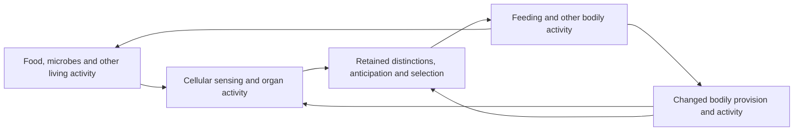

# Relations across scales

8 October 2026, Asia/Bangkok. AI-authored research following [Ren’s direction](../../../sources/15-codex-theory-conversations/2026-10-08-relations-across-scales.md). Extends the [exact systems projections](../history/SYSTEMS-COMPLEXITY-CHAOS.md) and [controlled refinement](../history/CONTROLLED-REFINEMENT.md). [Proof correspondence](../../../_process/research/2026-10-05-generative-foundation-review/history/root-foundation/RELATIONS-ACROSS-SCALES-PROOF.md) · [Integration, counterreview and sources](../../../_process/research/2026-10-05-generative-foundation-review/history/root-foundation/RELATIONS-ACROSS-SCALES-INTEGRATION.md).

**A description’s adequacy depends on the relations it preserves through actual change and the judgment it is meant to support.** Coarser descriptions can be sufficiently accurate. An exact prediction of a total can nevertheless omit a basic loss at a particular position. Changing organization can require additional information, a shorter prediction horizon or renewed calibration.

**Ren’s subsequent clarification makes the organizational connection explicit: cells participate in organs, organs in bodies, and bodies in ecosystems; cognition and the selection of activities occur within these relations.** The account below now distinguishes this actual organization from the maps used to describe it. The [embodied-scale integration and review](../../../_process/research/2026-10-05-generative-foundation-review/history/root-foundation/EMBODIED-SCALES-INTEGRATION.md), [biological evidence](../../../_process/research/2026-10-05-generative-foundation-review/history/root-foundation/EMBODIED-SCALES-EVIDENCE.md) and [14 additional checked results](../../../_process/research/2026-10-05-generative-foundation-review/history/root-foundation/EMBODIED-SCALES-PROOF.md) preserve their distinct scopes.

> **Restructured 17 October 2026.** The rounds' next-connection, further-test and completion-scope passages, and the empirical-data rounds (§13, §15–§17), were moved verbatim to [the rounds history](../history/RELATIONS-ACROSS-SCALES-rounds-2026-10-17.md); each place keeps its anchor and a pointer. Arguments, formal results and Lean receipts stay on this page.
>
> Chinese edition: [RELATIONS-ACROSS-SCALES.zh.md](RELATIONS-ACROSS-SCALES.zh.md) (split from the bilingual original; not maintained in step with this page).

## 1. Descriptions within one unfolding

Cells, organisms, communities and institutions are not introduced as independent layers of reality. Each description selects patterns and relations within connected activity. Some such relations sustain recognizable organization; their causal importance must be identified rather than inferred from their place in a hierarchy. A summary is neither automatically a real collective organization nor necessarily an arbitrary convention. A proposed biological or social scale needs correspondence to its actual formation and effects.

The map \(p_t:X\to Y\) selects a description from a more detailed state \(x_t\). “More detailed” is relative to this map; it does not assert an ultimate microscopic ontology. The omitted relations remain active. The map may change with time, but its discovery, implementation and support are not derived merely by allowing a time index. Fixed carriers can encode stored organization; genuinely changing description types require a further common encoding or a richer formalization.

The named foundational contribution is **organization and representation → warranted identification of consequences across descriptions → application of justified practical conditions**. This tests a correspondence requirement of the universal programme: judgments about the whole must remain accountable to differentiated consequences. It supplies no new proof of living significance and adds no ethical weighting rule.

### Cells, organs, bodies and ecological relations

A part–whole explanation identifies how activities are organized together, what that organization accomplishes, and how it supports or changes its participants. Anatomical inclusion is one relation; functional participation and dependence are others. A cell’s contribution depends on its connections and state, not simply on its being inside an organ. A body is sustained through coordinated activities whose participants also require support. Its ecological participation extends through relations that cross its anatomical boundary. Microbial lineages can live within a body without becoming ordinary cells of that organism. Organ systems overlap; not every organism has organs. The sequence cell–organ–body–ecosystem is therefore an important biological case, not a universal fixed ladder.

| Relation being explained | What must be identified | What cannot be inferred from the label |
|---|---|---|
| Cell participation in an organ | Differentiated activity, arrangement, communication and material support | A pile of cells already performs the organ’s work |
| Organs participating in a body | Coordinated provision, regulation and effects on continuing activity | Every local increase benefits the body |
| A body participating in ecological relations | Acquisition, consumption, production, dispersal and effects on other lives | The ecosystem is one organism with one decision center |
| Cognition within these relations | Discrimination, retention, anticipation, selection and correction through actual activity | A separate mind directs an otherwise passive body |

What is often called influence “from above” must be unpacked through these relations. A change in whole-body activity can change local supply or signaling; the change reaches cells through particular pathways. Calling it a bodily condition does not introduce an additional force outside cellular activity. Conversely, explaining those pathways does not eliminate the usefulness of a bodily description that preserves their coordinated effects. A proposed intervention on a bodily variable must have an admissible realization: one cannot hold every constituting relation fixed while independently changing the whole they constitute.

“Upward” and “downward” name different relational paths within the same unfolding. Whole organization can give parts roles they lack alone, and changes in parts can reorganize the whole activity; the particular direction, delay and strength are settled by mechanism and evidence. “Constraint” and “flow” are not first made two ontologies, one of which then rules the other. Which relations stay relatively stable over a given period, and which change faster, also needs explanation.

The existing [living-dependency account](../history/LIVING-DEPENDENCIES.md) supplies conditional results on inherited organization, support, competing uses and recovery. [New possibilities](../history/NEW-POSSIBILITIES.md) explains how changed organization can enable effects unavailable to its earlier operative repertoire. These results support the present connection without constituting a derivation of every biological organ or a proof that all ecological relations are beneficial.

### How cognition participates

Cognition enters the explanation when activity forms discriminations and retained effects that guide subsequent activity: detecting a difference, retaining something of it, anticipating a consequence, selecting a response and revising after what happens. This is a working functional account of the cognitive activities relevant here, not a complete definition of consciousness. A molecular response alone does not establish reflective thought. Human deliberation adds language, reasons, learned commitments and social relations whose specific organization must be explained.

**Cognition is not one more layer placed on top of the cell–organ–body–ecology chain.** Perception and memory are realized through bodily activity and its support; the anticipations and selections they form in turn change what the body does next, and so organ load, local conditions and ecological participation. Being able to select does not mean that every selection succeeds, nor that all its consequences are known.

For a feeding episode, the explanatory circuit is:

The nodes select overlapping activities within a shared history; cognition is realized through some of the cells and organs already represented. Arrows identify explanatory connections requiring mechanism and evidence. The diagram is neither an anatomical map nor a claim that one experiment has measured every arrow.

The [primary evidence assessment](../../../_process/research/2026-10-05-generative-foundation-review/history/root-foundation/EMBODIED-SCALES-EVIDENCE.md) identifies four concrete tests. In mice, interfering with gut neuropod signaling changes sugar preference: a cellular contribution inside an organ matters to whole-animal choice. [Buchanan et al., 2022](https://pmc.ncbi.nlm.nih.gov/articles/mid/NIHMS1756304/). Neural feeding-related activity can also change before consumption and reverse after food removal; a contemporaneous bodily nutrient quantity alone misses relevant anticipation. [Chen et al., 2015](https://pmc.ncbi.nlm.nih.gov/articles/PMC4373539/).

In fruit flies, nutrient conditions and particular commensal bacteria alter food choice. [Leitão-Gonçalves et al., 2017](https://journals.plos.org/plosbiology/article?id=10.1371/journal.pbio.2000862). In a separate fruit-substrate experiment, fly participation changes yeast abundance and community composition, including reduced diversity; altering conditions favorable to one participant need not expand every other life’s possibilities. [Stamps et al., 2012](https://journals.plos.org/plosone/article?id=10.1371/journal.pone.0042238). These studies constrain different links. Their different preparations, species and timescales are not silently joined into one measured history.

Three judgments must be kept separate: whether an activity is selected, whether it is realized under present conditions, and whether its overall consequences have a good direction. Accurate anticipation can be used for destruction; a beneficial intention can fail when conditions change; support at one place in a body can come with loss for another life. Cognition and scale correspondence give ethical judgment actual consequences to identify; they do not by themselves supply its ethical ground.

### Descriptions change with the question

For an inventory question, an amount may suffice. For an organ-function question, arrangement and available capacity may matter. For a choice question, acquired signals, retained history and response organization may matter even at the same current amount. For consequences across lives, other participants, access and renewal can become indispensable. A description earns adequacy for its stated task; a successful total does not license erasing these distinctions elsewhere.

The analyst’s map and a living participant’s operative discrimination must also be distinguished within the same unfolding. Writing a better variable in a paper does not make an organism acquire it. Actual revision requires a realized route for sensing, retention, learning or reorganization, with its support and delay. [Controlled refinement](../history/CONTROLLED-REFINEMENT.md) already checks exact preservation of observations, memory and selected histories; [protocol composition](../history/PROTOCOL-COMPOSITION.md) accounts conditionally for multi-event implementations. The new approximate result in §7 adds the effect of potentially different choices. None of these interface theorems alone explains the formation of the capacities it relates.

## 2. Approximate preservation over a finite horizon

Consider actual and represented histories

\[
x_{t+1}=F_t(x_t),\qquad y_{t+1}=G_t(y_t).
\]

They are not two independent realities: the second is a proposed representation of selected relations in the first. The actual history is also a checked history of the existing generative core, with the stage index retained. Time here is a sequence index, not a supplied physical clock rate.

Define the current discrepancy \(e_t=d(p_t(x_t),y_t)\). Supply and justify two local bounds on the reached states:

\[
 d(p_{t+1}(F_t(x_t)),G_t(p_t(x_t)))\le\varepsilon_t,
\]
\[
 d(G_t(p_t(x_t)),G_t(y_t))\le L_t e_t,\qquad L_t\ge0.
\]

The first measures one-step failure of correspondence, including any change of description; the second bounds propagation of existing error. Lean derives, throughout any specified horizon whose premises hold,

\[
 e_n\le E_n,\qquad E_0\ge e_0,\quad E_{t+1}=\varepsilon_t+L_tE_t.
\]

No global bound on all unreached states is necessary for this theorem. However, evidence that bounds hold on one observed history does not establish them for unobserved interventions. A predictive use must warrant them for the possible histories to which it applies.

A checked cap criterion is \(E_0\le B\) and \(\varepsilon_t+L_tB\le B\) at each step. It is sufficient, not necessary. The checked positive-drift counterexample has constant small one-step discrepancy but arbitrarily large accumulated error. Neither a stable-looking aggregate nor a previously successful fit warrants indefinite use.

**Description changes must be charged.** A fixed state can be described first by \(p_0(x)=x\) and then by \(p_1(x)=x+M\). Each frozen description commutes perfectly with identity dynamics. Keeping the old predicted coordinate nevertheless introduces error \(|M|\). A valid coordinate transport can remove this particular mismatch; the example challenges omission of that transport, not changing descriptions itself.

## 3. Composition and changing organization

For another map \(q_t:Y\to Z\), suppose the first scale has defect \(\varepsilon_t\), the second has defect \(\eta_t\), and \(q_{t+1}\) changes distances by at most a factor \(K_t\ge0\). Lean proves the composed one-step defect is bounded by

\[
 K_t\varepsilon_t+\eta_t.
\]

This is a two-map result that can be applied successively, not a formalization of every hierarchy. For multi-step prediction the composed model still needs its own propagation bounds. Distances, units and sensitivities are supplied correspondence choices, not interchangeable measures of ethical significance.

A concrete mechanism shows why descriptions can cease to suffice. In one joint two-position process, let

\[
F_c(a,b)=(a+cb,b),\qquad p(a,b)=a+b.
\]

The positions describe differentiated relations in the same history. The equation is an illustrative linear coupling, not a conservation law or a biological fit. At \(c=0\), the total-only identity model is exact. When coupling changes, the next total is \(p(a,b)+cb\). If evidence bounds \(|b|\le B\), the identity predictor has one-step error at most \(|c|B\). Without such information, a universal small bound has not been supplied.

For equal-total states \((2,0)\) and \((0,2)\), any common prediction whose error is at most \(\varepsilon\) in both must satisfy \(c\le\varepsilon\). Thus for positive coupling larger than the tolerated error, no refitting of a total-only predictor solves this uniform task. Retaining the consequential coordinate \((p,b)\) restores an exact update. This particular repair retains as much information as the original pair; it is not a dimensional-reduction achievement.

This explains when some relation must be restored; it does not show that every case requires a return to full detail. One can retain the relevant coordinate, use reliable memory, restrict the context of application, or accept a bounded error; each route must state the information actually obtainable and its cost. This round checked the coordinate repair and the bounded error; it did not construct a memory kernel or select the best scale automatically.

## 4. From prediction error to particular judgments

Suppose \(f_i(x)\) measures a specified condition at position or relationship \(i\), and \(g_i(y)\) estimates that same condition from the representation. Require independent calibration

\[
 |f_i(x)-g_i(p(x))|\le a_i,
 \qquad |g_i(p(x))-g_i(y)|\le K_i d(p(x),y).
\]

Then the checked observable error is at most \(a_i+K_iE\). With a separately warranted threshold \(\theta_i\),

\[
 g_i(y)\ge\theta_i+a_i+K_iE\quad\Longrightarrow\quad f_i(x)\ge\theta_i.
\]

An upper error margin can likewise certify a strict violation. When the uncertainty interval crosses the threshold, two values compatible with the same estimate lie on different sides: neither verdict follows from that estimate alone. These are sufficient certificates, not a complete decision procedure.

The indexed theorem preserves every supplied condition without averaging them. Whether the index set includes everyone affected, whether the readout tracks the relevant condition, and why its threshold has practical authority remain distinct obligations. This supports application of [practical judgment](PRACTICAL-JUDGMENT.md) under its explicit premises; it does not derive its additional commitments from approximation theory.

**An exact total can still lose the target.** The joint transfer \(T(a,b)=(a+b,0)\) preserves \(a+b\) exactly for every state. Yet \((1,1)\) satisfies the two conditions \(a\ge1,b\ge1\), whereas its successor \((2,0)\) does not. Lean proves that no predicate of the total alone characterizes those two conditions on all states. The failure is in the representation’s information, not in a separately toggled ethical label.

For this one conjunction, \(\min(a,b)\ge1\) is an exact test. That smaller summary still does not identify who lacks support, the size of every loss, consent, history or responsibility. Thus a description can suffice for one claim and fail for another. No assertion that every aggregate is ethically useless follows.

## 5. Argument, testing and limits

The affirmative result is that useful scale relations can be stated as explicit, testable contracts. Complete microdescription is not required for every warranted inference. Conversely, relational unity does not make every coarse summary adequate: it directs attention to precisely which connections are retained or lost.

This round completes a general finite-horizon error bound, two-scale composition, epistemic transfer for particular conditions, and a formal counterexample of real information loss. It does not claim automatic discovery of natural scales, a proof that macroscopic agents form, a whole renormalization theory, control of every feedback policy, or a proof of universal ethics. A supplied law is not said to lie outside reality because it is “given” in the model; its formation remains a relation open to further explanation.

The formal package records **21 new checked theorems**, plus 42 inherited audits replayed from the core and exact-organization module. It uses the existing pinned Lean/Mathlib environment. No new empirical experiment is claimed. The [proof receipt](../../../experiments/integrated-correction/general-framework/generative-basis/lean/systems-complexity/analysis/scales-verification.json) binds source, compiler and audit output. Counterreview was performed by the same agent and is explicitly not an independent-agent review.

**§6 Next connection** (the test selected after the first round; §9 completes one conditional realization of it). Moved verbatim to [history](../history/RELATIONS-ACROSS-SCALES-rounds-2026-10-17.md#6-下一连接--next-connection).

## 7. Choice changes error propagation

Let the detailed joint state include the relations through which cognition operates. A selected action is \(a_t=\pi_t(x_t)\); the represented selection is \(b_t=\widehat\pi_t(y_t)\). Supply action-dependent updates \(F_t(x,a)\), \(G_t(y,a)\), and the earlier maps \(p_t\). These are two descriptions used in a correspondence test, not an external controller and an independently existing world. The policies are supplied in this theorem; their formation is not proved by writing \(\pi\).

In addition to same-action model defect \(\varepsilon_t\) and state-error propagation \(L_t\), require a bound on the difference in action effects at the represented state:

\[
d(G_t(y_t,a_t),G_t(y_t,b_t))\le\sigma_t.
\]

Then Lean checks the finite-horizon bound

\[
e_n\le E_n,\qquad E_{t+1}=\varepsilon_t+L_tE_t+\sigma_t,
\quad E_0\ge e_0,\quad L_t\ge0.
\]

An approximation that changes the selected action must account for the changed effects. Equal actions allow \(\sigma_t=0\); different actions may also have the same relevant effect. No metric on action names is required. The theorem requires a common action vocabulary, finite horizon, applicable local bounds and corresponding state maps. It does not cover an uncalibrated change of action repertoire.

For the specified threshold rule “choose true iff score ≥ \(\theta\),” suppose \(|r-\widehat r|\le u\), \(u\ge0\). Lean verifies equal true choices if \(\widehat r\ge\theta+u\), and equal false choices if \(\widehat r+u<\theta\). The asymmetry follows from the rule’s treatment of equality. Near the threshold, scores \(-\delta\) and \(\delta\) differ by only \(2\delta\) but choose effects 0 and 1 for every \(\delta>0\). Accurate estimation by itself therefore does not preserve the selected effect. These margins concern fidelity to a stated policy, not the policy’s practical or ethical correctness.

A separate finite witness puts sensing, retention, selection, bodily acquisition and another living participant’s consumption in one shared state. Sensing followed by response transfers available support into the bodily store. Clamping the sensor changes the selected response despite equal starting support. Another participant can consume the shared unit after sensing: the retained plan persists until the attempted response, but its material opportunity is gone. Lean checks the actual core trace and conservation of the declared support count throughout every finite event list. The two participants are positions in the same process, not a separately given agent and environment.

This witness tests the distinction between acquired information, chosen attempt and realized effect. Its Boolean sensor, memory, response rule and event schedule are supplied. Sensing is cost-free in this local law; metabolism, organ structure, population renewal and ecological regeneration are omitted. Thus it is a checked explanatory countermodel, not a physiological model, a derivation of consciousness or a sustainable ecosystem. The earlier **21** scale theorems and these **14** additional theorems have separate receipts; the latter freshly replay **63** inherited audits. [Correspondence and dependency audit](../../../_process/research/2026-10-05-generative-foundation-review/history/root-foundation/EMBODIED-SCALES-PROOF.md).

## 8. Integration and further tests

The account now connects actual part–whole organization, ecological participation and cognitively selected activity, alongside the mathematical relations between descriptions. Its strongest supported claim is a conditional explanatory architecture: organization enables differentiated capacities; supported cognitive activity selects responses; responses alter the conditions of subsequent cellular, bodily and ecological activity. The four primary studies constrain particular realizations, and the formal results specify when descriptions preserve consequences and choices.

This round did not substitute “a cell is a numerical summary of an organ” for “a cell belongs to an organ”, nor treat cognition as a selector outside the whole. What is completed is the theoretical connection of these relations and tests within a stated scope. A universal derivation of the spontaneous formation of every scale, a quantitative model of the whole biosphere, a theory of consciousness and a proof of universal ethics do not follow from it.

*The proposed stronger biological test (one preparation joining cellular or organ function, acquired discrimination, selected activity and changed support). Moved verbatim to [history](../history/RELATIONS-ACROSS-SCALES-rounds-2026-10-17.md#8-本轮整合与后续检验--integration-and-further-tests).*

## 9. Acquired evidence, revised description and enacted response

8 October 2026, continuation. A new checked history connects the earlier approximation criteria to an operative revision. Records, inquiry, available support, changing dependencies and response are roles within one evolving state. The result advances **acquired consequence → description revision → calibrated and feasible response**. It supplies an implementation condition for practical judgment; it does not establish the ethical authority of the target being protected. [Argument, dependencies, counterreview and sources](../../../_process/research/2026-10-05-generative-foundation-review/history/root-foundation/SCALE-REVISION-INTEGRATION.md).

**Revision is not merely a change of wording.** After the dependency changes, the acquired change of the total enters the retained record; a further discrimination acquires the coordinate the old description omitted; the revised forecast actually changes the selected response. Inquiry, discrimination, revision and response each cost work and take time under the declared law. Even when the new description is correct, insufficient remaining support can make the response unrealizable.

The supplied local law has a signed condition level \(a\), a retained coordinate \(b\), an available support source \(S\), a stored view and an operating account. Activating a dependency changes each subsequent stage's loss to \(b\). Without intervention, \(a'=a-b\); an eligible response of amount \(u\) gives \(a'=a-b+u\), \(S'=S-u\). The coordinate \(b\) is retained by this law. These are illustrative quantities, not measured cellular stores, a physiological conservation law or a model of every affected life.

The entrance is \((a,b,S)=(12,3,1)\). An initial probe records the actual total decrement, an inspection obtains \(b\), and revision transports the recorded total through its own delay. The coarse forecast assigns half the predicted total to \(a\); the refined forecast subtracts the acquired second coordinate and the recorded next loss. Both can learn the total decrement. Only the refined rule uses the second coordinate. The response amount is read from the stored view, not from privileged access to the actual dependency switch.

| Declared stage | Actual \(a\) | Retained information or effect |
|---|---:|---|
| Entrance and dependency activation | 12 | \(b=3\), support source 1 |
| Probe | 9 | Total 12; recorded decrement 3 |
| Inspection | 6 | Total 9; measured second coordinate 3 |
| Revision | 3 | Transported total 6; refined next-condition forecast 0 |
| Response | 1 | One support unit delivered; source exhausted |

The exact endpoint and revision-state checks appear in `acquired_revision_endpoint` and `enacted_refinement_protects`. The stage table unfolds the declared law. The inherited charger assigns each of the four operations 1044 abstract work ticks: initial fuel 4176 becomes spent work 4176. The fixed tariff and idealized real-valued registers do not constitute a finite-bit implementation or an energy measurement.

Clamping revision preserves the same acquisitions, stage costs and physical history up to response. Its next-condition forecast is \((6-3)/2=1.5\); for threshold 1 it selects no support and ends at \(a=0\). The revised forecast is 0, so it selects one unit and ends at \(a=1\), with \(b=3\) in both histories. This isolates an operative consequence of using the acquired distinction. It does not prove that every successful response requires that distinction: an equally funded, supplied fixed-one-unit response also succeeds here.

**Calibration has a direct practical role.** Let \(\widehat r\) be the stored forecast of the next condition without intervention, and assume independently that \(|r-\widehat r|\le U\). Lean checks

\[
u=\max(0,\theta+U-\widehat r)\quad\Longrightarrow\quad r+u\ge\theta.
\]

The earlier observable-error certificate can supply \(U=\alpha+KE\). Actual enactment additionally requires the declared additive response law, a current context-bound record and enough source to deliver \(u\); executing the event also requires operating fuel. A sufficient error bound is not itself an available resource. With a biased coordinate reading, allowance 3 restores the example's condition; with an accurate reading, that same conservative allowance asks for 4 units against a source of 1 and the funded refusal ends at \(a=0\).

Calibration, binding, timeliness and affordability each have their own role and cannot stand in for one another: a record from the wrong context is rejected; extra waiting invalidates an old timestamp; yet stamping old content with a new timestamp can still mislead. A reading bias, or ignoring the time revision takes, can make a “revised” model miss the support. Inquiry can also exhaust the work the response needs. Refusing an unwarranted or unrealizable response does not mean that the actual condition has been protected.

The new package contains **27 checked theorems**, separately replaying **106 inherited audits** (core 18, exact organization 24, earlier scales 21, existing inquiry dependency module 43). It reuses the actual `RemainingDependency.charge` and context decoder. It is a new quantitative realization, not a replay of the ancestral learner's numeric endpoint or a composition theorem for its full learning algorithm. [Lean source](../../../experiments/integrated-correction/general-framework/generative-basis/lean/systems-complexity/analysis/ScaleRevision.lean) · [fresh verification receipt](../../../experiments/integrated-correction/general-framework/generative-basis/lean/systems-complexity/analysis/scale-revision-verification.json). The separate 14-result embodied-choice extension retains its own scope and receipt.

**§10 Selecting the continuation** (limits of the supplied channels and candidate descriptions; the selected inquiry-versus-response comparison is completed in §12). Moved verbatim to [history](../history/RELATIONS-ACROSS-SCALES-rounds-2026-10-17.md#10-后续连接的选择--selecting-the-continuation).

## 11. Composition of organized activity and biological correspondence

8 October 2026. Ren requested completion after the distinction between component proofs and whole-account certification. The [new integration and completion assessment](../../../_process/research/2026-10-05-generative-foundation-review/history/root-foundation/ORGANIZED-SCALES-INTEGRATION.md) adds **26 checked Lean theorems**, with **77 inherited audits**, and a reproducible reanalysis of **403 published measurements**. This completes a connected conditional construction and advances empirical correspondence. It does not certify the entire biological account.

The same joint event law now connects regional material transfers, serial signal operations, cumulative retention, funded withdrawal, competing response conditions and renewed or interrupted exposure. An exact view compresses the signal route while retaining the distinctions needed by its actual law. General composition also covers selected activity when the successive dynamics and operative choices agree through their descriptions. These are checked interface requirements, not consequences of merely naming cells, organs or bodies.

Two histories from the same initial state acquire information at different times. They end with equal material, current support, spent work, route and context, yet differ in retained effect and withdrawal. Equal whole-organ burden can also conceal different regional signals. Thus descriptions must preserve the particular relations through which a capacity is realized; more detail is useful when it recovers a consequential distinction, not simply because it is more detail.

**Local operations form transmissible effects through organization; continuing consequences take part in selection; whether a selection is realized also depends on support and competing conditions; actual activity in turn changes later contact.** In the formal model these connections are joined, and counterexamples of a broken route, exhausted support and renewed contact are retained. But the linear transfer, retention law, costs and timing remain explicitly supplied; cell differentiation, tissue formation and ecological regeneration are not derived from them.

The [primary evidence assessment](../../../_process/research/2026-10-05-generative-foundation-review/history/root-foundation/ORGANIZED-SCALES-EVIDENCE.md) now distinguishes enterococcal learning, a mapped motor circuit and newer epithelial-neural signaling results. The evidence requires region and context sensitivity and narrows the unspecified gut-to-activity connection. These preparations do not supply one matched trajectory calibrating the whole formal loop.

*What remains for the stronger request: observation maps, mechanisms, delays and error bounds in one preparation, held-out interventions and rival models. Moved verbatim to [history](../history/RELATIONS-ACROSS-SCALES-rounds-2026-10-17.md#11-组织机制的组合与生物对应--composition-of-organized-activity-and-biological-correspondence).*

## 12. When to inquire and when to respond

8 October 2026, further continuation. **The useful amount of detail depends on the available responses, the conditions they must preserve and the time in which they must act.** A distinction matters for this task when histories compatible with the current evidence require incompatible responses. More information can make an adequate response selectable, but obtaining it also changes the history in which that response must occur. If the compatible histories still share a feasible response, there is no need to keep inquiring merely because the description could be finer; when further discrimination is needed, real change during inquiry, the work consumed and later support must all be counted. This explains epistemic adequacy for a particular task; it does not treat the task's target as already ethically warranted. [Argument, exact hypotheses and self-counterreview](../../../_process/research/2026-10-05-generative-foundation-review/history/root-foundation/INQUIRY-CHOICE-INTEGRATION.md).

### A common horizon and explicit tolerances

For the supplied additive law, let the initial condition be \(a\), the constant loss per stage be \(\ell\in[\ell_-,\ell_+]\), the common horizon be \(H\ge0\), and the one permitted nonnegative intervention be \(u\le S\). The terminal condition is

\[
x_H=a-H\ell+u.
\]

Require \(L\le x_H\le B\). The upper bound prevents an excessive intervention from counting as success; neither bound receives normative authority from the equation. For a nonempty loss interval, Lean proves that a single intervention works throughout it exactly when

\[
\max(0,L-a+H\ell_+)\le u\le\min(S,B-a+H\ell_-).
\]

A robust immediate response exists exactly when this interval is nonempty. Its left endpoint is the least such dose. This is an elementary interval result, not a new general control theory or proof that every target should be a scalar interval.

More generally, a deterministic policy based on an observation can satisfy the declared action conditions for every represented history exactly when every observation class admits a common admissible action (with the formal theorem's nonempty action-type hypothesis). Histories with the same observation but disjoint admissible actions defeat a guaranteed policy based only on that observation. The existence proof uses classical choice; it does not construct sensors, establish calibration or supply a computable optimal policy.

### Actual acquired evidence can resolve a conflict

The two compared histories share initial condition 8, support 5, operating work 2088 and the same available evidence: the loss is between 1 and 3. The installed routes each end at **stage 2**. Immediate response delivers a selected dose during stage 1, then time passes. Inquiry instead records the actual total decrement during stage 1 and uses that acquired loss to select a dose during stage 2. The inherited work charger and probe run within the same joint state; the route selector reads the same visible bounds in both histories, not the hidden actual loss.

| Actual loss per stage | Doses meeting terminal interval [7,8] | Acquired response | Terminal condition | Support left |
|---:|---:|---:|---:|---:|
| 1 | [1,2] | 1 | 7 | 4 |
| 3 | [5,6], restricted by supply to 5 | 5 | 7 | 0 |

No single immediate dose succeeds in both histories. Inquiry selects 1 or 5 from the recorded decrement and succeeds in both checked executions. Its unassisted intermediate conditions are 7 and 5, above the separately declared floor 0. The terminal lower target 7 is not silently required at every intermediate stage.

This is a scoped information advantage over one immediate intervention chosen before acquisition. An equally informed conventional controller can do the same. The comparison does not exclude split interventions, continuous feedback, reversible action or additional sensors: those are different repertoires that require a new comparison.

### Inquiry is sometimes unnecessary or too late

Widening the acceptable terminal interval to [3,8] leaves the loss range and support unchanged. Immediate dose 1 then works for **every** loss in [1,3]. In the checked high-loss execution it reaches 3 and uses 1044 work ticks; inquiry uses 2088. For a fixed dose, early and late intervention have equal terminal effect in this particular additive law, while early support gives at least as much condition before late delivery. The advantage is not obtained by giving immediate response a shorter evaluation horizon.

With initial condition 2 and actual loss 3, one inquiry stage crosses the floor to −1. An immediate dose 5 instead ends at condition 1 at the same stage-2 horizon. Better eventual information cannot erase a past violation. This is a signed condition coordinate, not a claim that a biological stock literally becomes negative.

A first selector checked a failed robust-response test, inquiry work and waiting headroom. A counterexample shows that it still selected inquiry when the source held only 4 but the eventual correction needed 5. The preserved failed rule is followed by a repaired rule checking post-inquiry correction capacity and excessive unassisted outcomes as well. The repaired rule retains the useful inquiry case and rejects that insufficient-support case. Its general theorems certify the immediate robust dose or the calibrated post-query correction and waiting floor; its two concrete inquiries are actual checked executions. Selection overhead and the origin of its uncertainty bounds remain supplied.

**Checked scope: 28 new theorems, 133 inherited audits.** This round connects the histories that evidence can distinguish, the intersection of feasible responses, and the actual timing of inquiry and response. It retains the counterexamples of failed inquiry, successful immediate response and the repaired selector. Thresholds, tolerances, laws and candidate routes remain explicit; it does not claim that all scales are exhausted or that all biological relations are verified.

[Lean source](../../../experiments/integrated-correction/general-framework/generative-basis/lean/systems-complexity/analysis/InquiryChoice.lean) · [checked receipt](../../../experiments/integrated-correction/general-framework/generative-basis/lean/systems-complexity/analysis/inquiry-choice-verification.json).

*The remaining application question: how actual evidence warrants the interval, delay, tolerances and repertoire. Moved verbatim to [history](../history/RELATIONS-ACROSS-SCALES-rounds-2026-10-17.md#inquiry-is-sometimes-unnecessary-or-too-late).*

**§13 Measured history, activity and later biological conditions.** In 198 worms' mixed-density foraging data, a five-parameter history model predicts held-out choices better (mean soft cross entropy 0.605695) than an equally sized current-density/time model (0.621669), with stated qualifications; a pathogen preparation constrains the reverse link from activity opportunities to later bodily and microbial conditions. No new theorem ([continuation](../../../_process/research/2026-10-05-generative-foundation-review/history/root-foundation/BIOLOGICAL-CONTINUATION-INTEGRATION.md)). Moved verbatim to [history](../history/RELATIONS-ACROSS-SCALES-rounds-2026-10-17.md#13-历史活动与后续生物条件的实测检验--measured-history-activity-and-later-biological-conditions).

## 14. How long a description remains usable

8 October 2026, continuation. The preceding comparison assumed that the acquired loss remained constant. The new study allows the dependency to change between reading and response. **A record's usefulness depends on what can change before its consequence is realized, as well as on what the record originally captured.** [Argument, theorem map and counterreview](../../../_process/research/2026-10-05-generative-foundation-review/history/root-foundation/CHANGING-DEPENDENCY-INTEGRATION.md).

A timestamp says when a record was acquired; it does not by itself ensure that the record still applies to the present relation. Reading error, change since acquisition, the period the forecast covers and the response tolerance must be tested together. Reading again does not automatically restore certainty: change can continue after the reading. The corresponding revision uses a new reading together with a reliable bound on subsequent change.

### Error, tolerance and the remaining opportunity

If the actual condition and upcoming loss are \(a,\ell\), their retained estimates are \(\widehat a,\widehat\ell\), and their separately warranted error bounds are \(\alpha,\beta\), Lean checks

\[
|(a-\ell)-(\widehat a-\widehat\ell)|\le\alpha+\beta.
\]

Sensor error and change since acquisition similarly add; a finite sequence of stage errors is bounded by the sum of its stated bounds. These bounds require real correspondence. An old successful prediction does not establish them for a changed dependency.

For an unassisted terminal prediction \(r\) with error bound \(E\ge0\), require the actual corrected condition to lie in \([L,B]\), with correction \(0\le u\le S\). A certificate covering the whole uncertainty interval is exactly

\[
\max(0,L-r+E)\le u\le\min(S,B-r-E).
\]

Its existence requires \(2E\le B-L\). If \(E=\sigma+\rho t\), it also requires \(2\rho t\le B-L-2\sigma\). With nonnegative sensor error and positive growth rate, this supplies a necessary age budget for this certificate; support limits can defeat it sooner. Failure of a conservative certificate is not proof that every actual response fails. These are conditions for the declared additive intervention, not a universal expiry date for knowledge.

### Three routes at the same deadline

The initial condition is 12, loss 1, support 5 and operating work 3132. A first read takes one stage, leaves condition 11 and records loss 1. The dependency then changes to loss 3. This supplied change updates a real coordinate within the joint history but takes no modeled stage or work; its formation is not explained here. The old record's timestamp is still current, yet its next-step forecast is 10 while the actual unassisted next condition is 8.

All three routes below end at stage 3. The broad terminal interval is [7,11].

| Route after the first read | Delivered correction | Terminal condition | Work consumed |
|---|---:|---:|---:|
| Trust the old constant-loss forecast, respond, then wait | 0 | 5 | 2088 |
| Use a bound of [1,3] on each remaining loss, respond, then wait | 2 | 7 | 2088 |
| Read again, then respond using exact continuation | 2 | 7 | 3132 |

The bounded early correction covers every pair of remaining losses in [1,3], including different losses at the two stages. Re-reading is therefore unnecessary for this broad target under these bounds. Work, deliverable support and the signed condition remain different quantities; none is a universal ethical currency.

For the narrower interval [7,9], the old two-stage uncertainty admits no common correction: losses 3 and 3 require at least 2, while losses 1 and 1 permit at most 0. A second reading can shrink the remaining uncertainty. If the loss stays 1, refreshed response delivers 0 and ends at 9; if it stays 3, it delivers 2 and ends at 7. However, an acquired loss of 2 followed by an actual loss of 3 ends at 6 when the refreshed response falsely assumes exact continuation. The fresh reading was accurate when acquired.

A repaired refreshed response retains the bound [1,3] on the remaining stage. If the second reading experienced loss \(\ell_1\), it has acquired condition \(11-\ell_1\) and delivers \(u=\ell_1-1\). For **every** \(\ell_1,\ell_2\in[1,3]\), Lean checks that support is sufficient and the terminal condition is \(10-\ell_2\in[7,9]\). The failed history with losses 2 then 3 now delivers 1 and ends at 7 in an actual checked execution. This closes a bounded-change repair, while preserving the failed exact-continuation rule.

**25 new Lean theorems; 161 inherited audits replayed.** The general error certificate and the particular work-consuming histories each have their own scope; the added two-channel readings, the work per inquiry, the admitted change bounds and the response rules remain explicitly supplied. It does not prove that these bounds can be extrapolated automatically from finite old data, nor does it establish the whole biological loop.

[Lean source](../../../experiments/integrated-correction/general-framework/generative-basis/lean/systems-complexity/analysis/ChangingDependency.lean) · [verification receipt](../../../experiments/integrated-correction/general-framework/generative-basis/lean/systems-complexity/analysis/changing-dependency-verification.json).

The next substantive application must justify the change bounds and tolerances from actual records or mechanisms, including cases in which those bounds fail. The present extension connects temporal validity to scale adequacy: retaining a relevant distinction is insufficient if its relationship to the response has changed. Standard control methods already address aspects of this question; the contribution here is the explicit connection within the theory, with success and failure preserved.

**§15 Evidence for actual change bounds and targets.** In three preserved temperature-control runs, retained-reading envelopes fitted on early data are violated in held-out and transfer tests, and every tested interval is wider than the ±0.2°C soft target band: a negative result for that certification route. No new theorem ([assessment](../../../_process/research/2026-10-05-generative-foundation-review/history/root-foundation/BOUND-CALIBRATION-INTEGRATION.md); [measurement protocol](../../../_process/research/2026-10-05-generative-foundation-review/history/root-foundation/BOUND-CALIBRATION-PROTOCOL.md)). Moved verbatim to [history](../history/RELATIONS-ACROSS-SCALES-rounds-2026-10-17.md#15-实际变化界与目标的证据--evidence-for-actual-change-bounds-and-targets).

**§16 Molecular retention, measured calibration and finite ecological return.** After Ren chose full experimental validation: reanalysis of bacterial small-RNA avoidance data, a held-out fluorescence-to-viable-count calibration (log10-CFU RMSE 0.662542 against 0.784138 for a linear model), and a published 144-hour worm-dispersal experiment; joint validation in one preparation is not done ([integration](../../../_process/research/2026-10-05-generative-foundation-review/history/root-foundation/BIOLOGICAL-RENEWAL-INTEGRATION.md); [joint measurement specification](../../../_process/research/2026-10-05-generative-foundation-review/history/root-foundation/BIOLOGICAL-JOINT-VALIDATION.md)). Moved verbatim to [history](../history/RELATIONS-ACROSS-SCALES-rounds-2026-10-17.md#16-分子保持实测校准与有限生态回返--molecular-retention-measured-calibration-and-finite-ecological-return).

**§17 What retaining dynamics improves.** On the same archives a six-feature local-history model beats retaining the latest reading in all 18 within-run comparisons, while no residual-calibrated interval narrower than 0.2°C is a reliable certificate. No new theorem or laboratory experiment ([continuation](../../../_process/research/2026-10-05-generative-foundation-review/history/root-foundation/PREDICTIVE-CALIBRATION-INTEGRATION.md)). Moved verbatim to [history](../history/RELATIONS-ACROSS-SCALES-rounds-2026-10-17.md#17-保留动力学关系能改善什么--what-retaining-dynamics-improves).

## 18. How a description supports continuation

8 October 2026. Following Ren's instruction “专注在理论推进” (gloss, not Ren's words: focus on advancing the theory), this round advances the existing single-response conditions to **continuation adequacy**: [full derivation, counterexamples and counterreview](../../../_process/research/2026-10-05-generative-foundation-review/history/root-foundation/CONTINUATION-ADEQUACY-INTEGRATION.md). New empirical research is no longer a completion gate for this round's theoretical interface; existing data and unfinished validations keep their scopes.

**That a description is adequate now does not guarantee that it remains adequate after action changes the conditions.** One must first select an activity performable in every currently compatible case, then propagate the actually possible consequences, and finally choose the next step only from the record acquired by then. Successful routes that depend on different unknown truths cannot be spliced into a plan that in fact cannot be chosen.

Let `B` be the states compatible with acquired evidence within the joint history. After activity `u` and acquired record `o`, retain exactly the possible successors `y` of some `x` in `B` that yield `o`. Finite continuation adequacy requires current conditions to hold, a common allowed activity with an actual successor at every compatible state, and adequacy of every resulting observation class for the remaining horizon. **Lean proves equivalence with an observation-dependent finite branching plan.** Its existence is not an executable synthesis algorithm or a warrant for the supplied requirements.

Further checks show that, other relations unchanged, narrowing the compatible set or refining later readings preserves existing feasibility, and adequacy over a longer horizon implies adequacy over a shorter one. A family of compatible sets supports every finite horizon if, each time, some common activity keeps the later observation classes inside the family. That the actual case stays within the set, that observations can be acquired and that actions and requirements are warranted are all explicit premises; no infinite plan is extracted and no unlimited duty of continuation is inferred.

A checked two-step counterexample makes the new distinction concrete. Two initially indistinguishable histories permit the same first step but later require opposite responses. A constant record cannot guide the second step. A later reading of the retained dependency repairs this; a separately supplied transition that actually completes the dependency also repairs it while retaining the coarse record. The latter changes real consequences, not merely the description or the list of people whose losses count. Its availability, costs and legitimacy require their own argument.

This joins scale relations to the implementation question of generative alignment: action changes the later conditions of understanding, correction, transfer and fulfilling undertakings, and these changes must themselves enter the whole assessment. Which distinctions must be kept depends on the scope of continuation undertaken; it does not require depicting the whole world at each step, nor does it allow temporary forecasting success to hide later particular losses. The existing practical judgment of the conditional alignment route and the extension to new reasons continue to supply the normative interface, allowing warranted completion, transformation and finite ending.

**14 new Lean theorems / 14 audits pass; 9 have empty dependencies, the rest only standard logical / classical dependencies.** [Source](../../../experiments/integrated-correction/general-framework/generative-basis/lean/systems-complexity/analysis/ContinuationAdequacy.lean) · [checked receipt](../../../experiments/integrated-correction/general-framework/generative-basis/lean/systems-complexity/analysis/continuation-adequacy-verification.json). Results of earlier rounds are reused directly; their audits are not counted again in this round. Recursive feasibility and feedback abstraction have mature conventional precedents; the contribution here is to connect the theory's one-step judgment, information limits and later conditions, not to claim that these control ideas are new.

*Completion of the interface at its stated scope; its next connection is §19. Moved verbatim to [history](../history/RELATIONS-ACROSS-SCALES-rounds-2026-10-17.md#18-描述怎样支持接续--how-a-description-supports-continuation).*

## 19. How local responses continue together

8 October 2026. [This round's derivation and counterreview](../../../_process/research/2026-10-05-generative-foundation-review/history/root-foundation/JOINT-CONTINUATION-INTEGRATION.md) connects the previous section's observation-branching plans to joint activity. The existing results on full support scope, changing occupation and actual advance are reused directly and are not reopened as unfinished problems.

**For plans valid separately to be performed jointly, one must also show that their joint effect is still covered by the local accounts, and that every actually possible later record branch can still be performed jointly.** The first condition tracks the consequences each has on the other; the second keeps one and the same support, authority and timing, preventing double promises when the arguments are made separately.

Start from one joint state and two projections, without assuming that the state is a product of independent parts. Pair two finite plans and pass each its own component of the later joint record. If every actual joint transition projects to admitted local transitions, the initial candidates project into the local evidence classes, and the paired actions remain jointly executable throughout all resulting record branches, Lean proves that the paired plan preserves both local requirements. Joint executability is also necessary for that fixed plan; local success alone does not supply it.

This does not require the absence of mutual influence. A local account can include changes caused by other activities; but a law correct for an activity alone need not cover the effect of joint performance. For example, two plans each intend to consume two units, and each succeeds starting from two units. If they in fact share the same two units, the first joint round brings them to zero and the second round cannot run. The joint effect is `2→0`; the separate single consumption `2→1` can no longer serve as the projected account.

The checked finite repair uses four actual units for the same paired two-step plan. Separate accounting lemmas show how reservations within a common total support a selected paired demand and preserve residual accounting. Merely serializing four unit consumptions does not make two units sufficient without renewal. These are explicit consumable-support laws, not universal laws of living organization or an ethical currency. The origin and justified allocation of extra support remain separate premises.

The contribution to generative alignment is to bring commitments back into one actual history: activities that humans, institutions and intelligences each have reason to advance may share the same conditions. A joint plan must show how these relations stay compatible over time; separately valid commitments cannot simply be added. The theorem transmits only the listed requirements; it does not prove that they exhaust the good of the whole, or decide who should have priority in a conflict; normative judgment reuses the completed results of the conditional alignment route directly.

**16 new Lean theorems / 16 new audits pass; 14 inherited audits are listed separately.** [Source](../../../experiments/integrated-correction/general-framework/generative-basis/lean/systems-complexity/analysis/JointContinuation.lean) · [receipt](../../../experiments/integrated-correction/general-framework/generative-basis/lean/systems-complexity/analysis/joint-continuation-verification.json). This round completes a conditional interface for synthesizing synchronous observation plans; it does not claim general asynchronous deployment, actual fulfillment, automatic formation of support, or completion of all systems theory. The interface for starting and maintaining mutually dependent commitments proposed in this round is now connected by §20 under explicit conditions; that conditional derivation is no longer listed as unfinished.

## 20. Grounded mutual continuation

8 October 2026. [This round's derivation, premises and counterreview](../../../_process/research/2026-10-05-generative-foundation-review/history/root-foundation/SEEDED-CONTINUATION-INTEGRATION.md) supply the conditional interface of the previous section: from **existing common support and a one-step law of mutual maintenance**, they derive joint performability over the whole finite observation plan, then call the existing synthesis theorem directly. The old results on retention, joint acquisition and actual advance are not listed as unfinished again.

**Mutual dependence can be warranted; mutual promises alone cannot show that it has started.** The key is the temporal relation: the two present conditions already hold, this step's joint activity depends on them, and its actual consequences form the next step's conditions. The proof does not use “the other will succeed at the next step” to guarantee, backwards, one's own success at the same step.

Let `R,S` describe two conditions within the same joint history. Initial compatible candidates satisfy both. Whenever they hold, any pair of locally authorized actions is jointly allowed and has a successor; every admitted joint successor preserves both conditions. Together with faithful joint-to-local projections and the existing valid local plans, these one-step obligations imply recursive compatibility and hence validity of the paired finite plan. Each branch still receives only its own acquired record. This is a sufficient interface: the all-authorized-pairs premise can be stronger than a particular plan needs.

Two counterexamples bound this affirmative derivation: both sides guaranteeing “if the other eventually does it, I eventually do it too” still allows neither ever to happen; and a law with no successors can vacuously satisfy “every successor preserves the conditions”. Hence the initial ground, the existence of actual successors and the preservation of consequences must each be accounted for.

A shared configuration example exchanges two retained activation conditions each step. An empty start remains empty; a one-sided start never provides simultaneous joint readiness; a fully active start retains it. An explicit ignition transition uses an already-present reserve to establish both conditions and marks that reserve spent. Without that reserve, ignition is unavailable. This is a supplied discrete transfer-and-ignition law, not a physical creation theorem. Alternating activity may be adequate for another target; the failure concerns the stated simultaneous requirement.

The advance for scale accounts is that the same circular dependency graph can correspond to mutual maintenance already running, or to a waiting that no one can begin. To explain actual continuation, one must keep the start conditions, the time at which consequences become available and the joint performance relation, or supply a correspondence that can recover these distinctions. For generative alignment it helps audit whether commitments have grounds for implementation; who bears the start-up cost, whether to continue, and how to care for real losses still follow the existing judgment of the conditional alignment route, and the good cannot be inferred from maintainability itself.

**13 new Lean theorems / 13 audits pass, with 30 inherited audits replayed; of the new results, 6 have empty dependencies and 7 standard dependencies, with no classical choice.** [Source](../../../experiments/integrated-correction/general-framework/generative-basis/lean/systems-complexity/analysis/SeededContinuation.lean) · [receipt](../../../experiments/integrated-correction/general-framework/generative-basis/lean/systems-complexity/analysis/seeded-continuation-verification.json). The conditional synthesis interface for finite plans is completed here; retention over a given natural-number history is also checked, but actual fulfillment under an arbitrary schedule and infinite physical realization are not guaranteed. The evidence-to-implementation interface proposed in this round is now connected by §21 under explicit candidate coverage and change relations; it is no longer listed as underived.

## 21. Evidence that continues to support action

8 October 2026. [This round's derivation and counterreview](../../../_process/research/2026-10-05-generative-foundation-review/history/root-foundation/EVIDENCE-THROUGH-CHANGE-INTEGRATION.md) connect §20's actual start conditions to acquired evidence. The existing results on reading timeliness, changing support, version transfer and witnesses that can become false are reused directly; what is added is the interface from the compatible set at acquisition, through change before action, into the same joint plan.

**A record that still correctly describes the past is not thereby still sufficient to support present action.** Only by propagating, from every state compatible at acquisition, all admitted changes after the reading and before execution does one obtain the set to consider at execution. When the actual state and actual change are both covered, this set contains the actual pre-execution case.

Let `C` be acquisition-time candidates and `D` the admitted relation between acquisition and use. The propagated set contains `y` exactly when some `x` in `C` can change to `y` through `D`. A certificate for a condition `I` is equivalent to `I` holding throughout that set. Sequential propagation composes; a condition true initially and preserved by every admitted change remains certified through arbitrary finite histories. Conservative enlargement can lose certification without proving actual failure; omitted actual changes can invalidate a passing certificate.

When reconnecting to the local plans, one must certify at the same time that **the joint start conditions still hold and the changed projections still lie within the domains of both local plans**. One cannot keep only the support while still using an old plan proof that no longer applies. The new Lean theorem feeds these two into the previous round's `seeded_joint_plan`, giving validity of the paired plan over the whole candidate set after change. Later changes during execution must still be covered by the joint transition.

The concrete example acquires a truthful availability record, then permits an unreserved shared support to be consumed while leaving the record unchanged. The old record cannot exactly distinguish the still-available and consumed histories. An atomic check-and-reserve operation instead changes the actual availability relation: under a law respecting that reservation, support survives every finite admitted change history, and a duplicate reservation is blocked. Unmediated destruction still defeats the guarantee. Atomicity and effective protection are explicit premises, not consequences of a more authoritative record.

Two composable affirmative routes follow: responding after accommodating change, or changing which changes can happen through warranted actual protection. The first does not require freezing the process; the second cannot be achieved merely by deleting unfavorable events from the model. Being technically protectable does not mean being normatively entitled to occupy, or to prohibit others' activity; the cost, authority, release and ending of a reservation continue to follow the practical judgment of the conditional alignment route.

**15 new Lean theorems / 15 audits pass, 10 with empty dependencies and 5 with only `propext`; 43 inherited audits replayed.** See the [receipt](../../../experiments/integrated-correction/general-framework/generative-basis/lean/systems-complexity/analysis/evidence-through-change-verification.json) and [source](../../../experiments/integrated-correction/general-framework/generative-basis/lean/systems-complexity/analysis/EvidenceThroughChange.lean). This round does not claim non-atomic deployment, automatic reliable measurement, or that conflicts in general are resolved. The next interface is how actual feedback distinguishes an omitted change range, a false reading and an execution deviation, and connects to the existing revision mechanisms.
