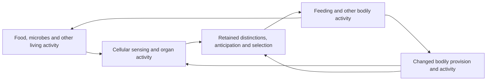

# 尺度之间的关系

> **中文版（2026-10-17）。** 正典文本是[英文版](RELATIONS-ACROSS-SCALES.md)；本版由重构时从双语原文拆出，不与英文同步维护，两者有出入时以英文为准。

**一个尺度的描述是否充分，取决于它在实际变化中保留了哪些关系，以及我们据此要作出什么判断。较粗描述可以足够准确；总量预测完全准确，也仍可能遗漏具体位置的基本损失。组织关系改变时，原先充分的描述可能需要增加信息、缩短有效时域，或重新校准。**

> **2026-10-17 重构：** 各轮的“下一连接”、后续检验与完成范围段落，以及实测数据轮（第13、15–17节），已原文移至[轮次历史](../history/RELATIONS-ACROSS-SCALES-rounds-2026-10-17.md)；每处保留锚点与指引。论证、形式结果与 Lean 回执仍在本页。

## 1. 同一展开的不同描述

数学中用一个较细状态 \(x_t\) 表示本轮研究所保留的共同关系，用 \(p_t(x_t)\) 表示另一描述。这里“较细”只相对于这个映射，不表示最终微观本体或完整宇宙状态。被省略的关系仍在实际活动中；它们可以通过误差、记忆、耦合或描述修订重新进入解释。认识与判断也是同一过程内的活动，本轮数学没有解释其全部形成。

### 细胞、器官、身体与生态关系

**“部分”不只是放在一个更大的容器里面。** 一个细胞成为器官活动的一部分，涉及它的分化、位置、连接和实际参与；器官活动又改变这些细胞得以继续活动的条件。身体通过多个器官和组织的协调形成相对持续的活动中心。生态关系则延伸到其他生命、食物、空气、水和共同栖居条件，其边界通常不等同于解剖边界。这里有嵌套，也有交叉、迁移、竞争和合作，不能一律画成一棵固定树。

| 所解释的关系 | 必须辨明的内容 | 名称本身不能推出 |
|---|---|---|
| 细胞参与器官 | 分化活动、排列、传递与实际支持 | 细胞总数已能说明器官功能 |
| 器官参与身体 | 协同供给、调节及对继续活动的影响 | 每处局部增加都使身体更好 |
| 身体参与生态关系 | 获取、消耗、产生、传播及对其他生命的影响 | 生态系统就是具有单一决策中心的身体 |
| 其中的认知 | 活动中的分辨、保持、预期、选择与修正 | 独立心灵指挥被动身体 |

“向上”与“向下”描述的是同一展开中不同关系路径。整体组织能使部分具有单独时没有的作用，部分的变化也能重组整体活动；具体方向、延迟与强度由机制及证据决定。不是先把“约束”和“流”分成两种本体，再让其中一种统治另一种。哪些关系在某段时间内相对稳定、哪些变化较快，同样需要说明。

### 认知怎样参与尺度关系

**认知不是加在细胞—器官—身体—生态链条最上方的又一层。** 感知和记忆的实现需要身体活动及其支持；它们形成的预期与选择又改变身体接下来做什么，进而改变器官负荷、局部条件和生态参与。能够选择，不等于每次选择都成功，也不等于知道全部后果。

三个判断必须分别保留：活动是否被选中，活动在当前条件下是否实现，以及其整体后果是否具有好的方向。准确的预期可以被用于破坏；有益意图可以因条件变化而失败；身体一处得到支持也可能伴随另一生命的损失。认知和尺度对应为伦理判断提供需要辨明的实际后果，不独自给出伦理根据。

### 描述应随所问的问题改变

## 2. 有限时域内的近似保持

若已有 \(E_0\le B\)，且每步 \(\varepsilon_t+L_tB\le B\)，则该时域内 \(E_t\le B\)。这个不变上限是充分条件，并非所有成功近似的必要条件。小单步误差不能单独保证长时域可靠：形式反例每步增加 \(\delta>0\)，零预测的误差为 \(n\delta\)，最终超过任意给定界限。

## 3. 多尺度组合与组织变化

\[
 K_t\varepsilon_t+\eta_t.
\]

因此，把两个各自可用的近似接起来，还要检查第二个描述怎样放大第一个描述的遗漏。若要预测多步，组合后的动力学仍须提供其误差传播条件；一个单步组合式不能替代整个历史的验证。

这解释的是“何时必须补回某种关系”，并未证明每次都要退回全部细节。可以保留有关坐标、使用可靠的记忆、限制适用情境，或接受有界误差；各路线都要说明实际可获得的信息及代价。本轮验证了坐标修复与有界误差，没有构造记忆核或自动选择最佳尺度。

## 4. 从预测误差到具体判断

\[

各项条件保持其索引和各自单位；没有把生命、负担与参与合成一个总分。阈值、指标所指及哪些条件应受保护，来自实际对应与明示伦理承诺，不能从距离函数或预测准确率中推出。校准正确也不意味着所有相关位置已被纳入。

## 5. 论证、检验与边界

本轮完成的是一般有限时域误差、两尺度组合、具体条件的认识性传递，以及真实信息丢失的形式反例。它不宣称自动发现自然尺度、证明宏观主体形成、建立整个重整化理论、控制所有反馈策略，或证明普遍伦理。所给法则不因在模型中“给定”便被说成现实之外；其形成仍是可继续解释的关系。

**第6节 下一连接**（第一轮选定的检验，由第9节完成一个有条件实现）已原文移至[历史](../history/RELATIONS-ACROSS-SCALES-rounds-2026-10-17.md#6-下一连接--next-connection)。

## 7. 选择会改变误差传播

**同样准确的状态描述，未必给出同样的行动；行动影响又进入下一步实际状态。** 需要保留选择所依赖的区别，或明示选择改变所造成的误差。阈值附近的不同选择不是所有近似都失败的证明，而是旧有误差界缺少行动连接的具体反例。

## 8. 本轮整合与后续检验

本轮没有把“细胞属于器官”偷换成“细胞是器官的一个数字摘要”，也没有把认知当作整体之外的选择者。完成的是这些关系的理论接线及明确范围内的检验。所有尺度自发形成的普遍推导、整个生物圈的量化模型、意识理论及普遍伦理证明仍不由此成立。

*本轮其余的后续检验与完成范围已移至[历史](../history/RELATIONS-ACROSS-SCALES-rounds-2026-10-17.md#8-本轮整合与后续检验--integration-and-further-tests)。*

## 9. 取得证据、修订描述并实际回应

**修订不只是换一种说法。** 依存改变后，取得的总量变化进入保留记录；进一步辨别取得被旧描述遗漏的坐标；修订后的预期实际改变所选回应。查询、辨别、修订和回应都要花费工作量，并在已声明的规律中经历时间。即使新描述正确，剩余支持不足也可能使回应不能实现。

校准、绑定、及时性、可支付性各有作用，不能相互冒充：错误情境的记录被拒绝；额外等待使旧时间戳失效；但把旧内容盖上新时间戳仍可能误判。读数偏差或忽略修订耗时都可让“已修订”的模型错失支持。查询也可耗尽回应所需的工作量。拒绝一个无根据或不可实现的回应不意味着实际条件已获保护。

**第10节 后续连接的选择**（所给通道与候选描述的限度，以及选定的“查询或直接回应”比较，由第12节完成）已原文移至[历史](../history/RELATIONS-ACROSS-SCALES-rounds-2026-10-17.md#10-后续连接的选择--selecting-the-continuation)。

## 11. 组织机制的组合与生物对应

**局部操作经组织形成可传递的作用；持续后果参与选择；选择是否实现还取决于支持及竞争条件；实际活动再改变后续接触。** 形式模型中这些连接已接通，并保留断路、耗尽支持及重新接触的反例。但线性传递、保持规律、费用与时序仍为明确给定；细胞分化、组织发生和生态再生未由此推导。

*本轮其余的后续检验与完成范围已移至[历史](../history/RELATIONS-ACROSS-SCALES-rounds-2026-10-17.md#11-组织机制的组合与生物对应--composition-of-organized-activity-and-biological-correspondence)。*

## 12. 何时继续查询，何时直接回应

若当前证据所容许的各条历史仍有共同可行的回应，就不必仅因“描述可以更细”而继续查询。若这些历史需要互不相容的回应，进一步辨别才可能解除选择困难；但查询期间的真实变化、工作消耗和后续支持都须计入。这里解释的是具体任务中的认识充分性，不把任务目标本身当作已获得伦理证明。

**实查范围：28项新定理，133项继承审计。** 本轮连接的是证据所能区分的历史、可行回应的交集及实际查询／回应时序。保留查询失败、直接回应成功和修订选择器的反例。阈值、容差、法则和候选路线仍明示；没有宣称所有尺度已穷尽或全部生物关系已验证。

[Lean source](../../../experiments/integrated-correction/general-framework/generative-basis/lean/systems-complexity/analysis/InquiryChoice.lean) · [checked receipt](../../../experiments/integrated-correction/general-framework/generative-basis/lean/systems-complexity/analysis/inquiry-choice-verification.json).

*本轮其余的后续检验与完成范围已移至[历史](../history/RELATIONS-ACROSS-SCALES-rounds-2026-10-17.md#inquiry-is-sometimes-unnecessary-or-too-late)。*

**第13节 历史、活动与后续生物条件的实测检验**（实测数据轮）已原文移至[历史](../history/RELATIONS-ACROSS-SCALES-rounds-2026-10-17.md#13-历史活动与后续生物条件的实测检验--measured-history-activity-and-later-biological-conditions)。

## 14. 描述在变化中还能用多久

时间戳能说明何时取得记录，不能独自保证记录仍适用于当前关系。读数误差、取得以后发生的变化、预测所覆盖的时段和回应容差都要相连检验。重新查询也不自动恢复确定性：查询之后仍可能继续改变。相应修订是把新读数与后续变化的可靠界一起使用。

\[
\]

**新增25项 Lean 定理，重放161项继承审计。** 一般误差证书与具体工作消耗的历史分别有范围；新增双通道读数、每次查询的工作量、允许的变化界及响应规则仍为明确给定。没有证明这些界可以从有限旧数据自动外推，也没有建立整个生物闭环。

[Lean source](../../../experiments/integrated-correction/general-framework/generative-basis/lean/systems-complexity/analysis/ChangingDependency.lean) · [verification receipt](../../../experiments/integrated-correction/general-framework/generative-basis/lean/systems-complexity/analysis/changing-dependency-verification.json).

**第15节 实际变化界与目标的证据**（实测数据轮）已原文移至[历史](../history/RELATIONS-ACROSS-SCALES-rounds-2026-10-17.md#15-实际变化界与目标的证据--evidence-for-actual-change-bounds-and-targets)。

**第16节 分子保持、实测校准与有限生态回返**（实测数据轮）已原文移至[历史](../history/RELATIONS-ACROSS-SCALES-rounds-2026-10-17.md#16-分子保持实测校准与有限生态回返--molecular-retention-measured-calibration-and-finite-ecological-return)。

**第17节 保留动力学关系能改善什么**（实测数据轮）已原文移至[历史](../history/RELATIONS-ACROSS-SCALES-rounds-2026-10-17.md#17-保留动力学关系能改善什么--what-retaining-dynamics-improves)。

## 18. 描述怎样支持接续

2026-10-08。按 Ren“专注在理论推进”的指示，本轮把已有单次回应条件推进到**接续充分性**：[完整推导、反例与反审](../../../_process/research/2026-10-05-generative-foundation-review/history/root-foundation/CONTINUATION-ADEQUACY-INTEGRATION.md)。新的经验研究不再是本轮理论接口的完成门槛，已有数据及未完成验证各保留范围。

**一个描述当前足够，不保证它在行动改变条件以后仍足够。** 必须先选择当前相容情形都能实施的活动，再传播实际可能的后果，最后仅依据届时取得的记录选择下一步。不能把依赖不同未知真相的各条成功路线拼成一个实际上无从选择的方案。

进一步实查表明：其他关系不变时，缩小相容范围或细化后续读数保留原有可行性；较长时域充分性蕴涵较短时域充分性。一族相容范围若每次都有共同活动使后续观察类仍在其中，就支持每个有限时域。真实情况仍在范围内、观测可取得、动作和要求有根据，均是明确前提；没有抽取无限方案或推出无限持续义务。

这把尺度关系接到生成性对齐的实施问题：行动会改变今后理解、纠正、交接和兑现承担的条件，这些变化本身须进入完整评价。需要保留哪些区别，取决于所承担的接续范围；它不要求每步描绘整个世界，也不允许用暂时预测成功遮蔽后来的具体损失。已有 G0/J 实践判断及新理由扩展继续提供规范接口，容许有根据的完成、转化与有限结束。

**14项新 Lean 定理／14项审计通过，9项空依赖，其余仅标准逻辑／经典依赖。** [源码](../../../experiments/integrated-correction/general-framework/generative-basis/lean/systems-complexity/analysis/ContinuationAdequacy.lean) · [实查回执](../../../experiments/integrated-correction/general-framework/generative-basis/lean/systems-complexity/analysis/continuation-adequacy-verification.json)。已有各轮结果直接复用，本轮不重复计入其审计。递归可行性和反馈抽象已有成熟的常规理论先例；这里的贡献是接通当前理论的一步判断、信息限制与后续条件，不声称这些控制思想首次提出。

*本轮其余的后续检验与完成范围已移至[历史](../history/RELATIONS-ACROSS-SCALES-rounds-2026-10-17.md#18-描述怎样支持接续--how-a-description-supports-continuation)。*

## 19. 局部回应怎样共同接续

2026-10-08。[本轮推导与反审](../../../_process/research/2026-10-05-generative-foundation-review/history/root-foundation/JOINT-CONTINUATION-INTEGRATION.md)把上一节的观察分支方案接到共同活动。已有完整支持范围、变化占用及实际推进结果直接复用，不重开为未完成问题。

**各处分别有效的方案要共同实施，还须证明共同作用仍被局部说明覆盖，以及每个实际可能的后续记录分支仍能共同实施。** 前一条件追踪彼此改变的后果；后一条件保留同一份支持、权限与时序，防止分开论证时重复许诺。

这不是要求无相互影响。局部说明可以包含其他活动造成的变化；但单独活动时正确的规律，不一定覆盖共同实施时的作用。例如，两份方案各自计划消耗两单位，分别从两单位出发都成功。若其实共用同一份两单位，首轮共同消耗后已归零，第二轮便无法执行。共同作用是 `2→0`，不能再用各自独立消耗一次的 `2→1` 作为投影说明。

对生成性对齐的贡献是把承诺接回同一实际历史：人类、机构与智能各自有理由推进的活动，也可能共享同一组条件。共同方案必须说明这些关系如何持续相容，不能把分别成立的承诺直接相加。定理只传递已列出的要求，不证明它们穷尽整体的善，也不决定冲突中谁应优先；规范判断直接复用 G0/J 的已完成成果。

**16项新 Lean 定理／16项新审计通过；14项继承审计另列。** [源码](../../../experiments/integrated-correction/general-framework/generative-basis/lean/systems-complexity/analysis/JointContinuation.lean) · [回执](../../../experiments/integrated-correction/general-framework/generative-basis/lean/systems-complexity/analysis/joint-continuation-verification.json)。本轮完成有条件的同步观察方案合成接口，不冒称一般异步部署、实际履约、自动支持形成或全部系统理论完成。这一轮提出的相互依赖承诺启动与维持接口，现由第20节在明确条件下接通；不再将该条件推导列为未完成。

## 20. 相互依赖怎样有根据地接续

2026-10-08。[本轮推导、前提与反审](../../../_process/research/2026-10-05-generative-foundation-review/history/root-foundation/SEEDED-CONTINUATION-INTEGRATION.md)补上上一节的条件接口：从**已有共同支持和一步互相维持规律**，推导整棵有限观察方案上的共同可实施性，再直接调用已有合成定理。没有重新把保持、共同取得或实际推进的旧结果列为未完成。

**相互依赖可以有根据；仅凭相互许诺则不能证明已经启动。** 关键是时间关系：当前两项条件已经成立，本步共同活动依赖它们，其实际后果再形成下一步的条件。证明不用“对方下一步会成功”去反向保证同一步的自己成功。

两个反例限定这条肯定推导：双方都保证“若对方最终做到，我也最终做到”，仍允许双方永远不发生；没有任何后继的规律，则可以空真地满足“每个后继都保持条件”。因此，初始根据、实际后继存在和后果保持必须分别交代。

对尺度说明的推进在于：相同的环形依赖图，可以对应已运转的相互维持，也可以对应无人能开始的等待。要说明实际接续，必须保留启动条件、后果可用的时间与共同实施关系，或提供能恢复这些区别的对应。对生成性对齐，它帮助审计承诺是否有实施根据；启动成本由谁承担、是否值得继续以及怎样照顾真实损失，继续依已有 G0/J 判断，不能从可维持本身推出善。

**13项新 Lean 定理／13项审计通过，另重放30项继承审计；新结果6项空依赖、7项标准依赖，无经典选择。** [源码](../../../experiments/integrated-correction/general-framework/generative-basis/lean/systems-complexity/analysis/SeededContinuation.lean) · [回执](../../../experiments/integrated-correction/general-framework/generative-basis/lean/systems-complexity/analysis/seeded-continuation-verification.json)。有限方案的条件合成接口在此完成；给定自然数历史上的保持也已检查，但不保证任意调度实际履约或无限物理实现。这一轮提出的证据到实施接口，现由第21节在明确候选覆盖和变化关系下接通；不再列为尚未推导。

## 21. 证据怎样持续支持实施

2026-10-08。[本轮推导与反审](../../../_process/research/2026-10-05-generative-foundation-review/history/root-foundation/EVIDENCE-THROUGH-CHANGE-INTEGRATION.md)将第20节的真实启动条件接到取得证据。已有读数时效、变化支持、版本交接及可失实见证成果直接复用；新增的是从取得时相容范围，经行动前变化，进入同一共同方案的接口。

**记录仍然正确地描述过去，不等于它仍足以支持当前行动。** 从取得时相容的每个状态出发，把读数之后、执行之前被容纳的变化都传播进去，才得到执行时应考虑的范围。实际状态和实际变化均被覆盖时，这个范围包含实际执行前情形。

接回局部方案时，必须同时认证**共同启动条件仍成立、变化后的投影仍在两份局部方案的适用范围内**。不能只保住支持，却沿用已经不适用的旧计划证明。新的 Lean 定理把这两项送入上一轮的 `seeded_joint_plan`，得到配对方案在变化后整个候选范围上的有效性。执行期间的后续变化仍必须被共同转移涵盖。

由此出现两条可组合的正面路线：容纳变化后仍能回应，或通过有根据的实际保护改变可能发生的变化。前者不要求冻结过程；后者不能仅靠在模型中删除不利事件。技术上可保护不等于规范上应占用或禁止他人活动；保留的成本、权限、释放与结束继续依 G0/J 实践判断。

**15项新 Lean 定理／15项审计通过，10项空依赖、5项仅 `propext`，另重放43项继承审计。** 见[回执](../../../experiments/integrated-correction/general-framework/generative-basis/lean/systems-complexity/analysis/evidence-through-change-verification.json)及[源码](../../../experiments/integrated-correction/general-framework/generative-basis/lean/systems-complexity/analysis/EvidenceThroughChange.lean)。本轮不宣称非原子部署、自动可靠测量或一般冲突均已解决。下一接口是实际反馈怎样区分变化范围遗漏、读数失实与执行偏差，并接到已有修订机制。
