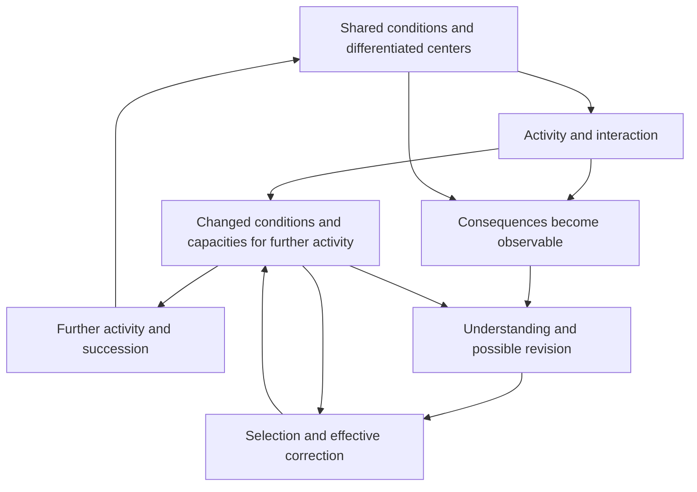

# The unified foundation in brief

**Working perspective for the whole account:** read [the project-wide nondual method](NONDUAL-METHOD.md), implementing [Ren's latest direction](../../../sources/15-codex-theory-conversations/2026-10-06-project-wide-nondual-method.md). Core and tree are differentiated articulations of one generative unfolding; studying a branch can revise how the core is understood. Explanatory diagrams and formal distinctions must preserve those relationships. Assess the adequacy of a decomposition before treating its absent connections as foundational gaps, and test constitutive proposals against substantive rivals with fixed targets and genuine revision conditions. This extends existing nondual work without altering the scope of the completed results below.

**V7.3 integrated into the generative account, 6 October 2026:** [Selection, shared conditions and the renewal of correction](GENERATIVE-SELECTION.md) now connects shared-benefit blindness, effective priorities under compounding, networks of correctors, delegation-induced competence loss, strategic communication and durable reform to the existing formation, learning and concern results. The [main theory](THEORY.md#six-mechanisms-connecting-formed-capacities-to-their-social-continuation), premise ledger and derivation map carry the integration. It explains how formed understanding and concern can gain or lose practical influence; its inherited local laws do not establish one combined implementation, empirical inevitability or ethical necessity.

**Conditional candidate completion assessment, 6 October 2026:** the [independently reviewed five-condition assessment](../../../_process/research/2026-10-05-generative-foundation-review/root-foundation/FIXED-FINISH-LINE-AUDIT.md#15-completion-assessment-of-the-conditional-candidate) finds the connected foundation adequate at its declared conditional scope, including formed evaluative influence, independently warranted application, generic correction and bounded wisdom. The original criteria remain unchanged. This does not establish universal empirical truth, unique metaphysical necessity, general moral reliability or completed alignment/governance. Earlier dated checkpoints retain their historical scope; this assessment supersedes their central-gap statuses.

**Acquired evaluation can realize justified repair.** The [new accepted connection](EVALUATIVE-GROUNDING.md) identifies when an initially absent evaluative link can mediate a warranted response to another being. Its formation and subsequent action explain how it becomes effective; independently defended responsibility and reasons concerning the affected being justify its use. The same associative learning can later suppress that response without defeating the reason. This connects a constructive and a destructive path while retaining the distinction between learning a disposition and learning ethical validity.

5 October 2026; current derivation and evidence synthesis updated 6 October 2026. The accepted results below retain their individual scopes; the finite evaluative-successor continuation is now independently accepted.

**Our current goal is to find and formalize a minimal generative foundation with universal explanatory scope wherever systems form.** The [governing position and derivation map](GENERATIVE-GROUNDING.md) explains the intended progression: interacting differences form organizations; consequences become significant within regulation; learning changes responses and selection mechanisms; models discover shared dependencies and other centers; concern and wisdom develop through that process. These are transitions to derive, with their enabling conditions and failures made explicit.

For developments after this synthesis, use the [current research index](../../../RESEARCH.md). The physical renewal, inquiry, and concern studies contribute to this foundation. Their supplied architectures, positive anchors and favorable institutions remain further explanatory targets; the completed local results do not yet establish the whole progression.

The [connected explanatory argument](FOUNDATION-PREMISES.md#7-the-connected-explanatory-argument) now states what the common account adds beyond a transition diagram: material access, retained discriminating information, actual differential retention and compatible implementation constrain development in different ways. The [composition map](../../../_process/research/2026-10-05-generative-foundation-review/root-foundation/FOUNDATION-COMPOSITION.md) identifies actual handoffs, conditional transports and separate realizations, including a failed conjunction whose two successful margins never occur together. Its [independent internal review](../../../_process/research/2026-10-05-generative-foundation-review/root-foundation/FOUNDATION-CONNECTION-REVIEW.md) accepts that explanatory scope. The [positive application synthesis](EVALUATIVE-APPLICATION.md#from-acquired-understanding-to-warranted-revisable-choice) separately derives a recommendation from defended grounds and comparison before checking acquired mediation, policy agreement and execution under the stated resource conditions. The accepted [plasticity result](EVALUATIVE-PLASTICITY.md) further supplies a conditional origin of operative evaluative connections, while its matched replacement exposes a failure of learned influence to preserve effective help. The independently reviewed [grounding argument](EVALUATIVE-GROUNDING.md) now connects that formed influence to warranted role-bound repair under explicit patient-good, responsibility, authority and comparison premises. This closes a conditional connection, not general learning of ethical validity; fixed architecture, stronger continuing uses and empirical identification retain their stated scopes.

The strongest common idea in the latest work is that **activity changes the conditions through which further activity becomes possible**. Understanding a process means understanding that relationship: what supports it, what its activity does to those supports and to others, and what it leaves its successors able to do.

This is the proposed root of 生生. The account begins with activity whose relations and effects differentiate within its unfolding. Centers of experience and action, where they form, exist through those relations; their different experiences and consequences remain real. Acting and undergoing are related aspects of particular histories, not a division into already complete givers and passive receivers. A flourishing whole can still contain deprivation, just as a stable measured total can conceal a growing internal difference.

The [application-evidence proof](../../../_process/research/2026-10-05-generative-foundation-review/root-foundation/APPLICATION-EVIDENCE-MATH.md) now gives a concrete example of activity changing its own practical conditions. In the specified receipt-only reader class, a supported command requires an acquired record preceded by the modeled delivery associated with the claim. Under independently fixed one-service episode meanings, that delivery already fulfills the claim before the later selected use. Twenty-four new Lean audits and a separate fresh build establish this historical boundary. Publication is current relative to the reader's declared context; the proof supplies no new freshness sensor, ethical ground or fulfillment-sensitive policy. It shows why acquiring means knowledge and recognizing that further action is warranted are different tasks.

The diagram is a proposed causal structure. Each arrow needs a mechanism in an actual application. The upper loop can renew, deplete, or transform its conditions. The lower route can fail through inadequate observation, understanding, authority, means of acting, timing, or succession.

## What now connects, and what remains

The [common premise ledger](FOUNDATION-PREMISES.md) separates the causal presentation from local construction laws, measurements and ethical grounds. For the discrete results, a supplied state/event relation generates finite histories through actual successors. Informative support, observation and construction conditions then constrain which histories are possible. This is a conditional foundation; an arbitrary transition description alone does not explain learning or concern.

The universal claim has the form **for every process satisfying independently stated law conditions, the corresponding consequences follow**. The [checked support law](CONDITIONAL-UNIVERSALITY.md) is one example: if each event's remaining reserve plus demand is no greater than its incoming reserve plus provision, every actual history obeys the cumulative bound. Unbounded cumulative demand then requires unbounded cumulative provision. This necessity does not create a regulator, choose a helpful policy or guarantee that any proposed next operation is enabled. The [completion contract](PROTOCOL-COMPLETION.md) separately identifies sufficient conditions under which an issued operation actually reaches a boundary.

Five claim forms must therefore remain separate:

| Claim | What establishes it | What it leaves open |
|---|---|---|
| A necessary constraint on a law class | A quantified theorem under independently interpreted premises | Whether a real system meets those premises, or a particular useful process exists |
| A mechanism can form and operate | An actual constructive history satisfying its component, observation and resource requirements | Whether it is likely, selected or indefinitely supported |
| A mechanism is selected in the specified setting | A derived selection outcome under the declared variation, retention or choice law, including competing feasible continuations and costs | Selection under other laws, initial conditions or environments |
| A response is warranted for an affected being | A defended ground and sound application, including authority and competing claims | Whether a controller recognizes or delivers it |
| A real system instantiates the proposed mechanism | Identified measurements and discriminating comparisons at the advertised scope | Universal prevalence, a uniquely necessary ontology or inevitable favorable direction |

These distinctions give the root substantive content without a single universal utility. A dependency is operationally significant when its consequences change the conditions of an organization's continuing activity. A learned model becomes effective when acquired distinctions alter an implemented update or action. Another center gains causal influence when its represented condition changes the choice, even while private information and opportunities are held fixed. Justified concern additionally requires reasons concerning that center; persistence, prediction accuracy and learned influence alone do not establish those reasons. The constructions and ethical argument address different parts of this connected account.

The current connected work has reached the following interfaces:

| Transition | Established contribution | Remaining connection |
|---|---|---|
| Dependencies → regulation | Actual formation, repair, source access and differential retention under a declared reaction law | Broader physical identification and alternative realizations; the reaction law remains supplied |
| Regulation → learned and revisable response | Formed selectors, updaters and a finite predictive register; actual correction changes a later command whose execution consumes specified resources. [Learning-route revision](LEARNING-ROUTE-REVISION.md) additionally changes an inherited updater from acquired diagnosis and carries its effect into a successor | Generality beyond the declared sensing/assembly repertoire and continued access to warranted diagnosis |
| Implemented learning → continued physical use | [Material prediction](MATERIAL-PREDICTION-COMPOSITION.md) and [protocol composition with explicit resource use](PREDICTION-PROTOCOL.md) retain parts, acquired memory, intermediate costs and failed prefixes. [Bounded completion](PROTOCOL-COMPLETION.md) gives an additional admitted-domain progress guarantee | Compose later mechanisms through compatible endpoints; completion is not automatically successful learning, and distinct material implementations cannot be substituted without a construction |
| Prediction → another center's consequences | [Motor-coupling revision and a route affecting another center](GENERATIVE-DEVELOPMENT.md); [local architecture formation](ARCHITECTURE-FORMATION.md); [learning through that formed route, including its maintenance requirements](ARCHITECTURE-LEARNING.md); [qualified evidence under outages](../../../_process/research/2026-10-05-concern-theory/RECIPIENT-IDENTIFICATION-INTEGRATION.md) | Explain selection and continuing support of faithful acquisition where matched private retention gives no advantage, and identify its empirical realization. Formation, learning and finite maintenance are already established under supplied component and acquisition laws; suppression and misleading-proxy alternatives remain |
| Retained evidence → revisable reasons and action | [Fresh recipient-reason revision](RECIPIENT-REASON-REVISION.md) joins new evidence acquisition, sparse records, reasoning with specified resource use, and action affecting the same identified being. The [existing protection witness](EVALUATIVE-APPLICATION.md#an-existing-witness-of-correction-and-feasible-choice) separately revises a premise and selects a narrower affordable action while broader protection remains feasible | Apply the correct target meanings and actual accessible premises when joining this capacity to another lineage. Two commands for one recipient cannot be identified with two patients; effect, fulfillment, authority and standing remain distinct |
| Copied learner → acquired correction → further inheritance | [Successor learning](SUCCESSOR-LEARNING.md), [inherited-route revision](LEARNING-ROUTE-REVISION.md) and [recipient renewal](RECIPIENT-RENEWAL.md) establish their declared learning, route-change and repeated-transmission contracts | [Evaluative succession](EVALUATIVE-SUCCESSION.md) now supplies access to actual acquired influence, a distinct child, fresh evidence and selected use, with resource requirements tracked throughout. Application-premise correction in that lineage and broader continued support remain separate requirements |
| Acquired understanding → formed evaluative influence and warranted application | [Evaluative uptake](EVALUATIVE-UPTAKE.md) joins acquisition, current evidence and action through the identified help route, with each operation meeting its resource requirements. In a sibling continuation, [plasticity](EVALUATIVE-PLASTICITY.md) now forms and replaces initially absent operative signed connections. The [application argument](EVALUATIVE-APPLICATION.md) derives bounded warranted choice under independently defended grounds, authority and comparison | Fixed socket/coding/plasticity/gain laws and patient-good interpretation remain explicit. Learned replacement can suppress effective help even when the means to act remain available. The altered connection has no automatic handoff into the separate successor. A probe may already fulfill a one-delivery claim; the current successor does not use fulfillment to revise that application |

The later rows retain distinct supplied laws and meanings. Some formerly missing joins are now actual histories: the fresh-recipient continuation carries acquisition through revised reasons and action, while route revision carries diagnosis through changed learning and a successor. Other interfaces remain separate, particularly evaluative concern and continued justified use. The enlarged precursors include the resources required for their added construction and source access; later stages begin with the stocks actually left by earlier activity. Correlated command evidence remains distinct from arbitrary ethical edge truths, and a zero under outages remains insufficient for a negative certificate. The common explanation must preserve these boundaries when composing accepted results.

Constructive and destructive paths already share the account: evidence can correct a response or mislead it; construction can enable action or exhaust later parts; an accurate actor can help, exclude or suppress another center. The [current regime ledger](FOUNDATION-PREMISES.md#5-how-constructive-and-destructive-regimes-share-the-root) connects the accepted contrasts and their intervention conditions. Their separation requires named centers, horizons, accessible evidence and feasible alternatives. Persistence, truth, benefit to the affected being and ethical warrant are separate outcomes. A harmful organization can be capable of renewing itself, and ending one of its activities can protect an affected being.

The empirical record has several distinct forms. Engineered biological feedback supports a bounded burden/regulation mechanism; preserved AI tasks support particular correction and handoff observations; [recipient-harm data](RECIPIENT-HARM-AND-ACTION.md) concern choices under a physical harm contingency. The [reward-learning reanalysis](REWARD-LEARNING-AND-RECIPIENT-CHOICE.md) has an uncertain primary training contrast and an explicit value/expectancy identification limit. Neither that result nor observed harm-sensitive behavior establishes a newly acquired ethical ground. The [cross-domain audit](../../../_process/research/2026-10-05-generative-foundation-review/root-foundation/CROSS-DOMAIN-IDENTIFICATION.md) and linked source analyses state which measurements support each connection. They are not observations of one complete developmental chain.

Several conventional controllers exactly match the constructed mechanisms. The candidate's current contribution is their explicit connection to formation, support, consequential information, affected centers and succession. A claim of empirical advantage requires a comparator whose relevant omissions and observation budget are fixed, plus a contrast that actually distinguishes the predictions. Renaming the same transition law supplies no such advantage.

The [five-part completion audit](../../../_process/research/2026-10-05-generative-foundation-review/root-foundation/FOUNDATION-COMPLETION-AUDIT.md) and its [fixed-finish-line follow-up](../../../_process/research/2026-10-05-generative-foundation-review/root-foundation/FIXED-FINISH-LINE-AUDIT.md) track explicit grounding, connected derivations, compatible composition, constructive/destructive regimes, and evidence at the claimed scope. The actual evaluative-successor join now has 92 new Lean audits, independent reconstruction of 3,306 histories and a selected execution crosscheck. The bounded common explanation, composition/regime map and evidence/scope statement are already accepted. The conditional formed-influence-to-warranted-repair connection is also now accepted in [evaluative grounding](EVALUATIVE-GROUNDING.md). The [five-condition assessment](../../../_process/research/2026-10-05-generative-foundation-review/root-foundation/FIXED-FINISH-LINE-AUDIT.md#15-completion-assessment-of-the-conditional-candidate) now finds the combined conditional candidate adequate at its declared scope, preserving its explicit normative and local-law premises. Further compositions or empirical identification require work where a stronger claim relies on them; they are not unnamed prerequisites to this completed candidate. A generic revision engine is already established at its stated scope. A synthesis that merely lists incompatible successful branches would still fail these criteria. Local proofs and the earlier synthesis below retain their completed scopes.

## Earlier branches and their established scope

**Regeneration can form through the process itself.** In a supplied reaction model, usable material builds machinery, machinery wears down, and powered machinery restores usable material. Above an exact threshold, every starting state with some usable material or machinery converges to a maintained regime; the machinery itself can start absent. The reactions and continuing energy supply remain premises.

**Preserving the whole does not automatically preserve each being within it.** A second, institutional model keeps production and shared support intact while an affected participant loses a protected capacity. Protection requires a timely, funded route with actual authority to change the allocation.

**Correction needs renewal too.** The same model derives a repeating correction cycle. Funding the corrector's upkeep is insufficient to fund repeated intervention. It also needs money available before each bill and enough participant reserve to survive the delay.

**Effective protection can arise from actual choices.** A completed new model lets a participant build an alternative and lets the operator choose whether to protect or obstruct them. It derives protection from credible refusal under specified physical and strategic conditions. A persistent operator can nevertheless block once to remove the participant's future operating money. The exact two-period result separates the reserve needed to begin from the reserve needed to remove that attack. [Read the new development](FORMATION.md).

**Concern can be learned, yet learning and power need to work together.** The parallel concern theory derives learned valuation and recognition from zero under explicit teaching and shared-routing premises. A new one-period interface proves that concern and a credible alternative can jointly induce protection when neither alone suffices. With imperfect safeguards, stronger concern can instead favor harmless exit. Development 2 now supplies a [joint resource-dependent reconstruction process](JOINT-FORMATION.md), with an equilibrium proof and explicit failure regions. [Read the connection and revised roadmap](CONCERN-AND-CORRECTION.md).

**The components can form and renew together in a declared strategic class.** Initially zero concern, chosen useful learning, truthful inspection, input control, and shared resources now coexist in one process. Fresh controllers pay to rebuild them; a persistent opponent optimally safeguards. Cheap ways to suppress concern, disable its effect, or destroy the next learning budget can instead sustain harm. The [new proof](JOINT-FORMATION-MATH.md) establishes conditional existence and renewal, not natural prevalence or universal moral progress.

**Concern can revise its grounds while financing protection and succession.** The later [revisable-concern settlement](REVISABLE-CONCERN-SETTLEMENT.md) joins resource-dependent audit, admission, selective retraction, effective protection, and reconstruction in one strategic process. Independent grounds survive the defeat of another derivation. A positive root, sound finite audit, known contexts, and explicit price, attack, and reserve conditions remain premises. Its witness records two actual harms before or outside current admission; the result does not guarantee complete ethical coverage or discover arbitrary unknown harms. The [accepted contribution review](../../../_process/research/2026-10-05-support-and-shared-generativity/completion/CONCERN-SETTLEMENT-INTEGRATION.md) states the remaining physical and explanatory interfaces.

**Understanding depends on consequential distinctions.** An aggregate can hide exactly the difference that determines the necessary response. More reasoning over unchanged information cannot always fix this. A new question, measurement, relation, tool, or institutional route may be needed. Complete knowledge is unnecessary when all remaining possibilities share a good action.

**What is inherited must remain usable.** The experiments distinguish retention, access, activation, construction, and onward transmission. More inherited material helped some new tasks and obstructed others under fixed search budgets. No universal rule to maximize retention or openness followed.

These results join in a precise formal question: **can the actual coupled process preserve its obligations and keep delivering the functions it depends on, including through changes to its own rules and carriers?** For finite specified systems, the proof appendix gives exact policy-feasibility and installed-process certificates, along with failure witnesses and resource limits.

## Where wisdom and 善 enter

The proposed root of wisdom is the capacity to recognize and revise consequential dependencies in understanding and action, while maintaining workable conditions for further correction. It includes knowing when to investigate, change the interface, preserve a commitment, pause, or act. The existing reasoning pilots did not establish that this formulation produces superior reasoning; that remains a testable claim.

The current ethical models commit to affected beings mattering even when the productive whole could continue without protecting them. Under that commitment, **善 supports their worthwhile possibilities and their effective ability to understand and change the conditions shaping those possibilities**. The causal mathematics explains how such protection can work or fail. The foundational task includes explaining how this recognition develops and examining its justification; the existing proofs do not derive moral standing from survival.

The [positive ethical argument](ETHICAL-FOUNDATION.md) now develops standing beyond usefulness, relevant consistency, and effective answerability. It distinguishes whose claims matter from who has the power to make others respond.

The stronger directional hypothesis—that reality generally develops increasingly shared and responsive regeneration—remains open within this program. Universal explanatory scope also includes degeneration, domination and failed learning. Local architecture formation, learning about effects on another center, and finite maintenance under specified resource conditions now have conditional constructions. Acquired evaluative uptake supplies a further path to responsiveness beyond private return. Selection and sustained support of faithful acquisition, empirical identification, and warranted application to unfamiliar affected beings remain open at broader scopes.

## Reading route

- [Generative grounding](GENERATIVE-GROUNDING.md): the current foundational goal, provisional premises, and derivation tasks connecting the studies.
- [Common premises](FOUNDATION-PREMISES.md): what the present account supplies, derives and leaves to empirical or ethical justification.
- [Generative development](GENERATIVE-DEVELOPMENT.md): the current explanatory connection from organization through learning, motor-coupling revision and functional concern, with its remaining interfaces.
- [Completion audit](../../../_process/research/2026-10-05-generative-foundation-review/root-foundation/FOUNDATION-COMPLETION-AUDIT.md): accepted contributions and remaining obligations across all five criteria.
- [Unified theory](THEORY.md): the original integrated argument and its frontier at that checkpoint; the current research index and audit track subsequent advances.
- [Joint formation and renewal](JOINT-FORMATION.md), with [proof](JOINT-FORMATION-MATH.md): the completed response to the central joint-formation challenge.
- [Revisable-concern settlement](REVISABLE-CONCERN-SETTLEMENT.md): the later conditional integration of reason revision, resource-dependent protection, and succession, with separate ethical and evidence results.
- [Formation and strategic correction](FORMATION.md), with [new proofs](FORMATION-MATH.md): the first completed development beyond the original synthesis.
- [Concern and correction](CONCERN-AND-CORRECTION.md): the connection to learned concern, its exact action conditions, and the revised research route.
- [Formal core](FORMAL-CORE.md): definitions, proofs, constructions, counterexamples, and scope conditions.
- [Claim register](CLAIMS.md): what is proved, observed in simulations, proposed, or unresolved.
- [Source map](SOURCE-MAP.md): the contribution and evidence status of each session family.
- [Synthesis and verification record](SYNTHESIS-RECORD.md): checkpoints, review corrections, reproducible checks, and the next discriminating study.

This reading guide summarizes a completed synthesis and its subsequent developments. The foundational research continues under the governing goal above: establish the connected generative explanation. A final theory of reality, a universal moral tendency, and a uniquely best theory have not been proved.
