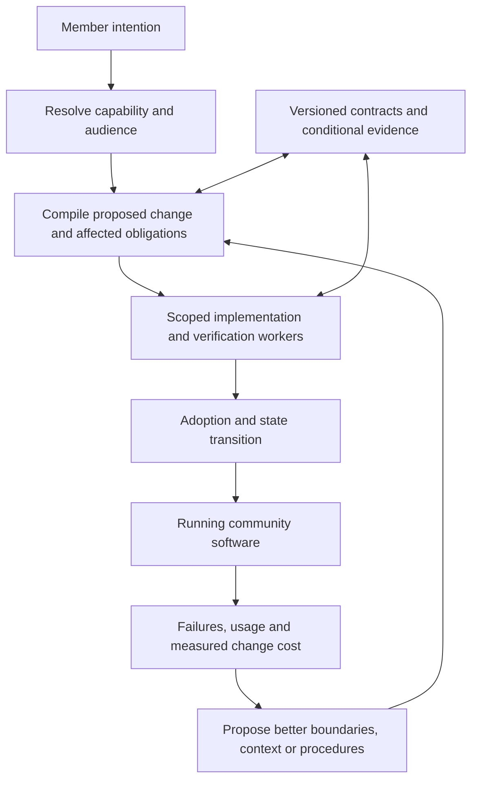

# Proposed architecture

**Design proposal, 2026-09-07.** Names below describe mechanisms to specify and test. No component is represented as implemented.

## The organizing model

A durable module has an identity, a current owner, contracts, owned state, implementations, audience-specific version selections, maintenance knowledge, and evidence. An executing agent is temporary. Several workers may serve one module; the same worker implementation may serve many modules over time.

Keep five structures distinct: responsibility hierarchy, temporary task graph, reusable artifact/version graph, runtime capability connections, and view tree. Their relationships are explicit records. Changing one structure need not silently change the others.

The host supplies storage boundaries, capability checks, version resolution, task execution, resource accounting, and durable records of external actions. Common rules and the host have versions too. We can replace a host component through the same disciplined evolution process, while preserving an independent evaluation reference.



## 1. Addressable assumptions and obligations

An API name is too coarse a dependency. A consumer should identify the particular promises it uses: identity stability, duplicate handling, what a qualification means, whether corrections arrive, and who owns a record.

A proposed minimal representation:

```yaml
module: participation
revision: 7
parent: community.activities
owns: [participation_observations, qualification_records]
offers:
  - id: qualified_under_policy
    semantic_revision: 3
    inputs: [member_id, gathering_id, policy_revision]
    guarantees:
      - qualification_records_name_their_policy
      - duplicate_observations_do_not_duplicate_qualification
    corrections: explicit_revision_events
requires:
  - provider: identity
    promise: stable_member_id
effects: [write_owned_qualification_records, emit_qualification_revision]
authority: community.activities.participation_policy
evidence: [qualification_model_check_12, correction_scenarios_19]
```

This is illustrative design notation, not a finished schema or an assertion that strings can prove behavior. A promise needs a machine identifier, a readable meaning, applicable scope and time, acceptance criteria, and an evidence class. Unresolved meaning is represented explicitly.

Runtime mediation constrains observable data access and effects to declared channels. It cannot establish that a human concept was completely specified. Static analysis, runtime traces, counterexamples, consumer declarations, and domain decisions contribute different evidence. An observed undeclared dependency becomes a repair obligation.

## 2. Compile a change into a repair frontier

The change compiler is a proposed planner backed by explicit dependency records. It converts intent into a versioned candidate transition and a set of obligations to discharge.

It starts with the affected module and the promises the candidate preserves, replaces, weakens, or adds. Consumers of changed promises receive a delta through their declared boundaries. Each determines whether its own guarantees remain supported, need new evidence, or must change. Propagation continues until a supported boundary stops it or a broader owner must resolve the obligation.

The record includes candidate hashes, baseline epochs, affected scopes, transition order, evidence requirements, and unknowns. Deduplicate visits by obligation and the relevant premise revisions; a revised premise reopens an earlier obligation. An iteration budget bounds negotiation, and unresolved cycles go to the owner of the joint invariant. Exhausting the budget leaves an unresolved result. Visiting each module once does not establish closure, and a budget limit never converts unknown compatibility into acceptance.

This is a predicted dependency closure. Hidden assumptions can make it incomplete. We retain initial predictions and later expansion so locality is measured rather than defined after the fact.

Evidence has different invalidation rules. Implementation-specific tests expire when relevant code changes. A compositional argument may remain reusable when a changed implementation re-establishes exactly the promises that argument assumes. Every reuse records the premises and environmental conditions on which it relies.

For a formal subset, prove preservation in that model. For ordinary generated code, tests and review remain bounded evidence. A periodic independent broader check estimates what targeted verification missed.

## 3. Learn the decomposition

Repeated coordination is input to architectural search. Each parent can propose bounded local operations:

- Split independent responsibilities or state.
- Merge responsibilities whose coordination costs dominate their separation.
- Extract a shared concept with a specific owner.
- Move an operation closer to the state and obligations it uses.
- Introduce an adapter, then retire it when dependents migrate.
- Replace a development procedure, maintainer implementation, or recurring runtime interpretation.

The parent searches its neighborhood first. A change crossing its outward promises escalates to the relevant ancestor or explicit invariant owner. A global optimizer with the entire codebase in its prompt is not assumed.

Score candidates by expected future successful-change cost, context, coordination, runtime cost, maintenance, and transition cost. Preserve reliability and existing authority constraints. Use a minimum improvement margin and a cooldown to discourage repeated restructuring. Include the search cost and uncertainty in projected payback.

Historical replay can reject obviously poor candidates, but it can overfit. Promotion requires a trial and later evaluation on unseen changes. A rollback candidate must account for state already transformed and effects already performed.

This is the central proposed advantage: the system can improve the boundaries that determine how much reasoning future work requires.

## 4. Context and evidence that remain useful

Maintain three separate stores: authoritative facts and commitments; current module contracts and evidence; learned strategies with provenance and applicability conditions.

A worker receives the current request, its module dossier, required neighbor promises, relevant examples and counterexamples, and unresolved obligations. An index can find relevant records without inserting the whole catalog into context. Requests for more information go through declared boundaries and are charged to the change.

Memory updates should be incremental and attributable. A learned strategy can become stale or inapplicable; retrieval must check its conditions. Compression must not delete unresolved obligations. Historical records may be archived outside active context while preserving access and authority rules.

Verification artifacts bind property, implementation or contract revisions, assumptions, environment, method, and result. Prompts, tests, proofs, and community decisions are different evidence types. The system cannot upgrade test results into a universal proof by summarizing them.

Recurring well-specified work may be converted into ordinary code or a constrained solver. That conversion is a candidate implementation change with held-out checks and invalidation conditions. Runtime LLM interpretation remains where the task needs it.

## 5. Views, forks, state, and adoption

The resolver considers reuse, configuration, composition, distinct fork, general upgrade, and generation. Candidate contracts, lifecycle cost, authority, and data compatibility matter alongside semantic retrieval similarity.

Definitions, running instances, and authoritative records have different identities. A view can fork while its records remain shared. A group can adopt a different policy where its commitments are independent. An official outcome refers to the selected policy and record versions; a personal preference cannot silently change that outcome.

A proposed release lifecycle is:

```text
proposed → scoped → candidate → verified → adopted → transitioning → active
                           ↘ revise              ↘ recover
active → superseded → retired-with-record-access
```

Adoption can be automatic under existing delegated authority. Changes beyond that authority require an identified decision. Adoption preconditions cover the dependency and assumption revisions supporting the evidence as well as edited modules. Validation and reservation/commit must be coordinated over conflicting premises, or activation must pin compatible versions through an explicit transition. An earlier validation alone is insufficient: two owners must not each activate a change proved against the other’s old promises. Stale candidates are reconciled or rebuilt; this requires coordination among the conflicting obligations rather than global serialization of unrelated work.

State transitions need stable identities, explicit ownership transfer, compatibility windows, and handling for active sessions and jobs. For a local transaction we can require atomicity. Across modules or external effects, use an explicit durable transition with retries, idempotency and specified compensation or reconciliation. Do not promise general atomic rollback.

When a module retires, identify its dependents, stop new work, resolve continuing obligations, transfer ownership where needed, and preserve required records. A variant budget must include the cost of adapters and migrations.

## 6. Thousands of useful workers

A durable queue exposes ready obligations and dependencies. Workers claim bounded assignments with leases, renewals, idempotent results, and candidate-version preconditions. Domain owners serialize conflicting adoption decisions. Independent development and verification can proceed concurrently.

Schedule by expected accepted progress, remaining budget, urgency, and integration capacity. Backpressure constrains new work when verification or transition queues grow. An ownership conflict changes the assignment or boundary; spawning another worker is not itself a remedy.

Parent context contains contract deltas, unresolved decisions and evidence summaries. Measure the full cost of those summaries, the common runtime, discovery, and reconciliation. Sharding a queue does not prove semantic coordination scales.

Retain two execution candidates: strict parent mediation and parent-supplied capabilities. Run the same change workloads against both before choosing. Under either, a worker reasons from the contracts on its connected boundaries.

## Worked architectural revision

Initially, calendar check-ins drive badges, rewards, and voting eligibility. Requiring verified participation reveals that one event name conflates observations and policy.

The candidate extracts participation qualification from calendar observations. Consumers declare the named policy and correction semantics they require. Personal calendar rendering can retain its unchanged contract. Badge, voting and reward obligations are included in the repair frontier.

Existing rewards that have been spent create a historical policy decision. The community’s authorized rule determines whether to preserve, reconcile, or compensate; an LLM cannot derive that decision from types. The transition records the choice and its scope.

A later gardening-group request should reuse the separation with less explanation. The evaluation must count the original extraction and migration cost before crediting later savings.

## Conditions that would defeat the mechanism

The design fails its central claim if boundary search costs exceed later savings; summaries approach whole-system context; conditional verification misses material regressions; undeclared assumptions routinely escape detection; or a tuned ordinary team delivers the same outcomes more cheaply.

Those outcomes guide simplification or redesign. The ambition to surpass requires finding an actual advantage, not retaining every proposed mechanism.
