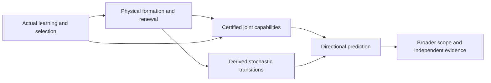

# Practical path to a fully finished theory

5 October 2026. AI-assisted execution plan responding to Ren's request to integrate other sessions, including active work on completion, and lead with full formalization. Existing theories and counterexamples remain intact.

## The goal and what completion means

The recorded goal is: **Fully finish the integrated theory of shared generative direction and its relation to 善: lead with a unified formal specification; integrate relevant completed and active-session work as it completes; connect physical formation and renewal, joint capability, stochastic direction, endogenous architecture, evidence and normative claims, with explicit completion criteria and limits.**

Ren's current priority is the descriptive direction of reality. The ethical work is preserved and its interface tracked, but an entirely new moral theory is not silently added as a prerequisite for that descriptive result.

There are separate completion gates: a complete specification; an integrated proof; empirical support; justified scope/generalization; and the stronger universal claim. Completing the first, disproving one formulation, or finishing all registered source imports does not satisfy the whole positive goal. If a version fails, retain the failure and identify the remaining positive objective rather than changing its meaning without notice.

Full formalization should lead because it exposes missing premises before another example hides them. It means a precise language, explicit assumptions, theorem statements, proofs or marked proof obligations, and measurable predictions. Encoding selected stable proofs in a proof assistant can strengthen this work later. It cannot validate the physical premises or replace external evidence.

The [direction-and-turnover clarification](../../../_process/research/2026-10-05-support-and-shared-generativity/completion/DIRECTION-AND-TURNOVER.md) now removes one ambiguous interpretation. A nonconstant capability cannot increase from every state of a finite irreducible process at every time; sustained paid turnover remains possible at a stationary distribution. In the current absorbing specimen, unconditional productive capability eventually vanishes even with imperfect observations. The positive target therefore needs explicit preparation, support and timescale quantifiers. A maintained regime, an intervention advantage, a stationary comparison and spontaneous temporal development each require their own proof. This rules out a stated overstrong claim; it does not silently substitute another claim for the full goal.

## The argument to complete

Each arrow is an obligation in the [formal specification](FORMAL-SPECIFICATION.md). Separate examples at its endpoints are insufficient. A common positive mechanism should explain the sign of the prediction, including its reversal when support, timing or incentives change.

## Work sequence and acceptance gates

| Stage | Concrete deliverable | Completion test | Current position |
|---|---|---|---|
| 0. Fix the common specification | Operational interface; assay definitions; direction quantifiers; source and conflict ledger | Every used claim has typed premises, scope and output; no pending contribution silently counted as established | Version0.5 integrates current proofs and separates their unmatched assumptions; active sources registered |
| 1. Realize the existing physical mechanism | One stochastic event model for shared capture/recycling and loss; source/sink/work ledger; seed and restart alternatives | Boundary behavior, balances and event rates checked; deterministic approximation justified where used; physical identification distinguished from model choice | Reversible local-detailed-balance embedding now preserves the one-capture gain; multicycle source realization, formed fabricators and physical identification remain to be joined |
| 2. Certify its actual joint possibilities | Fixed functional assays with time, energy, information and protected-condition budgets | One implementable protocol realizes each advertised joint profile; comparisons include losses as well as gains | Original eight profiles have rigorous bounds; sixteen sequential profiles now have independently checked floating calculations; a distinct paid-allocation theorem certifies one joint hitting profile; broader capacities remain open |
| 3. Derive the directional prediction | First-passage/exit analysis and full transition graph, or justified reduced dynamics | Rates and approximation errors come from Stage 1; capacity levels come from Stage 2; favorable sign follows after all costs | Actual repair-return kernels and a damage-conditioned kernel order now derived; four-packet full turnover is reachable but can be very unlikely; unrestricted multicycle gain and broad capability direction remain open |
| 4. Explain actual formation and retention | Connect learned concern, constructed control, resource renewal, revision and succession within one installed process | Positive formation and continuation arise under actual dynamics; suppression, bypass, depletion and calibration failures retained; primitives identified | One fixed-law model now pays for fabricator and gate formation and replacement; useful delivery does not guarantee useful copying or retention; physical identity, repertoire origin and prevalence remain open |
| 5. Generalize and test | Mechanism-class theorem plus an independent validation study with competing explanations | Class specified before outcomes; limits and failures predicted; parameters identified separately from evaluation; external data test held-out predictions | No universal direction established; existing simulations and bounded live-AI evidence have narrower scope |
| 6. Resolve coverage and interpretation | Explicit statement of what physical regimes and claims the finished theory covers | Strong quantifiers defended; unsupported extensions removed from the established results; moral claims separately justified if asserted | Open research, with no guaranteed positive outcome |

Stages 1–3 are the immediate critical path. Stage 4's source integration can run in parallel, but it must ultimately meet the same physical and capability interfaces. Do not delay the first integrated proof by attempting every scale at once. Do not infer scale-independence from completing that first proof.

## First proof package

The first component is now written: [a declared stochastic realization](../../../_process/research/2026-10-05-support-and-shared-generativity/completion/STOCHASTIC-REALIZATION.md). Its event law reproduces the deterministic drift and permits a scoped absorption proof. This advances the construction; it does not infer unique microscopic rates from the differential equations or complete the integrated directional theorem.

The [joint-capability bridge](../../../_process/research/2026-10-05-support-and-shared-generativity/completion/JOINT-CAPABILITY-BRIDGE.md) now connects that law to actual joint tests without introducing reduced favorable rates. At a common horizon and reliability, extra recycling improves one reliable output and loses one reliable reserve profile. The [subsequent opportunity audit](../../../_process/research/2026-10-05-support-and-shared-generativity/completion/REGULATION-OPPORTUNITY-AUDIT.md) shows why those are distinct functions: recycling transfers fuel into usable material without reducing assigned work. A reserve loss alone does not establish that regulation is needed to preserve later production. The next construction must address a demonstrated productive conflict and include its own costs. A free controller that can suppress any inconvenient reaction is not an available premise.

That construction has now been attempted in the same process: [fuel-responsive inhibition](../../../experiments/shared-renewal-capability/regulation/README.md) forms from zero, with material, binding, wear and work accounted for. The first prespecified comparison is negative: constructed regulators underperform the absent-regulator arm across the declared tests. More source power and a correct sensing sign are insufficient. Retain this failure while developing the positive explanation; do not silently relabel the regulator as generative or tune away its costs.

The **mechanistic boundary for net useful regulation** now has two new components. The [response diagnosis](../../../experiments/shared-renewal-capability/regulation/response/README.md) applies the exact identity and independently confirms the negative net effect. Construction can irreversibly consume the last productive unit; moreover the proposed inhibitor has not been shown to target a pre-existing productive fuel conflict. The opportunity audit supplies a conditional kinetic inequality for when reduced opportunity loss outweighs productive slowdown, but its rates have not been derived from a paid physical implementation. These findings redirect the next work from parameter tuning to identifying the opportunity and its physical loss mechanism.

The [delivered-continuation experiment](../../../experiments/shared-renewal-capability/continuation/README.md) now completes the next fixed-model assay: initial recycling and assembly, another assembly in a later window, and productive survival throughout. Faster recycling improves repeated delivery in the tested original pair. All 384 constructed-versus-absent sequential comparisons for the old regulator remain negative. Independent marked-process reconstruction checks the later event directly.

The [paid allocation-control theorem](../../../_process/research/2026-10-05-support-and-shared-generativity/completion/ALLOCATION-CONTROL.md) then identifies a productive conflict and changes the corresponding interaction. Bound Y is prevented from consuming the last R that can become capture machinery. Actual fabrication consumes one R and one F; finite-rate path bounds show a net gain in fresh capture with both productive forms present, from a common supported preparation with G initially absent. This is a conditional theorem in the same reaction framework, not a successful rerun of the old architecture. The [independent review](../../../_process/research/2026-10-05-support-and-shared-generativity/completion/ALLOCATION-REVIEW.md) checks its hazards, timing, ledger and comparison scope.

The same paid architecture and target have a proved early disadvantage and later advantage. The new theorem therefore predicts a genuine time reversal after construction cost, rather than demonstrating only a favorable prepared controller. The exact break-even time and general gain/failure surface remain to be derived.

The matched preparation is the counted material and fuel. The compared models still differ in supplied construction-channel availability. Creating G molecules is paid within the enabled network; physically implementing and funding the difference in fabrication capability remains open. This distinction belongs in the full physical identification and architecture-origin work below.

The next obligations now have more precise starting points:

1. **Compose one physical model for formation and repeated repair.** The [return theorem](../../../_process/research/2026-10-05-support-and-shared-generativity/completion/RENEWAL-RETURN.md) supplies a complete carrier-turnover path and actual return kernels, including a damage-conditioned improvement. It also proves a necessary repair boundary; the former first-capture witness has repair probability at most1/72 from the stated damaged state. Derive the full joint formation/repair law or controlled bounds across support, timing and costs. A tiny positive path bound does not establish reliable operation or a comparative gain from the original preparation.
2. **Put reversibility and sufficient support into that same model.** The [thermodynamic embedding](../../../_process/research/2026-10-05-support-and-shared-generativity/completion/THERMODYNAMIC-EMBEDDING.md) preserves the one-capture advantage with finite fuel stocks and checked detailed balance. Its one source carrier cannot fund the four-capture turnover. Extend the charged source and bound depletion/reverse-path effects over the entire joint assay; do not carry over the old absorbing-state theorem after reverse seeding is added. Then identify molecules and achievable rates, or clearly justified physical parameter bounds.
3. **Derive retention of the formed architecture.** The [common-law fabricator model](../../../_process/research/2026-10-05-support-and-shared-generativity/completion/ARCHITECTURE-FORMATION-CRITIQUE.md) now pays for A and G formation from shared precursors, rather than switching fabrication laws. It proves a delivery difference between equally offered endogenous branches and a paid replacement route. Its exact copying counterexample shows that usefulness need not produce prevalence. Add and justify the material coupling that favors useful retention, including rivals and bypass; evaluate the whole unconditioned process. Its N=4 model is not automatically the N=3 turnover or thermodynamic model.
4. **Carry the resulting law into common joint-capability tests.** Preserve losses, protection, accessible information and changing assay vocabulary. Derive transition or renewal kernels from the physical law; test any claimed order before replacing regions by scalar levels. Specify temporal development, stationary comparison, intervention gain and survival conditioning separately. A useful delivery event is an intermediate certificate.
5. **Test a prediction beyond the conventional baseline.** The reviewed resource-allocation model already predicts both beneficial and harmful inhibition. State the extra quantitative constraint from this theory, identify its parameters independently and evaluate new outcomes, including adverse regimes. Formal consistency does not replace this external test.

The immediate deliverable is therefore one formally specified process containing paid fabricator formation, gate function, repair after wear, sufficient charged source stocks and thermodynamic reverse channels, with a common assay and an explicit failure region. Only after its integrated claim is checked should the proof be generalized to an independently recognizable class. Explaining favorable retention remains necessary for a spontaneous direction claim; an engineered design that performs well does not establish it.

A further successful example is an intermediate step. The required theorem must state an independently recognizable mechanism class and predict both gains and reversals; its premises cannot be defined by the favorable outcome.

The new allocation theorem supplies one such sufficient class for one joint delivery. It leaves class coverage, broad capability comparison and spontaneous direction unresolved; this intermediate closure does not redefine the full goal.

The old assay vocabulary must also be extended when genuinely new functions are claimed. The regulator adds fuel-responsive chemistry while reducing the tested plant functions; this does not establish an ordering over every possible function. Define the new regulation assay and its intervention/readout costs before evaluation, then compare both arrangements in the same expanded vocabulary. This addresses Ren's original question about possibilities missing from a current model without treating every new structure as automatically beneficial.

Use the existing \(R,C,Y,D,E\) shared-resource mechanism rather than creating another disconnected positive example. Produce one package containing:

1. An event table and generator, including accessible-work accounting and explicit source assumptions.
2. A small prespecified joint assay suite: material conversion, maintenance/repair, and one second productive function, with any protected reserves separately stated.
3. An exact small-state calculation where feasible, followed by controlled approximations for larger systems. Treat finite extinction, seeded restart and continuing immigration as different physical models.
4. A comparison of functioning renewal and a declared alteration, with construction, competition for resources, and upkeep charged on both sides.
5. A theorem or falsifying witness for the resulting directional claim. Report finite-time and stationary statements separately.
6. An independent derivation/check of the composed argument, including the interfaces rather than only algebra and code agreement.

If the capacity regions are incomparable, retain that result and explain which functions gain or lose. If the sign depends on support or cost parameters, derive the boundary. A precise condition for reversal may be a substantial explanatory advance, while the stronger universal positive objective remains unresolved.

The current supplied repertoire already permits the \(Y\) structure; its invasion exponent does not depend on its shared-renewal contribution. Explaining selection of beneficial coupling therefore needs additional dynamics or a demonstrated regime, not a verbal appeal to persistence. This is an early discriminating test.

## Integration of other sessions

The [integration record](../../../_process/research/2026-10-05-support-and-shared-generativity/completion/INTEGRATION.md) assigns completed work to particular obligations. Contributions include faithful causal reduction, whole-process certification, renewal thresholds, joint capacity, learned and revisable concern, scientific inquiry, and a bounded live-AI succession experiment.

For each contribution record its statement, quantifiers, state and dynamics, preparation, sources and budgets, available interventions, observable and horizon, proof/evidence status, failure cases and outputs. Two results connect only when the first supplies the second's premises, or a new bridge provides a quantified approximation. Repeated summaries and copied experiments do not count as independent support.

The registered contributions now have these statuses:

| Chat | Expected use |
|---|---|
| Unify theory sessions | Completed and integrated: repository preservation, index and provenance; no added scientific evidence |
| Unify theory sessions (2) | Completed and reviewed at commit b379528: conditional joint formation and funded reconstruction accepted with its counterexamples and equilibrium scope |
| Review v0.2 build plan | Still active at last inspection: application verification only unless a defined theory-relevant experiment is present; performance alone does not support a universal claim |

A later turn in **Unify theory sessions** completed at commit c5cf2cc. Its [concern-settlement contribution review](../../../_process/research/2026-10-05-support-and-shared-generativity/completion/CONCERN-SETTLEMENT-INTEGRATION.md) accepts the repaired conditional process and bounded decision results. The human-study protocol remains unrun and supplies no new empirical evidence. This separately completed contribution does not change the consolidation's evidential role.

A follow-up in this chat checks these registered contributions every fifteen minutes, incorporates completed relevant results, and stays quiet when nothing meaningful changes. It stops its own tracking after these specific contributions are resolved. The broader theory goal remains separate and active. Local scheduled work requires the computer to be on and the desktop app running; see the [official automation documentation](https://learn.chatgpt.com/docs/automations?surface=app).

On completion, freeze the inspected artifact bytes and record hashes, turn identity and reading scope. Treat later edits as deltas. A chat's completed status is provenance, not a correctness certificate. Preserve conflicting results rather than smoothing their differences into a common narrative.

## Evidence path after the first proof

The practical sequence is: finish one physically paid mechanism and derive its gain/failure boundary; generalize the proof to a stated class; identify one real implementation independently of evaluation; test held-out predictions against established alternatives; then examine whether the same mechanism survives transport to another domain. Selection and renewal of the architecture must be shown within the installed dynamics. A successful intervention does not by itself establish a spontaneous direction of reality. Broad coverage cannot be completed by translating the same simulation into biological and institutional vocabulary.

Before collecting new validation results, freeze the claim, meaningful effect or error tolerance, unit of analysis, parameter-identification procedure, adverse controls and comparison models. Include regimes expected to fail. A favorable fit on the same data used to choose the model is not predictive validation.

Use the existing live-AI handoff work as one bounded source for paid feedback, maintained records and successor behavior. It does not validate physical universality, human moral development, or an origin of evaluative architecture. A later chemical/biological or institutional test must identify its own mechanisms and measurement limits; a numerical mapping between vocabularies is insufficient.

The [completed Ceroni methods and data audit](../../../_process/research/2026-10-05-support-and-shared-generativity/completion/PHYSICAL-EVIDENCE-CERONI.md) advances the physical evidence branch beyond the earlier abstract-only inspection. The accepted manuscript, supplementary methods/figures, reporting form and selected source-data records were reviewed; exact source bytes are preserved. This engineered feedback addresses a real competition between target expression and host growth. Some controller designs improve growth, while others reduce it despite a higher capacity-reporter readout; these are net package effects, not independently measured molecular costs. In the reported batch comparison, reduced output per biomass can be outweighed by more productive biomass. The audit derives the corresponding finite-batch observation identity, with maturation and loss, without claiming to identify its parameters from endpoint fluorescence.

The controller was installed before the experiment; beneficial construction from zero and architecture discovery remain untested. Source label/summary discrepancies, missing replicate-level late-batch data and unmeasured controller states prevent a defensible full kinetic identification from the inspected files. Preserve these ambiguities rather than assigning labels to obtain a preferred fit. Next, build the conventional resource-allocation/feedback comparison with explicit observation laws and identification requirements; derive what additional quantitative restriction our theory supplies. Then identify parameters separately and freeze a validation plan before evaluating new outcomes. The already-read published results can support a labeled retrospective analysis, not a pristine held-out test. This evidence cannot be transferred to the failed G network by analogy, and recovering an established feedback result would not by itself demonstrate new predictive content.

The [Weiße resource-allocation baseline](../../../_process/research/2026-10-05-support-and-shared-generativity/completion/RESOURCE-ALLOCATION-BASELINE.md) now supplies the actual cellular equations, growth closure, finite-batch balance and a conditional allocation boundary. It distinguishes actual protein mass from a fixed reference mass and records differences between the published supplement and model code. Controller RNA/protein spending, sensing and binding must still be added and identified before using it for the biological feedback system. This is a concrete conventional comparison, not an identification of our synthetic gate or a new validation result.

A broad theory can earn support through common mechanisms and distinct successful predictions across independently studied domains. An unrestricted claim about every physical realization needs a correspondingly stronger argument. If the project also seeks a literal theory of fundamental physics, recovering or explaining established relativistic and quantum laws is an additional major obligation; this operational interface has not done that.

## Completion discipline

Maintain a versioned claim register with **defined**, **proved conditionally**, **numerically checked**, **empirically supported**, **refuted in stated scope**, and **open** statuses. Publish acceptance criteria before each validation round. Revisions must state why a premise changed and which prior tests cease to apply.

The finish criterion is an integrated, scrutinized explanation that satisfies the claimed scope—not a polished manuscript, a large number of simulations, agreement among AI reviewers, or a final equation with universal-looking notation. The positive universal objective remains active until it is actually established or Ren explicitly revises it.
