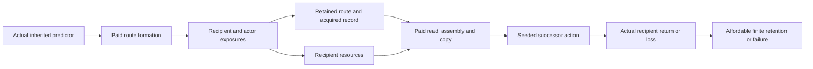

# Formed recipient routes and consequence-funded transmission

6 October 2026. AI-authored construction under [generative grounding](GENERATIVE-GROUNDING.md), continuing [recipient correction](RECIPIENT-CORRECTION.md). **Accepted bounded result:** a declared assembly process forms alternative retained evidence routes before they operate; actual recipient resources then pay to copy the resulting route and record, and a successor's actual return can pay for its finite retention. Equal original-actor resources and equal initial copying access do not force equal successor retention.

This advances **formed recipient route → acquired response → paid transmission and retention**. The recipes, proposal law, calibrated addressing, recipient operation, copying association and prices remain supplied local inputs. The child expresses an inherited estimate in one action; it does not yet perform another learning cycle. The result therefore explains a conditional consequence-to-retention connection without establishing selection for truthful learning in general.

## What was missing, and what now connects

The predecessor's policy `arm` was an external experiment setting. Its packed register contained two estimated orientations, not the evidence-routing policy. Copying those bits could not demonstrate inheritance of that policy. The [prospective contract](../../../_process/research/2026-10-05-generative-foundation-review/root-foundation/RECIPIENT-TRANSMISSION-CONTRACT.md) and [saved-evidence audit](../../../experiments/shared-renewal-capability/regulation/retention/formation/selectors/updaters/prediction/recipient-correction/transmission/handoff-audit.json) preserved this gap, together with a difficult comparison: faithful correction and a misleading private-zero proxy can both leave actor nine and recipient ten, while retaining different recipient estimates.

The new [executable construction](../../../experiments/shared-renewal-capability/regulation/retention/formation/selectors/updaters/prediction/recipient-correction/transmission/model.py) installs a retained route `gamma` and a bounded four-code payload `q` before the original four recipient/actor exposures. After assembly, the operational suffix reads that stored route; it receives no external arm argument. Its command reads only the record and paid target report. The hidden target law determines physical capture, not the chosen command or copier's preference.

Arrows denote implemented dependencies under this local law, not a completed universal derivation. Formation and receiver construction require additional declared parts; successor work requires a separately accounted finite source packet.

## Formation before use

Four configurations are available: actual target feedback, disconnected recipient feedback, private-zero feedback and frozen writing. The proposal law assigns each probability one-quarter independently of truth and later outcomes. Each has the same formation guard and price: two actor units for common setup, then two for route installation/recoding. Installation consumes one new blank carrier and one routing part and initializes both estimate cells from the actual inherited bit. Missing second-stage resources leave the first payment sunk.

These are new typed stocks. They are not the actor's two occupied slots, and no identity with the parallel A/H material realization is claimed. Positive probability of construction under this repertoire does not derive the repertoire itself.

For adequate parts, the independently implemented four-exposure dynamics project exactly to the predecessor's indexed, private-only, private-proxy and frozen arms. The comparison retains complete saved parent states, receipts, metrics, traces and probability masses, including preparation and payment failures. It covers eight existing fixtures and three upstream producers. Conventional indexed equivalence remains an inherited result; the new representation does not establish superiority over a conventional controller.

## Copying and use with actual accounts

The successor boundary carries the real terminal actor fuel, recipient stock, live installed route and payload. The old action source is exhausted. One receiver blank, one routing part and a ten-unit auxiliary packet are declared separately in the extended experiment. Unused stocks remain accounted for when construction fails.

The actor pays one for a finite donor-access interval. This requires an already accessible module and does not resurrect lost memory. The recipient pays one for its own declared operation, one to read the actual template onto a blank, one to assemble the receiver and one to commit the record on that same carrier. It then transfers five units to the child. Every recipient payment leaves a stipulated floor of one; seed transfer moves existing fuel rather than creating or dissipating it. A missing part after reading leaves the paid occupied carrier and prior charges intact.

The child spends one on retention, one on target access and three on work before receiving any return. It queries the same named recipient: the donor's actor bit is not reinterpreted as knowledge of a new carrier's self. Correct work transfers the auxiliary packet's ten units to the recipient; incorrect work loses them. A final recipient payment of one retains the child for the specified finite interval. No recipient return replenishes the original actor.

The actual paired witnesses make the distinction concrete:

| Quantity | Faithful route | Private-zero proxy |
|---|---:|---:|
| Actor / recipient at entry | 9 / 10 | 9 / 10 |
| Packed record at entry | 1: recipient estimate 0 | 3: recipient estimate 1 |
| Copy committed and child seeded | Yes | Yes |
| Recipient after copying and seed transfer | 1 | 1 |
| Child action when the recipient's productive law is 0 | Correct | Incorrect |
| Actor / recipient at end | 8 / 10 | 8 / 1 |
| New expenditure / source loss | 11 / 0 | 10 / 10 |
| Child retained | Yes | No |

Each successor starts with total energy \(9+10+10=29\). The successful history ends with \(8+10+11=29\); the proxy history with \(8+1+10+10=29\). Both children spend their five seed units. Copying access is identical; retention differs only after actual use. The copier has no correctness or provenance oracle.

For general nonnegative prices, the sequential recipient prefix is affordable exactly when its initial stock covers its floor, own operation, reading, assembly, writing and seed transfer; this statement presupposes the required phase, donor and component conditions. Component, energy and recipient-floor invariants hold on admitted formal traces. A favorable final balance alone is not enough: each operation must be prepaid in its actual order.

## Actual finite proposal and retention counts

The joined primary experiment keeps the uniform route proposal and every preparation or operational failure. At most one new carrier can be made, so these unconditional probabilities are also expected counts per initial experiment:

| Upstream producer | Route formed | Copy committed | Child successfully acts | Child retained |
|---|---:|---:|---:|---:|
| Variable | 1/6 | 1/18 | 1/36 | 1/36 |
| Conventional | 1/6 | 1/18 | 1/36 | 1/36 |
| Fixed normal | 2/9 | 1/9 | 1/18 | 1/18 |

Conditioning on the proposed route, while retaining upstream failures, faithful and proxy routes each copy with probability 1/9 for variable/conventional producers and 2/9 for fixed normal. In this primary law only the faithful copies are subsequently retained. These conditional probabilities are distinct from the unconditional mixture above and from the mass of an individual displayed witness.

The complete distribution account includes original initial energy 151 and auxiliary source 10, totaling 161, with four typed-component conservation equations. The aggregate energy check uses the frozen predecessor's conditional mean expenditure/loss records; it does not reconstruct every earlier micro-event history. Every new successor prefix has its own checked exact energy and receiver-component account. Saved witnesses retain preparation, conditional predecessor record, new suffix trace and successor trace, extending the old comparator audit's limited lineage under the new recipe.

These are one-cycle count laws. They are not the expected frequency of a repeated population process, a fixation result or a guarantee of indefinite reproduction. A favorable route does not become globally beneficial merely because more of its carriers remain.

## Countercases are part of the result

- A frozen or disconnected route supplied with the correct record performs equally well in this stable, read-only continuation. The copied channel's later acquisition and revision function is not exercised here.
- Changing the target reverses which inherited record succeeds. A wrong paid target context can defeat an otherwise correct record.
- Stripping the acquired recipient estimate, removing the whole module or disabling recipient action blocks the corresponding benefit. A disconnected evidence input alone does not disable an already stored response.
- A public correct template can succeed using resources produced by another route; a public wrong template fails. These are explicit substitutions, demonstrating that the local association between contributor and copied template is consequential and supplied.
- Refusal avoids the actor's donor-access payment; omission can preserve recipient stock. No actor preference for participation is derived. Resource scarcity and missing parts retain paid partial failures.

Interventions change named state or rule inputs. They are not presented as unchanged-law continuations of the baseline. The recipient operation and reserve floor are stipulated operational demands, not a derivation of welfare or ethical standing.

## Verification and its boundaries

The [executable verification](../../../experiments/shared-renewal-capability/regulation/retention/formation/selectors/updaters/prediction/recipient-correction/transmission/model-verification.json) records 96 case/producer/route comparisons, 584 exact local distribution comparisons, 608 resulting branches, 22 successor controls and three partial formation failures. Thirteen frozen source/specification hashes match. Parent preparation and prefix producers are reused from their checked fixtures; the new suffix is independently implemented. **All eight fixtures are covered by route projection; the joined copy/use/retention distribution is evaluated on the primary fixture's three producers, with the separately named interventions.**

The [Lean source](../../../experiments/shared-renewal-capability/regulation/retention/formation/selectors/updaters/prediction/recipient-correction/transmission/formal/FormedRecipientRoute.lean) imports the actual packed action/write interface from `RecipientCorrection`. A [fresh pinned Lean 4.29.1 build](../../../experiments/shared-renewal-capability/regulation/retention/formation/selectors/updaters/prediction/recipient-correction/transmission/formal/verification.json) checks 37 new declarations across two frozen modules, also auditing the dependency's 36 declarations. Results cover formation, live-module handoff, bounded copying, payment order, trace accounts and concrete retention/reversal/failure cases. There are no added axioms or proof holes; dependencies include the standard `propext`, `Quot.sound` and `Classical.choice`.

This is a proof of the declared deterministic interface, not a Lean refinement proof for the full stochastic Python experiment. The separate [implementation review](../../../_process/research/2026-10-05-generative-foundation-review/root-foundation/RECIPIENT-TRANSMISSION-IMPLEMENTATION-REVIEW.md) records the accepted scope. The [earlier contract review](../../../_process/research/2026-10-05-generative-foundation-review/root-foundation/RECIPIENT-TRANSMISSION-REVIEW.md) remains a prospective checkpoint, not retrospective validation of this code. Prices were chosen to investigate an existing endpoint; this is a synthetic construction, not a preregistered empirical finding.

## What this changes in the foundation

A response policy previously supplied only as an experimental choice now has a paid retained implementation before use, and the recipient's actual subsequent return can maintain a copy without repayment to the original actor. This supplies one concrete path by which consequences for another center affect persistence of a responding structure. It preserves distinct accounts and does not require a single aggregate value assigned to both centers.

The **next unresolved bridge** is to let a funded successor acquire new evidence, revise its estimate or routing mechanism, and transmit the actual revised structure under changing contexts. Correct frozen controls, misleading but subsidized routes, copying errors, local versus pooled support, finite component renewal and donor/recipient conflict must remain possible. Otherwise the experiment could explain persistence of a lucky record while leaving learning and selection over learners supplied.

The acquired identity/qualified-record branch and [recorded contextual reasons](RECORDED-REASONS.md) provide complementary interfaces. They are not automatically this same execution: their component stocks, context identities, calibration certificates and support bills still need an actual join. Nor does this study chemically identify its blank carrier and routing part with [material updater construction](MATERIAL-UPDATER-COMPOSITION.md). These are named composition obligations, rather than a claim that the unified foundation is complete.
