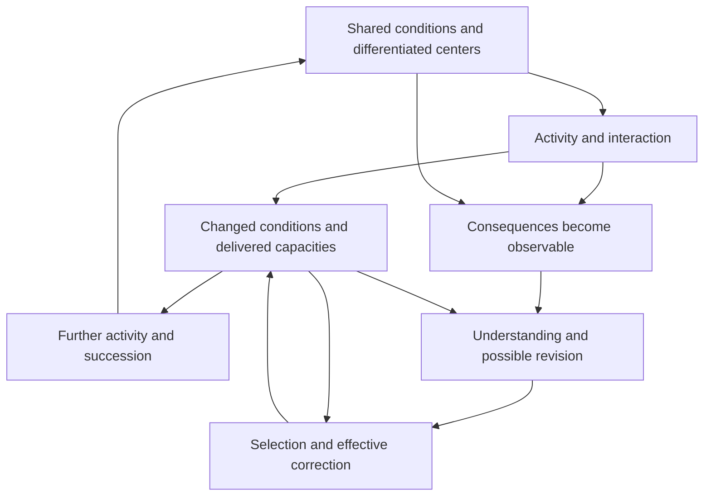

# The unified foundation in brief

5 October 2026

The strongest common idea in the latest work is that **activity changes the conditions through which further activity becomes possible**. Understanding a process means understanding that relationship: what supports it, what its activity does to those supports and to others, and what it leaves its successors able to do.

This is the proposed root of 生生. The subject is a whole situation with differentiated centers and relations. A center exists through those relations; its particular consequences still matter. A flourishing aggregate can conceal a depleted participant, just as a stable measured total can conceal a growing internal difference.

The diagram is a proposed causal structure. Each arrow needs a mechanism in an actual application. The upper loop can renew, deplete, or transform its conditions. The lower route can fail at observation, understanding, authority, finance, timing, or succession.

## What the work establishes

**Regeneration can form through the process itself.** In a supplied reaction model, usable material builds machinery, machinery wears down, and powered machinery restores usable material. Above an exact threshold, every starting state with some usable material or machinery converges to a maintained regime; the machinery itself can start absent. The reactions and continuing energy supply remain premises.

**Preserving the whole does not automatically preserve its participants.** A second model keeps production and shared support intact while an affected participant loses a protected capacity. Protection requires a timely, funded route with actual authority to change the allocation.

**Correction needs renewal too.** The same model derives a repeating correction cycle. Funding the corrector's upkeep is insufficient to fund repeated intervention. It also needs money available before each bill and enough participant reserve to survive the delay.

**Effective protection can arise from actual choices.** A completed new model lets a participant build an alternative and lets the operator choose whether to protect or obstruct them. It derives protection from credible refusal under specified physical and strategic conditions. A persistent operator can nevertheless block once to remove the participant's future operating money. The exact two-period result separates the reserve needed to begin from the reserve needed to remove that attack. [Read the new development](FORMATION.md).

**Understanding depends on consequential distinctions.** An aggregate can hide exactly the difference that determines the necessary response. More reasoning over unchanged information cannot always fix this. A new question, measurement, relation, tool, or institutional route may be needed. Complete knowledge is unnecessary when all remaining possibilities share a good action.

**What is inherited must remain usable.** The experiments distinguish retention, access, activation, construction, and onward transmission. More inherited material helped some new tasks and obstructed others under fixed search budgets. No universal rule to maximize retention or openness followed.

These results join in a precise formal question: **can the actual coupled process preserve its obligations and keep delivering the functions it depends on, including through changes to its own rules and carriers?** For finite specified systems, the proof appendix gives exact policy-feasibility and installed-process certificates, along with failure witnesses and resource limits.

## Where wisdom and 善 enter

The proposed root of wisdom is the capacity to recognize and revise consequential dependencies in understanding and action, while maintaining workable conditions for further correction. It includes knowing when to investigate, change the interface, preserve a commitment, pause, or act. The existing reasoning pilots did not establish that this formulation produces superior reasoning; that remains a testable claim.

The ethical commitment is that affected beings matter even when the productive whole could continue without protecting them. Under that commitment, **善 supports their worthwhile possibilities and their effective ability to understand and change the conditions shaping those possibilities**. The causal mathematics explains how such protection can work or fail. It does not derive moral standing from survival.

The [positive ethical argument](ETHICAL-FOUNDATION.md) now develops standing beyond usefulness, relevant consistency, and effective answerability. It distinguishes whose claims matter from who has the power to make others respond.

The stronger hypothesis—that reality generally develops increasingly shared and responsive regeneration—remains open. We now have specific formation mechanisms and correction conditions. We still need an explanation of why responsiveness would systematically extend to centers whose protection is not already rewarded.

## How to read the completed synthesis

- [Unified theory](THEORY.md): the full argument, the connections among sessions, and the precise frontier.
- [Formation and strategic correction](FORMATION.md), with [new proofs](FORMATION-MATH.md): the first completed development beyond the original synthesis.
- [Formal core](FORMAL-CORE.md): definitions, proofs, constructions, counterexamples, and scope conditions.
- [Claim register](CLAIMS.md): what is proved, observed in simulations, proposed, or unresolved.
- [Source map](SOURCE-MAP.md): the contribution and evidence status of each session family.
- [Synthesis and verification record](SYNTHESIS-RECORD.md): checkpoints, review corrections, reproducible checks, and the next discriminating study.

This is a completed integration of the latest research into one coherent candidate foundation. It is not a claim that the final theory of reality, a universal moral tendency, or a uniquely best theory has been proved.
