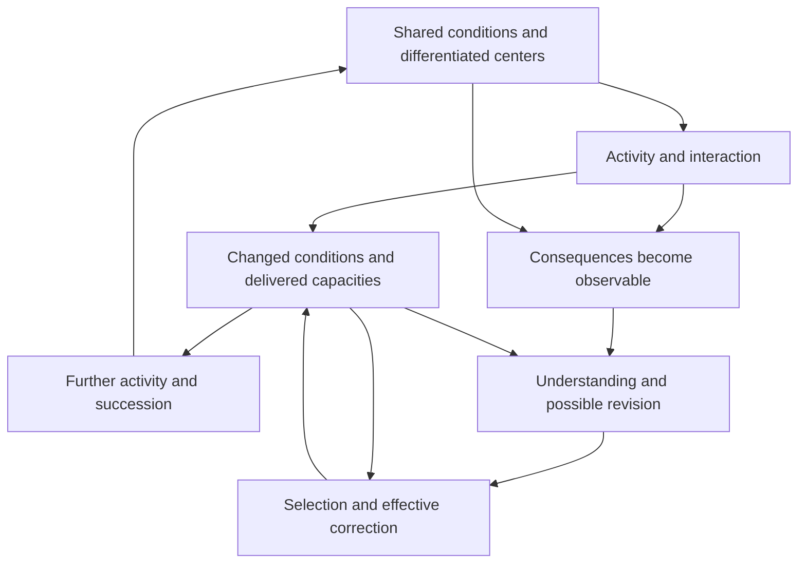

# The unified foundation in brief

5 October 2026; navigation and later-study status reconciled 6 October 2026.

**Our current goal is to find and formalize a minimal generative foundation with universal explanatory scope wherever systems form.** The [governing position and derivation map](GENERATIVE-GROUNDING.md) explains the intended progression: interacting differences form organizations; consequences become significant within regulation; learning changes responses and selection mechanisms; models discover shared dependencies and other centers; concern and wisdom develop through that process. These are transitions to derive, with their enabling conditions and failures made explicit.

For developments after this synthesis, use the [current research index](../../../RESEARCH.md). The physical renewal, inquiry, and concern studies contribute to this foundation. Their supplied architectures, positive anchors and favorable institutions remain further explanatory targets; the completed local results do not yet establish the whole progression.

The strongest common idea in the latest work is that **activity changes the conditions through which further activity becomes possible**. Understanding a process means understanding that relationship: what supports it, what its activity does to those supports and to others, and what it leaves its successors able to do.

This is the proposed root of 生生. The subject is a whole situation with differentiated centers and relations. A center exists through those relations; its particular consequences still matter. A flourishing aggregate can conceal a depleted participant, just as a stable measured total can conceal a growing internal difference.

The diagram is a proposed causal structure. Each arrow needs a mechanism in an actual application. The upper loop can renew, deplete, or transform its conditions. The lower route can fail at observation, understanding, authority, finance, timing, or succession.

## What now connects, and what remains

The [common premise ledger](FOUNDATION-PREMISES.md) separates the causal presentation from local construction laws, measurements and ethical grounds. For the discrete results, a supplied state/event relation generates finite histories through actual successors. Informative support, observation and construction conditions then constrain which histories are possible. This is a conditional foundation; an arbitrary transition description alone does not explain learning or concern.

The current connected work has reached the following interfaces:

| Transition | Established contribution | Remaining connection |
|---|---|---|
| Dependencies → regulation | Actual formation, repair, source access and differential retention under a declared reaction law | Broader physical identification and alternative realizations; the reaction law remains supplied |
| Regulation → learned and revisable response | Formed selectors, updaters and a finite predictive register; actual correction changes a later paid command. [Paid route revision](LEARNING-ROUTE-REVISION.md) additionally changes an inherited updater from acquired diagnosis and carries its effect into a successor | Generality beyond the declared sensing/assembly repertoire and continued access to warranted diagnosis |
| Implemented learning → continued physical use | [Material prediction](MATERIAL-PREDICTION-COMPOSITION.md) and [paid protocol composition](PREDICTION-PROTOCOL.md) retain parts, acquired memory, intermediate costs and failed prefixes | Compose later mechanisms through compatible endpoints; distinct material implementations cannot be substituted without a construction |
| Prediction → another center's consequences | [Motor-coupling revision and a recipient route](GENERATIVE-DEVELOPMENT.md); [context-specific recipient correction](RECIPIENT-CORRECTION.md); [qualified evidence under outages](../../../_process/research/2026-10-05-concern-theory/RECIPIENT-IDENTIFICATION-INTEGRATION.md) | Explain formation and persistence of faithful recipient-sensitive routes where private retention gives no advantage; preserve suppression and misleading-proxy alternatives |
| Retained evidence → revisable reasons and action | [Fresh recipient-reason revision](RECIPIENT-REASON-REVISION.md) now joins actual new acquisition, sparse contextual records, paid instrumental reasoning and same-recipient action. [Claims through paid histories](CLAIMS-AND-PAID-ACTION.md) separately connects addressed fulfillment and interval-specific protection to the protection law | Warranted evaluative correction and compatible continued use; acquired causal influence is now checked, while command alternatives for one recipient cannot be identified with different patients |
| Copied learner → acquired correction → further inheritance | [Successor learning](SUCCESSOR-LEARNING.md), [paid inherited-route revision](LEARNING-ROUTE-REVISION.md) and [recipient renewal](RECIPIENT-RENEWAL.md) establish their declared learning, route-change and repeated-transmission contracts | Connect the evaluative/reason interface to actual successor conditions and continuing support; a replacement evaluation port is not a new learner |
| Acquired understanding → evaluative influence and warranted application | [Evaluative uptake](EVALUATIVE-UPTAKE.md) now joins paid acquisition, current evidence, recipient choice and actual use, with 77 new Lean audits and independent finite checks. The accepted [application argument](EVALUATIVE-APPLICATION.md) supplies bounded functional recognition under independently justified grounds, authority and comparison | Connect warranted evaluative correction and actual learner succession; transfer sign/scale and patient-good interpretation remain explicit, and port replacement keeps the same learner |

The later rows retain distinct supplied laws and meanings. Some formerly missing joins are now actual histories: the fresh-recipient continuation carries acquisition through revised reasons and action, while route revision carries diagnosis through changed learning and a successor. Other interfaces remain separate, particularly evaluative concern and continued justified use. The enlarged precursors explicitly pay for their added construction and source; they do not refund depleted endpoints. Correlated command evidence remains distinct from arbitrary ethical edge truths, and a zero under outages remains insufficient for a negative certificate. The common explanation must preserve these boundaries when composing accepted results.

Constructive and destructive paths already share the account: evidence can correct a response or mislead it; construction can enable action or exhaust later parts; an accurate actor can help, exclude or suppress another center. Their separation requires named centers, horizons, accessible evidence and feasible alternatives. The [cross-domain identification audit](../../../_process/research/2026-10-05-generative-foundation-review/root-foundation/CROSS-DOMAIN-IDENTIFICATION.md) maps existing biological, AI and human evidence without treating them as observations of one complete chain.

The [five-part completion audit](../../../_process/research/2026-10-05-generative-foundation-review/root-foundation/FOUNDATION-COMPLETION-AUDIT.md) is the current answer to what remains. It tracks explicit grounding, connected derivations, compatible composition, constructive/destructive regimes, and evidence at the claimed scope. Local proofs and the earlier synthesis below retain their completed scopes.

## Earlier branches and their established scope

**Regeneration can form through the process itself.** In a supplied reaction model, usable material builds machinery, machinery wears down, and powered machinery restores usable material. Above an exact threshold, every starting state with some usable material or machinery converges to a maintained regime; the machinery itself can start absent. The reactions and continuing energy supply remain premises.

**Preserving the whole does not automatically preserve its participants.** A second model keeps production and shared support intact while an affected participant loses a protected capacity. Protection requires a timely, funded route with actual authority to change the allocation.

**Correction needs renewal too.** The same model derives a repeating correction cycle. Funding the corrector's upkeep is insufficient to fund repeated intervention. It also needs money available before each bill and enough participant reserve to survive the delay.

**Effective protection can arise from actual choices.** A completed new model lets a participant build an alternative and lets the operator choose whether to protect or obstruct them. It derives protection from credible refusal under specified physical and strategic conditions. A persistent operator can nevertheless block once to remove the participant's future operating money. The exact two-period result separates the reserve needed to begin from the reserve needed to remove that attack. [Read the new development](FORMATION.md).

**Concern can be learned, yet learning and power need to work together.** The parallel concern theory derives learned valuation and recognition from zero under explicit teaching and shared-routing premises. A new one-period interface proves that concern and a credible alternative can jointly induce protection when neither alone suffices. With imperfect safeguards, stronger concern can instead favor harmless exit. Development 2 now supplies a [joint paid reconstruction process](JOINT-FORMATION.md), with an equilibrium proof and explicit failure regions. [Read the connection and revised roadmap](CONCERN-AND-CORRECTION.md).

**The components can form and renew together in a declared strategic class.** Initially zero concern, chosen useful learning, truthful inspection, input control, and shared resources now coexist in one process. Fresh controllers pay to rebuild them; a persistent opponent optimally safeguards. Cheap ways to suppress concern, disable its effect, or destroy the next learning budget can instead sustain harm. The [new proof](JOINT-FORMATION-MATH.md) establishes conditional existence and renewal, not natural prevalence or universal moral progress.

**Concern can revise its grounds while financing protection and succession.** The later [revisable-concern settlement](REVISABLE-CONCERN-SETTLEMENT.md) joins paid audit, admission, selective retraction, effective protection, and reconstruction in one strategic process. Independent grounds survive the defeat of another derivation. A positive root, sound finite audit, known contexts, and explicit price, attack, and reserve conditions remain premises. Its witness records two actual harms before or outside current admission; the result does not guarantee complete ethical coverage or discover arbitrary unknown harms. The [accepted contribution review](../../../_process/research/2026-10-05-support-and-shared-generativity/completion/CONCERN-SETTLEMENT-INTEGRATION.md) states the remaining physical and explanatory interfaces.

**Understanding depends on consequential distinctions.** An aggregate can hide exactly the difference that determines the necessary response. More reasoning over unchanged information cannot always fix this. A new question, measurement, relation, tool, or institutional route may be needed. Complete knowledge is unnecessary when all remaining possibilities share a good action.

**What is inherited must remain usable.** The experiments distinguish retention, access, activation, construction, and onward transmission. More inherited material helped some new tasks and obstructed others under fixed search budgets. No universal rule to maximize retention or openness followed.

These results join in a precise formal question: **can the actual coupled process preserve its obligations and keep delivering the functions it depends on, including through changes to its own rules and carriers?** For finite specified systems, the proof appendix gives exact policy-feasibility and installed-process certificates, along with failure witnesses and resource limits.

## Where wisdom and 善 enter

The proposed root of wisdom is the capacity to recognize and revise consequential dependencies in understanding and action, while maintaining workable conditions for further correction. It includes knowing when to investigate, change the interface, preserve a commitment, pause, or act. The existing reasoning pilots did not establish that this formulation produces superior reasoning; that remains a testable claim.

The current ethical models commit to affected beings mattering even when the productive whole could continue without protecting them. Under that commitment, **善 supports their worthwhile possibilities and their effective ability to understand and change the conditions shaping those possibilities**. The causal mathematics explains how such protection can work or fail. The foundational task includes explaining how this recognition develops and examining its justification; the existing proofs do not derive moral standing from survival.

The [positive ethical argument](ETHICAL-FOUNDATION.md) now develops standing beyond usefulness, relevant consistency, and effective answerability. It distinguishes whose claims matter from who has the power to make others respond.

The stronger directional hypothesis—that reality generally develops increasingly shared and responsive regeneration—remains open within this program. Universal explanatory scope also includes degeneration, domination and failed learning. We now have specific formation mechanisms and correction conditions. The concern model explains one conditional path to learned responsiveness beyond private usefulness. Why its enabling architecture forms, spreads, and remains warranted for unfamiliar affected beings is still open.

## Reading route

- [Generative grounding](GENERATIVE-GROUNDING.md): the current foundational goal, provisional premises, and derivation tasks connecting the studies.
- [Common premises](FOUNDATION-PREMISES.md): what the present account supplies, derives and leaves to empirical or ethical justification.
- [Generative development](GENERATIVE-DEVELOPMENT.md): the current explanatory connection from organization through learning, motor-coupling revision and functional concern, with its remaining interfaces.
- [Completion audit](../../../_process/research/2026-10-05-generative-foundation-review/root-foundation/FOUNDATION-COMPLETION-AUDIT.md): accepted contributions and remaining obligations across all five criteria.
- [Unified theory](THEORY.md): the original integrated argument and its frontier at that checkpoint; the current research index and audit track subsequent advances.
- [Joint formation and renewal](JOINT-FORMATION.md), with [proof](JOINT-FORMATION-MATH.md): the completed response to the central joint-formation challenge.
- [Revisable-concern settlement](REVISABLE-CONCERN-SETTLEMENT.md): the later conditional integration of reason revision, paid protection, and succession, with separate ethical and evidence results.
- [Formation and strategic correction](FORMATION.md), with [new proofs](FORMATION-MATH.md): the first completed development beyond the original synthesis.
- [Concern and correction](CONCERN-AND-CORRECTION.md): the connection to learned concern, its exact action conditions, and the revised research route.
- [Formal core](FORMAL-CORE.md): definitions, proofs, constructions, counterexamples, and scope conditions.
- [Claim register](CLAIMS.md): what is proved, observed in simulations, proposed, or unresolved.
- [Source map](SOURCE-MAP.md): the contribution and evidence status of each session family.
- [Synthesis and verification record](SYNTHESIS-RECORD.md): checkpoints, review corrections, reproducible checks, and the next discriminating study.

This reading guide summarizes a completed synthesis and its subsequent developments. The foundational research continues under the governing goal above: establish the connected generative explanation. A final theory of reality, a universal moral tendency, and a uniquely best theory have not been proved.
