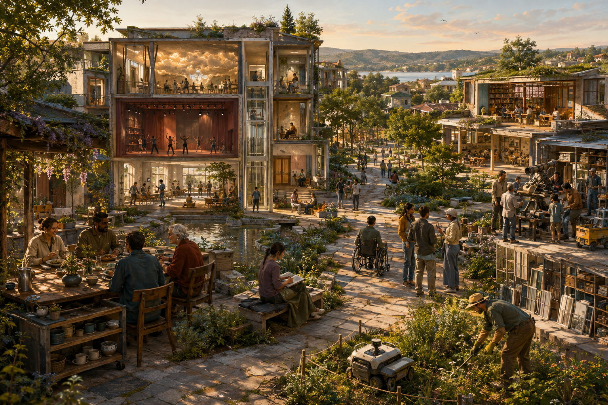

# Worldbuilding: the vision and its current shape

2026-09-07 · AI-authored interpretation prepared in response to Ren’s request to explain the current project, show its vision, and assess whether it can guide imagining the future. This overview and its visual composition are revisable proposals.

## What this project is

Worldbuilding here means developing possible ways of living until their relationships, places, institutions, and material support can be imagined together. Its central question is what people could become when intelligence sustains enough of material life that survival no longer depends on economic success.

The distinctive combination is secure existence, plural cultures, responsive environments, public knowledge, and a material civilization designed for continued use and transformation. These connect the [charter](../../foundations/charter.md) to the [regenerative-material foundation](../../foundations/regenerative-material-civilization.md). Broad autonomous provision remains a scenario premise; access to its benefits remains a separate institutional design problem.

## An ordinary afternoon

Imagine waking in a private home opening onto a garden court. Breakfast is available at a shared kitchen; you can join the table or take your food somewhere quiet. A person gardens because she enjoys that patch of earth. Another rests. Neither has to justify their home through contribution.

A public path connects this neighborhood to spaces for other lives. In the House of Worlds, friends make a performance or an immersive birthday environment. A visitor can enjoy it, take an ordinary route through the building, or leave. At the Open University, a question about the sea can become an afternoon of observation or a project lasting years. Changing your mind does not cost your livelihood.

The objects supporting this life have continuing histories. A cup returns for washing; a damaged instrument reaches a repair bench; panels from a former experience room enter a component library. Public design records help the next person understand what can be repaired or remade. People also keep beloved objects and familiar places. Ecological restoration needs its own attention alongside material circulation.

This connected afternoon is an illustrative synthesis of the existing briefs, not a selected settlement plan.

## Three places in development

| Place | What it lets us imagine | What its design must answer |
| --- | --- | --- |
| [Living Garden](../../worlds/01-living-garden.md) · W01 | Housing, gardens, care, meals, solitude, and common life sharing a landscape | Who decides when the landscape changes, how maintenance works, and whether uninvolved residents remain welcome |
| [House of Worlds](../../worlds/02-house-of-worlds.md) · W02 | People inhabiting different experienced realities on shared physical ground | Whether routes, privacy, refusal, and exit remain usable when immersion is popular or displays fail |
| [Open University](../../worlds/03-open-university.md) · W03 | Learning and inquiry as ways to spend a life without an employment credential | How newcomers, scarce instruments, expertise, maintenance, and freedom to stop coexist |

The places overlap in one person’s life. They are not exclusive social classes or an exhaustive list of futures.

## Current state and usefulness as a guide

At the start of this review, the project contained four preserved source messages, a charter, a typed network of 50 nodes and 115 directed relationships, three developed world briefs, two further world seeds, a research agenda, templates, and a development roadmap. One bounded external materials evidence note had been completed. No visual studies or 3D models existed.

The present illustration is a first visual interpretation. It does not complete the proposed circulation blockout, material-flow study, capability audit, or engineering work. See the [project status](../../README.md) and [roadmap](../../process/roadmap.md).

The project can already guide imagining futures through a repeatable method:

1. Choose a desired freedom or experience.
2. State the technical and social assumptions needed for it.
3. Propose the arrangement that makes it available.
4. Follow an inhabitant and a material flow through a concrete place.
5. Introduce disagreement, refusal, scarcity, or interruption.
6. Revise the place and the explanation; investigate real claims with evidence.

Its strength is making desirable life and its support systems develop together. Its current weakness is that principles and institutions are more developed than characters, customs, histories, and spatial experience. Specific ownership and allocation arrangements also remain open. The framework can generate and compare futures; it cannot establish which future will occur or when.

The next useful step is **One day in the Living Garden**: a small courtyard plan and lived sequence with several residents, one person declining communal activities, a cup’s return journey, a dispute over changing a familiar court, and a maintenance interruption. Compare broad and partial automation. Success would mean a more inhabitable place and a better-understood dependency.

## Image provenance and inspection

**Question:** What could the three existing settings feel like as parts of a shared everyday world?

**Source connections:** W01–W03; P01 (unconditional belonging), P03 (plural ways of being), P05 (consent and exit), P07 (learning), P09–P10 (material stewardship and shared knowledge), M05–M09 (responsive environments, learning commons, shared services, compatible parts, and reusable architecture). Definitions are in the [possibility map](../../foundations/possibility-map.md).

**Method:** Generated with the built-in image tool. [Complete generation prompt](prompt.txt) is retained as the editable generation source; [concept.png](concept.png) is the raster output. There is no editable 3D geometry.

**Assumptions:** The adjacency, architecture, temperate landscape, waterfront backdrop, and composition are illustrative choices, including details supplied by image generation. No real site, population, dimensions, deployment date, or final architectural style is selected. The broad-autonomy branch informs the depicted machine assistance.

**Visual inspection:** The image shows garden life, a bounded machine area, performance and imaginative rooms beside a conventional circulation core, a library, repair activity, and stored components. It also reveals unresolved design questions: uneven-looking paving needs a real accessible-route study, and the workshop and component handling need properly separated routes and boundaries. Cup washing, reserves, service flows, private-home arrangements, acoustic isolation, and emergency circulation are not sufficiently specified to assess. No structural, ecological, or access validation is claimed.

An attractive garden cannot show enforceable material security, accountable ownership, meaningful consent, or reliable material circulation on its own. The next spatial study should expose those relationships.

