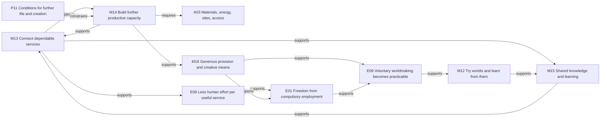
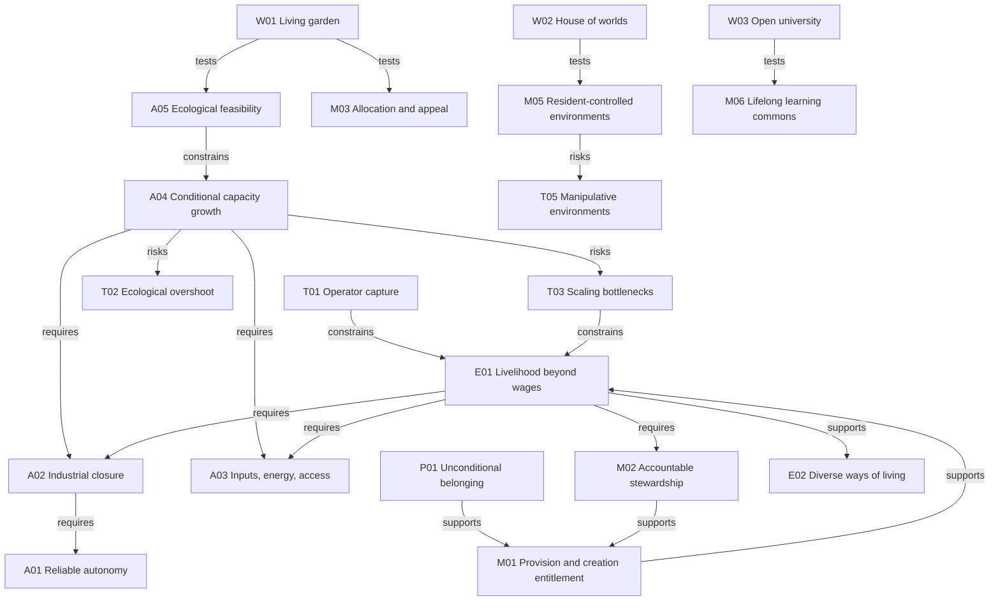
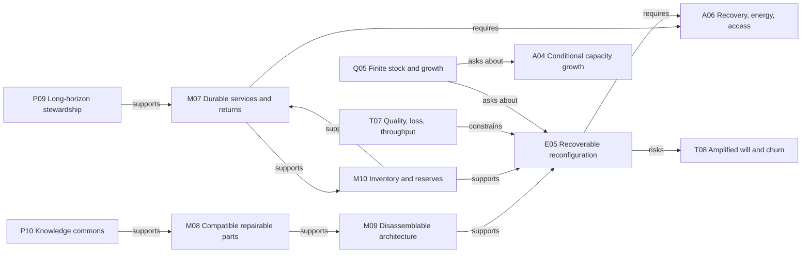

# A map of possibilities

**AI synthesis · working draft · established 5 September 2026; expanded 7 September 2026.** All text, classifications, and connections in this map are AI-written development of the archived conversation, selected earlier project sources, and dated evidence notes. Founder theses, proposed mechanisms, reported operating pieces, and unverified whole-system claims remain distinct. The original voices remain in the archive.

The project begins with a practical engineering thesis: **connect AI, robots, and industrial methods into productive systems whose output helps build more productive systems; direct that capacity toward generous shared means; use the resulting freedom to create worlds and systems that sustain better futures.** Ren’s [technical-foundation correction](../archive/007-ren-technical-foundation-and-next-version.txt) restores this causal argument to the foreground. The [automation-to-abundance foundation](automation-to-shared-abundance.md) develops it, and the [source reading](../research/2026-09-07-abundance-source-reading.md) traces its earlier formulations.

Existing automation participates in making robots and industrial tools, while learned systems connect perception, planning, action, and feedback in bounded tasks. The [industrial evidence note](../research/2026-09-07-industrial-automation-evidence.md) and [AI evidence note](../research/2026-09-07-ai-engineering-evidence.md) identify those reported operations, their technical significance, and their limits. They establish concrete starting pieces for construction and research. They do not certify that today’s models can perform every required task or that a fully autonomous industrial network already reproduces itself. That sufficiency question belongs explicitly in the program (`Q09`).

The purpose of this capacity is a civilization that sustains the conditions from which further life, relationships, knowledge, and forms of experience can arise. People help author the worlds that shape their own understanding. The [generative-worldmaking foundation](generative-worldmaking.md) develops that orientation, with a [separate meta-level reading record](../research/2026-09-07-meta-level-reading.md). Generative culture is neither an output requirement for individuals nor an instruction to maximize novelty. Shared abundance supplies the means; its institutions and culture give those means their direction.

This is a network of 68 nodes and 216 directed relationships, not a sequence in which one inevitable future unfolds. The [JSON graph](possibility-map.json) contains every description, source reference, edge rationale, assumption check, and expectation challenge. The diagrams are selective views. The catalog includes every node.

## How to read it

| Type | What it means | What it does not mean |
|---|---|---|
| Principle, `P` | A chosen normative commitment | A prediction about human behavior |
| Assumption, `A` | A premise granted within a scenario | An established claim about present capability |
| Mechanism, `M` | An institutional or design proposal | A guaranteed solution |
| Expectation, `E` | A conditional social hypothesis | An inevitable outcome |
| World, `W` | A place to imagine, draw, model, and inhabit | Empirical proof that a society works |
| Tension, `T` | A failure mode, limit, or conflict to explore | A reason to abandon the whole project |
| Question, `Q` | An unresolved inquiry | A gap to conceal with confident prose |

Arrows run from source to target. **Requires** means the source depends on the target within this scenario. **Supports** offers a contribution, not a guarantee. **Constrains** applies a boundary or countervailing pressure. **Tests** uses a fictional world to examine an idea; it does not validate that idea empirically. **Risks** names exposure to a failure mode. **Mitigates** proposes a way to reduce a risk. **Asks about** directs an inquiry. These relations are defined exactly in the JSON. A chain of arrows is not automatically a causal argument.

## The productive engine and what it is for

There are two constructive feedback loops here. **Productive equipment can contribute to making more productive equipment** (`M13` and `M14`). **Operating experience can improve knowledge that makes existing and new equipment more useful** (`M13` and `M15`). Together they describe how a network might become easier to extend and more capable of providing useful services. Neither loop implies that all dependencies are already automated.

The diagram uses actual graph relationships. Each “supports” arrow is a proposed contribution, not a guarantee or permission to infer every later result.

`M14` asks how output is divided between present provision, maintenance, and useful additions. Count **commissioned capacity**, not equipment waiting for power or components: next capacity equals current capacity plus commissioned additions minus retirements. If positive net addition remains proportional to useful operating capacity, exponential growth follows within that simplified model and interval. No observed rate or doubling time follows from the cases examined. `Q08` asks what actually grows, which process limits the next cycle, and when growth should slow or turn toward circulation and care.

Full industrial reproduction within a declared boundary (`A02`) is the project’s strongest scenario. Useful expansion can also begin in a network with explicit outside supplies and human work. That is the less demanding construction route in `M13`–`M15`; a robot factory need not produce every chip before its output helps build additional useful capacity. The outside dependencies still belong in the engineering account. This distinction preserves the strong thesis while making steps toward it concrete.

The intended destination is **generous common means**, including comfortable homes, good food, mobility, care, culture, and the tools and materials for ambitious collective projects (`M16`). A subsistence guarantee is not the whole aspiration. Less human effort in production (`E08`) and durable access (`M01`) must meet before employment can cease to be a condition of living well (`E01`). Necessary human tasks must be visible and acceptably arranged; freedom cannot be obtained by hiding other people’s compelled work.

With these means, a rocket group has something to build with, a university has instruments, and a realm can sustain its shared world (`E09`). Free association becomes a practical ability to make and maintain worthwhile systems. What those projects learn can return to the common technical and cultural capacity. `P11` supplies direction: productive expansion serves the continuing capacity for life and creation, rather than a duty to expand machinery forever.

## Worlds also change their authors

The first loop expands the working hypothesis `E06`. Every arrow names a relationship to investigate, not a proven law or a guarantee that everybody responds alike. These are stages within that hypothesis, rather than additional catalog nodes or independently asserted graph edges.

`P11` asks whether these conditions support continuing becoming: what can grow here, who gains room to live, and what will remain available to those who come next? `P12` frames inhabitants as situated coauthors. `P13` keeps their accounts of reality open to learning. These are chosen orientations, not conclusions that follow automatically from being interconnected.

The structured graph makes one constructive feedback cycle explicit: **`M11` reciprocal practices → supports → `E06` mutual formation → supports → `M12` shared imagination and revision → supports → `M11` renewed practices.** Imagine a guild learning astronomy during a festival, founding an observation group, and changing next year’s stories through what its members discover. The next world comes partly from what people became in the previous one.

The loop can also narrow. `T09` asks what happens when success buys control over future rules, tools, and accounts of success. A celebrated guild could become the permanent judge of every new guild. This is a conditional mechanism to examine, not a theorem that rivalry inevitably ends in domination. A shared project can also do harm; calling it collective or generative does not settle its consequences.

## Edition-five scenes as tests of existing ideas

Ren [authorized the upgrade](../archive/009-ren-edition-five-upgrade.txt) after the [independent edition-four review](../artifacts/friends-worldbook/reviews/2026-09-07-v4/README.md). The new episodes develop existing principles and questions. They are AI-proposed fictional tests, not observed institutional results or new statements attributed to Ren. Edition five is **complete and reviewed**; the assembled export, page appearance and reading package have been verified in the [review record](../artifacts/friends-worldbook/reviews/2026-09-07-v5/README.md).

| Proposed episode | Existing graph path and question |
| --- | --- |
| Mira pauses garden planning, retains home, meals and care, and borrows a telescope | `W01 → tests → M16` and `P05`: does a changed commitment leave ordinary provision and creative means dependable? The service account must state how remaining human work is arranged. |
| A successful quest guild revises a rule excluding newcomers from authorship | `W06 → tests → M12` and `T09`: can inhabitants recognize and change the feedback from prior success to control over future participation? Necessities never depend on quest results. |
| The Expressive Commons offers movement, music, privacy, and rest | `W04 → tests → P03`, `P04`, and `M16`: do these different lives have equal standing and practical means without needing a productive or academic justification? |
| One indigo-endplate bay moves from pavilion through inspection into a music room | `W04 → tests → E05`: does reuse remain intelligible when qualification, replacement layers, losses, energy, and additional stock are included? The color marks identity, not structural suitability. |
| Neighbors revise a proposed room’s footprint to preserve a mature tree | `W01 → tests → T08` and `M04`: can affected people shape or restrain the changes that powerful fabrication makes easier? Ecological protection still needs assessment. |
| The cloud harbor hosts the First Arrival music gathering | `W02 → tests → M12` and `E06`: does the same coherent physical place support shared culture and authorship beyond sightseeing? |

These scenes make relationships in the map easier to examine. The technical argument still needs its two explicit feedback loops, Ren’s attributed full-automation thesis, bounded evidence, and the distinction between productive capability and durable access.

## The material and institutional ground

## The full catalog

Descriptions below mirror the JSON node definitions. References `S1`–`S8` and `S12` identify conversational or historical origins; `S13` records revision authorization without adding philosophical claims or accepting particular proposals; `S9` is a provenance reading record; `S10`–`S11` are dated evidence reviews with links to primary operational reports. None is a claim that the complete technical or social system has been demonstrated. Node statuses, evidence context, edge rationales, assumption checks, and hypothesis challenges remain in the JSON.

The meta-level nodes (`P11`–`P13`, `M11`–`M12`, `E06`–`E07`, `T09`, `Q07`) link to the [generative foundation](generative-worldmaking.md). The eight productive-capacity and abundance additions (`M13`–`M16`, `E08`–`E09`, `Q08`–`Q09`) link to [automation and shared abundance](automation-to-shared-abundance.md).

### Principles

| ID | Node | Description | Sources |
|---|---|---|---|
| P01 | Unconditional belonging | A person’s material security and standing do not depend on employment, competitive success, prestige, or being judged sufficiently generative. | S1, S2 |
| P02 | Care for the shared substrate | Communities share ecological and material conditions. Their projects must account for effects on other people, other living systems, and future inhabitants. | S1, S2 |
| P03 | Plural ways of being | A shared civilization can hold scholarly, expressive, exploratory, quiet, and mixed lives. Belonging does not require one account of a good life. | S1, S2 |
| P04 | Generative ambition without compulsory productivity | Culture can encourage creating possibilities beyond oneself while protecting rest, ordinary affection, unremarkable lives, and the freedom to stop. | S1, S2 |
| P05 | Consent, refusal, and exit | People can refuse personalization, criticize institutions, leave communities, and retain material security. Others’ attention, affection, and agreement remain voluntary. | S2 |
| P06 | Competition with bounded consequences | Games and rivalry can be intense, but winning must not determine access to essentials or transfer authority over shared life-support systems. | S1, S2 |
| P07 | Learning as a way of inhabiting reality | Understanding, embodied practice, expression, and exploration can be valued for how they change experience, beyond their usefulness for employment. | S1, S2 |
| P08 | Revisable shared governance | Institutions must be open to criticism and repair, with intelligible decisions and ways to challenge or replace administrators. No single vision is beyond revision. | S1, S2 |
| P09 | Long-horizon regenerative stewardship | Treat materials, ecosystems, and productive infrastructure as inheritances to care for across generations. Favor durable service, repair, recoverable transformation, and ecological restoration over repeated extraction and disposal; circulating objects alone does not establish regeneration. | S1, S4 |
| P10 | Knowledge as a shared foundation | Develop knowledge, repair documentation, design records, and understandable standards as accessible public goods so people can learn, inspect, adapt, and build together. Public information does not by itself confer physical access or establish the performance of a manufactured object. | S4 |
| P11 | Sustain the conditions of continuing becoming | Cultivate a living environment in which relationships, practices, knowledge, and forms of life can emerge and develop while sustaining their shared foundations. Generativity concerns the capacity for further life and creation; it is neither a command to maximize a count of options nor a demand for constant novelty. Particular forms can mature, end, or be mourned. | S1, S4, S5, S6, S7 |
| P12 | Participate as a coauthor of shared conditions | Understand oneself as an interdependent participant whose choices help shape other lives and the world that shapes oneself. Take responsibility for the conditions a project creates beyond its owner, and make room for affected people to help author them. Interdependence does not erase personal boundaries or by itself settle what anyone ought to do. | S1, S5, S6 |
| P13 | Keep understanding revisable and give learning time | Treat models, principles, and narratives as useful but partial guides. Cultivate curiosity, embodied attention, comparison, criticism, and time to notice consequences as capabilities and environments change. Even this orientation can be questioned; it supplies neither a final doctrine nor a numerical law relating technological speed to human understanding. | S1, S5, S6 |

### Scenario premises

| ID | Node | Description | Sources |
|---|---|---|---|
| A01 | Reliable autonomy across required tasks | Ren’s engineering thesis is that present AI methods and industrial knowledge can be developed into full automation. The strong scenario grants adequate reliability and recoverability across the cognitive and physical tasks required for infrastructure and everyday provision. Bounded operating capabilities make this a concrete program to pursue, but do not establish that today’s available models are sufficient for every required task. | S1, S2, S8, S10, S11 |
| A02 | Industrial reproduction with supply-chain closure | The strong scenario grants a productive network able to construct, commission, maintain, and reproduce its required equipment, including upstream tools and critical components within a declared boundary. A robot factory alone does not establish this closure. Useful recursive expansion within an externally supplied network is a less demanding route, represented separately by M14. | S1, S2, S8, S10 |
| A03 | Resource and energy access | Material inputs, usable energy, suitable sites, logistics, and lawful access are available at the scale required by the selected scenario. These are finite and spatially uneven. | S1, S2 |
| A04 | Growth through reinvested productive capacity | In the strong industrial-closure scenario, output reinvested in further useful capacity may accelerate expansion while complementary inputs, system closure, repairs, and commissioning keep pace. Positive net addition proportional to operating capacity would yield an exponential phase under those model conditions; this is not a measured industrial rate, universal doubling time, or indefinite planetary trajectory. M14 also explores recursive expansion with declared outside dependencies. | S1, S2, S8, S9, S10 |
| A05 | Provision within ecological limits | The chosen level of provision and construction can operate inside explicitly chosen ecological budgets, including material throughput, land use, waste, habitat effects, and energy infrastructure. | S1, S2 |
| A06 | Recoverable material flows with usable energy and access | For the selected objects and places, collection, cleaning, inspection, sorting, repair, remanufacture, and recycling recover enough usable material to sustain the intended service, with accessible facilities, logistics, reserves, and energy. Recovery is specified by material and application; neither lossless cycles nor energy without environmental cost is assumed. | S4 |

### Proposed arrangements

| ID | Node | Description | Sources |
|---|---|---|---|
| M01 | Durable provision and creation entitlement | Establish an enforceable, portable claim to dependable provision and an accessible share of tools or productive capacity. Essentials are a necessary guarantee within a larger aim of generous common means and creative freedom; the delivery and allocation model remains open, and access does not depend on selling labor. | S1, S2, S8, S9 |
| M02 | Accountable stewardship of automated infrastructure | Choose ownership, operating mandates, audits, maintenance duties, and succession arrangements that preserve the provision guarantee and prevent operators from making residents dependent on their favor. No single ownership form is assumed to suffice. | S1, S2 |
| M03 | Participatory allocation and appeal | Make decisions over shared space and rival resources through understandable procedures with representation, appeals, and protection for dissenting or less influential inhabitants. | S1, S2 |
| M04 | Reversible trials and collective repair | Prototype changes where feasible, keep rollback and repair capacity, include affected people, and evaluate consequences before committing to larger transformations. Some ecological and social changes cannot be fully reversed. | S2 |
| M05 | Responsive environments under resident control | Buildings, gardens, mobility, and mixed-reality spaces can adapt to inhabitants, with intelligible controls, consent, physical accessibility, privacy, manual alternatives, and protected unpersonalized spaces. | S1, S2 |
| M06 | Lifelong learning and practice commons | Make equipment, mentorship, spaces, knowledge, and time accessible across ages; support embodied and expressive practices alongside formal inquiry, and make leaving or returning ordinary. | S1, S2 |
| M07 | Shared durable services and return loops | Provide functions through durable objects and convenient return, cleaning, repair, and redistribution systems where a whole-system comparison supports them. A shared metal cup is a starting design case; personal use and long possession remain possible, and the loop must work for different bodies, preferences, and daily rhythms. | S2, S4 |
| M08 | Compatible repairable parts and open standards | Develop interoperable interfaces, replaceable parts, identified material grades, repair instructions, and revisable open standards. Choose fabrication methods for the application, including 3D printing where suitable; a shared design file does not establish material quality, dimensional accuracy, or structural fitness. | S4 |
| M09 | Architecture designed for disassembly and reuse | Design structures and fit-outs with accessible reversible connections, identifiable components, documented histories, and safe disassembly routes. Robots may assemble and recover steel members or other suitable parts; each reuse requires condition assessment and a design-specific performance case. Material reversibility does not reverse every ecological or social consequence. | S2, S4 |
| M10 | Material inventory and recovery reserves | Maintain an intelligible record of material quantities, grades, condition, location, commitments, and routes for return, alongside reserves for repair and interrupted processing. Use this information to match available parts to new purposes and expose losses and bottlenecks without making personal tracking a condition of access. | S2, S4 |
| M11 | Practices of reciprocal worldmaking | Develop shared meals, mentorship, care, artistic rituals, expeditions, and resident-authored projects through which people learn to notice dependencies, contribute to something beyond themselves, and welcome others into it. These practices make the culture tangible while leaving belonging independent of contribution and allowing communities to develop different traditions. | S1, S2, S5, S6 |
| M12 | Shared imagination, lived trials, and cultural revision | Let inhabitants propose worlds and rituals, build inspectable representations, try changes at a suitable scale, and compare lived consequences with intentions. Use stories, discussion, observation, and accessible records to revise both arrangements and the ideas guiding them. Participants can dispute interpretations and choose continuity; permanent changes need their own judgment rather than a blanket reversibility test. | S1, S2, S3, S5, S6 |
| M13 | Connect available capabilities into dependable services | Compose learned perception, planning, tools, feedback, conventional controls, and suitable robots into repeatable useful services. Connect those services through explicit input and output requirements, maintenance, energy, logistics, and human support. Existing deployments provide starting components; measure reliability of the connected network rather than treating a set of demonstrations as a complete autonomous system. | S1, S8, S10, S11 |
| M14 | Reinvest output in complementary productive capacity | Direct part of useful output toward additional builders, production cells, power, tooling, logistics, and other processes that limit the next round of provision. Count commissioned additions and retirements, preserve maintenance capacity, and expose outside inputs. Additional builders can help create further builders before full supply-chain closure; whether net growth compounds depends on the whole chosen network. | S1, S4, S8, S9, S10 |
| M15 | Spread validated knowledge and learn from operation | Make design records, process improvements, failure lessons, and reusable robot skills available for adaptation across installations. Shared knowledge can reduce repeated discovery and improve existing equipment alongside hardware expansion. Preserve testing, local fit, consent for data use, and reliable records; copying a policy or drawing does not guarantee useful performance at another site. | S4, S8, S10, S11 |
| M16 | Generous common provision and creative means | Build common services for good food, comfortable homes, care, hygiene, mobility, culture, and usable access to fabrication, instruments, materials, knowledge, and spaces for ambitious shared projects. Join dependable access to actual supply, maintenance, allocation, and coordination. The aspiration is a rich life and capacity to create beyond a subsistence floor, without promising unlimited quantities, one institutional form, or compulsory participation. | S1, S2, S4, S8, S9 |

### Conditional expectations

| ID | Node | Description | Sources |
|---|---|---|---|
| E01 | Livelihood can separate from paid employment | If dependable provision requires much less human effort, remaining necessary work has acceptable arrangements, and people have durable common access, livelihood can separate from compulsory paid employment. The aim includes a generous life and usable means of creation. Reducing a task’s labor requirement alone does not grant its former workers access to the output, and one group’s freedom cannot hide another group’s coerced labor. | S1, S2, S8, S9 |
| E02 | Lives may organize around diverse pursuits | With secure belonging and voluntary associations, more people may organize life around relationships, gardening, expression, inquiry, exploration, play, or rest. This is neither a prediction that everyone becomes a builder nor an obligation to do so. | S1, S2 |
| E03 | Physical speed can coexist with civic patience | If construction becomes faster, communities may choose to spend more time understanding consequences, relationships, memory, and consent before changing a place. Faster capability need not dictate faster collective decisions. | S1, S2 |
| E04 | Learning may become less credential-driven | When livelihoods are secure and learning resources are accessible, learning can increasingly follow curiosity, relationships, practice, and long commitments. Credentials may remain useful for responsibility and trusted expertise. | S1, S2 |
| E05 | Freedom through recoverable reconfiguration | With usable recovery systems, compatible parts, accessible knowledge, and legitimate decisions, people may gain freedom to revise their surroundings while retaining more of the material capacity for later uses. A finite circulating stock can support repeated reconfiguration within quality and throughput limits; expanding simultaneous buildings or factories still requires stock, energy, space, and capacity. | S4 |
| E06 | People and their environments may reshape one another | In a setting with participatory worldmaking, shared understandings may shape habits and expectations; these may shape choices, institutions, and material and social environments; experienced consequences may then revise or reinforce the original understandings. People can interpret the same world differently and change it in turn. This reciprocal formation is a working causal hypothesis with variable effects, not proof that one designed environment produces a particular kind of person. | S1, S5, S6 |
| E07 | Shared projects may support meaning beyond personal victory | When people can freely join sustained, welcoming pursuits, some may find meaning in caring for a world, exploring together, or contributing to work that outlasts them. Relationships and ordinary life can carry the same depth. The scenario does not predict universal harmony, identical desires, or the disappearance of rivalry. | S1, S2, S5, S6 |
| E08 | Provision may expand with less required human effort | If connected productive systems repeatedly complete useful services with less human effort per service, provision and further capacity may grow without a proportional increase in required human labor. Pairing this technical gain with dependable common access and acceptable arrangements for remaining work can support freedom from compulsory employment. Autonomous equipment counts alone do not measure the gain. | S1, S8, S10, S11 |
| E09 | Abundant shared means can make voluntary worldmaking practicable | When generous provision, usable creative capacity, knowledge, stewardship, and coordination are available together, people may gather around rockets, gardens, scholarship, embodied worlds, or other long projects without needing those projects to earn their livelihoods. Free association can then lead to systems people can actually build and sustain. It remains a possible social outcome, not a guarantee from abundant machinery or an obligation to join a grand purpose. | S1, S2, S4, S8, S9 |

### Worlds

| ID | Node | Description | Sources |
|---|---|---|---|
| W01 | [Living garden](../worlds/01-living-garden.md) | A neighborhood shaped around habitat, food, seasons, shared space, and ecological stewardship. A proposed resident changes from garden planning to astronomy while retaining ordinary provision and creative means; an affected group revises a building footprint to keep a mature tree. These scenes examine durable access, remaining human work, ecological continuity, and whose preferred landscape becomes real. | S1, S2, S4, S8 |
| W02 | [House of worlds](../worlds/02-house-of-worlds.md) | A megastructure purpose-built for shared embodied AR, where world halls, portal lifts, touchable routes, and service levels support persistent collectively authored realities. The current concept uses three broad stacked halls, a left passenger core, a right service core, and a cloud-harbor music gathering called the First Arrival. Dedicated AR purpose is Ren’s direction; this geometry, culture, and display approach remain proposals. Shared physics, accessible exits, and support spaces remain real. | S1, S2, S5, S6, S12 |
| W03 | [Open university](../worlds/03-open-university.md) | An inhabited learning commons that welcomes lifelong inquiry, making, teaching, departure, and return. It must make room for varied abilities and nonacademic lives without treating membership as a rank. | S1, S2 |
| W04 | [Expressive commons](../worlds/04-expressive-commons.md) | A community organized around movement, music, feeling, performance, and embodied exploration, with quiet rooms, privacy, and ordinary rest as complete ways to belong. Its proposed culture lets participants revise invitations and performance space without making participation, talent, or emotional disclosure a condition of security. A music room also explores the assessed reuse of a former garden pavilion’s structural bay. | S1, S2, S4 |
| W05 | [Exploration community](../worlds/05-exploration-community.md) | A community that makes exploration a shared way of life: robotic fabrication, rocket and spacecraft work, observatories, long missions, and public learning support projects that outlast participants. The scenario separates workshops and public life from hazardous launch operations. Specific vehicles, destinations, and mission claims require their own feasibility cases. | S1, S2, S5, S6 |
| W06 | [City of shared quests](../worlds/06-city-of-shared-quests.md) | A lived world inspired by MMORPGs and LARP, with resident-authored districts, roles, quests, festivals, and persistent shared stories. A proposed guild observes that its success-based rule excludes newcomers from authorship, revises access, and examines what changes. This concerns creative participation, never a loss of necessities: the ordinary city and secure belonging remain available to residents who decline the fiction. | S1, S2, S5, S6 |

### Tensions

| ID | Node | Description | Sources |
|---|---|---|---|
| T01 | Ownership and operator capture | High productive capacity may coexist with dependence if a few actors can deny access, set conditions, or monopolize infrastructure. Abundance and widely shared security are separate claims. | S1, S2 |
| T02 | Ecological overshoot and displaced harm | Cheap or rapid construction may increase total material use, occupy habitats, move pollution elsewhere, or consume resources needed by other communities and future inhabitants. | S1, S2 |
| T03 | Incomplete closure and scaling bottlenecks | A missing upstream capability, limited energy, scarce components, long lead times, maintenance burden, or repair failure can stop expansion or reduce provision. Scaling may be local, uneven, or stalled. | S1, S2 |
| T04 | Scarce attention, place, and prestige | Affection, trust, recognition, unique places, and some opportunities remain rival or voluntary. Informal rankings can become coercive and unequal influence can survive material abundance. | S1, S2 |
| T05 | Paternalistic or manipulative environments | A responsive system or institution may shape inhabitants toward its preferred behavior, make choices illegible, normalize surveillance, or penalize refusal while claiming to help. | S1, S2 |
| T06 | Inherited habits and disrupted identity | People may experience guilt about rest, loss of identity, distrust of security, or pressure to prove usefulness. Different generations and cultures may inhabit the change differently. | S1, S2 |
| T07 | Material quality, losses, and recovery bottlenecks | Collection failures, dispersed materials, incompatible mixtures, wear, contamination, processing losses, stock tied up in long-lived objects, and limited recovery capacity can interrupt the intended loops. A high recycling claim by itself does not specify how much suitable material returns, when it becomes available, or what new inputs are still required. | S4 |
| T08 | Amplified harmful will and unnecessary churn | Powerful fabrication and rapid reconfiguration can amplify destructive intentions, unilateral redesign, status-driven novelty, and avoidable replacement. Even recoverable construction can consume energy, disrupt lives or habitats, and overwhelm repair and deliberation. The ability to act does not establish a right to impose the result. | S1, S2, S4 |
| T09 | Compounding rewards can capture the rules of shared life | Where winning yields durable advantages that buy further victories or control over rules and necessities, feedback may concentrate power and teach people to organize increasingly around that contest. Powerful automation may amplify the mechanism. This is conditional on institutions, returns, and constraints; it is not a theorem that every competition converges to domination or that cooperation automatically avoids capture. | S1, S5, S6 |

### Open questions

| ID | Node | Description | Sources |
|---|---|---|---|
| Q01 | How are rival goods allocated? | How should communities allocate unique places, scarce equipment time, ecological capacity, and opportunities without converting prestige or administrative favor into a right to dominate? | S1, S2 |
| Q02 | How do different worlds coexist? | How can communities with incompatible rhythms, landscapes, experiences, or projects share infrastructure and ecological budgets while preserving criticism, exit, and minority ways of life? | S1, S2 |
| Q03 | What makes a productive system dependable? | What operating evidence would justify granting autonomy and industrial closure at a particular scale, and what fallback provision remains available through failures, repair periods, or stalled expansion? | S1, S2, S3 |
| Q04 | How do guarantees survive institutional failure? | Who enforces provision and access when owners, operators, communities, or governing bodies fail, and how can people replace them without interrupting essential services? | S1, S2, S3 |
| Q05 | How does finite circulating stock relate to growth? | For a chosen region and service level, distinguish more simultaneous productive capacity from more varied uses of existing stock. What additional stock, energy, throughput, replacement inputs, and ecological capacity does each require, and when should reinvested expansion slow, stop, or shift toward maintenance and reconfiguration? | S1, S4 |
| Q06 | When does collective provision improve the whole system? | Compared with durable personal provision, when does a shared service reduce total burdens while preserving convenience, autonomy, reliability, and access? Test actual use frequency, cleaning, travel, returns, reserves, loss, and user preferences rather than treating collective provision as automatically superior. | S2, S4 |
| Q07 | What ways of being do our worlds cultivate? | How do narratives, attention, habits, institutions, and physical experiences interact to shape what people can imagine and become? Examine what a shared project makes inviting, who helps author it, how it changes its authors, and whether its success sustains further life or increasingly channels everyone toward one form of winning. | S1, S3, S5, S6 |
| Q08 | What is the actual net growth of useful capacity? | For a specified network, how much output becomes additional commissioned capacity after maintenance, retirements, lead times, losses, and essential provision? Which complementary process limits the next cycle, which inputs remain external, and does useful capacity actually make subsequent additions faster? Establish the interval and stopping conditions of any compounding phase rather than inferring a doubling time from robot production alone. | S1, S4, S8, S10 |
| Q09 | Are current AI systems sufficient for the declared automation scope? | For a declared service and productive network, can available AI, conventional automation, and robots complete every required task under relevant conditions with adequate reliability, recovery, and acceptable human support? Separate integration work, environmental redesign, and improvements possible with existing methods from unresolved capability research. Test Ren’s strong current-knowledge thesis directly instead of asserting it proved or replacing it with a premise that ignores the construction program. | S1, S8, S10, S11 |

## Three paths to examine

### From a robot factory to generous shared means

Start with actual useful automation and the question of what it can be made to do next (`M13`, `Q09`). The strongest branch grants dependable autonomy across the required tasks (`A01`) and a network that replenishes its required equipment (`A02`). With access to inputs and energy (`A03`), reinvested output can be examined as a growth scenario (`A04`). `M14` supplies a concrete design task: build the complementary capacity that lets the next addition become useful. This can begin with declared outside suppliers before full closure.

**The growth branch can stall.** If a critical input cannot expand or maintenance consumes the margin, `T03` applies. Robot counts might grow while useful complete capacity fails to keep pace. If throughput breaches ecological budgets, `T02` applies and the expansion must change. `Q08` asks for actual net additions, remaining human effort, and bottlenecks. A factory is not a complete self-reproducing industrial system, and no universal doubling interval is assumed.

Production must also reach people. `M01` and `M02` address dependable access and stewardship; `M16` turns the aspiration into generous services and usable creative means. `E08` joins reduced human effort to `E01`, where access and acceptable arrangements for remaining work make freedom from compulsory employment possible. The same machinery can otherwise support concentrated dependency (`T01`). `Q03` and `Q04` keep dependability and durable access connected.

The older `E01 → requires → A02` edge records the strongest closed-provision branch, not a claim that all freedom from wage dependence requires industrial self-sufficiency. The connected-service route makes lesser but useful technical achievements, outside inputs, and remaining voluntary work explicit. A network can improve life before it fulfills the strongest premise, while the premise itself remains an engineering question rather than disappearing from the project.

### From freedom from wages to many ways of living

`E01` supports `E02`, while `P03` supplies a commitment to pluralism and `P04` prevents a new obligation to display productivity. A plausible expectation is that some people redirect time toward inquiry, making, expression, relationships, or rest. The map does not infer that people become uniformly harmonious or that everyone wants the same experience.

**The cultural branch can narrow.** `T04` asks whether admiration becomes administrative power or scarce mentors become social gatekeepers. `T06` asks whether people can trust provision and inhabit unstructured time. Test these possibilities through an ordinary resident who changes interests, produces little, refuses a prestigious role, or leaves a community. If that person loses standing or practical access, the world has not fulfilled its principles simply because food is plentiful.

### From a purpose-built AR megastructure to an embodied world

Ren’s [eighth message](../archive/008-ren-embodied-worlds-and-ar-megastructure.txt) clarifies `W02`: a mega building constructed for AR is the setting. The earlier mixed-use interpretation is retained in the [edition-three brief](../worlds/02-house-of-worlds-edition-03.md), and the first dedicated-megastructure proposal remains in the [edition-four brief](../worlds/02-house-of-worlds-edition-04.md). The current [House of Worlds](../worlds/02-house-of-worlds.md) develops a dedicated structure whose large world halls, portal lifts, sensory and tracking systems, touchable surfaces, and service levels are designed together. That building purpose is user direction; the particular arrangements remain proposals.

The edition-five concept coordinates three broad stacked halls above a logistics base, a left passenger core, a right service core, and amber technical strata. In the middle cloud-harbor hall, a curved promenade, real rail, amber bench, and music table lead into the First Arrival gathering. The display assumption must accompany the image: occlusive or passthrough mediation is proposed, and ordinary transparent glasses alone do not explain full visual replacement. A visual journey should let a reader approach the megastructure, pass into a realm, inhabit it with others, and understand how its physical support works. The same structural bays, lift locations, major paths, and touchable anchors should agree across the building section and embodied views. The lift carries actual bodies between halls; coordinated AR, sound, light, thresholds, and arrival geometry make that movement an experienced passage between realities. Expanded perceptual space does not remove physical obstacles, structure, or other people.

`M05` asks how this dedicated architecture responds to participants. `M12` asks who authors and revises the realms, while `E06` asks what sustained inhabitation makes of those authors. `P05` keeps consent and the ability to pause or leave connected to the experience. Accessible circulation and support/refuge areas serve this building’s purpose; they should not quietly replace it with a generic mixed-use block. **The experience branch can become coercive** when participants cannot understand mediation, decline recording, or leave without social or practical penalty (`T05`). Spatial scenes can reveal those contradictions without establishing engineering reliability.

## Material circulation and recoverable freedom

The [7 September extension](../archive/004-ren-regenerative-materials.txt) adds a cultural and material branch: people could understand objects as temporary forms of a shared material inheritance, build durable services together, and value the ability to transform without repeatedly exhausting that inheritance. This is Ren’s direction, developed here as principles, design proposals, and hypotheses. The [regenerative material civilization note](regenerative-material-civilization.md) develops the idea from cups to buildings. The [dated evidence note](../research/2026-09-07-material-circulation.md) examines material constraints separately from the conversational provenance used in this graph.

The loop below is a selective view of graph relationships. The cycle between `M07` and `M10` represents feedback between returning objects and knowledge of available material; it does not assert a physically closed or lossless cycle.

A cup gives this branch a small, tangible test. Specify how it is used, returned, washed, inspected, repaired where possible, and eventually recovered into suitable material. Compare the service with a durable personally held cup; collective provision is a proposal to investigate, and convenience, washing, transport, loss, and access all belong in the comparison (`Q06`). A metal chosen for one cup does not settle the best material or manufacturing method for every object.

A building extends the same inquiry. `M08` and `M09` ask whether parts can be identified, disconnected, inspected, stored, and reused in a later arrangement. Robots and public design files can help within the scenario. Structural performance, safe disassembly, and suitability for the next use still need their own evidence. `M05` gains a material route to adaptation, and `W02` can test how this interacts with residents who need continuity.

**Finite stock and expanding capacity are different quantities.** Repeated reconfiguration can draw on an existing stock while accounting for losses, quality, and energy. Growth in the number of simultaneously operating factories or buildings additionally commits material to those systems; it cannot indefinitely multiply a finite stock. `Q05` connects this distinction to the existing `A04` growth premise and `A05` ecological budgets. Recovery may reduce replacement demand without removing the need to model it.

`P09` adds a further test: does the civilization restore and sustain its living substrate as well as circulate objects? `T08` preserves Ren’s warning that more capable systems amplify will. The same fluidity that helps people remake a place can accelerate harmful intentions, imposed change, or needless turnover. `M03`, `M04`, and `P05` keep consent, accountability, revision, and the option to leave something alone connected to this freedom.

## Turning this map into work

1. Choose a node or path, then name the uncertainty the next artifact should address. For example, use `W01 → tests → M03` to design a shared-water dispute rather than an undifferentiated beautiful garden.
2. State which assumptions the artifact grants and which it examines. A visual sketch may grant autonomous maintenance while testing whether a wheelchair user and a habitat corridor can share a route.
3. Make both a desired case and a difficult case concrete: a resident who agrees, one who dissents, and a system that is unavailable or under repair. Track where an entitlement, consent rule, or ecological budget would fail.
4. Produce the appropriate artifact: a scene, site plan, building section, system diagram, resource ledger, 3D model, or research note. Attach its node IDs so later work can find what it changes.
5. Record what the artifact clarified, contradicted, or left open. A design test supports revision; it does not convert speculation into empirical fact.

Dated, bounded research now covers [industrial automation](../research/2026-09-07-industrial-automation-evidence.md), [AI methods and operating examples](../research/2026-09-07-ai-engineering-evidence.md), and [material circulation](../research/2026-09-07-material-circulation.md). These notes identify working pieces and specific limits. A complete-network autonomy audit, measured replication model, and evidence that current AI covers every required task remain outstanding. Add further primary evidence and counterevidence to those inquiries; do not promote a strong premise to a fact because some of its components operate.

## Maintaining the graph

Keep existing IDs when wording changes. New nodes receive new IDs; splitting or retiring an idea should record what replaced it. Preserve distinctions between values, assumptions, proposals, and outcomes. Before adding an edge, write its rationale and check that its named direction says what you intend. Cycles are allowed; unsupported leaps are not.

Six developed worlds link to their briefs above: the garden, AR House of Worlds, university, Expressive Commons, exploration community, and City of Shared Quests. `W04` retains its original ID as its expressive-community seed becomes a full brief. These are scenario sketches, not completed architecture or engineering. Add further worlds when they bring a different form of life or a meaningful question for the principles, and let those worlds revise the framework as they develop.

## Sources and inspected passages

- **S1:** [Ren’s opening vision](../archive/001-ren-opening.txt).
- **S2:** [The assistant’s initial development](../archive/002-assistant-development.md).
- **S3:** [Ren’s project brief](../archive/003-ren-project-brief.txt).
- **S4:** [Ren’s regenerative materials extension, 7 September 2026](../archive/004-ren-regenerative-materials.txt).
- **S5:** [Ren’s correction on the meta-level, rendered worlds, and generative principles](../archive/006-ren-meta-level-and-worlds.txt).
- **S6:** [Earlier speculative-future project prompts](../../sources/14-claude-code-prompts/Users-ren-repos-speculative-future.md). This map revision directly inspected first-person sections dated 2026-06-03T10:32 and 19:12, 2026-06-04T14:53 and 19:48, and 2026-06-05T09:24 and 09:40. The source also includes pasted or mixed-provenance text; not every sentence is independently authored by Ren. Its strongest forecasts remain source claims, not established findings.
- **S7:** Generativity as environmental stewardship (private source, kept locally, not in the shared repository), Ren’s HUMAN turns at 09:03 and 09:04. These distinguish a generative environment from personally compulsory productivity and name 生生不息. The surrounding assistant elaboration is not silently attributed to Ren.

- **S8:** [Ren’s technical-foundation correction and request for the next version](../archive/007-ren-technical-foundation-and-next-version.txt).
- **S9:** [Automation, shared abundance, and voluntary worldmaking: source reading](../research/2026-09-07-abundance-source-reading.md). This is an assistant-authored provenance review, not direct evidence that technical capabilities are complete.
- **S10:** [Industrial automation evidence, 7 September 2026](../research/2026-09-07-industrial-automation-evidence.md). A bounded review of primary operational and demonstration reports, with scope and reporting limitations.
- **S11:** [AI engineering evidence, 7 September 2026](../research/2026-09-07-ai-engineering-evidence.md). A bounded review of primary methods, evaluations, and deployment accounts, preserving intervention and generalization limits.
- **S12:** [Ren’s request for embodied worlds and a purpose-built AR megastructure](../archive/008-ren-embodied-worlds-and-ar-megastructure.txt). Establishes the building’s dedicated purpose and the need for readers to see lived experience and its engineering. Specific architectural solutions remain proposals.

- **S13:** [Ren’s edition-five upgrade authorization](../archive/009-ren-edition-five-upgrade.txt). Authorizes revision and related Markdown updates after review. It does not independently endorse any particular new scene, institution, optical system, or philosophical claim.

The archive and historical records establish the project’s origins; the dated research notes support only the operating claims within their stated scope. All synthesis in this map remains attributed to AI development and leaves the archived statements intact.
