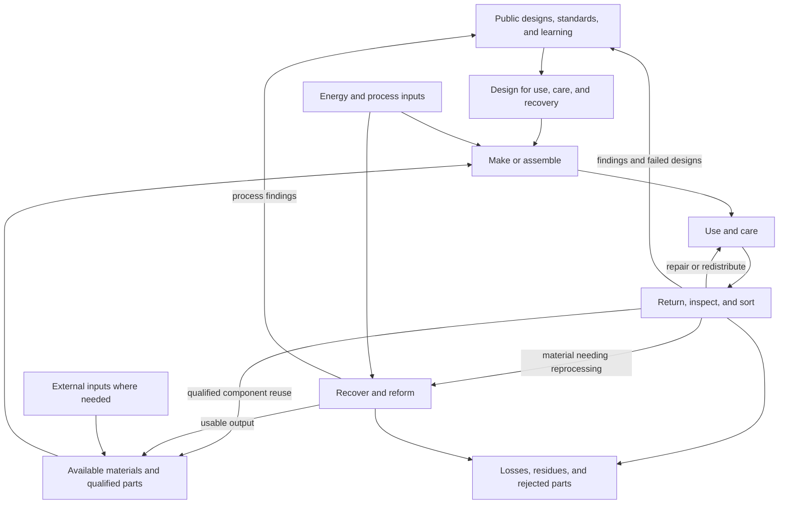

# Regenerative material civilization

2026-09-07 · AI-developed working synthesis of [Ren’s addition](../archive/004-ren-regenerative-materials.txt). The direction comes from Ren; the arrangements, terminology, and scenarios below develop it and remain revisable. A [bounded evidence note](../research/2026-09-07-material-circulation.md) distinguishes researched constraints from proposals. The Edition 05 development adds a component sequence and a decision about continuity after the [Edition 04 review](../artifacts/friends-worldbook/reviews/2026-09-07-v4/README.md).

## Abundance across successive lives

Ren adds a material foundation to the project: organize civilization so that the things it makes remain available for further life. A cup, a room, a machine, and a building can be temporary arrangements of a material inheritance whose stewardship extends beyond their present use.

The important horizon includes the next user, the next form, and future generations. A successful object supplies a useful experience now and leaves good possibilities afterward. A successful civilization can keep making its surroundings more inhabitable while caring for the stocks and living systems that make transformation possible.

This develops a different account of freedom: **the practical ability to reshape a shared world while preserving the resources and relationships needed to reshape it again.** That includes freedom to maintain a place, keep a beloved object, or decline another redesign. Fast iteration is valuable when it helps people; continuity can be equally valuable.

Ren’s comparison between geological accumulation and short consumption horizons motivates this long view. Specific formation, renewal, depletion, and recovery times remain resource-specific research questions; this project does not adopt a single numerical depletion story for everything Earth provides.

## Design the whole service

The cup example begins with the need for a drink, a gathering, and a usable vessel. A neighborhood could supply durable cups at kitchens, parks, and gathering places. People could return one wherever their day takes them. Washing, inspection, repair, redistribution, and eventual material recovery become part of the service from the beginning.

Its convenience would be collectively constructed: the cup is available, the return is easy, the system works, and nobody has to manage a small private logistics operation to participate. A resident can still keep a particular cup for decades. Shared provision and personal attachment can coexist.

This is a hypothesis about a whole arrangement. Reusable cups’ environmental performance depends on use, washing, losses, and local conditions; a metal object does not establish those conditions by itself. [UNEP’s cup life-cycle synthesis](https://www.lifecycleinitiative.org/wp-content/uploads/2021/03/UNEP-D002-Beverage-Cups-Report_lowres.pdf).

For our world, compare the same service delivered by plausible alternatives. Include equipment, water, energy, transport, recovery, and the burden placed on people. A collective service succeeds when its actual operation serves people well and sustains material usefulness. Central ownership is not a requirement; interoperable neighborhood systems are one possible arrangement.

## Public knowledge makes material more usable

Ren proposes knowledge as a public good. In this setting, design libraries could include geometry, material specifications, connection standards, fabrication methods, repair instructions, inspection criteria, and what earlier versions got wrong. People could understand and adapt the things sustaining their lives.

Open interfaces could allow a component made in one place to be repaired or used elsewhere. A common connection can support many forms of architecture. Standards should be revisable, with compatible alternatives and migration paths, so the shared library does not become one institution’s permanent control over possible designs.

3D printing belongs among the candidate methods. A design can also call for cutting, forming, casting, machining, joining, or direct reuse when appropriate. Publishing a file makes knowledge available; each material and process still needs its own account of performance, resource use, and recoverability.

A useful library would preserve the difference between a proposed design, a tested component, and an actual recovered part with its own history. Personal lives remain private even when infrastructure knowledge is public.

## Reincarnation includes keeping things useful

We can develop Ren’s image of material “reincarnation” across several routes: continuing use, repair, redistribution, component reuse, reconfiguration, and material recovery for new manufacture. The route should preserve the most useful capacity under the circumstances. Remaking an object is one possibility among these.

The following is a design map, not a claim that a complete material loop has already been demonstrated:

Energy and process inputs also support transport, cleaning, inspection, and maintenance; the diagram simplifies these connections. Residues and rejected parts need explicit destinations. Material circulation supports a regenerative aim, but restoring soils, watersheds, habitats, and biodiversity requires attention to living processes and their own timescales. A recovered beam cannot substitute for a recovered ecosystem.

## Architecture as a maintained collection of possibilities

The steel-building example suggests designing assembly and eventual separation together. A world brief could specify accessible connections, replaceable service layers, component identification, handling space, and a place to inspect and store recovered parts. Robots could assemble and disassemble within the setting’s autonomy premise.

A building’s useful history would include earlier configurations, repairs, exposure, and which parts remain suitable for which uses. Real reclaimed structural steel requires assessment for its next application; designing something to come apart is only part of that work. [JRC guidance on reclaimed steel components](https://publications.jrc.ec.europa.eu/repository/bitstream/JRC144410/JRC144410_01.pdf).

This suggests architecture with different rhythms: a stable home, a service layer that can be repaired, a public room that changes with the seasons, and a frame that may serve a later building. The brief must account for the parts that resist recovery, including foundations, finishes, seals, and connections, rather than drawing only the convenient reusable members.

The proposed material yard becomes a civic place: a library of available parts, a repair workshop, a receiving area, and a record of what the community can build next. Its inventory describes things and their condition; it need not become a record of everyone’s private behavior.

### A proposed episode: one bay, two useful forms

A garden tea pavilion reaches the end of its agreed use. Its pale steel frame has recognizable indigo connection plates, including a triangular corner plate. In a closed work area, robots separate removable roof and wall layers, support the members, and release the accessible joints. The component record follows the frame into inspection. Worn seals enter a distinct rejected-material route; no later illustration should imply they became sound again merely because the frame was kept.

Once assessed for the proposed new use, compatible members enter a small public music room. The same marked corner remains visible above a cellist, percussionist, and listeners; enclosure, acoustic layers, seals, and foundations have their own material accounts. New fittings and other additions are shown separately from reused members. A public record preserves what was kept, repaired, replaced, and learned. This is an illustrative sequence requiring structural design and robotic validation, not proof that an arbitrary pavilion can safely become a different building.

## Fluidity has physical and social conditions

Here, **fluidity** means how readily a useful material or component can move from one permitted use into another. It depends on knowing what exists, where it is, whether it is available, its condition, its compatibility, how to move it, and who can authorize its use.

These conditions can fail independently. A recyclable object might not be collected. An intact component might have no known history. A recovered part might wait for transport. A technically ready project might lack consent. An accessible design file might depend on unavailable tooling.

The project should therefore track stocks, actual return flows, quality, queues, energy, repair capacity, and access arrangements separately. A broad label such as “recyclable” cannot represent all of them. Knowledge, recoverable material, and effective coordination jointly enlarge what people can do.

**Repeated transformation and net physical expansion are different cases.** Material committed to an operating robot or an occupied building remains committed until released. More simultaneous equipment can require additional stock even when its eventual recovery is excellent. IEA describes this gap in steel systems whose growing stock exceeds the returns from earlier production. [IEA steel roadmap](https://iea.blob.core.windows.net/assets/eb0c8ec1-3665-4959-97d0-187ceca189a8/Iron_and_Steel_Technology_Roadmap.pdf).

The pavilion-to-music-room sequence reassigns a frame already available in the stock. Keeping the pavilion while adding the music room would require another qualified frame, obtained from available inventory, another release, or additional production and its inputs. The same distinction applies to the [productive expansion loop](automation-to-shared-abundance.md): materials working in a new factory cannot simultaneously be recovered to make the next one. Circulation changes the uses of an inheritance; expansion changes how much is committed at once.

The recursive-production branch remains available. Its growth must account for material tied up in use, accessible reserves, replacement, losses, energy, throughput, and sites. Circulation could support many successive configurations without establishing indefinite exponential expansion. No recovery yield or doubling time is assumed here.

## Culture and amplified will

An inhabitant might learn to see an object as something with a past and a possible next life. Children could follow a returned cup through the workshop or recognize a pavilion member in a later public room. Repair and imaginative reuse might become respected forms of skill. These are cultural hypotheses to develop through scenes, including people who do not share the enthusiasm.

Collective provision should not make every possession conditional on good behavior or every material request a plea to a central administrator. Material security, meaningful choice, privacy, and ordinary attachment remain part of the earlier foundation. Stewardship is a responsibility of institutions and shared systems as well as individuals.

Ren also names the danger: increasing material malleability amplifies will. Someone can build a garden, monopolize desirable places, erase a familiar neighborhood, or exhaust shared processing capacity much faster. Even recoverable components can be used in projects whose ecological or social consequences are hard to repair.

Proposed responses include reserving capacity for essential maintenance, making large commitments of common stock contestable, trying changes at a reversible scale where appropriate, and protecting inhabitants from displacement disguised as improvement. Authorization to transform a place needs to remain distinguishable from the technical ability to transform it. Public knowledge and faster machines do not settle that authority.

### A proposed episode: enough power to change, enough judgment to keep

A community can assemble a new public building quickly, but its first footprint would displace a mature tree and the garden paths around it. Neighbors gather at a physical model while heavy construction remains paused. They move compatible bays away from the tree, preserve the familiar shaded route, and agree to investigate the revised layout's access, roots, drainage, structure, and service connections. A different footprint is a candidate to test, not a guarantee that every conflict has vanished.

The choice makes amplified will visible. Machinery reduces the delay between a decision and a changed place; it cannot recreate the tree's history, habitat, or accumulated relationships on the same schedule. Here the shared achievement is a new use made compatible with a valued continuity. The [generative foundation](generative-worldmaking.md) treats this as a practice of learning what an intervention does to the environment that makes further life possible.

## Two next studies

**A cup’s successive lives.** Connect the Living Garden’s kitchen to a return point, cleaning area, inspection bench, repair route, and material recovery destination. Follow a shared cup and a privately kept cup. Compare good returns with a disrupted loop. Show the ordinary experience alongside the material flow.

**A structural bay’s successive uses.** Develop the pavilion-to-music-room proposal above into a traceable component study, including service access, part records, handling, storage, new inputs, and rejected components. Show how a change affects occupants and what remains stable. Treat structural and robotic performance as unresolved until investigated.

These studies connect the new material principles to [Living Garden](../worlds/01-living-garden.md), [House of Worlds](../worlds/02-house-of-worlds.md), and [Open University](../worlds/03-open-university.md). The [possibility map](possibility-map.md) links them through `P09–P10`, `A06`, `M07–M10`, `E05`, `T07–T08`, and `Q05–Q06`.
